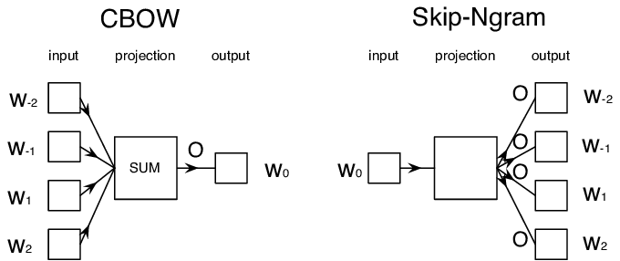

# Language Modeling

Semantic embeddings, such as Word2Vec and GloVe, are in fact a first step towards **language modeling** - creating models that somehow *understand* (or *represent*) the nature of the language.

## [Pre-lecture quiz](https://ff-quizzes.netlify.app/en/ai/quiz/29)

The main idea behind language modeling is training them on unlabeled datasets in an unsupervised manner. This is important because we have huge amounts of unlabeled text available, while the amount of labeled text would always be limited by the amount of effort we can spend on labeling. Most often, we can build language models that can **predict missing words** in the text, because it is easy to mask out a random word in text and use it as a training sample.

## Training Embeddings

In our previous examples, we used pre-trained semantic embeddings, but it is interesting to see how those embeddings can be trained. There are several possible ideas the can be used:

* **N-Gram** language modeling, when we predict a token by looking at N previous tokens (N-gram)
* **Continuous Bag-of-Words** (CBoW), when we predict the middle token $W_0$ in a token sequence $W_{-N}$, ..., $W_N$.
* **Skip-gram**, where we predict a set of neighboring tokens {$W_{-N},\dots, W_{-1}, W_1,\dots, W_N$} from the middle token $W_0$.

> Image from [this paper](https://arxiv.org/pdf/1301.3781.pdf)

## ✍️ Example Notebooks: Training CBoW model

Continue your learning in the following notebooks:

* [Training CBoW Word2Vec with TensorFlow](CBoW-TF.ipynb)
* [Training CBoW Word2Vec with PyTorch](CBoW-PyTorch.ipynb)

Writing the training loop yourself is a good way to understand how embeddings are trained, but in practice we usually use a library. The following notebook uses **gensim** to train Word2Vec (both CBoW and skip-gram) and FastText embeddings on the AG News text. It also shows how the main hyper-parameters affect the result, how to visualize the embedding space, and how to save the embeddings and use them to initialize the embedding layer of a classifier:

* [Training Word2Vec and FastText with Gensim](Embeddings-Gensim.ipynb)

## Conclusion

In the previous lesson we have seen that words embeddings work like magic! Now we know that training word embeddings is not a very complex task, and we should be able to train our own word embeddings for domain specific text if needed. 

## [Post-lecture quiz](https://ff-quizzes.netlify.app/en/ai/quiz/30)

## Review & Self Study

* [Official PyTorch tutorial on Language Modeling](https://pytorch.org/tutorials/beginner/nlp/word_embeddings_tutorial.html).
* [Official TensorFlow tutorial on training Word2Vec model](https://www.TensorFlow.org/tutorials/text/word2vec).
* Using the **gensim** framework to train most commonly used embeddings in a few lines of code is described [in this documentation](https://radimrehurek.com/gensim/models/word2vec.html).

## 🚀 [Assignment: Train Skip-Gram Model](lab/README.md)

In the lab, we challenge you to modify the code from this lesson to train skip-gram model instead of CBoW. [Read the details](lab/README.md)
