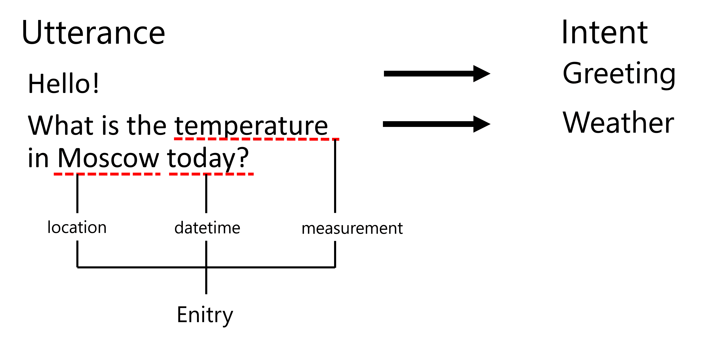
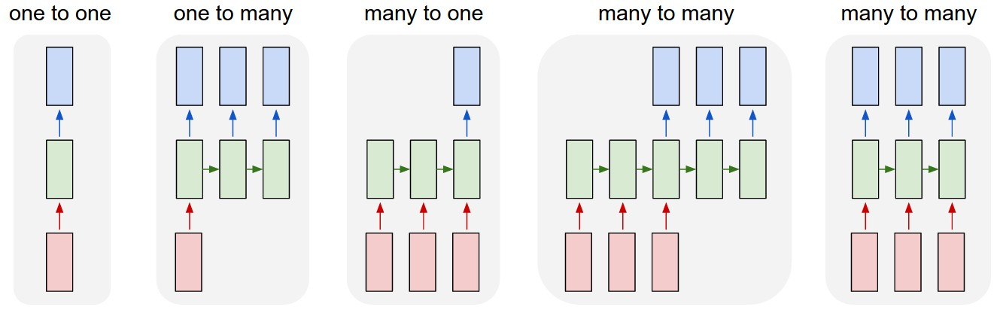

# Named Entity Recognition

Up to now, we have mostly been concentrating on one NLP task - classification. However, there are also other NLP tasks that can be accomplished with neural networks. One of those tasks is **[Named Entity Recognition](https://wikipedia.org/wiki/Named-entity_recognition)** (NER), which deals with recognizing specific entities within text, such as places, person names, date-time intervals, chemical formulae and so on.

## [Pre-lecture quiz](https://ff-quizzes.netlify.app/en/ai/quiz/37)

## Example of Using NER

Suppose you want to develop a natural language chat bot, similar to Amazon Alexa or Google Assistant. The way intelligent chat bots work is to *understand* what the user wants by doing text classification on the input sentence. The result of this classification is so-called **intent**, which determines what a chat bot should do.



> Image by the author

However, a user may provide some parameters as part of the phrase. For example, when asking for the weather, she may specify a location or date. A bot should be able to understand those entities, and fill in the parameter slots accordingly before performing the action. This is exactly where NER comes in.

> ✅ Another example would be [analyzing scientific medical papers](https://soshnikov.com/science/analyzing-medical-papers-with-azure-and-text-analytics-for-health/). One of the main things we need to look for are specific medical terms, such as diseases and medical substances. While a small number of diseases can probably be extracted using substring search, more complex entities, such as chemical compounds and medication names, need a more complex approach.

## NER as Token Classification

NER models are essentially **token classification models**, because for each of the input tokens we need to decide whether it belongs to an entity or not, and if it does - to which entity class.

Consider the following paper title:

**Tricuspid valve regurgitation** and **lithium carbonate** **toxicity** in a newborn infant.

Entities here are:

* Tricuspid valve regurgitation is a disease (`DIS`)
* Lithium carbonate is a chemical substance (`CHEM`)
* Toxicity is also a disease (`DIS`)

Notice that one entity can span several tokens. And, as in this case, we need to distinguish between two consecutive entities. Thus, it is common to use two classes for each entity - one specifying the first token of the entity (often the `B-` prefix is used, for **b**eginning), and another - the continuation of an entity (`I-`, for **i**nner token). We also use `O` as a class to represent all **o**ther tokens. Such token tagging is called [BIO tagging](https://en.wikipedia.org/wiki/Inside%E2%80%93outside%E2%80%93beginning_(tagging)) (or IOB). When tagged, our title will look like this:

Token | Tag
------|-----
Tricuspid | B-DIS
valve | I-DIS
regurgitation | I-DIS
and | O
lithium | B-CHEM
carbonate | I-CHEM
toxicity | B-DIS
in | O
a | O
newborn | O
infant | O
. | O

### Reading and writing BIO tags

The `B-` prefix is what lets us separate two entities of the same type that stand next to each other, because a new `B-` tag always starts a new entity. Let's look at a general-purpose example with person (`PER`), organization (`ORG`) and location (`LOC`) entities:

Token | Tag | Comment
------|-----|--------
Angela | B-PER | a new person entity starts here
Merkel | I-PER | ...and continues
visited | O | not part of any entity
the | O |
United | B-ORG | a new organization starts here
Nations | I-ORG | ...and continues
in | O |
New | B-LOC | a new location starts here
York | I-LOC | ...and continues
. | O |

Going from tags back to entities is a simple loop: start a new entity on each `B-X`, extend it on each `I-X` of the same type, and close it on `O` (or on the next `B-`). Here is a minimal version of this idea:

```python
def tags_to_entities(tokens, tags):
    entities, current = [], None
    for token, tag in zip(tokens, tags):
        if tag.startswith("B-"):                      # a new entity starts
            current = [tag[2:], [token]]
            entities.append(current)
        elif tag.startswith("I-") and current and current[0] == tag[2:]:
            current[1].append(token)                  # continue the current entity
        else:                                         # "O" (or a broken I- tag) closes the entity
            current = None
    return [(label, " ".join(words)) for label, words in entities]
```

Calling it on the table above returns `[('PER', 'Angela Merkel'), ('ORG', 'United Nations'), ('LOC', 'New York')]`.

> ✅ What would happen with a tag sequence such as `O I-PER I-PER`? There is no `B-PER` to start the entity, so it is an *invalid* sequence. Models can sometimes produce such sequences, and evaluation libraries have to decide how to treat them.

The scheme described above is sometimes called IOB2. You may also meet *IOB1* (where `B-` is only used to separate two adjacent entities of the same type) and *BIOES* (which adds `E-` for the **e**nd of an entity and `S-` for **s**ingle-token entities). The ideas are the same; just make sure that you use one scheme consistently for training and evaluation.

Since we need to build a one-to-one correspondence between tokens and classes, we can train a rightmost **many-to-many** neural network model from this picture:



> *Image from [this blog post](http://karpathy.github.io/2015/05/21/rnn-effectiveness/) by [Andrej Karpathy](http://karpathy.github.io/). NER token classification models correspond to the right-most network architecture on this picture.*

## Training NER models

Since a NER model is essentially a token classification model, we can use RNNs that we are already familiar with for this task. In this case, each block of recurrent network will return the token ID. The following example notebook shows how to train LSTM for token classification.

### Fine-tuning a pre-trained transformer

LSTMs are a good starting point, but in practice most modern NER systems fine-tune a pre-trained transformer such as [BERT](https://wikipedia.org/wiki/BERT_(language_model)) (see the [previous lessons](../18-Transformers/README.md)). The pre-trained model already "knows" a lot about the language, so a relatively small labeled dataset and a modest amount of training are enough. The recipe is:

1. Take a pre-trained model and put a small classification layer on top of **every** token's output vector (in the [Hugging Face Transformers](https://huggingface.co/docs/transformers/tasks/token_classification) library this is `AutoModelForTokenClassification`). The number of output classes is `2 * (number of entity types) + 1`: a `B-` and an `I-` class for each entity type, plus `O`.
2. Convert your dataset into words with BIO tags and tokenize it with the tokenizer of the pre-trained model (more on this in the next section).
3. Train with the usual cross-entropy loss computed for every token, using a small learning rate (around `2e-5` to `5e-5`) for a few epochs.
4. Evaluate the model using entity-level metrics (see below) on a held-out set, and run it on your own sentences.

### Sub-word tokens and label alignment

There is one practical complication. Transformer models do not work with whole words, but with **sub-word tokens**: a rare word is split into several pieces, and special tokens such as `[CLS]` and `[SEP]` are added to the sentence. As a result, the number of tokens no longer matches the number of word-level tags! For example, a general-purpose BERT tokenizer splits the word `Tricuspid` into `Tri`, `##cus` and `##pid` (the `##` prefix marks a continuation of a word), so we have to decide what to do with the single tag `B-DIS` that belongs to that word.

The tokenizer helps us with this: it can tell us which original word each token came from (`word_ids()` in Hugging Face tokenizers). The most common strategy is:

* give the label of the word to the **first** sub-word token;
* give the special value `-100` to all other tokens (special tokens and continuation pieces). This is the value that PyTorch's cross-entropy loss ignores by default, so these positions do not contribute to the training loss and are skipped during evaluation.

Token | Word | Label used for training
------|------|------------------------
[CLS] | *(special)* | -100
Tri | Tricuspid | B-DIS
##cus | Tricuspid | -100
##pid | Tricuspid | -100
valve | valve | I-DIS
[SEP] | *(special)* | -100

Another option is to label all pieces of the word, changing `B-DIS` into `I-DIS` for the continuation pieces. Whichever you choose, at prediction time you read the tag of the first sub-word as the tag of the whole word. The [example notebook](NER-PyTorch.ipynb) shows how to implement this alignment in practice.

## Evaluating NER models

How do we know whether a NER model is any good? The first idea is to measure **token accuracy**: the percentage of tokens with the correct tag. Unfortunately, this number is very misleading, because in most texts the vast majority of tokens are `O` (in the popular CoNLL-2003 dataset it is more than 80%). A "model" that always outputs `O` would get a high accuracy without finding a single entity!

What we really care about is whether we found whole **entities**. In **entity-level** evaluation, a predicted entity counts as correct only if both its boundaries *and* its type exactly match a real (gold) entity. Then we can count:

* **True positives (TP)**: predicted entities that exactly match a gold entity;
* **False positives (FP)**: predicted entities that do not match any gold entity;
* **False negatives (FN)**: gold entities that the model missed.

From these we compute **precision** = TP / (TP + FP) (how many of the found entities are right), **recall** = TP / (TP + FN) (how many of the real entities were found), and **F1**, which is their harmonic mean: 2 * precision * recall / (precision + recall).

Let's see how this works on a short sentence:

Token | Barack | Obama | was | born | in | Honolulu | , | Hawaii | .
------|--------|-------|-----|------|----|----------|---|--------|---
Gold | B-PER | I-PER | O | O | O | B-LOC | O | B-LOC | O
Predicted | O | B-PER | O | O | O | B-LOC | O | B-LOC | O

The model gets 7 of 9 tokens right (78% token accuracy). The gold entities are `Barack Obama` (PER), `Honolulu` (LOC) and `Hawaii` (LOC). The model found `Obama` (PER), `Honolulu` and `Hawaii`. Only the last two are exact matches, so TP = 2, FP = 1 (`Obama`, wrong boundary), FN = 1 (`Barack Obama`), and precision = recall = F1 = 2/3 ≈ 0.67. Getting a boundary slightly wrong counts as a complete miss, which is why entity-level scores are usually lower than token accuracy - and much more honest.

You do not need to implement this yourself: the [`seqeval`](https://github.com/chakki-works/seqeval) library computes entity-level precision, recall and F1 from lists of BIO tags, both per entity type and overall:

```python
from seqeval.metrics import classification_report, f1_score

y_true = [["B-PER", "I-PER", "O", "O", "O", "B-LOC", "O", "B-LOC", "O"]]
y_pred = [["O",     "B-PER", "O", "O", "O", "B-LOC", "O", "B-LOC", "O"]]

print(f1_score(y_true, y_pred))               # 0.666...
print(classification_report(y_true, y_pred))  # per-type precision, recall and F1
```

> ✅ If you have several entity types, you can average the per-type scores in different ways (*micro* average counts all entities together; *macro* average gives every type the same weight). Which one would you look at if one rare entity type is particularly important for your application?

## ✍️ Example Notebooks: NER

Continue your learning in the following notebook:

* [NER with TensorFlow](NER-TF.ipynb)
* [NER with PyTorch and Transformers](NER-PyTorch.ipynb) - fine-tuning a small pre-trained transformer (DistilBERT) on a subset of CoNLL-2003

## Conclusion

A NER model is a **token classification model**, which means that it can be used to perform token classification. This is a very common task in NLP, helping to recognize specific entities within text including places, names, dates, and more.

## 🚀 Challenge

Complete the assignment linked below to train a named entity recognition model for medical terms, then try it on a different dataset.

## [Post-lecture quiz](https://ff-quizzes.netlify.app/en/ai/quiz/38)

## Review & Self Study

Read through the blog [The Unreasonable Effectiveness of Recurrent Neural Networks](http://karpathy.github.io/2015/05/21/rnn-effectiveness/) and follow along with the Further Reading section in that article to deepen your knowledge.

## [Assignment](lab/README.md)

In the assignment for this lesson, you will have to train a medical entity recognition model. You can start with training an LSTM model as described in this lesson, and proceed with using the BERT transformer model. Read [the instructions](lab/README.md) to get all the details.
