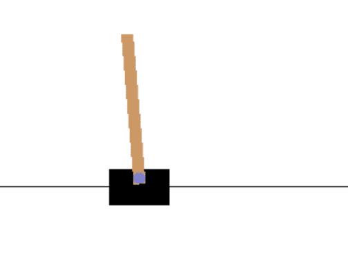
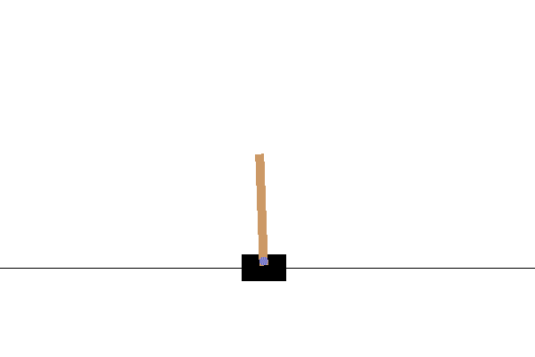
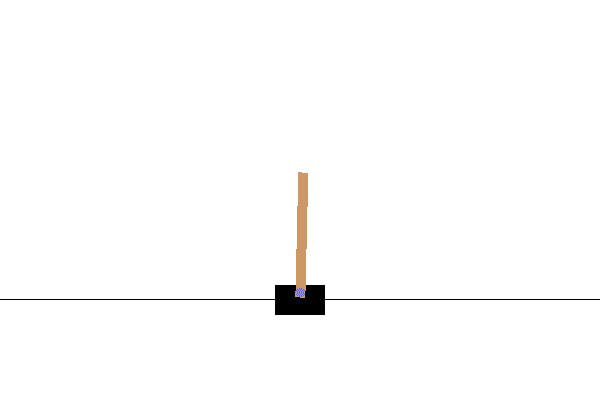

# Deep Reinforcement Learning

Reinforcement learning (RL) is seen as one of the basic machine learning paradigms, next to supervised learning and unsupervised learning. While in supervised learning we rely on the dataset with known outcomes, RL is based on **learning by doing**. For example, when we first see a computer game, we start playing, even without knowing the rules, and soon we are able to improve our skills just by the process of playing and adjusting our behavior.

## [Pre-lecture quiz](https://ff-quizzes.netlify.app/en/ai/quiz/43)

To perform RL, we need:

* An **environment** or **simulator** that sets the rules of the game. We should be able to run the experiments in the simulator and observe the results.
* Some **Reward function**, which indicate how successful our experiment was. In case of learning to play a computer game, the reward would be our final score.

Based on the reward function, we should be able to adjust our behavior and improve our skills, so that the next time we play better. The main difference between other types of machine learning and RL is that in RL we typically do not know whether we win or lose until we finish the game. Thus, we cannot say whether a certain move alone is good or not - we only receive a reward at the end of the game.

During RL, we typically perform many experiments. During each experiment, we need to balance between following the optimal strategy that we have learned so far (**exploitation**) and exploring new possible states (**exploration**).

## OpenAI Gym

A great tool for RL is the [OpenAI Gym](https://gym.openai.com/) - a **simulation environment**, which can simulate many different environments starting from Atari games, to the physics behind pole balancing. It is one of the most popular simulation environments for training reinforcement learning algorithms, and is maintained by [OpenAI](https://openai.com/).

> **Note**: You can see all the environments available from OpenAI Gym [here](https://gym.openai.com/envs/#classic_control).

## CartPole Balancing

You have probably all seen modern balancing devices such as the *Segway* or *Gyroscooters*. They are able to automatically balance by adjusting their wheels in response to a signal from an accelerometer or gyroscope. In this section, we will learn how to solve a similar problem - balancing a pole. It is similar to a situation when a circus performer needs to balance a pole on his hand - but this pole balancing only occurs in 1D.

A simplified version of balancing is known as a **CartPole** problem. In the cartpole world, we have a horizontal slider that can move left or right, and the goal is to balance a vertical pole on top of the slider as it moves.



To create and use this environment, we need a couple of lines of Python code:

```python
import gym
env = gym.make("CartPole-v1")

env.reset()
done = False
total_reward = 0
while not done:
   env.render()
   action = env.action_space.sample()
   observaton, reward, done, info = env.step(action)
   total_reward += reward

print(f"Total reward: {total_reward}")
```

Each environment can be accessed exactly in the same way:
* `env.reset` starts a new experiment
* `env.step` performs a simulation step. It receives an **action** from the **action space**, and returns an **observation** (from the observation space), as well as a reward and a termination flag.

In the example above we perform a random action at each step, which is why the experiment life is very short:



The goal of a RL algorithm is to train a model - the so called **policy** &pi; - which will return the action in response to a given state. We can also consider policy to be probabilistic, eg. for any state *s* and action *a* it will return the probability &pi;(*a*|*s*) that we should take *a* in state *s*.

## Policy Gradients Algorithm

The most obvious way to model a policy is by creating a neural network that will take states as input, and return corresponding actions (or rather the probabilities of all actions). In a sense, it would be similar to a normal classification task, with a major difference - we do not know in advance which actions should we take at each of the steps.

The idea here is to estimate those probabilities. We build a vector of **cumulative rewards** which shows our total reward at each step of the experiment. We also apply **reward discounting** by multiplying earlier rewards by some coefficient &gamma;=0.99, in order to diminish the role of earlier rewards. Then, we reinforce those steps along the experiment path that yield larger rewards.

> Learn more about the Policy Gradient algorithm and see it in action in the [example notebook](CartPole-RL-TF.ipynb).

## Actor-Critic Algorithm

An improved version of the Policy Gradients approach is called **Actor-Critic**. The main idea behind it is that the neural network would be trained to return two things:

* The policy, which determines which action to take. This part is called **actor**
* The estimation of the total reward we can expect to get at this state - this part is called **critic**.

In a sense, this architecture resembles a [GAN](../../4-ComputerVision/10-GANs/README.md), where we have two networks that are trained against each other. In the actor-critic model, the actor proposes the action we need to take, and the critic tries to be critical and estimate the result. However, our goal is to train those networks in unison.

Because we know both the real cumulative rewards and the results returned by the critic during the experiment, it is relatively easy to build a loss function that will minimize the difference between them. That would give us **critic loss**. We can compute **actor loss** by using the same approach as in the policy gradient algorithm.

After running one of those algorithms, we can expect our CartPole to behave like this:



## Value-Based RL: Deep Q-Networks (DQN)

Policy gradients and actor-critic learn the **policy** directly. There is another big family of RL algorithms that does something different: it learns how **valuable** each action is, and then derives the policy from those values.

The central object is the **Q-function** (Q stands for *quality*). *Q*(*s*, *a*) is the total discounted reward we expect to collect if we take action *a* in state *s*, and then keep playing as well as we can. If we knew *Q*, the policy would be trivial - in every state we simply pick the action with the highest value:

```
π(s) = argmax over a of Q(s, a)
```

> ✅ In the Actor-Critic section the *critic* estimated the value of a **state** *V*(*s*). The Q-function is similar, but it estimates the value of a **state-action pair**, which is what lets us choose between actions without a separate actor.

### The Bellman equation

The Q-function has a nice recursive property. The value of taking action *a* in state *s* is the reward *r* we get right away, plus the discounted value of the best action in the next state *s'*:

```
Q(s, a) = r + γ · max over a' of Q(s', a')
```

Here &gamma; is the same discount factor we used for the policy gradients. Classical **Q-learning** stores *Q* in a table (one row per state, one column per action) and repeatedly nudges each entry towards the right-hand side of this equation:

```
Q(s, a) ← Q(s, a) + α · ( r + γ · max over a' of Q(s', a') - Q(s, a) )
```

A table only works when there are few states. In CartPole the state consists of 4 continuous numbers, so there are infinitely many states. The idea of the **Deep Q-Network (DQN)** is to replace the table with a neural network that takes a state and returns one Q-value per action (for CartPole, two numbers: "push left" and "push right"). We train it like a regression model, where the target comes from the Bellman equation:

```
target = r + γ · max over a' of Q_target(s', a')      (just r if the episode has ended)
loss   = (Q(s, a) - target)²
```

### Tricks that make DQN work

Training a network on its own predictions is unstable, because the target keeps moving while we learn, and because consecutive steps of one episode are highly correlated (unlike shuffled examples in a normal dataset). The DQN algorithm, made famous by [DeepMind's results on Atari games](https://www.nature.com/articles/nature14236), uses three ingredients to deal with this:

* **Replay buffer**. We store every transition (*s*, *a*, *r*, *s'*, *done*) in a large memory and train on small random batches from it. This breaks the correlation between consecutive steps and lets us re-use each experience many times.
* **Target network**. We keep a second copy of the network that is used only to compute the targets, and update it slowly (copy the weights every once in a while, or blend them in a little at each step). The target stays still for a while, which makes the regression problem much more stable.
* **&epsilon;-greedy exploration**. With probability &epsilon; we take a random action, otherwise we take the action with the highest Q-value. We start with &epsilon; close to 1 (mostly **exploration**) and gradually decrease it (more and more **exploitation**), which is exactly the balance we discussed at the beginning of this lesson.

### Value-based vs. policy-based methods

| | **Value-based** (Q-learning, DQN) | **Policy-based** (Policy Gradients, Actor-Critic) |
|---|---|---|
| What the network learns | Q-value of each action | Probability of each action (and, for actor-critic, the state value) |
| How we choose an action | Highest Q-value (the policy is *implicit*) | Sample from the policy network (the policy is *explicit*) |
| Action space | Discrete actions only (we need to take a max over actions) | Discrete or continuous |
| Exploration | &epsilon;-greedy, added by hand | Comes from the randomness of the policy itself |
| Data re-use | High - old experience stays useful (replay buffer) | Low - typically each experience is used for one update |
| Typical weakness | Can be unstable and sensitive to hyper-parameters | High variance, many episodes are needed |

**Which one should you pick?** For problems with a small set of discrete actions (CartPole, Atari games) DQN is a great and sample-efficient choice. When actions are continuous (for example, the torque of a robot joint), or when you need a stochastic policy, use policy-based methods. In practice, most of the modern algorithms (such as A2C/A3C, DDPG or SAC) combine both ideas, in the same way as actor-critic does.

## ✍️ Exercises: Policy Gradients, Actor-Critic and DQN

Continue your learning in the following notebooks:

* [RL in TensorFlow](CartPole-RL-TF.ipynb)
* [RL in PyTorch](CartPole-RL-PyTorch.ipynb)
* [Deep Q-Network (DQN) in PyTorch](CartPole-DQN-PyTorch.ipynb)

## Other RL Tasks

Reinforcement Learning nowadays is a fast growing field of research. Some of the interesting examples of reinforcement learning are:

* Teaching a computer to play **Atari Games**. The challenging part in this problem is that we do not have simple state represented as a vector, but rather a screenshot - and we need to use the CNN to convert this screen image to a feature vector, or to extract reward information. Atari games are available in the Gym.
* Teaching a computer to play board games, such as Chess and Go. Recently state-of-the-art programs like **Alpha Zero** were trained from scratch by two agents playing against each other, and improving at each step.
* In industry, RL is used to create control systems from simulation. A service called [Bonsai](https://azure.microsoft.com/services/project-bonsai/?WT.mc_id=academic-77998-cacaste) is specifically designed for that.

## Conclusion

We have now learned how to train agents to achieve good results just by providing them a reward function that defines the desired state of the game, and by giving them an opportunity to intelligently explore the search space. We have successfully tried three algorithms (policy gradients, actor-critic and Deep Q-Networks), and achieved a good result in a relatively short period of time. However, this is just the beginning of your journey into RL, and you should definitely consider taking a separate course is you want to dig deeper.

## 🚀 Challenge

Explore the applications listed in the 'Other RL Tasks' section and try to implement one!

## [Post-lecture quiz](https://ff-quizzes.netlify.app/en/ai/quiz/44)

## Review & Self Study

Learn more about classical reinforcement learning in our [Machine Learning for Beginners Curriculum](https://github.com/microsoft/ML-For-Beginners/blob/main/8-Reinforcement/README.md).

Watch [this great video](https://www.youtube.com/watch?v=qv6UVOQ0F44) talking about how a computer can learn to play Super Mario.

## Assignment: [Train a Mountain Car](lab/README.md)

Your goal during this assignment would be to train a different Gym environment - [Mountain Car](https://www.gymlibrary.ml/environments/classic_control/mountain_car/).
