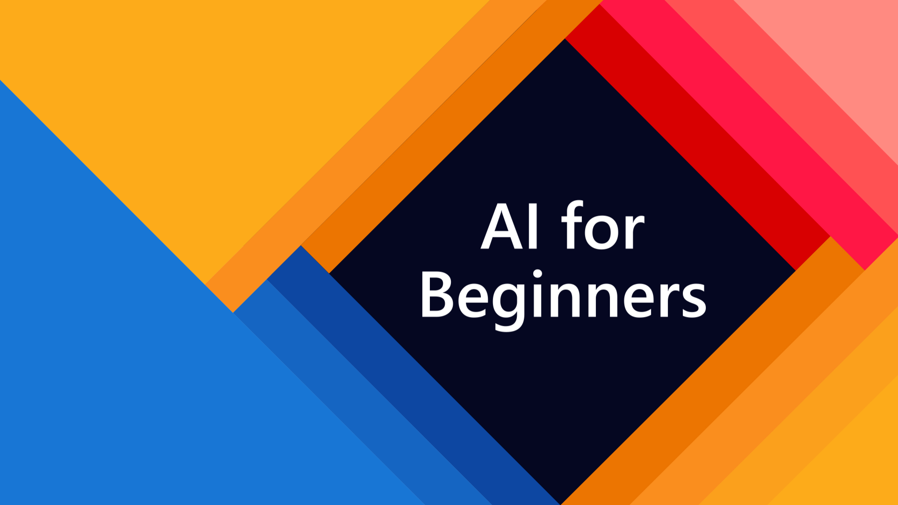

# 初心者のための人工知能 カリキュラム

| ](https://github.com/microsoft/AI-For-Beginners/raw/main/lessons/sketchnotes/ai-overview.png)|
|:---:|
| AI For Beginners - _Sketchnote by [@girlie_mac](https://twitter.com/girlie_mac)_ |

マイクロソフトのAzure Cloud Advocateは、12週間、24レッスンの人工知能に関するカリキュラムを提供します。

このカリキュラムでは、以下のことを学びます。

* **知識表現**と推論（GOFAI）による「古き良き」記号的アプローチを含む、人工知能へのさまざまなアプローチ。
* 現代のAIの中核をなす**ニューラルネットワーク**と**ディープラーニング**。これらの重要なトピックの背後にある概念を、最も人気のある2つのフレームワークであるTensorFlowとPyTorchのコードを使用して説明します。
* 画像やテキストを扱うための**ニューラル・アーキテクチャ**。最近のモデルを取り上げますが、最先端技術については少し不足する可能性があります。
* **遺伝的アルゴリズム**や**マルチエージェントシステム**など、あまり一般的ではないAIアプローチ。

本カリキュラムで扱わない内容

* **AIをビジネスで活用するためのビジネスケース**。Microsoft Learnの学習パス[ビジネスユーザーのためのAI入門](https://docs.microsoft.com/learn/paths/introduction-ai-for-business-users/?WT.mc_id=academic-77998-cacaste)や、[INSEAD](https://www.insead.edu/)と共同で開発した[AIビジネススクール](https://www.microsoft.com/ai/ai-business-school/?WT.mc_id=academic-77998-cacaste)の受講をご検討ください。
* **古典的な機械学習**については、[初心者のための機械学習カリキュラム](http://github.com/Microsoft/ML-for-Beginners)で十分に説明されています。
* **[Cognitive Services](https://azure.microsoft.com/services/cognitive-services/?WT.mc_id=academic-77998-cacaste)** を利用して構築された実践的なAIアプリケーション。これには、Microsoft Learnの[ビジョン](https://docs.microsoft.com/learn/paths/create-computer-vision-solutions-azure-cognitive-services/?WT.mc_id=academic-77998-cacaste)、[自然言語処理](https://docs.microsoft.com/learn/paths/explore-natural-language-processing/?WT.mc_id=academic-77998-cacaste)などのモジュールから始めることをお勧めします。
* [Azure Machine Learning](https://azure.microsoft.com/services/machine-learning/?WT.mc_id=academic-77998-cacaste) や [Azure Databricks](https://docs.microsoft.com/learn/paths/data-engineer-azure-databricks?WT.mc_id=academic-77998-cacaste) などの特定のML **Cloud Frameworks** を利用する [Azure Machine Learning による機械学習ソリューションの構築と運用](https://docs.microsoft.com/learn/paths/build-ai-solutions-with-azure-ml-service/?WT.mc_id=academic-77998-cacaste)、[Azure Databricksによる機械学習ソリューションの構築と運用](https://docs.microsoft.com/learn/paths/build-operate-machine-learning-solutions-azure-databricks/?WT.mc_id=academic-77998-cacaste) の学習パスの利用を検討します。
* **会話型AI**と**Chat Bots**。別途、[Create conversational AI solutions](https://docs.microsoft.com/learn/paths/create-conversational-ai-solutions/?WT.mc_id=academic-77998-cacaste) という学習パスがあり、詳しくは[こちらのブログ](https://soshnikov.com/azure/hello-bot-conversational-ai-on-microsoft-platform/) も参照してください。
* **ディープラーニングの背後にある深層数学**。これについては、Ian Goodfellow、Yoshua Bengio、Aaron Courvilleによる[Deep Learning](https://www.amazon.com/Deep-Learning-Adaptive-Computation-Machine/dp/0262035618)をお勧めします。また、[https://www.deeplearningbook.org/](https://www.deeplearningbook.org/) で公開されています。

クラウドにおける*AI*のトピックを優しく紹介するために、[Get started with artificial intelligence on Azure](https://docs.microsoft.com/learn/paths/get-started-with-artificial-intelligence-on-azure/?WT.mc_id=academic-77998-cacaste) Learning Pathの受講を検討してもよいでしょう。

---
# コンテンツ

<table>
<tr><th>#</th><th>Lesson</th><th>概要</th><th>PyTorch</th><th>Keras/TensorFlow</th><th>ラボ</th></tr>

<tr><td>I</td><td colspan="4"><b>AIについての概要</b></td><td></td></tr>
<tr><td>1</td><td>AIの概要と歴史</td><td><a href="../lessons/1-Intro/translations/README.ja.md">Text 🇯🇵</a></td><td></td><td></td><td></td></tr>

<tr><td>II</td><td colspan="4"><b>シンボリックAI</b></td><td></td></tr>
<tr><td>2 </td><td>知識表現とエキスパートシステム</td><td><a href="../lessons/2-Symbolic/README.md">Text</a></td><td colspan="2"><a href="../lessons/2-Symbolic/Animals.ipynb">エキスパートシステム</a>, <a href="../lessons/2-Symbolic/FamilyOntology.ipynb">Ontology</a>, <a href="../lessons/2-Symbolic/MSConceptGraph.ipynb">コンセプトグラフ</a></td><td></td></tr>
<tr><td>III</td><td colspan="4"><b><a href="../lessons/3-NeuralNetworks/README.md">ニューラルネットワーク入門</a></b></td><td></td></tr>
<tr><td>3</td><td>パーセプトロン</td>
   <td><a href="../lessons/3-NeuralNetworks/03-Perceptron/README.md">Text</a>
   <td colspan="2"><a href="../lessons/3-NeuralNetworks/03-Perceptron/Perceptron.ipynb">Notebook</a></td><td><a href="../lessons/3-NeuralNetworks/03-Perceptron/lab/README.md">Lab</a></td></tr>
<tr><td>4 </td><td>多層パーセプトロンと独自のフレームワークの構築</td><td><a href="../lessons/3-NeuralNetworks/04-OwnFramework/README.md">Text</a></td><td colspan="2"><a href="../lessons/3-NeuralNetworks/04-OwnFramework/OwnFramework.ipynb">Notebook</a><td><a href="../lessons/3-NeuralNetworks/04-OwnFramework/lab/README.md">Lab</a></td></tr> 
<tr><td>5</td>
   <td>フレームワーク入門 (PyTorch/TensorFlow) オーバーフィッティング</td>
   <td><a href="../lessons/3-NeuralNetworks/05-Frameworks/README.md">Text</a> <a href="../lessons/3-NeuralNetworks/05-Frameworks/Overfitting.md">Text</a></td>
   <td><a href="../lessons/3-NeuralNetworks/05-Frameworks/IntroPyTorch.ipynb">PyTorch</td>
   <td><a href="../lessons/3-NeuralNetworks/05-Frameworks/IntroKerasTF.md">Keras/TensorFlow</td>
   <td><a href="../lessons/3-NeuralNetworks/05-Frameworks/lab/README.md">Lab</a></td></tr>
<tr><td>IV</td><td><b><a href="../lessons/4-ComputerVision/README.md">コンピュータビジョン</a></b></td>
  <td colspan="3"><a href="https://docs.microsoft.com/learn/paths/explore-computer-vision-microsoft-azure/?WT.mc_id=academic-77998-cacaste"><i>AIファンダメンタルズ コンピュータビジョンの探求</i></a></td>
  <td></td></tr>
<tr><td></td><td colspan="2"><i>Microsoft Learn Module - コンピュータビジョン</i></td>
  <td><a href="https://docs.microsoft.com/learn/modules/intro-computer-vision-pytorch/?WT.mc_id=academic-77998-cacaste"><i>PyTorch</i></a></td>
  <td><a href="https://docs.microsoft.com/learn/modules/intro-computer-vision-TensorFlow/?WT.mc_id=academic-77998-cacaste"><i>TensorFlow</i></a></td>
  <td></td></tr>
<tr><td>6</td><td>コンピュータビジョン入門 OpenCV</td><td><a href="../lessons/4-ComputerVision/06-IntroCV/README.md">Text</a><td colspan="2"><a href="../lessons/4-ComputerVision/06-IntroCV/OpenCV.ipynb">Notebook</a></td><td><a href="../lessons/4-ComputerVision/06-IntroCV/lab/README.md">Lab</a></td></tr>
<tr><td>7</td><td>畳み込みニューラルネットワーク CNN アーキテクチャ</td><td><a href="../lessons/4-ComputerVision/07-ConvNets/README.md">Text</a> <a href="../lessons/4-ComputerVision/07-ConvNets/CNN_Architectures.md">Text</a></td><td><a href="../lessons/4-ComputerVision/07-ConvNets/ConvNetsPyTorch.ipynb">PyTorch</a></td><td><a href="../lessons/4-ComputerVision/07-ConvNets/ConvNetsTF.ipynb">TensorFlow</a></td><td><a href="../lessons/4-ComputerVision/07-ConvNets/lab/README.md">Lab</a></td></tr>
<tr><td>8</td><td>事前学習済みネットワークと転移学習 ディープラーニングのトレーニングのコツ</td><td><a href="../lessons/4-ComputerVision/08-TransferLearning/README.md">Text</a> <a href="../lessons/4-ComputerVision/08-TransferLearning/TrainingTricks.md">Text</a></td><td><a href="../lessons/4-ComputerVision/08-TransferLearning/TransferLearningPyTorch.ipynb">PyTorch</a></td><td><a href="l../essons/4-ComputerVision/08-TransferLearning/TransferLearningTF.ipynb">TensorFlow</a> <a href="../lessons/4-ComputerVision/08-TransferLearning/Dropout.ipynb">Dropout sample</a></td><td><a href="../lessons/4-ComputerVision/08-TransferLearning/lab/README.md">Lab</a></td></tr>
<tr><td>9</td><td>オートエンコーダーとVAE</td><td><a href="../lessons/4-ComputerVision/09-Autoencoders/README.md">Text</a></td><td><a href="../lessons/4-ComputerVision/09-Autoencoders/AutoEncodersPytorch.ipynb">PyTorch</td><td><a href="../lessons/4-ComputerVision/09-Autoencoders/AutoencodersTF.ipynb">TensorFlow</a></td><td></td></tr>
<tr><td>10</td><td>生成アドバーサリアルネットワーク Artistic Style Transfer</td><td><a href="../lessons/4-ComputerVision/10-GANs/README.md">Text</a></td><td><a href="../lessons/4-ComputerVision/10-GANs/GANPyTorch.ipynb">PyTorch</td><td><a href="../lessons/4-ComputerVision/10-GANs/GANTF.ipynb">TensorFlow GAN</a> <a href="../lessons/4-ComputerVision/10-GANs/StyleTransfer.ipynb">Style Transfer</a></td><td></td></tr>
<tr><td>11</td><td>オブジェクト検出</td><td><a href="../lessons/4-ComputerVision/11-ObjectDetection/README.md">Text</a></td><td>PyTorch</td><td><a href="../lessons/4-ComputerVision/11-ObjectDetection/ObjectDetection-TF.ipynb">TensorFlow</td><td><a href="../lessons/4-ComputerVision/11-ObjectDetection/lab/README.md">Lab</a></td></tr>
<tr><td>12</td><td>セマンティック・セグメンテーション U-Net</td><td><a href="../lessons/4-ComputerVision/12-Segmentation/README.md">Text</a></td><td><a href="../lessons/4-ComputerVision/12-Segmentation/SemanticSegmentationPytorch.ipynb">PyTorch</td><td><a href="../lessons/4-ComputerVision/12-Segmentation/SemanticSegmentationTF.ipynb">TensorFlow</td><td></td></tr>
<tr><td>V</td><td><b><a href="../lessons/5-NLP/README.md">自然言語処理</a></b></td>
   <td colspan="3"><a href="https://docs.microsoft.com/learn/paths/explore-natural-language-processing/?WT.mc_id=academic-77998-cacaste"><i>AIファンダメンタルズ 自然言語処理の探究</i></a></td>
   <td></td></tr>
<tr><td></td><td colspan="2"><i>Microsoft Learn Module - 自然言語</i></td>
   <td><a href="https://docs.microsoft.com/learn/modules/intro-natural-language-processing-pytorch/?WT.mc_id=academic-77998-cacaste"><i>PyTorch</i></a></td>
   <td><a href="https://docs.microsoft.com/learn/modules/intro-natural-language-processing-TensorFlow/?WT.mc_id=academic-77998-cacaste"><i>TensorFlow</i></a></td>
   <td></td></tr>
<tr><td>13</td><td>文書表現 Bow/TF-IDF</td><td><a href="../lessons/5-NLP/13-TextRep/README.md">Text</a></td><td><a href="../lessons/5-NLP/13-TextRep/TextRepresentationPyTorch.ipynb">PyTorch</a></td><td><a href="../lessons/5-NLP/13-TextRep/TextRepresentationTF.ipynb">TensorFlow</td><td></td></tr>
<tr><td>14</td><td>セマンティックな単語の埋め込み Word2Vec と GloVe</td><td><a href="../lessons/5-NLP/14-Embeddings/README.md">Text</td><td><a href="../lessons/5-NLP/14-Embeddings/EmbeddingsPyTorch.ipynb">PyTorch</a></td><td><a href="../lessons/5-NLP/14-Embeddings/EmbeddingsTF.ipynb">TensorFlow</a></td><td></td></tr>
<tr><td>15</td><td>言語モデリング 言語モデリング - 独自のエンベッディングを学習させる</td><td><a href="../lessons/5-NLP/15-LanguageModeling/README.md">Text</a></td><td></td><td><a href="../lessons/5-NLP/15-LanguageModeling/CBoW-TF.ipynb">TensorFlow</a></td><td><a href="../lessons/5-NLP/15-LanguageModeling/lab/README.md">Lab</a></td></tr>
<tr><td>16</td><td>リカレント・ニューラルネットワーク</td><td><a href="../lessons/5-NLP/16-RNN/README.md">Text</a></td><td><a href="../lessons/5-NLP/16-RNN/RNNPyTorch.ipynb">PyTorch</a></td><td><a href="../lessons/5-NLP/16-RNN/RNNTF.ipynb">TensorFlow</a></td><td></td></tr>
<tr><td>17</td><td>生成リカレントネットワーク</td><td><a href="../lessons/5-NLP/17-GenerativeNetworks/README.md">Text</a></td><td><a href="../lessons/5-NLP/17-GenerativeNetworks/GenerativePyTorch.md">PyTorch</a></td><td><a href="../lessons/5-NLP/17-GenerativeNetworks/GenerativeTF.md">TensorFlow</a></td><td><a href="../lessons/5-NLP/17-GenerativeNetworks/lab/README.md">Lab</a></td></tr>
<tr><td>18</td><td>トランスフォーマー BERT</td><td><a href="../lessons/5-NLP/18-Transformers/README.md">Text</a></td><td><a href="../lessons/5-NLP/18-Transformers/TransformersPyTorch.md">PyTorch</a></td><td><a href="../lessons/5-NLP/18-Transformers/TransformersTF.md">TensorFlow</a></td><td></td></tr>
<tr><td>19</td><td>名前付き固有表現認識</td><td><a href="../lessons/5-NLP/19-NER/README.md">Text</a></td><td></td><td><a href="../lessons/5-NLP/19-NER/NER-TF.ipynb">TensorFlow</a></td><td><a href="../lessons/5-NLP/19-NER/lab/README.md">Lab</a></td></tr>
<tr><td>20</td><td>大規模言語モデル、プロンプトプログラミング、Few-shot タスク</td><td><a href="../lessons/5-NLP/20-LangModels/README.md">Text</a></td><td><a href="../lessons/5-NLP/20-LangModels/GPT-PyTorch.ipynb">PyTorch</td><td></td><td></td></tr>
<tr><td>VI</td><td colspan="4"><b>その他のAI技術</b></td><td></td></tr>
<tr><td>21</td><td>遺伝的アルゴリズム</td><td><a href="../lessons/6-Other/21-GeneticAlgorithms/README.md">Text</a><td colspan="2"><a href="../lessons/6-Other/21-GeneticAlgorithms/Genetic.ipynb">Notebook</a></td><td></td></tr>
<tr><td>22</td><td>深層強化学習</td><td><a href="../lessons/6-Other/22-DeepRL/README.md">Text</a></td><td></td><td><a href="../lessons/6-Other/22-DeepRL/CartPole-RL-TF.ipynb">TensorFlow</td><td><a href="../lessons/6-Other/22-DeepRL/lab/README.md">Lab</a></td></tr>
<tr><td>23</td><td>マルチエージェントシステム</td><td><a href="../lessons/6-Other/23-MultiagentSystems/README.md">Text</a></td><td></td><td></td><td></td></tr>
<tr><td>VII</td><td colspan="4"><b>AI倫理</b></td><td></td></tr>
<tr><td>24</td><td>AI 倫理と責任ある AI のあり方</td><td><a href="../lessons/7-Ethics/README.md">Text</a></td><td colspan="2"><a href="https://docs.microsoft.com/learn/paths/responsible-ai-business-principles/?WT.mc_id=academic-77998-cacaste"><i>MS Learn: Responsible AI Principles</i></a></td><td></td></tr>
<tr><td></td><td colspan="4"><b>Extras</b></td><td></td></tr>
<tr><td>X1</td><td>マルチモーダルネットワーク、CLIP、VQGAN</td><td><a href="../lessons/X-Extras/X1-MultiModal/README.md">Text</a></td><td colspan="2"><a href="../lessons/X-Extras/X1-MultiModal/Clip.ipynb">Notebook</a></td><td></td></tr>
</table>

**[コースのマインドマップ](http://soshnikov.com/courses/ai-for-beginners/mindmap.html)**

各レッスンには、事前に読むべき資料（上の**Text**としてリンクされています）と、実行可能なJupyter Notebooksが含まれており、これらは多くの場合、フレームワーク（**PyTorch**または**TensorFlow**）に固有のものです。実行可能なノートブックには理論的な内容も多く含まれているので、トピックを理解するためには、少なくとも1つのバージョンのノートブック（PyTorchまたはTensorFlowのどちらか）を通読する必要があります。また、いくつかのトピックには**Lab**が用意されており、学習した内容を特定の問題に適用してみる機会があります。

いくつかのセクションでは、関連するトピックをカバーする **MS Learn** モジュールへのリンクも含まれています。Microsoft Learnは、GPUを利用した便利な学習環境を提供しますが、内容的にはもう少し深いカリキュラムを期待できます。

# Getting Started

**学生の皆さん**、カリキュラムの利用方法はいくつかあります。まず、テキストを読んで GitHub にあるコードに直接目を通すことができます。
もし、いずれかのノートブックでコードを実行したい場合は - 私たちの[手順](../lessons/0-course-setup/how-to-run.md)を読んで、その方法についての詳しいアドバイスをこの[ブログ記事](https://soshnikov.com/education/how-to-execute-notebooks-from-github/)で見つけてください。

> **Note**: [本カリキュラムのコードの実行方法の説明](../lessons/0-course-setup/how-to-run.md)

ただし、自習用として受講したい場合は、レポ全体を自分のGitHubアカウントにフォークして、一人で、またはグループで演習をこなすことをお勧めします。

- 講義前のクイズから始める
- 講義のイントロテキストを読む 
- ノートブックがある場合はそれを読み、コードを実行する。TensorFlowとPyTorchの両方のノートブックが提供されている場合は、どちらかに焦点を当てることができますのでお好みのフレームワークを選択
- ノートブックにはコードを少しいじるよう必要のある課題も含まれています
- 講義後のクイズに参加
- モジュールにラボが付属している場合その課題もしましょう
- [議論ボード](https://github.com/microsoft/AI-For-Beginners/discussions)にアクセスして「大きく声を出して」学ぼう
- 他の学習者と [Gitter](https://gitter.im/Microsoft/ai-for-beginners) または [Telegram チャンネル](http://t.me/ai_for_beginners)でチャットすることができます。

> さらに学習を進めるには、以下の [Microsoft Learn](https://docs.microsoft.com/en-us/users/dmitrysoshnikov-9132/collections/31zgizg2p418yo/?WT.mc_id=academic-77998-cacaste) のモジュールとラーニングパスに沿って学習することをお勧めします。

**先生方**、[このカリキュラムをどのように使うかのいくつかの提案](../lessons/0-course-setup/for-teachers.md)を参考にしてください。

---

## Credits

**✍️ Primary Author:** [Dmitry Soshnikov](http://soshnikov.com), PhD  
**🔥 Editor:** [Jen Looper](https://twitter.com/jenlooper), PhD  
**🎨 Sketchnote illustrator:** [Tomomi Imura](https://twitter.com/girlie_mac)  
**✅ Quiz Creator:** [Lateefah Bello](https://github.com/CinnamonXI), [MLSA](https://studentambassadors.microsoft.com/)   
**🙏 Core Contributors:** [Evgenii Pishchik](https://github.com/Pe4enIks) 

## Meet the Team

> 🎥 上の画像をクリックすると、このプロジェクトについてとプロジェクトに関わった人たちについての動画が見られます。

---

## 教育学

私たちはこのカリキュラムの作成にあたって、2つの教育的信条を選びました：実践的な**プロジェクトベース**であることと、**頻繁な小テスト**を含むことを保証することです。.

プロジェクトに沿った内容であることを確認することで、学生にとってより魅力的なプロセスとなり、概念の定着が強化されます。また、授業前に行われる小テストは、生徒の学習意欲を高め、授業後に行われる2回目の小テストでは、さらなる定着を図ることができます。このカリキュラムは、全部または一部を受講できるよう、柔軟かつ楽しくデザインされています。プロジェクトは小さなものから始まり、12週間のサイクルが終わるころには徐々に複雑になっていきます。

> [行動規範](../etc/CODE_OF_CONDUCT.md)、[コントリビューター](../etc/CONTRIBUTING.md)、[翻訳のガイドライン](../etc/TRANSLATIONS.md)をご覧ください。サポートドキュメントやセキュリティ情報についてはこちらをご覧ください。建設的なご意見をお待ちしています。

> **クイズについての注意事項**。すべてのクイズは[このアプリ](https://red-field-0a6ddfd03.1.azurestaticapps.net/)に含まれており、3問ずつのクイズが合計50問あります。クイズはレッスンからリンクされていますが、クイズアプリはローカルで実行することができます。

## オフラインでのアクセス

[Docsify](https://docsify.js.org/#/)を使えば、このドキュメントをオフラインで実行することができます。この repo を fork して、ローカルマシンに [Docsify](https://docsify.js.org/#/quickstart) をインストールし、この repo の `etc/docsify` フォルダで `docsify serve` とタイプしてください。ウェブサイトはあなたのローカルホストのポート3000に提供されます: `localhost:3000`. カリキュラムの pdf は[このリンク](/etc/pdf/readme.pdf)で入手できます。

## ヘルプ募集中

翻訳にご協力いただけますか？ [翻訳のガイドライン](../etc/TRANSLATIONS.md)をお読みください。

## その他のカリキュラム

私たちのチームは、他のカリキュラムを制作しています チェックしてみてください。

- [Web Dev for Beginners](https://aka.ms/webdev-beginners)
- [IoT for Beginners](https://aka.ms/iot-beginners)
- [Machine Learning for Beginners](http://aka.ms/ML-for-Beginners)
- [Data Science for Beginners](http://aka.ms/Data-Science-for-Beginners)
