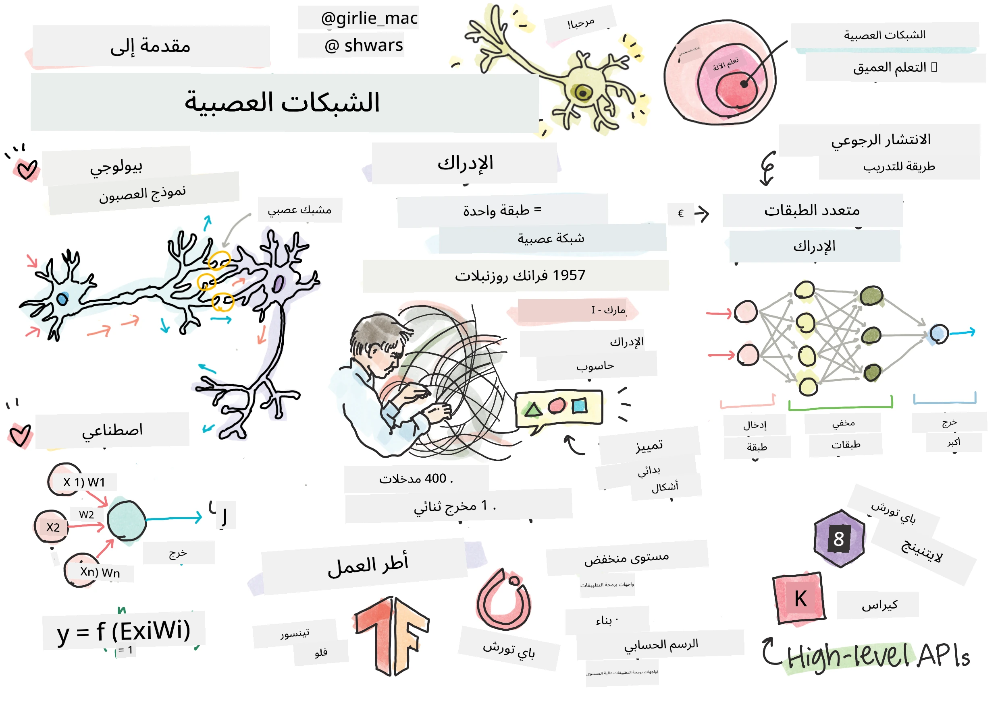
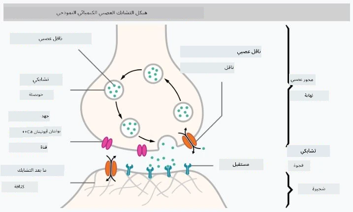
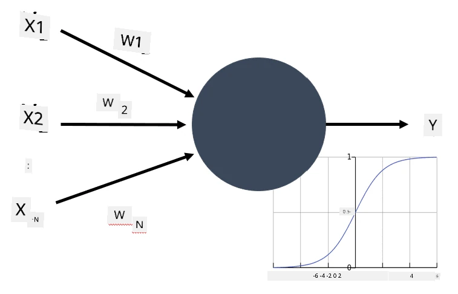
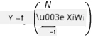

# مقدمة في الشبكات العصبية

كما ناقشنا في المقدمة، واحدة من طرق تحقيق الذكاء هي تدريب **نموذج حاسوبي** أو **دماغ صناعي**. منذ منتصف القرن العشرين، جرب الباحثون نماذج رياضية مختلفة، حتى أثبت هذا الاتجاه في السنوات الأخيرة نجاحًا كبيرًا. تُسمى هذه النماذج الرياضية للدماغ **الشبكات العصبية**.

> أحيانًا يطلق على الشبكات العصبية اسم *الشبكات العصبية الاصطناعية*، ANNs، للإشارة إلى أننا نتحدث عن نماذج، وليس عن شبكات حقيقية من الخلايا العصبية.

## تعلم الآلة

الشبكات العصبية هي جزء من تخصص أكبر يُدعى **تعلم الآلة**، الذي يهدف إلى استخدام البيانات لتدريب نماذج حاسوبية قادرة على حل المشكلات. يشكل تعلم الآلة جزءًا كبيرًا من الذكاء الاصطناعي، ومع ذلك، لا نغطي تعلم الآلة الكلاسيكي في هذا المنهج.

> زر منهجنا المنفصل **[تعلم الآلة للمبتدئين](http://github.com/microsoft/ml-for-beginners)** لتتعلم المزيد عن تعلم الآلة الكلاسيكي.

في تعلم الآلة، نفترض أن لدينا مجموعة بيانات من الأمثلة **X**، وقيم مخرجات مقابلة **Y**. غالبًا ما تكون الأمثلة متجهات ذات أبعاد N تتكون من **الميزات**، وتُسمى المخرجات **التسميات**.

سننظر في أكثر مشكلتين شائعتين في تعلم الآلة:

* **التصنيف**، حيث نحتاج إلى تصنيف كائن الإدخال إلى فئتين أو أكثر.
* **الانحدار**، حيث نحتاج إلى التنبؤ برقم عددي لكل من عينات الإدخال.

> عند تمثيل المدخلات والمخرجات على هيئة موترات، تكون مجموعة بيانات الإدخال مصفوفة بحجم M&times;N، حيث M هو عدد العينات وN هو عدد الميزات. تسميات الإخراج Y هي متجه بحجم M.

في هذا المنهج، سنركز فقط على نماذج الشبكات العصبية.

## نموذج العصبون

من علم الأحياء، نعلم أن دماغنا يتكون من خلايا عصبية (عصبونات)، كل منها يحتوي على عدة "مدخلات" (التغصنات) و"مخرج" واحد (المحور). كلا التغصنات والمحاوير يمكنها توصيل إشارات كهربائية، والاتصالات بينها — المعروفة بالمشابك العصبية — يمكن أن تظهر درجات مختلفة من الموصلية، التي ينظمها الناقلات العصبية.

 | 
----|----
عصبون حقيقي *([صورة](https://en.wikipedia.org/wiki/Synapse#/media/File:SynapseSchematic_lines.svg) من ويكيبيديا)* | عصبون صناعي *(صورة من المؤلف)*

بالتالي، أبسط نموذج رياضي للعصبون يحتوي على عدة مدخلات X1, ..., XN ومخرج Y، وسلسلة من الأوزان W1, ..., WN. يُحسب المخرج كما يلي:

حيث f هي دالة **تفعيل** غير خطية ما.

> تم وصف النماذج المبكرة للعصبون في الورقة الكلاسيكية [A logical calculus of the ideas immanent in nervous activity](https://www.cs.cmu.edu/~./epxing/Class/10715/reading/McCulloch.and.Pitts.pdf) بواسطة وارن مكولوك ووالتر بيتس في عام 1943. اقترح دونالد هيب في كتابه "[The Organization of Behavior: A Neuropsychological Theory](https://books.google.com/books?id=VNetYrB8EBoC)" الطريقة التي يمكن بها تدريب تلك الشبكات.

## في هذا القسم

في هذا القسم سنتعلم عن:
* [المدرك](03-Perceptron/README.md)، أحد أقدم نماذج الشبكات العصبية لتصنيف فئتين
* [الشبكات متعددة الطبقات](04-OwnFramework/README.md) مع دفترة مقترنة [كيفية بناء إطارنا الخاص](04-OwnFramework/OwnFramework.ipynb)
* [أُطُر الشبكات العصبية](05-Frameworks/README.md)، مع هذه الدفاتر: [PyTorch](05-Frameworks/IntroPyTorch.ipynb) و[Keras/Tensorflow](05-Frameworks/IntroKerasTF.ipynb)
* [المبالغة في التعميم](../../../../lessons/3-NeuralNetworks/05-Frameworks#overfitting)

---

<!-- CO-OP TRANSLATOR DISCLAIMER START -->
**تنويه**:
تمت ترجمة هذا المستند باستخدام خدمة الترجمة بالذكاء الاصطناعي [Co-op Translator](https://github.com/Azure/co-op-translator). بينما نسعى للدقة، يرجى العلم أن الترجمات الآلية قد تحتوي على أخطاء أو عدم دقة. يجب اعتبار المستند الأصلي بلغته الأصلية المصدر الرسمي والمعتمد. للمعلومات الهامة، يُنصح بالاستعانة بترجمة بشرية محترفة. نحن غير مسؤولين عن أي سوء فهم أو تفسير ناتج عن استخدام هذه الترجمة.
<!-- CO-OP TRANSLATOR DISCLAIMER END -->