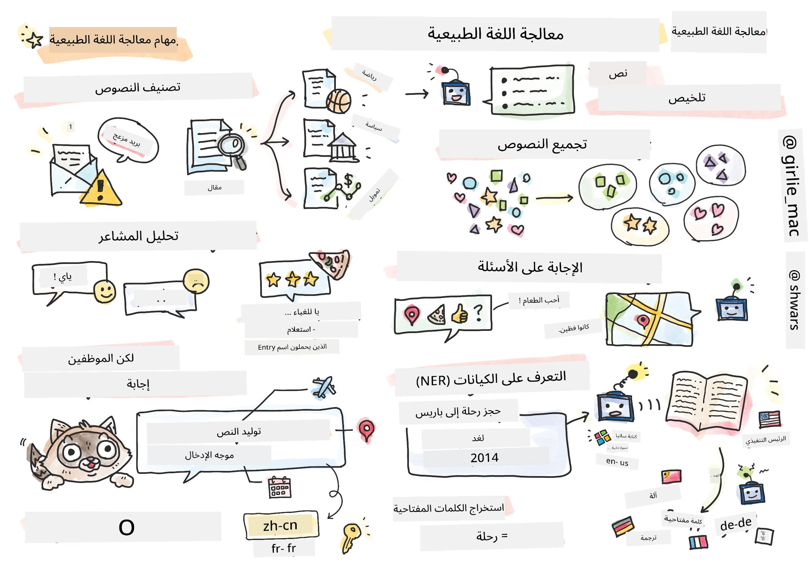

# معالجة اللغة الطبيعية



في هذا القسم، سنركز على استخدام الشبكات العصبية لمعالجة المهام المتعلقة بـ **معالجة اللغة الطبيعية (NLP)**. هناك العديد من مشكلات معالجة اللغة الطبيعية التي نريد أن تتمكن الحواسيب من حلها:

* **تصنيف النصوص** هي مشكلة تصنيف نموذجية تخص سلاسل النصوص. تشمل الأمثلة تصنيف رسائل البريد الإلكتروني كبريد مزعج أو غير مزعج، أو تصنيف المقالات كرياضة، أعمال، سياسة، إلخ. أيضًا، عند تطوير روبوتات المحادثة، نحتاج غالبًا إلى فهم ما أراد المستخدم قوله – في هذه الحالة نتعامل مع **تصنيف النية**. غالبًا، في تصنيف النية نحتاج إلى التعامل مع العديد من الفئات.
* **تحليل المشاعر** هو مشكلة انحدار نموذجية، حيث نحتاج إلى إسناد رقم (مشاعر) يعكس مدى إيجابية/سلبية معنى الجملة. نسخة متقدمة من تحليل المشاعر هي **تحليل المشاعر المعتمد على الجوانب** (ABSA)، حيث نُسند المشاعر ليس للجملة بأكملها، بل لأجزاء مختلفة منها (الجوانب)، مثلًا *في هذا المطعم، أحببت المأكولات، لكن الأجواء كانت سيئة*.
* **التعرف على الكيانات المسماة** (NER) يشير إلى مشكلة استخراج كيانات معينة من النص. على سبيل المثال، قد نحتاج إلى فهم أن في العبارة *أحتاج للطيران إلى باريس غدًا* تشير كلمة *غدًا* إلى التاريخ، و*باريس* هي موقع.
* **استخراج الكلمات المفتاحية** يشبه NER، لكننا نحتاج إلى استخراج الكلمات المهمة لمعنى الجملة تلقائيًا، دون تدريب مسبق على أنواع كيانات محددة.
* **تجميع النصوص** يمكن أن يكون مفيدًا عندما نريد تجميع جمل متشابهة، مثل الطلبات المتشابهة في محادثات دعم فني.
* **إجابة الأسئلة** تشير إلى قدرة النموذج على الإجابة عن سؤال محدد. يستقبل النموذج مقطع نصي وسؤال كمدخلات، ويحتاج إلى تحديد مكان في النص يحتوي على إجابة السؤال (أو، أحيانًا، لتوليد نص الإجابة).
* **توليد النص** هو قدرة النموذج على توليد نص جديد. يمكن اعتباره مهمة تصنيف تتنبأ بالحرف/الكلمة التالية بناءً على *نص مُحفز*. نماذج التوليد المتقدمة، مثل GPT-3، قادرة على حل مهام NLP أخرى مثل التصنيف باستخدام تقنية تسمى [برمجة المحفزات](https://towardsdatascience.com/software-3-0-how-prompting-will-change-the-rules-of-the-game-a982fbfe1e0) أو [هندسة المحفزات](https://medium.com/swlh/openai-gpt-3-and-prompt-engineering-dcdc2c5fcd29)
* **تلخيص النصوص** هي تقنية نريد من خلالها أن "يقرأ" الحاسوب نصًا طويلاً ويُلخصه في بضع جمل.
* **الترجمة الآلية** يمكن اعتبارها مزيجًا من فهم النص بلغة واحدة وتوليد النص بلغة أخرى.

في البداية، كان يتم حل معظم مهام NLP باستخدام طرق تقليدية مثل القواعد اللغوية. على سبيل المثال، في الترجمة الآلية، كان يُستخدم محللو التراكيب لتحويل الجملة الأصلية إلى شجرة بناء جملة، ثم تُستخرج البنى الدلالية الأعلى لتمثيل معنى الجملة، وبناءً على هذا المعنى وقواعد لغة الهدف يُولد النص النهائي. اليوم، يتم حل العديد من مهام NLP باستخدام الشبكات العصبية بشكل أكثر فعالية.

> العديد من طرق NLP الكلاسيكية مُنفذة في مكتبة بايثون [Natural Language Processing Toolkit (NLTK)](https://www.nltk.org). هناك كتاب رائع [NLTK Book](https://www.nltk.org/book/) متاح عبر الإنترنت يشرح كيفية حل مهام NLP المختلفة باستخدام NLTK.

في دورتنا، سنركز أكثر على استخدام الشبكات العصبية لـ NLP، وسنستخدم NLTK عند الحاجة.

لقد تعلمنا بالفعل كيفية استخدام الشبكات العصبية للتعامل مع البيانات الجدولية والصور. الفرق الرئيسي بين هذين النوعين من البيانات والنص هو أن النص هو تسلسل متغير الطول، بينما حجم الإدخال في حالة الصور معروف مسبقًا. بينما يمكن للشبكات الالتفافية استخراج أنماط من البيانات المدخلة، الأنماط في النص أكثر تعقيدًا. مثلاً، يمكن أن تكون النفي منفصلًا عن الفاعل بمسافة عدة كلمات (مثل *أنا لا أحب البرتقال*، مقابل *أنا لا أحب تلك البرتقالات الكبيرة الملونة اللذيذة*)، ويجب تفسير ذلك كأنماط موحدة. لذلك، لمعالجة اللغة نحتاج إلى تقديم أنواع جديدة من الشبكات العصبية، مثل *الشبكات العودية* و*المحولون*.

## تثبيت المكتبات

إذا كنت تستخدم تثبيت بايثون محليًا لتشغيل هذه الدورة، قد تحتاج إلى تثبيت جميع المكتبات المطلوبة لمعالجة اللغة الطبيعية باستخدام الأوامر التالية:

**لـ PyTorch**
```bash
pip install -r requirements-pytorch.txt
```
**لـ TensorFlow**
```bash
pip install -r requirements-tf.txt
```

> يمكنك تجربة NLP مع TensorFlow على [Microsoft Learn](https://docs.microsoft.com/learn/modules/intro-natural-language-processing-tensorflow/?WT.mc_id=academic-77998-cacaste)

## تحذير حول وحدة معالجة الرسومات (GPU)

في هذا القسم، سنقوم في بعض الأمثلة بتدريب نماذج كبيرة نسبيًا.
* **استخدام حاسوب مزود بوحدة معالجة رسومات**: يُنصح بتشغيل دفاترك على حاسوب مزود بوحدة معالجة رسومات لتقليل أوقات الانتظار عند التعامل مع نماذج كبيرة.
* **قيود ذاكرة GPU**: قد تؤدي التشغيل على GPU إلى حالات نفاد ذاكرة GPU، خصوصًا عند تدريب نماذج كبيرة.
* **استهلاك ذاكرة GPU**: كمية الذاكرة المستخدمة على GPU أثناء التدريب تعتمد على عوامل عديدة، بما في ذلك حجم الدُفعة الصغيرة.
* **تقليل حجم الدُفعة الصغيرة**: إذا واجهت مشاكل في ذاكرة GPU، فكر في تقليل حجم الدُفعة الصغيرة في الكود كحل محتمل.
* **إطلاق ذاكرة GPU في TensorFlow**: النسخ القديمة من TensorFlow قد لا تُفرج عن ذاكرة GPU بشكل صحيح عند تدريب عدة نماذج داخل نواة بايثون واحدة. للتحكم في استخدام ذاكرة GPU بشكل فعال، يمكنك إعداد TensorFlow لتخصيص ذاكرة GPU فقط حسب الحاجة.
* **إدراج الكود**: لتعيين TensorFlow ليزيد تخصيص ذاكرة GPU تدريجيًا فقط عند الحاجة، أدخل الكود التالي في دفاترك:

```python
physical_devices = tf.config.list_physical_devices('GPU') 
if len(physical_devices)>0:
    tf.config.experimental.set_memory_growth(physical_devices[0], True) 
```

إذا كنت مهتمًا بتعلم NLP من منظور تعلم الآلة الكلاسيكي، زُر [مجموعة الدروس هذه](https://github.com/microsoft/ML-For-Beginners/tree/main/6-NLP)

## في هذا القسم
في هذا القسم سنتعرف على:

* [تمثيل النص كمصفوفات متعددة الأبعاد](13-TextRep/README.md)
* [ترميزات الكلمات](14-Embeddings/README.md)
* [نمذجة اللغة](15-LanguageModeling/README.md)
* [الشبكات العصبية العودية](16-RNN/README.md)
* [الشبكات التوليدية](17-GenerativeNetworks/README.md)
* [المحولون](18-Transformers/README.md)

---

<!-- CO-OP TRANSLATOR DISCLAIMER START -->
**تنويه**:
تمت ترجمة هذا المستند باستخدام خدمة الترجمة بالذكاء الاصطناعي [Co-op Translator](https://github.com/Azure/co-op-translator). بينما نسعى للدقة، يرجى العلم أن الترجمات الآلية قد تحتوي على أخطاء أو عدم دقة. يجب اعتبار المستند الأصلي بلغته الأصلية المصدر الرسمي والمعتمد. للمعلومات الهامة، يُنصح بالاستعانة بترجمة بشرية محترفة. نحن غير مسؤولين عن أي سوء فهم أو تفسير ناتج عن استخدام هذه الترجمة.
<!-- CO-OP TRANSLATOR DISCLAIMER END -->