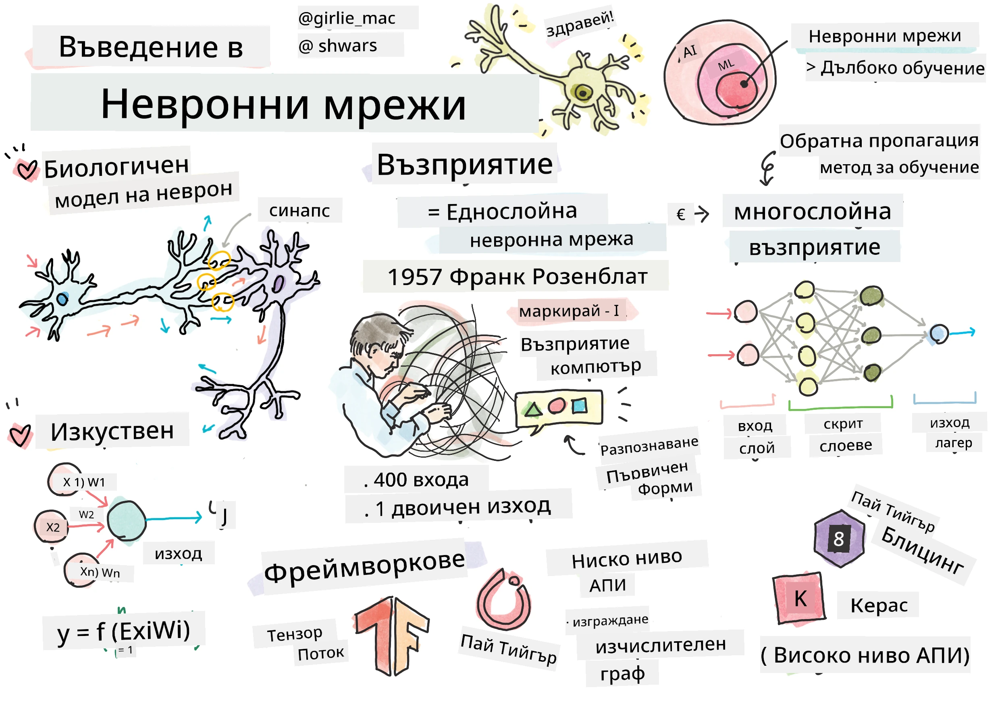
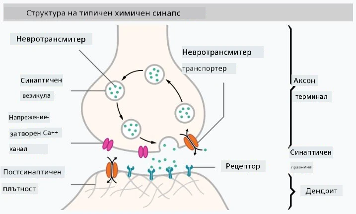
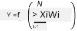

# Въведение в невронните мрежи

Както обсъдихме във въведението, един от начините за постигане на интелигентност е да се обучи **компютърен модел** или **изкуствен мозък**. От средата на 20-ти век изследователите опитваха различни математически модели, докато през последните години това направление доказа огромния си успех. Такива математически модели на мозъка се наричат **невронни мрежи**.

> Понякога невронните мрежи се наричат *Изкуствени Невронни Мрежи*, ИНМ, за да се подчертае, че говорим за модели, а не за реални мрежи от неврони.

## Машинно обучение

Невронните мрежи са част от по-голяма дисциплина, наречена **машинно обучение**, чиято цел е да използва данни за обучение на компютърни модели, способни да решават проблеми. Машинното обучение е голяма част от изкуствения интелект, но в тази учебна програма не разглеждаме класическото машинно обучение.

> Посетете нашата отделна учебна програма **[Машинно обучение за начинаещи](http://github.com/microsoft/ml-for-beginners)**, за да научите повече за класическото машинно обучение.

В машинното обучение приемаме, че имаме комплект от примери **X** и съответни изходни стойности **Y**. Примерите обикновено са векторни данни с N измерения, наречени **признаци**, а изходите се наричат **етикети**.

Ще разгледаме двата най-често срещани проблема в машинното обучение:

* **Класификация**, където трябва да класифицираме входен обект в две или повече категории.
* **Регресия**, където трябва да предвидим числова стойност за всеки входен пример.

> Когато представяме входните и изходните данни като тензори, входният набор е матрица с размер M&times;N, където M е броят на примерите, а N е броят на признаците. Изходните етикети Y са вектор с размер M.

В тази учебна програма ще се фокусираме само върху модели на невронни мрежи.

## Модел на неврон

От биологията знаем, че нашият мозък се състои от нервни клетки (неврони), всяка от които има множество "входове" (дендрити) и един "изход" (аксон). И дендритите, и аксоните могат да провеждат електрически сигнали, а връзките между тях — наречени синапси — могат да имат различна степен на проводимост, която се регулира от невротрансмитерите.

 | 
----|----
Реален неврон *([Изображение](https://en.wikipedia.org/wiki/Synapse#/media/File:SynapseSchematic_lines.svg) от Уикипедия)* | Изкуствен неврон *(Изображение от автора)*

Следователно най-простият математически модел на неврон включва няколко входа X1, ..., XN и един изход Y, както и поредица от тегла W1, ..., WN. Изходът се изчислява като:

където f е някаква нелинейна **активационна функция**.

> Ранните модели на невроните са описани в класическата статия [Логически изчисления на идеите, присъщи на нервната активност](https://www.cs.cmu.edu/~./epxing/Class/10715/reading/McCulloch.and.Pitts.pdf) от Уорън Маккалок и Уолтър Питс през 1943 г. Доналд Хеб в своята книга "[Организация на поведението: Невропсихологическа теория](https://books.google.com/books?id=VNetYrB8EBoC)" предложи начин за обучение на тези мрежи.

## В този раздел

В този раздел ще научим за:
* [Персептрон](03-Perceptron/README.md), един от най-ранните модели на невронна мрежа за двукласова класификация
* [Многослойни мрежи](04-OwnFramework/README.md) с придружен тетрадка [как да построим собствен фреймуърк](04-OwnFramework/OwnFramework.ipynb)
* [Фреймуъркове за невронни мрежи](05-Frameworks/README.md), с тези тетрадки: [PyTorch](05-Frameworks/IntroPyTorch.ipynb) и [Keras/Tensorflow](05-Frameworks/IntroKerasTF.ipynb)
* [Прекомерно нагласяне](../../../../lessons/3-NeuralNetworks/05-Frameworks#overfitting)

---

<!-- CO-OP TRANSLATOR DISCLAIMER START -->
**Отказ от отговорност**:
Този документ е преведен с помощта на AI преводачески услуга [Co-op Translator](https://github.com/Azure/co-op-translator). Въпреки че се стремим към точност, моля имайте предвид, че автоматизираните преводи могат да съдържат грешки или неточности. Оригиналният документ на неговия роден език трябва да се счита за авторитетен източник. За критична информация се препоръчва професионален човешки превод. Ние не носим отговорност за каквито и да е недоразумения или неправилни тълкувания, произтичащи от използването на този превод.
<!-- CO-OP TRANSLATOR DISCLAIMER END -->