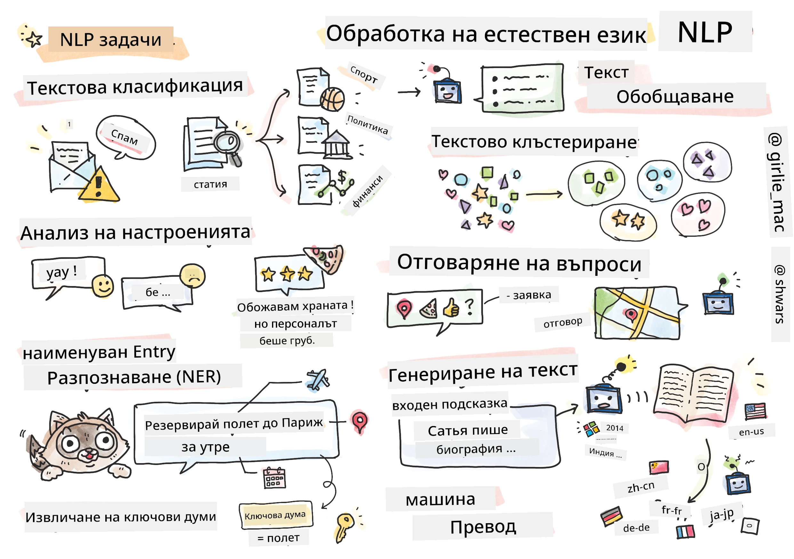

# Обработка на естествен език



В тази секция ще се фокусираме върху използването на невронни мрежи за обработка на задачи, свързани с **Обработка на естествен език (NLP)**. Съществуват много проблеми в NLP, които искаме компютрите да могат да решават:

* **Класификация на текст** е типичен проблем на класификация, свързан с текстови последователности. Примери включват класифицирането на имейл съобщения като спам или не-спам, или категоризирането на статии като спорт, бизнес, политика и др. Също така, при разработването на чат ботове често трябва да разберем какво иска потребителят да каже – в този случай се занимаваме с **класификация на намерение**. Често при класификация на намерение трябва да се справим с много категории.
* **Анализ на настроенията** е типичен проблем на регресия, където трябва да се приписва число (настроение), съответстващо на това колко позитивно/негативно е значението на изречението. По-напреднал вариант на анализа на настроенията е **анализ на настроенията на базата на аспекти** (ABSA), където настроението се приписва не на цялото изречение, а на отделните му части (аспекти), напр. *В този ресторант харесах кухнята, но атмосферата беше ужасна*.
* **Разпознаване на именовани единици** (NER) се отнася до проблема с извличането на определени единици от текст. Например, може да трябва да разберем, че в израза *Трябва да летя за Париж утре* думата *утре* се отнася за ДАТА, а *Париж* е МЯСТО.  
* **Извличане на ключови думи** е подобно на NER, но трябва да се извличат важни за значението на изречението думи автоматично, без предварително обучение за конкретни типове единици.
* **Групиране на текст** може да е полезно, когато искаме да групираме подобни изречения, например, подобни заявки в техническа поддръжка.
* **Отговаряне на въпроси** се отнася до способността на модела да отговори на конкретен въпрос. Моделът получава като вход текстов пасаж и въпрос и трябва да предостави място в текста, където се съдържа отговорът на въпроса (или понякога да генерира текста с отговора).
* **Генериране на текст** е способността на модела да генерира нов текст. Това може да се разглежда като задача на класификация, която предсказва следващата буква/дума въз основа на някакъв *текстов подканващ сигнал*. Напреднали модели за генериране на текст като GPT-3 могат да решават и други задачи в NLP, като класификацията, използвайки техника, наречена [програмиране с подканващи сигнали](https://towardsdatascience.com/software-3-0-how-prompting-will-change-the-rules-of-the-game-a982fbfe1e0) или [инженеринг на подканващи сигнали](https://medium.com/swlh/openai-gpt-3-and-prompt-engineering-dcdc2c5fcd29)
* **Обобщаване на текст** е техника, при която искаме компютърът да "чете" дълъг текст и да го обобщава в няколко изречения.
* **Машинен превод** може да се разглежда като комбинация от разбирането на текст на един език и генерирането на текст на друг език.

В началото повечето задачи в NLP се решаваха с традиционни методи като граматики. Например в машинния превод се използваха парсери за преобразуване на изречението в синтактично дърво, след което се извличаха по-висши семантични структури за представяне на значението на изречението и на основата на това значение и граматиката на целевия език се генерираше резултатът. Днес много задачи в NLP се решават по-ефективно с невронни мрежи.

> Много класически методи за NLP са реализирани в Python библиотеката [Natural Language Processing Toolkit (NLTK)](https://www.nltk.org). Има чудесна [NLTK книга](https://www.nltk.org/book/) достъпна онлайн, която обяснява как различни NLP задачи могат да се решават с NLTK.

В нашия курс основно ще се фокусираме върху използването на невронни мрежи за NLP и ще използваме NLTK при нужда.

Вече сме научили за използването на невронни мрежи за работа с таблични данни и с изображения. Основната разлика между тези типове данни и текста е, че текстът е последователност с променлива дължина, докато размерът на входа при изображенията е известен предварително. Докато конволюционните мрежи могат да извличат модели от входни данни, моделите в текста са по-сложни. Например, отрицанието може да е разделено от субекта и да бъде произволно разпределено по думите (например *Не харесвам портокалите* срещу *Не харесвам тези големи, цветни и вкусни портокали*), и това трябва все още да се интерпретира като един модел. Следователно, за обработка на езика трябва да се въведат нови типове невронни мрежи, като *рекурентни мрежи* и *трансформъри*.

## Инсталиране на библиотеки

Ако използвате локална инсталация на Python за изпълнение на този курс, може да е необходимо да инсталирате всички необходими библиотеки за NLP с следните команди:

**За PyTorch**
```bash
pip install -r requirements-pytorch.txt
```
**За TensorFlow**
```bash
pip install -r requirements-tf.txt
```

> Можете да пробвате NLP с TensorFlow в [Microsoft Learn](https://docs.microsoft.com/learn/modules/intro-natural-language-processing-tensorflow/?WT.mc_id=academic-77998-cacaste)

## Предупреждение за GPU

В тази секция в някои от примерите ще тренираме доста големи модели.
* **Използвайте компютър с GPU**: Препоръчително е да изпълнявате бележниците си на компютър с GPU, за да намалите времето за изчакване при работа с големи модели.
* **Ограничения на GPU паметта**: Работата с GPU може да доведе до ситуации, в които паметта на GPU изчерпва, особено при трениране на големи модели.
* **Потребление на GPU памет**: Количеството GPU памет, което се използва по време на трениране, зависи от различни фактори, включително размера на минипакета.
* **Минимизиране на размера на минипакета**: Ако срещнете проблеми с GPU паметта, опитайте да намалите размера на минипакета в кода си като потенциално решение.
* **Освобождаване на GPU памет в TensorFlow**: По-старите версии на TensorFlow може да не освобождават правилно GPU паметта при трениране на няколко модела в една Python среда. За ефективно управление на използването на GPU паметта, можете да конфигурирате TensorFlow да разпределя GPU памет само при потребност.
* **Включване на код**: За да настроите TensorFlow да увеличава разпределянето на GPU памет само когато е нужно, включете следния код в бележниците си:

```python
physical_devices = tf.config.list_physical_devices('GPU') 
if len(physical_devices)>0:
    tf.config.experimental.set_memory_growth(physical_devices[0], True) 
```

Ако се интересувате да научите за NLP от класическа перспектива на машинното обучение, посетете [този комплект уроци](https://github.com/microsoft/ML-For-Beginners/tree/main/6-NLP)

## В тази секция
В тази секция ще научим за:

* [Представяне на текст като тензори](13-TextRep/README.md)
* [Вграждане на думи](14-Embeddings/README.md)
* [Езиково моделиране](15-LanguageModeling/README.md)
* [Рекурентни невронни мрежи](16-RNN/README.md)
* [Генеративни мрежи](17-GenerativeNetworks/README.md)
* [Трансформъри](18-Transformers/README.md)

---

<!-- CO-OP TRANSLATOR DISCLAIMER START -->
**Отказ от отговорност**:
Този документ е преведен с помощта на AI преводачески услуга [Co-op Translator](https://github.com/Azure/co-op-translator). Въпреки че се стремим към точност, моля имайте предвид, че автоматизираните преводи могат да съдържат грешки или неточности. Оригиналният документ на неговия роден език трябва да се счита за авторитетен източник. За критична информация се препоръчва професионален човешки превод. Ние не носим отговорност за каквито и да е недоразумения или неправилни тълкувания, произтичащи от използването на този превод.
<!-- CO-OP TRANSLATOR DISCLAIMER END -->