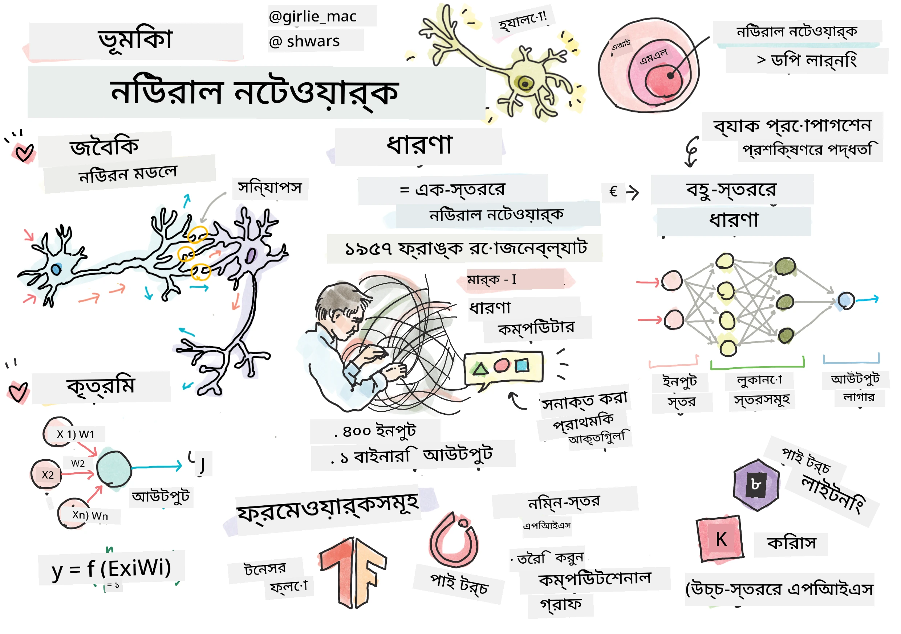
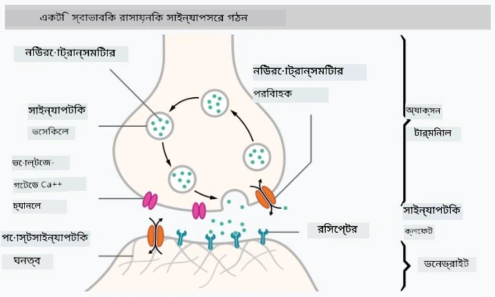
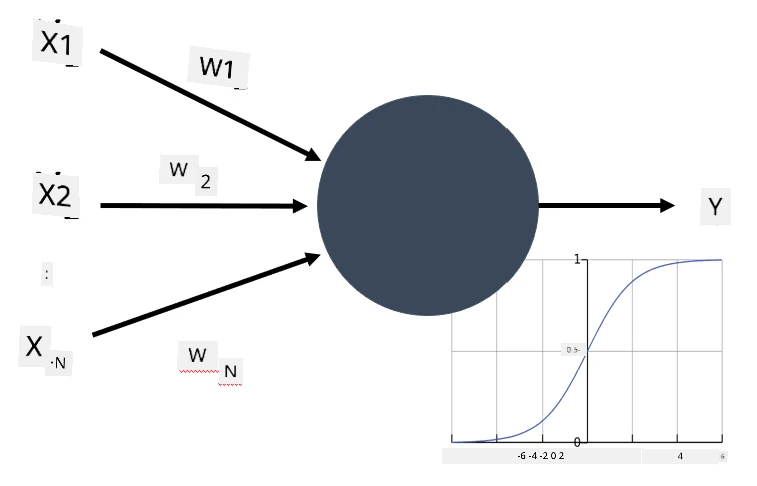

# নিউরাল নেটওয়ার্কের পরিচিতি

যেমন আমরা পরিচিতিতে আলোচনা করেছি, বুদ্ধিমত্তা অর্জনের একটি উপায় হলো একটি **কম্পিউটার মডেল** বা একটি **কৃত্রিম মস্তিষ্ক** প্রশিক্ষণ দেওয়া। ২০শ শতকের মাঝামাঝি থেকে গবেষকরা বিভিন্ন গণিত মডেল চেষ্টা করেছেন, এবং সাম্প্রতিক বছরগুলোতে এই দিকটি বহুল সফল প্রমাণিত হয়েছে। মস্তিষ্কের এই রকম গণিত মডেলগুলিকে **নিউরাল নেটওয়ার্ক** বলা হয়।

> কখনো কখনো নিউরাল নেটওয়ার্ককে *কৃত্রিম নিউরাল নেটওয়ার্ক*, ANNs বলা হয়, যাতে বোঝানো হয় যে আমরা মডেল নিয়ে কথা বলছি, প্রকৃত স্নায়ুবাহিক নেটওয়ার্ক নিয়ে নয়।

## মেশিন লার্নিং

নিউরাল নেটওয়ার্ক হলো একটি বৃহত্তর শাখার অংশ যার নাম **মেশিন লার্নিং**, যার লক্ষ্য হলো তথ্য ব্যবহার করে এমন কম্পিউটার মডেল প্রশিক্ষণ দেয়া যা সমস্যাগুলো সমাধান করতে পারে। মেশিন লার্নিং কৃত্রিম বুদ্ধিমত্তার বড় একটি অংশ, তবে আমরা এই পাঠক্রমে ক্লাসিক্যাল মেশিন লার্নিং আলোচনা করব না।

> আমাদের আলাদা **[শিখুন মেশিন লার্নিং ফর বিগিনার্স](http://github.com/microsoft/ml-for-beginners)** পাঠক্রমে ক্লাসিক মেশিন লার্নিং সম্পর্কে আরও জানুন।

মেশিন লার্নিং এ, আমরা ধরে নিই আমাদের কাছে কিছু উদাহরণ ডেটাসেট **X** এবং সংশ্লিষ্ট আউটপুট মান **Y** আছে। উদাহরণগুলি সাধারণত N-মাত্রিক ভেক্টর যা **ফিচার** নিয়ে গঠিত, এবং আউটপুটকে **লেবেল** বলা হয়।

আমরা দুটি সবচেয়ে সাধারণ মেশিন লার্নিং সমস্যার কথা বিবেচনা করব:

* **শ্রেণীবিন্যাস (Classification)**, যেখানে আমাদের একটি ইনপুট অবজেক্টকে দুই বা ততোধিক শ্রেণীতে শ্রেণীবদ্ধ করতে হয়।
* **রিগ্রেশন (Regression)**, যেখানে আমাদের প্রতিটি ইনপুট নমুনার জন্য একটি সংখ্যাসূচক মান পূর্বানুমান করতে হয়।

> ইনপুট এবং আউটপুটকে টেনসর আকারে উপস্থাপন করার সময়, ইনপুট ডেটাসেট একটি M×N মেট্রিক্স হয়, যেখানে M নমুনার সংখ্যা এবং N ফিচারের সংখ্যা। আউটপুট লেবেল Y হলো M-মাত্রার ভেক্টর।

এই পাঠক্রমে, আমরা শুধুমাত্র নিউরাল নেটওয়ার্ক মডেলগুলোর উপর ফোকাস করব।

## একটি নিউরনের মডেল

জীববিদ্যা থেকে আমরা জানি যে আমাদের মস্তিষ্ক নিউরাল কোষ (নিউরন) নিয়ে গঠিত, যার প্রতিটিতে একাধিক "ইনপুট" (ডেন্ড্রাইট) এবং একটি একক "আউটপুট" (অ্যাক্সন) থাকে। ডেন্ড্রাইট ও অ্যাক্সন উভয়ই বৈদ্যুতিক সংকেত পরিবহন করতে পারে, এবং তাদের মধ্যকার সংযোগ — যাকে সাইন্যাপস বলা হয় — বিভিন্ন মাত্রার পরিবাহিতা প্রদর্শন করতে পারে, যা নিউরোট্রান্সমিটার দ্বারা নিয়ন্ত্রিত হয়।

 | 
----|----
প্রকৃত নিউরন *([Image](https://en.wikipedia.org/wiki/Synapse#/media/File:SynapseSchematic_lines.svg) উইকিপিডিয়া থেকে)* | কৃত্রিম নিউরন *(লেখকের ছবি)*

তাই, একটি নিউরনের সবচেয়ে সহজ গণিত মডেলে একাধিক ইনপুট X1, ..., XN, একটি আউটপুট Y এবং ওজন W1, ..., WN থাকে। আউটপুট হিসাব করা হয়:

যেখানে f হল কোনো নন-লিনিয়ার **অ্যাক্টিভেশন ফাংশন**।

> নিউরনের প্রাথমিক মডেলগুলি ক্লাসিক্যাল পেপার [A logical calculus of the ideas immanent in nervous activity](https://www.cs.cmu.edu/~./epxing/Class/10715/reading/McCulloch.and.Pitts.pdf) এ ওয়ারেন ম্যাককালক এবং ওয়াল্টার পিটস ১৯৪৩ সালে বর্ণনা করেছিলেন। ডোনাল্ড হেব তার বই "[The Organization of Behavior: A Neuropsychological Theory](https://books.google.com/books?id=VNetYrB8EBoC)" তে এই নেটওয়ার্কগুলিকে প্রশিক্ষণ দেয়ার পদ্ধতি প্রস্তাব করেন।

## এই অংশে

এই অংশে আমরা আলোচনা করব:
* [পারসেপ্ট্রন](03-Perceptron/README.md), দুই-শ্রেণীর শ্রেণীবিন্যাসের জন্য প্রাচীনতম নিউরাল নেটওয়ার্ক মডেলগুলোর একটি
* [মাল্টি-লেয়ারড নেটওয়ার্ক](04-OwnFramework/README.md) সহ একটি যুগল নোটবুক [কিভাবে নিজের ফ্রেমওয়ার্ক তৈরি করবেন](04-OwnFramework/OwnFramework.ipynb)
* [নিউরাল নেটওয়ার্ক ফ্রেমওয়ার্ক](05-Frameworks/README.md), যার নোটবুক গুলো হলো: [PyTorch](05-Frameworks/IntroPyTorch.ipynb) এবং [Keras/Tensorflow](05-Frameworks/IntroKerasTF.ipynb)
* [ওভারফিটিং](../../../../lessons/3-NeuralNetworks/05-Frameworks#overfitting)

---

<!-- CO-OP TRANSLATOR DISCLAIMER START -->
**অস্বীকৃতি**:
এই নথিটি AI অনুবাদ পরিষেবা [Co-op Translator](https://github.com/Azure/co-op-translator) ব্যবহার করে অনূদিত হয়েছে। যদিও আমরা শুদ্ধতার জন্য চেষ্টা করি, অনুগ্রহ করে মনে রাখবেন যে স্বয়ংক্রিয় অনুবাদে ত্রুটি বা অসঙ্গতি থাকতে পারে। মূল নথিটি তার স্বভাষায় কর্তৃত্বপূর্ণ উৎস হিসেবে বিবেচিত হওয়া উচিত। গুরুত্বপূর্ণ তথ্যের জন্য পেশাদার মানব অনুবাদ সুপারিশ করা হয়। এই অনুবাদের ব্যবহারে প্রয়োজনীয় ভুল বোঝাবুঝি বা ভুল ব্যাখ্যার জন্য আমরা দায়বদ্ধ নই।
<!-- CO-OP TRANSLATOR DISCLAIMER END -->