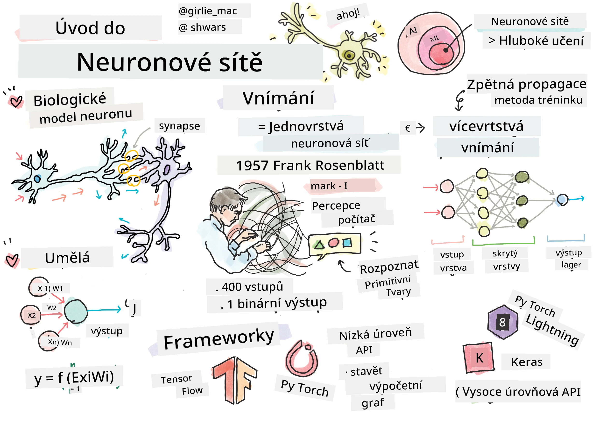
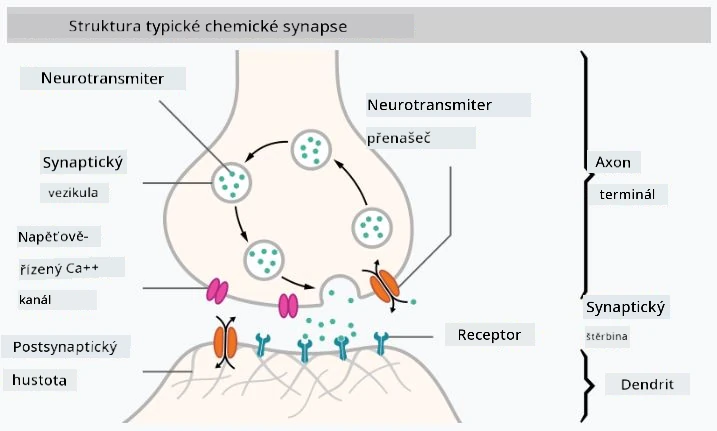

# Úvod do neuronových sítí

Jak jsme diskutovali v úvodu, jedním ze způsobů, jak dosáhnout inteligence, je trénovat **počítačový model** nebo **umělý mozek**. Od poloviny 20. století se výzkumníci pokoušeli o různé matematické modely, až se v posledních letech tento směr ukázal jako velmi úspěšný. Takové matematické modely mozku se nazývají **neuronové sítě**.

> Neuronové sítě se někdy nazývají *umělé neuronové sítě*, ANNs, aby bylo jasné, že mluvíme o modelech, ne o skutečných sítích neuronů.

## Strojové učení

Neuronové sítě jsou součástí širší disciplíny nazývané **strojové učení**, jejímž cílem je využití dat k trénování počítačových modelů, které jsou schopny řešit problémy. Strojové učení tvoří velkou část umělé inteligence, nicméně v této osnově se klasickému strojovému učení nevěnujeme.

> Navštivte naši samostatnou osnovu **[Strojové učení pro začátečníky](http://github.com/microsoft/ml-for-beginners)**, kde se dozvíte více o klasickém strojovém učení.

Ve strojovém učení předpokládáme, že máme nějakou datovou sadu příkladů **X** a odpovídající výstupní hodnoty **Y**. Příklady jsou často n-rozměrné vektory, které se skládají z **rysů**, a výstupy se nazývají **štítky**.

Budeme uvažovat dva nejběžnější problémy strojového učení:

* **Klasifikace**, kde je potřeba přiřadit vstupní objekt do dvou nebo více tříd.
* **Regrese**, kde je potřeba pro každý vstupní vzorek předpovědět číselnou hodnotu.

> Při zobrazování vstupů a výstupů jako tenzorů je vstupní datová sada matice velikosti M&times;N, kde M je počet vzorků a N počet rysů. Výstupní štítky Y jsou vektor velikosti M.

V této osnově se budeme zaměřovat pouze na modely neuronových sítí.

## Model neuronu

Z biologie víme, že náš mozek se skládá z nervových buněk (neuronů), z nichž každý má více "vstupů" (dendrity) a jeden "výstup" (axon). Dendrit i axon dokážou vést elektrické signály a spojení mezi nimi – známá jako synapse – mohou mít různé stupně vodivosti, které jsou řízeny neurotransmitery.

 | 
----|----
Skutečný neuron *([Obrázek](https://en.wikipedia.org/wiki/Synapse#/media/File:SynapseSchematic_lines.svg) z Wikipedie)* | Umělý neuron *(Obrázek autora)*

Nejjednodušší matematický model neuronu tedy obsahuje několik vstupů X1, ..., XN a jeden výstup Y, a sadu vah W1, ..., WN. Výstup se počítá jako:

kde f je nějaká nelineární **aktivační funkce**.

> První modely neuronů popisují klasický článek [A logical calculus of the ideas immanent in nervous activity](https://www.cs.cmu.edu/~./epxing/Class/10715/reading/McCulloch.and.Pitts.pdf) od Warrena McCullocka a Waltera Pittse z roku 1943. Donald Hebb ve své knize "[The Organization of Behavior: A Neuropsychological Theory](https://books.google.com/books?id=VNetYrB8EBoC)" navrhl způsob, jak tyto sítě trénovat.

## V této sekci

V této sekci se naučíme o:
* [Perceptronu](03-Perceptron/README.md), jednom z nejstarších modelů neuronových sítí pro dvoutřídní klasifikaci
* [Vícevrstvých sítích](04-OwnFramework/README.md) s přidruženým zápisníkem [jak si postavit vlastní framework](04-OwnFramework/OwnFramework.ipynb)
* [Frameworky neuronových sítí](05-Frameworks/README.md), s těmito zápisníky: [PyTorch](05-Frameworks/IntroPyTorch.ipynb) a [Keras/Tensorflow](05-Frameworks/IntroKerasTF.ipynb)
* [Přetrénování](../../../../lessons/3-NeuralNetworks/05-Frameworks#overfitting)

---

<!-- CO-OP TRANSLATOR DISCLAIMER START -->
**Prohlášení o omezení odpovědnosti**:
Tento dokument byl přeložen pomocí AI překladatelské služby [Co-op Translator](https://github.com/Azure/co-op-translator). Přestože usilujeme o co největší přesnost, mějte prosím na paměti, že automatizované překlady mohou obsahovat chyby nebo nepřesnosti. Originální dokument v jeho mateřském jazyce by měl být považován za autoritativní zdroj. Pro kritické informace se doporučuje profesionální lidský překlad. Nejsme odpovědní za jakékoli nedorozumění nebo nesprávné interpretace vzniklé použitím tohoto překladu.
<!-- CO-OP TRANSLATOR DISCLAIMER END -->