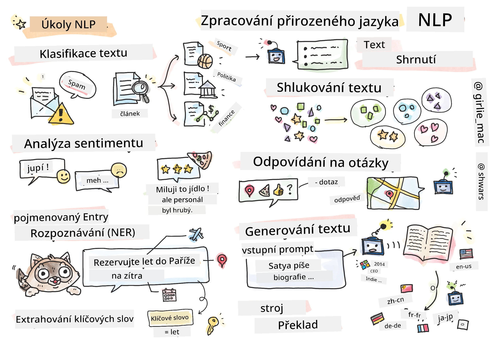

# Zpracování přirozeného jazyka



V této části se zaměříme na použití neuronových sítí k řešení úloh souvisejících s **Zpracováním přirozeného jazyka (NLP)**. Existuje mnoho NLP problémů, které chceme, aby počítače uměly řešit:

* **Klasifikace textu** je typický klasifikační problém týkající se posloupností textu. Příklady zahrnují klasifikaci e-mailových zpráv jako spam vs. ne-spam, nebo kategorizaci článků jako sport, obchod, politika atd. Také při vývoji chatbotů často potřebujeme pochopit, co chtěl uživatel říct – v tomto případě řešíme **klasifikaci záměru**. Často při klasifikaci záměrů musíme pracovat s mnoha kategoriemi.
* **Analýza sentimentu** je typický regresní problém, kde je potřeba přiřadit číslo (sentiment) odpovídající tomu, jak pozitivní/negativní je význam věty. Pokročilejší verze analýzy sentimentu je **analýza sentimentu založená na aspektech** (ABSA), kde sentiment není přiřazován celé větě, ale různým částem věty (aspektům), například *V této restauraci se mi líbila kuchyně, ale atmosféra byla hrozná*.
* **Rozpoznávání pojmenovaných entit** (NER) odkazuje na problém extrakce určitých entit z textu. Například můžeme potřebovat pochopit, že ve frázi *Potřebuji zítra letět do Paříže* slovo *zítra* označuje DATUM a *Paříž* je MÍSTO.  
* **Extrahování klíčových slov** je podobné jako NER, ale potřebujeme automaticky extrahovat slova důležitá pro význam věty, aniž bychom trénovali na konkrétní typy entit.
* **Shlukování textu** může být užitečné, když chceme seskupit podobné věty, například podobné požadavky v technické podpoře.
* **Odpovídání na otázky** znamená schopnost modelu odpovědět na konkrétní otázku. Model dostane jako vstupy textový úryvek a otázku a musí poskytnout místo v textu, kde je odpověď obsažena (nebo někdy vygenerovat text odpovědi).
* **Generování textu** je schopnost modelu generovat nový text. Může být považováno za klasifikační úlohu, která předpovídá další písmeno/slovo na základě nějakého *textového podnětu*. Pokročilé modely generování textu, jako GPT-3, jsou schopné řešit i jiné úlohy NLP, například klasifikaci pomocí techniky nazývané [programování podnětů](https://towardsdatascience.com/software-3-0-how-prompting-will-change-the-rules-of-the-game-a982fbfe1e0) nebo [inženýrství podnětů](https://medium.com/swlh/openai-gpt-3-and-prompt-engineering-dcdc2c5fcd29)
* **Shrnutí textu** je technika, kdy chceme, aby počítač "přečetl" dlouhý text a shrnul jej do několika vět.
* **Strojový překlad** lze pohlížet jako kombinaci porozumění textu v jednom jazyce a generování textu v jiném jazyce.

Zpočátku bylo většinu úloh NLP řešeno tradičními metodami, jako jsou gramatiky. Například při strojovém překladu byly používány parsers, které transformovaly počáteční větu do syntaktického stromu, poté byly extrahovány vyšší úrovně sémantických struktur pro reprezentaci významu věty, a na základě tohoto významu a gramatiky cílového jazyka byl generován výsledek. Dnes je mnoho úloh NLP efektivněji řešeno pomocí neuronových sítí.

> Mnoho klasických metod NLP je implementováno v Python knihovně [Natural Language Processing Toolkit (NLTK)](https://www.nltk.org). K dispozici je vynikající online [NLTK kniha](https://www.nltk.org/book/), která popisuje, jak různé úlohy NLP řešit pomocí NLTK.

V našem kurzu se většinou zaměříme na použití neuronových sítí pro NLP a NLTK budeme používat tam, kde to bude potřeba.

Už jsme se naučili používat neuronové sítě pro práci s tabulkovými daty a s obrázky. Hlavní rozdíl mezi těmito typy dat a textem je, že text je sekvence proměnné délky, zatímco vstupní velikost u obrázků je předem známá. Zatímco konvoluční sítě dokážou extrahovat vzory ze vstupních dat, vzory v textu jsou složitější. Například negace může být oddělena od subjektu mnoha slovy (např. *Nemám rád pomeranče* vs. *Nemám rád ty velké barevné chutné pomeranče*) a to by mělo být stále interpretováno jako jeden vzor. Proto pro zpracování jazyka potřebujeme zavést nové typy neuronových sítí, jako jsou *recurrentní sítě* a *transformery*.

## Instalace knihoven

Pokud používáte lokální instalaci Pythonu k běhu tohoto kurzu, může být potřeba nainstalovat všechny požadované knihovny pro NLP pomocí následujících příkazů:

**Pro PyTorch**
```bash
pip install -r requirements-pytorch.txt
```
**Pro TensorFlow**
```bash
pip install -r requirements-tf.txt
```

> NLP můžete vyzkoušet s TensorFlow na [Microsoft Learn](https://docs.microsoft.com/learn/modules/intro-natural-language-processing-tensorflow/?WT.mc_id=academic-77998-cacaste)

## Varování ohledně GPU

V této části budeme v některých příkladech trénovat poměrně velké modely.
* **Používejte počítač s podporou GPU**: Doporučuje se spouštět notebooky na počítači s GPU, aby se snížila doba čekání při práci s velkými modely.
* **Omezení paměti GPU**: Běh na GPU může vést k situacím, kdy dojde paměť GPU, zvláště při tréninku velkých modelů.
* **Spotřeba paměti GPU**: Množství paměti GPU využité během tréninku závisí na různých faktorech, včetně velikosti minibatch.
* **Minimalizujte velikost minibatch**: Pokud narazíte na problémy s pamětí GPU, zvažte snížení velikosti minibatch ve svém kódu jako možná řešení.
* **Uvolnění paměti GPU v TensorFlow**: Starší verze TensorFlow nemusí správně uvolňovat paměť GPU při tréninku více modelů v jednom Python kernelu. Pro efektivní správu paměti GPU můžete nastavit TensorFlow tak, aby alokoval paměť GPU pouze podle potřeby.
* **Zahrnutí kódu**: Pro nastavení TensorFlow, aby rozšiřoval alokaci paměti GPU pouze podle potřeby, zahrňte následující kód do svých notebooků:

```python
physical_devices = tf.config.list_physical_devices('GPU') 
if len(physical_devices)>0:
    tf.config.experimental.set_memory_growth(physical_devices[0], True) 
```

Pokud vás zajímá učení NLP z klasické perspektivy ML, navštivte [tuto sadu lekcí](https://github.com/microsoft/ML-For-Beginners/tree/main/6-NLP)

## V této části
V této části se naučíme o:

* [Reprezentaci textu jako tenzorů](13-TextRep/README.md)
* [Word embeddings](14-Embeddings/README.md)
* [Modelování jazyka](15-LanguageModeling/README.md)
* [Recurrentní neuronové sítě](16-RNN/README.md)
* [Generativní sítě](17-GenerativeNetworks/README.md)
* [Transformery](18-Transformers/README.md)

---

<!-- CO-OP TRANSLATOR DISCLAIMER START -->
**Prohlášení o omezení odpovědnosti**:
Tento dokument byl přeložen pomocí AI překladatelské služby [Co-op Translator](https://github.com/Azure/co-op-translator). Přestože usilujeme o co největší přesnost, mějte prosím na paměti, že automatizované překlady mohou obsahovat chyby nebo nepřesnosti. Originální dokument v jeho mateřském jazyce by měl být považován za autoritativní zdroj. Pro kritické informace se doporučuje profesionální lidský překlad. Nejsme odpovědní za jakékoli nedorozumění nebo nesprávné interpretace vzniklé použitím tohoto překladu.
<!-- CO-OP TRANSLATOR DISCLAIMER END -->