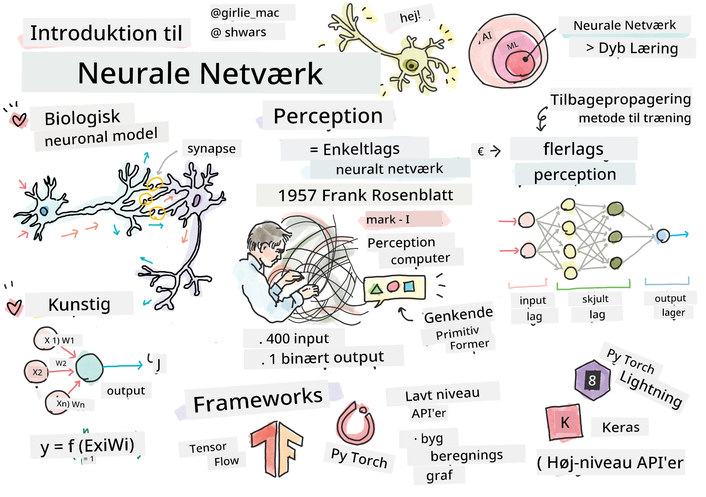
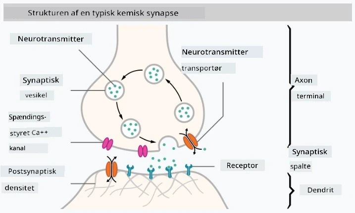
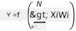

# Introduktion til Neurale Netværk

Som vi diskuterede i introduktionen, er en af måderne at opnå intelligens på at træne en **computermodel** eller en **kunstig hjerne**. Siden midten af det 20. århundrede har forskere prøvet forskellige matematiske modeller, indtil denne retning i de senere år viste sig at være særdeles succesfuld. Sådanne matematiske modeller af hjernen kaldes **neuronale netværk**.

> Nogle gange kaldes neurale netværk *kunstig nevrale netværk*, ANN'er, for at indikere, at vi taler om modeller, ikke ægte netværk af neuroner.

## Maskinlæring

Neurale netværk er en del af en større disciplin kaldet **Maskinlæring**, hvis mål er at bruge data til at træne computermodeller, der er i stand til at løse problemer. Maskinlæring udgør en stor del af kunstig intelligens, men vi dækker ikke klassisk ML i dette pensum.

> Besøg vores separate **[Maskinlæring for Begyndere](http://github.com/microsoft/ml-for-beginners)** pensum for at lære mere om klassisk Maskinlæring.

Inden for maskinlæring antager vi, at vi har et datasæt med eksempler **X** og tilsvarende outputværdier **Y**. Eksempler er ofte N-dimensionelle vektorer, der består af **features**, og output kaldes **labels**.

Vi vil betragte de to mest almindelige maskinlæringsproblemer:

* **Klassifikation**, hvor vi skal klassificere et inputobjekt i to eller flere klasser.
* **Regression**, hvor vi skal forudsige et numerisk tal for hver af inputprøverne.

> Når input og output repræsenteres som tensorer, er inputdatasættet en matrix af størrelse M&times;N, hvor M er antallet af prøver og N er antallet af features. Outputlabels Y er en vektor af størrelse M.

I dette pensum vil vi kun fokusere på neurale netværksmodeller.

## En Model af en Neuron

Fra biologien ved vi, at vores hjerne består af nerveceller (neuroner), som hver har flere "input" (dendritter) og et enkelt "output" (axon). Både dendritter og axoner kan lede elektriske signaler, og forbindelserne mellem dem – kendt som synapser – kan udvise varierende grad af ledningsevne, som reguleres af neurotransmittere.

 | 
----|----
Ægte Neuron *([Billede](https://en.wikipedia.org/wiki/Synapse#/media/File:SynapseSchematic_lines.svg) fra Wikipedia)* | Kunstig Neuron *(Billede af forfatter)*

Således indeholder den simpleste matematiske model af en neuron flere inputs X1, ..., XN og et output Y, samt en række vægte W1, ..., WN. Et output beregnes som:

hvor f er en eller anden ikke-lineær **aktiveringsfunktion**.

> Tidlige modeller af neuronen blev beskrevet i den klassiske artikel [A logical calculus of the ideas immanent in nervous activity](https://www.cs.cmu.edu/~./epxing/Class/10715/reading/McCulloch.and.Pitts.pdf) af Warren McCullock og Walter Pitts i 1943. Donald Hebb foreslog i sin bog "[The Organization of Behavior: A Neuropsychological Theory](https://books.google.com/books?id=VNetYrB8EBoC)" hvordan disse netværk kan trænes.

## I denne Sektion

I denne sektion vil vi lære om:
* [Perceptron](03-Perceptron/README.md), en af de tidligste neurale netværksmodeller til to-klasses klassifikation
* [Flerlagsnetværk](04-OwnFramework/README.md) med en tilhørende notesbog [hvordan man bygger vores eget framework](04-OwnFramework/OwnFramework.ipynb)
* [Neurale Netværks Frameworks](05-Frameworks/README.md), med disse notesbøger: [PyTorch](05-Frameworks/IntroPyTorch.ipynb) og [Keras/Tensorflow](05-Frameworks/IntroKerasTF.ipynb)
* [Overfitting](../../../../lessons/3-NeuralNetworks/05-Frameworks#overfitting)

---

<!-- CO-OP TRANSLATOR DISCLAIMER START -->
**Ansvarsfraskrivelse**:
Dette dokument er blevet oversat ved hjælp af AI-oversættelsestjenesten [Co-op Translator](https://github.com/Azure/co-op-translator). Selvom vi bestræber os på nøjagtighed, skal du være opmærksom på, at automatiserede oversættelser kan indeholde fejl eller unøjagtigheder. Det originale dokument på dets oprindelige sprog bør betragtes som den autoritative kilde. For kritisk information anbefales professionel menneskelig oversættelse. Vi påtager os intet ansvar for misforståelser eller fejltolkninger, der opstår som følge af brugen af denne oversættelse.
<!-- CO-OP TRANSLATOR DISCLAIMER END -->