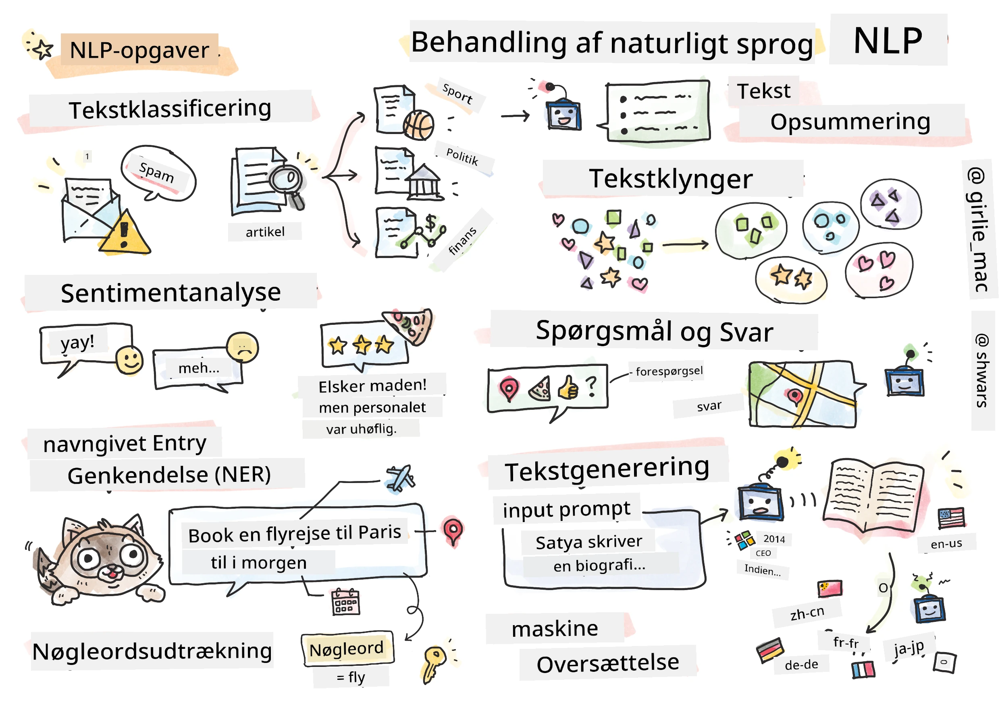

# Naturlig Sprogbehandling



I dette afsnit vil vi fokusere på at bruge neurale netværk til at håndtere opgaver relateret til **natur-sprogsbehandling (NLP)**. Der er mange NLP-problemer, som vi ønsker, at computere skal kunne løse:

* **Tekstklassificering** er et typisk klassifikationsproblem vedrørende tekstsekvenser. Eksempler inkluderer klassificering af e-mails som spam vs. ikke-spam eller kategorisering af artikler som sport, erhverv, politik osv. Også når vi udvikler chatbots, har vi ofte brug for at forstå, hvad en bruger ønskede at sige – i dette tilfælde arbejder vi med **intentionklassificering**. Ofte i intentionklassificering skal vi håndtere mange kategorier.
* **Sentimentanalyse** er et typisk regressionsproblem, hvor vi skal tildele et tal (en stemning), der svarer til, hvor positiv/negativ meningen med en sætning er. En mere avanceret version af sentimentanalyse er **aspektbaseret sentimentanalyse** (ABSA), hvor vi tilskriver sentiment ikke til hele sætningen, men til forskellige dele af den (aspekter), f.eks. *I denne restaurant kunne jeg lide køkkenet, men atmosfæren var forfærdelig*.
* **Named Entity Recognition** (NER) refererer til problemet med at udtrække bestemte enheder fra tekst. For eksempel kan vi have brug for at forstå, at i sætningen *Jeg skal flyve til Paris i morgen* henviser ordet *i morgen* til DATO, og *Paris* er en LOKATION.  
* **Nøgleordsekstraktion** ligner NER, men vi skal automatisk udtrække ord, der er vigtige for sætningens mening uden forudgående træning for specifikke enhedstyper.
* **Tekstklyngedannelse** kan være nyttig, når vi ønsker at gruppere lignende sætninger sammen, f.eks. lignende forespørgsler i teknisk support.
* **Spørgsmålsbesvarelse** refererer til en models evne til at besvare et specifikt spørgsmål. Modellen modtager et tekstafsnit og et spørgsmål som input og skal levere et sted i teksten, hvor svaret på spørgsmålet findes (eller nogle gange generere svaret i tekstform).
* **Tekstgenerering** er en models evne til at generere ny tekst. Det kan betragtes som en klassifikationsopgave, der forudsiger næste bogstav/ord baseret på en *tekstprompt*. Avancerede tekstgenereringsmodeller, som GPT-3, er i stand til at løse andre NLP-opgaver såsom klassifikation ved hjælp af en teknik kaldet [prompt programming](https://towardsdatascience.com/software-3-0-how-prompting-will-change-the-rules-of-the-game-a982fbfe1e0) eller [prompt engineering](https://medium.com/swlh/openai-gpt-3-and-prompt-engineering-dcdc2c5fcd29)
* **Tekstsammenfatning** er en teknik, hvor vi ønsker, at en computer "læser" lang tekst og sammenfatter den i nogle få sætninger.
* **Maskinoversættelse** kan ses som en kombination af tekstforståelse på et sprog og tekstgenerering på et andet.

Oprindeligt blev de fleste NLP-opgaver løst ved hjælp af traditionelle metoder som grammatikker. For eksempel blev der i maskinoversættelse brugt parser til at omdanne en oprindelig sætning til et syntakstræ, derefter blev der udtrukket højere niveau semantiske strukturer for at repræsentere sætningens betydning, og baseret på denne betydning og grammatikken i målsproget blev resultatet genereret. Nu om dage løses mange NLP-opgaver mere effektivt ved hjælp af neurale netværk.

> Mange klassiske NLP-metoder er implementeret i [Natural Language Processing Toolkit (NLTK)](https://www.nltk.org) Python-biblioteket. Der er en fantastisk [NLTK-bog](https://www.nltk.org/book/) tilgængelig online, som dækker, hvordan forskellige NLP-opgaver kan løses ved hjælp af NLTK.

I vores kursus vil vi primært fokusere på at bruge neurale netværk til NLP, og vi vil bruge NLTK, hvor det er nødvendigt.

Vi har allerede lært om brug af neurale netværk til håndtering af tabeldata og billeder. Den største forskel mellem disse datatyper og tekst er, at tekst er en sekvens af variabel længde, mens inputstørrelsen i tilfælde af billeder er kendt på forhånd. Mens konvolutionsnetværk kan udtrække mønstre fra inputdata, er mønstrene i tekst mere komplekse. F.eks. kan negation være adskilt fra subjektet med mange ord imellem (fx. *Jeg kan ikke lide appelsiner* vs. *Jeg kan ikke lide de store farverige lækre appelsiner*), og det skal stadig fortolkes som ét mønster. Derfor skal vi for at håndtere sprog introducere nye typer neurale netværk, såsom *rekurrente netværk* og *transformere*.

## Installer bibliotekker

Hvis du bruger en lokal Python-installation til at køre dette kursus, kan det være nødvendigt at installere alle krævede bibliotekker til NLP med følgende kommandoer:

**For PyTorch**
```bash
pip install -r requirements-pytorch.txt
```
**For TensorFlow**
```bash
pip install -r requirements-tf.txt
```

> Du kan prøve NLP med TensorFlow på [Microsoft Learn](https://docs.microsoft.com/learn/modules/intro-natural-language-processing-tensorflow/?WT.mc_id=academic-77998-cacaste)

## GPU Advarsel

I dette afsnit vil vi i nogle af eksemplerne træne ret store modeller.
* **Brug en GPU-aktiveret computer**: Det anbefales at køre dine notesbøger på en GPU-aktiveret computer for at reducere ventetiden ved arbejde med store modeller.
* **GPU Hukommelsesbegrænsninger**: Kørsel på en GPU kan føre til situationer, hvor du løber tør for GPU-hukommelse, især når du træner store modeller.
* **GPU Hukommelsesforbrug**: Mængden af GPU-hukommelse, der forbruges under træning, afhænger af flere faktorer, herunder minibatch-størrelsen.
* **Minimer minibatch-størrelse**: Hvis du støder på problemer med GPU-hukommelse, kan du overveje at reducere minibatch-størrelsen i din kode som en mulig løsning.
* **TensorFlow GPU Hukommelsesfrigivelse**: Ældre versioner af TensorFlow frigiver muligvis ikke GPU-hukommelse korrekt, når flere modeller trænes inden for én Python-kernel. For effektivt at håndtere GPU-hukommelsesforbruget kan du konfigurere TensorFlow til kun at allokere GPU-hukommelse efter behov.
* **Kodeinklusion**: For at indstille TensorFlow til kun at øge GPU-hukommelsesallokering, når det er nødvendigt, inkludér følgende kode i dine notesbøger:

```python
physical_devices = tf.config.list_physical_devices('GPU') 
if len(physical_devices)>0:
    tf.config.experimental.set_memory_growth(physical_devices[0], True) 
```

Hvis du er interesseret i at lære om NLP fra et klassisk ML-perspektiv, kan du besøge [denne række lektioner](https://github.com/microsoft/ML-For-Beginners/tree/main/6-NLP)

## I dette afsnit
I dette afsnit vil vi lære om:

* [Repræsentation af tekst som tensorer](13-TextRep/README.md)
* [Word Embeddings](14-Embeddings/README.md)
* [Sprogsmodellering](15-LanguageModeling/README.md)
* [Rekurrente neurale netværk](16-RNN/README.md)
* [Generative netværk](17-GenerativeNetworks/README.md)
* [Transformere](18-Transformers/README.md)

---

<!-- CO-OP TRANSLATOR DISCLAIMER START -->
**Ansvarsfraskrivelse**:
Dette dokument er blevet oversat ved hjælp af AI-oversættelsestjenesten [Co-op Translator](https://github.com/Azure/co-op-translator). Selvom vi bestræber os på nøjagtighed, skal du være opmærksom på, at automatiserede oversættelser kan indeholde fejl eller unøjagtigheder. Det originale dokument på dets oprindelige sprog bør betragtes som den autoritative kilde. For kritisk information anbefales professionel menneskelig oversættelse. Vi påtager os intet ansvar for misforståelser eller fejltolkninger, der opstår som følge af brugen af denne oversættelse.
<!-- CO-OP TRANSLATOR DISCLAIMER END -->