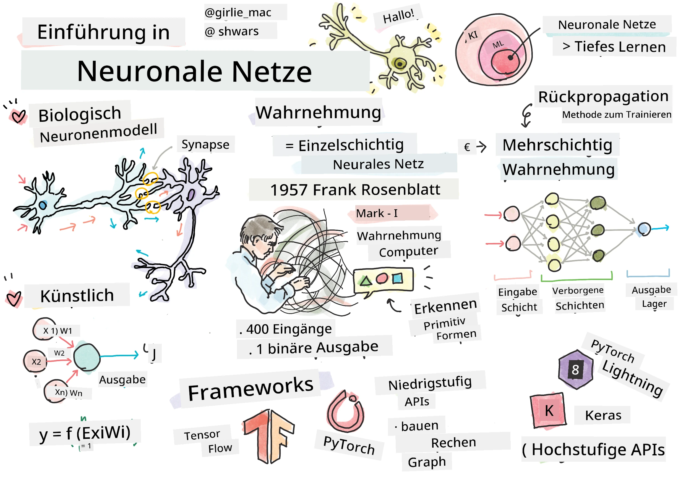
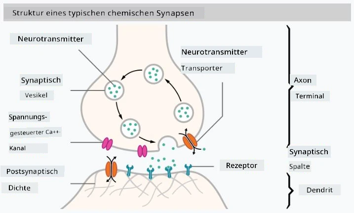

# Einführung in Neuronale Netzwerke

Wie wir in der Einführung besprochen haben, ist eine Möglichkeit, Intelligenz zu erreichen, ein **Computermodell** oder ein **künstliches Gehirn** zu trainieren. Seit Mitte des 20. Jahrhunderts probierten Forscher verschiedene mathematische Modelle aus, bis sich diese Richtung in den letzten Jahren als äußerst erfolgreich erwies. Solche mathematischen Modelle des Gehirns nennt man **neuronale Netzwerke**.

> Manchmal werden neuronale Netzwerke auch *Künstliche Neuronale Netzwerke*, KNN, genannt, um klarzustellen, dass wir von Modellen und nicht von echten Neuronennetzen sprechen.

## Maschinelles Lernen

Neuronale Netzwerke sind Teil einer größeren Disziplin namens **Maschinelles Lernen**, deren Ziel es ist, Computermodelle mithilfe von Daten zu trainieren, die in der Lage sind, Probleme zu lösen. Maschinelles Lernen macht einen großen Teil der Künstlichen Intelligenz aus, jedoch behandeln wir klassisches ML in diesem Curriculum nicht.

> Besuchen Sie unser separates **[Maschinelles Lernen für Anfänger](http://github.com/microsoft/ml-for-beginners)** Curriculum, um mehr über klassisches Maschinelles Lernen zu erfahren.

Im Maschinellen Lernen gehen wir davon aus, dass wir einen Datensatz von Beispielen **X** und die entsprechenden Ausgabewerte **Y** haben. Beispiele sind oft N-dimensionale Vektoren, die aus **Merkmalen** bestehen, und Ausgaben werden **Labels** genannt.

Wir betrachten die zwei häufigsten Probleme im maschinellen Lernen:

* **Klassifikation**, bei der wir ein Eingabeobjekt in zwei oder mehr Klassen einordnen müssen.
* **Regression**, bei der wir für jede Eingabeprobe eine numerische Zahl vorhersagen müssen.

> Wenn Eingaben und Ausgaben als Tensoren dargestellt werden, ist der Eingabedatensatz eine Matrix der Größe M&times;N, wobei M die Anzahl der Proben und N die Anzahl der Merkmale ist. Ausgabelabels Y sind der Vektor der Größe M.

In diesem Curriculum konzentrieren wir uns ausschließlich auf Modelle neuronaler Netzwerke.

## Ein Modell eines Neurons

Aus der Biologie wissen wir, dass unser Gehirn aus Nervenzellen (Neuronen) besteht, von denen jede mehrere „Eingänge“ (Dendriten) und einen einzigen „Ausgang“ (Axon) hat. Sowohl Dendriten als auch Axone können elektrische Signale leiten, und die Verbindungen zwischen ihnen — bekannt als Synapsen — können unterschiedliche Leitfähigkeiten aufweisen, die durch Neurotransmitter gesteuert werden.

 | 
----|----
Echtes Neuron *([Bild](https://en.wikipedia.org/wiki/Synapse#/media/File:SynapseSchematic_lines.svg) von Wikipedia)* | Künstliches Neuron *(Bild vom Autor)*

Somit enthält das einfachste mathematische Modell eines Neurons mehrere Eingänge X1, ..., XN und einen Ausgang Y sowie eine Reihe von Gewichten W1, ..., WN. Der Ausgang wird berechnet als:

wobei f eine nichtlineare **Aktivierungsfunktion** ist.

> Frühe Modelle von Neuronen wurden in dem klassischen Papier [A logical calculus of the ideas immanent in nervous activity](https://www.cs.cmu.edu/~./epxing/Class/10715/reading/McCulloch.and.Pitts.pdf) von Warren McCullock und Walter Pitts im Jahr 1943 beschrieben. Donald Hebb schlug in seinem Buch "[The Organization of Behavior: A Neuropsychological Theory](https://books.google.com/books?id=VNetYrB8EBoC)" eine Möglichkeit vor, wie diese Netzwerke trainiert werden können.

## In diesem Abschnitt

In diesem Abschnitt lernen wir:
* [Perzeptron](03-Perceptron/README.md), eines der frühesten neuronalen Netzwerkmodelle für die Zweiklassenklassifikation
* [Mehrschichtige Netzwerke](04-OwnFramework/README.md) mit einem begleitenden Notebook [wie man unser eigenes Framework baut](04-OwnFramework/OwnFramework.ipynb)
* [Neuronale Netzwerk-Frameworks](05-Frameworks/README.md), mit diesen Notebooks: [PyTorch](05-Frameworks/IntroPyTorch.ipynb) und [Keras/Tensorflow](05-Frameworks/IntroKerasTF.ipynb)
* [Überanpassung](../../../../lessons/3-NeuralNetworks/05-Frameworks#overfitting)

---

<!-- CO-OP TRANSLATOR DISCLAIMER START -->
**Haftungsausschluss**:
Dieses Dokument wurde mit dem KI-Übersetzungsdienst [Co-op Translator](https://github.com/Azure/co-op-translator) übersetzt. Obwohl wir uns um Genauigkeit bemühen, beachten Sie bitte, dass automatisierte Übersetzungen Fehler oder Ungenauigkeiten enthalten können. Das Originaldokument in seiner Ursprungssprache gilt als maßgebliche Quelle. Bei kritischen Informationen wird eine professionelle menschliche Übersetzung empfohlen. Wir übernehmen keine Haftung für Missverständnisse oder Fehlinterpretationen, die aus der Verwendung dieser Übersetzung entstehen.
<!-- CO-OP TRANSLATOR DISCLAIMER END -->