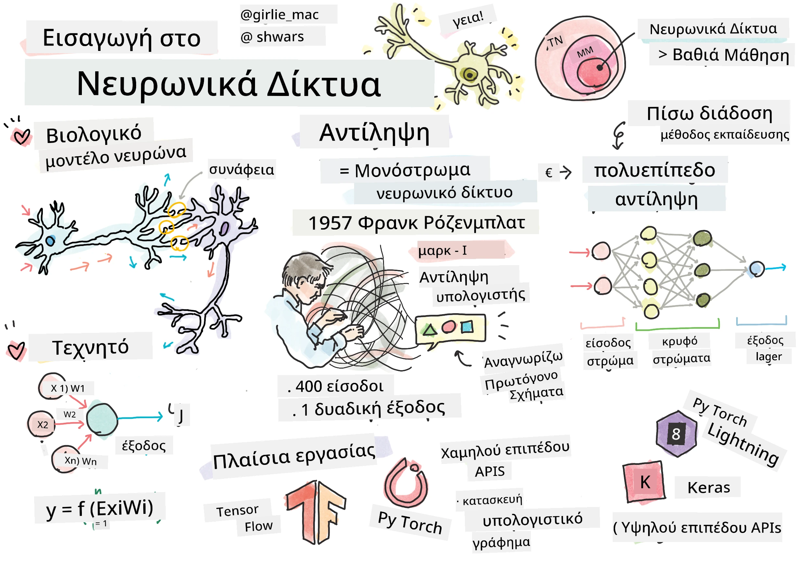
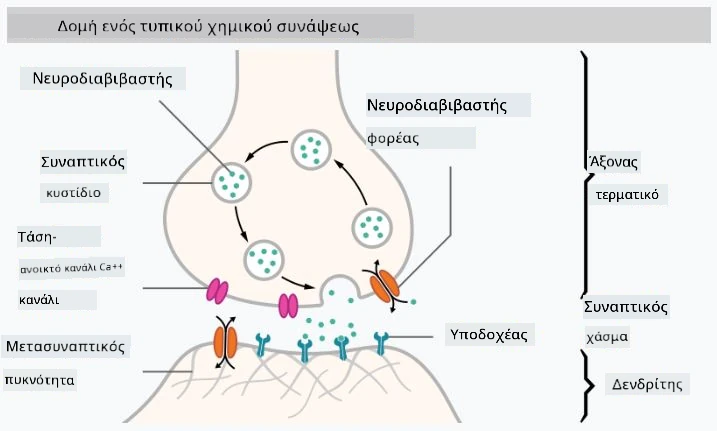

# Εισαγωγή στα Νευρωνικά Δίκτυα

Όπως συζητήσαμε στην εισαγωγή, ένας από τους τρόπους για να επιτευχθεί νοημοσύνη είναι να εκπαιδεύσουμε ένα **μοντέλο υπολογιστή** ή έναν **τεχνητό εγκέφαλο**. Από τα μέσα του 20ού αιώνα, οι ερευνητές δοκίμασαν διάφορα μαθηματικά μοντέλα, μέχρι τα τελευταία χρόνια αυτή η κατεύθυνση να αποδειχθεί εξαιρετικά επιτυχημένη. Τέτοια μαθηματικά μοντέλα του εγκεφάλου ονομάζονται **νευρωνικά δίκτυα**.

> Μερικές φορές τα νευρωνικά δίκτυα ονομάζονται *Τεχνητά Νευρωνικά Δίκτυα*, ANNs, για να δηλωθεί ότι αναφερόμαστε σε μοντέλα, όχι σε πραγματικά δίκτυα νευρώνων.

## Μηχανική Μάθηση

Τα Νευρωνικά Δίκτυα αποτελούν μέρος μιας ευρύτερης επιστήμης που ονομάζεται **Μηχανική Μάθηση**, της οποίας ο στόχος είναι η χρήση δεδομένων για την εκπαίδευση υπολογιστικών μοντέλων που είναι ικανά να λύσουν προβλήματα. Η Μηχανική Μάθηση αποτελεί μεγάλο μέρος της Τεχνητής Νοημοσύνης, ωστόσο, δεν καλύπτουμε την κλασική ΜΜ σε αυτή τη διδακτική ενότητα.

> Επισκεφθείτε το ξεχωριστό μας **[Machine Learning for Beginners](http://github.com/microsoft/ml-for-beginners)** εκπαιδευτικό πρόγραμμα για να μάθετε περισσότερα για την κλασική Μηχανική Μάθηση.

Στη Μηχανική Μάθηση, υποθέτουμε ότι έχουμε ένα σύνολο δεδομένων παραδειγμάτων **X**, και αντίστοιχες τιμές εξόδου **Y**. Τα παραδείγματα είναι συχνά N-διανύσματα που αποτελούνται από **χαρακτηριστικά**, και οι έξοδοι ονομάζονται **ετικέτες**.

Θα εξετάσουμε τα δύο πιο κοινά προβλήματα μηχανικής μάθησης:

* **Κατηγοριοποίηση**, όπου πρέπει να ταξινομήσουμε ένα είσοδο αντικείμενο σε δύο ή περισσότερες κατηγορίες.
* **Παλινδρόμηση**, όπου πρέπει να προβλέψουμε έναν αριθμητικό αριθμό για κάθε δείγμα εισόδου.

> Όταν αναπαριστούμε εισόδους και εξόδους ως τανύστεις, το σύνολο δεδομένων εισόδου είναι ένας πίνακας διαστάσεων M×N, όπου M είναι ο αριθμός των δειγμάτων και N ο αριθμός των χαρακτηριστικών. Οι ετικέτες εξόδου Y είναι το διάνυσμα μεγέθους M.

Σε αυτή τη διδακτική ενότητα θα εστιάσουμε μόνο σε μοντέλα νευρωνικών δικτύων.

## Ένα Μοντέλο Νευρώνα

Από τη βιολογία, γνωρίζουμε ότι ο εγκέφαλός μας αποτελείται από νευρικά κύτταρα (νευρώνες), το καθένα με πολλαπλές "εισόδους" (δενδρίτες) και μία μόνο "έξοδο" (άξονα). Τόσο οι δενδρίτες όσο και οι άξονες μπορούν να μεταφέρουν ηλεκτρικά σήματα, και οι συνδέσεις μεταξύ τους — γνωστές ως συνάψεις — μπορούν να παρουσιάζουν διάφορους βαθμούς αγωγιμότητας, οι οποίοι ρυθμίζονται από νευροδιαβιβαστές.

 | 
----|----
Πραγματικός Νευρώνας *([Εικόνα](https://en.wikipedia.org/wiki/Synapse#/media/File:SynapseSchematic_lines.svg) από τη Wikipedia)* | Τεχνητός Νευρώνας *(Εικόνα από τον Συγγραφέα)*

Έτσι, το απλούστερο μαθηματικό μοντέλο ενός νευρώνα περιέχει πολλαπλές εισόδους X1, ..., XN και μια έξοδο Y, καθώς και μια σειρά από βάρη W1, ..., WN. Η έξοδος υπολογίζεται ως:

όπου f είναι κάποια μη γραμμική **συνάρτηση ενεργοποίησης**.

> Τα πρώιμα μοντέλα νευρώνα περιγράφτηκαν στο κλασικό άρθρο [A logical calculus of the ideas immanent in nervous activity](https://www.cs.cmu.edu/~./epxing/Class/10715/reading/McCulloch.and.Pitts.pdf) από τους Warren McCullock και Walter Pitts το 1943. Ο Donald Hebb στο βιβλίο του "[The Organization of Behavior: A Neuropsychological Theory](https://books.google.com/books?id=VNetYrB8EBoC)" πρότεινε τον τρόπο με τον οποίο μπορούν να εκπαιδευτούν αυτά τα δίκτυα.

## Σε αυτή την Ενότητα

Σε αυτή την ενότητα θα μάθουμε για:
* [Perceptron](03-Perceptron/README.md), ένα από τα πρώτα μοντέλα νευρωνικών δικτύων για ταξινόμηση δύο κλάσεων
* [Πολυεπίπεδα δίκτυα](04-OwnFramework/README.md) με συνοδευτικό σημειωματάριο [πώς να φτιάξουμε το δικό μας πλαίσιο εργασίας](04-OwnFramework/OwnFramework.ipynb)
* [Πλαίσια Νευρωνικών Δικτύων](05-Frameworks/README.md), με αυτά τα σημειωματάρια: [PyTorch](05-Frameworks/IntroPyTorch.ipynb) και [Keras/Tensorflow](05-Frameworks/IntroKerasTF.ipynb)
* [Υπερεκπαίδευση](../../../../lessons/3-NeuralNetworks/05-Frameworks#overfitting)

---

<!-- CO-OP TRANSLATOR DISCLAIMER START -->
**Αποποίηση ευθυνών**:
Αυτό το έγγραφο έχει μεταφραστεί χρησιμοποιώντας την υπηρεσία μετάφρασης με τεχνητή νοημοσύνη [Co-op Translator](https://github.com/Azure/co-op-translator). Ενώ επιδιώκουμε την ακρίβεια, παρακαλούμε να έχετε υπόψη ότι οι αυτοματοποιημένες μεταφράσεις ενδέχεται να περιέχουν λάθη ή ανακρίβειες. Το πρωτότυπο έγγραφο στη μητρική του γλώσσα πρέπει να θεωρείται η αυθεντική πηγή. Για κρίσιμες πληροφορίες, συνιστάται επαγγελματική ανθρώπινη μετάφραση. Δεν φέρουμε ευθύνη για τυχόν παρεξηγήσεις ή λανθασμένες ερμηνείες που προκύπτουν από τη χρήση αυτής της μετάφρασης.
<!-- CO-OP TRANSLATOR DISCLAIMER END -->