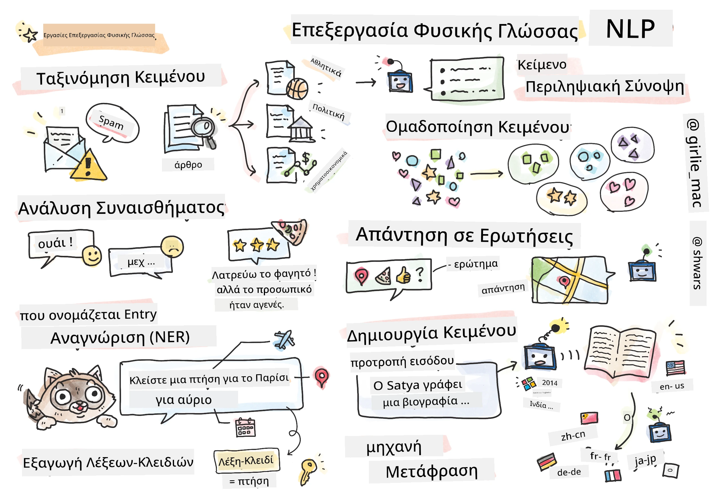

# Επεξεργασία Φυσικής Γλώσσας



Σε αυτή την ενότητα, θα επικεντρωθούμε στη χρήση Νευρωνικών Δικτύων για την αντιμετώπιση εργασιών σχετικών με την **Επεξεργασία Φυσικής Γλώσσας (NLP)**. Υπάρχουν πολλά προβλήματα NLP που θέλουμε οι υπολογιστές να μπορούν να λύσουν:

* **Ταξινόμηση κειμένου** είναι ένα τυπικό πρόβλημα ταξινόμησης που αφορά ακολουθίες κειμένου. Παραδείγματα περιλαμβάνουν την ταξινόμηση μηνυμάτων ηλεκτρονικού ταχυδρομείου ως ανεπιθύμητα (spam) ή μη, ή την κατηγοριοποίηση άρθρων ως αθλητικά, επιχειρηματικά, πολιτικά κ.ά. Επίσης, κατά την ανάπτυξη chat bots, συχνά χρειαζόμαστε να καταλάβουμε τι ήθελε να πει ο χρήστης - σε αυτή την περίπτωση έχουμε να κάνουμε με **ταξινόμηση προθέσεων** (intent classification). Συχνά, στην ταξινόμηση προθέσεων χρειάζεται να διαχειριστούμε πολλές κατηγορίες.
* **Ανάλυση συναισθήματος** είναι ένα τυπικό πρόβλημα παλινδρόμησης, όπου πρέπει να αποδώσουμε έναν αριθμό (ένα συναίσθημα) που αντιστοιχεί στο πόσο θετικό/αρνητικό είναι το νόημα μιας πρότασης. Μια πιο εξελιγμένη μορφή ανάλυσης συναισθήματος είναι η **ανάλυση συναισθήματος βάσει πτυχών** (ABSA), όπου αποδίδουμε συναίσθημα όχι σε ολόκληρη την πρόταση, αλλά σε διαφορετικά μέρη αυτής (πτυχές), π.χ. *Σε αυτό το εστιατόριο, μου άρεσε η κουζίνα, αλλά η ατμόσφαιρα ήταν απαίσια*.
* **Αναγνώριση Ονομαστικών Οντοτήτων** (NER) αναφέρεται στο πρόβλημα εξαγωγής ορισμένων οντοτήτων από το κείμενο. Για παράδειγμα, μπορεί να χρειαστεί να καταλάβουμε ότι στη φράση *Πρέπει να πετάξω στο Παρίσι αύριο* η λέξη *αύριο* αναφέρεται σε ΗΜΕΡΟΜΗΝΙΑ, και το *Παρίσι* είναι ΤΟΠΟΘΕΣΙΑ.  
* **Εξαγωγή λέξεων-κλειδιών** είναι παρόμοια με την NER, αλλά πρέπει να εξάγουμε αυτόματα λέξεις σημαντικές για το νόημα της πρότασης, χωρίς προεκπαίδευση για συγκεκριμένους τύπους οντοτήτων.
* **Ομαδοποίηση κειμένου (clustering)** μπορεί να είναι χρήσιμη όταν θέλουμε να ομαδοποιήσουμε παρόμοιες προτάσεις, για παράδειγμα, παρόμοια αιτήματα σε συζητήσεις τεχνικής υποστήριξης.
* **Απάντηση σε ερωτήσεις** αναφέρεται στην ικανότητα ενός μοντέλου να απαντάει σε μια συγκεκριμένη ερώτηση. Το μοντέλο λαμβάνει ως είσοδο μια αποσπασματική κείμενο και μια ερώτηση, και πρέπει να παρέχει μια θέση στο κείμενο όπου περιέχεται η απάντηση στην ερώτηση (ή, μερικές φορές, να παράγει το κείμενο της απάντησης).
* **Γεννήτρια κειμένου** είναι η ικανότητα ενός μοντέλου να παράγει νέο κείμενο. Μπορεί να θεωρηθεί ως πρόβλημα ταξινόμησης που προβλέπει το επόμενο γράμμα/λέξη βασισμένο σε κάποιο *κείμενο-προτροπή*. Προχωρημένα μοντέλα γεννήτριας κειμένου, όπως το GPT-3, είναι ικανά να λύσουν και άλλες εργασίες NLP όπως ταξινόμηση χρησιμοποιώντας μια τεχνική που ονομάζεται [programming prompt](https://towardsdatascience.com/software-3-0-how-prompting-will-change-the-rules-of-the-game-a982fbfe1e0) ή [engineering prompt](https://medium.com/swlh/openai-gpt-3-and-prompt-engineering-dcdc2c5fcd29)
* **Περίληψη κειμένου** είναι μια τεχνική όπου θέλουμε ένας υπολογιστής να "διαβάσει" ένα μακρύ κείμενο και να το συνοψίσει σε λίγες προτάσεις.
* **Μηχανική μετάφραση** μπορεί να θεωρηθεί ως συνδυασμός κατανόησης κειμένου σε μια γλώσσα και παραγωγής κειμένου σε άλλη.

Αρχικά, οι περισσότερες εργασίες NLP λύνονταν με παραδοσιακές μεθόδους όπως γραμματικές. Για παράδειγμα, στη μηχανική μετάφραση χρησιμοποιούνταν αναλυτές (parsers) για να μετατρέψουν την αρχική πρόταση σε συντακτικό δέντρο, στη συνέχεια εξάγονταν ανώτερα σημασιολογικά δομές για να αναπαραστήσουν το νόημα της πρότασης, και βάσει αυτού του νοήματος και της γραμματικής της γλώσσας στόχου δημιουργούνταν το αποτέλεσμα. Σήμερα, πολλές εργασίες NLP λύνονται πιο αποτελεσματικά χρησιμοποιώντας νευρωνικά δίκτυα.

> Πολλές κλασικές μέθοδοι NLP είναι υλοποιημένες στη βιβλιοθήκη Python [Natural Language Processing Toolkit (NLTK)](https://www.nltk.org). Υπάρχει ένα εξαιρετικό [Βιβλίο NLTK](https://www.nltk.org/book/) διαθέσιμο online που καλύπτει πώς διαφορετικές εργασίες NLP μπορούν να λυθούν χρησιμοποιώντας το NLTK.

Στο μάθημά μας, θα εστιάσουμε κυρίως στη χρήση Νευρωνικών Δικτύων για NLP και θα χρησιμοποιούμε το NLTK όπου χρειάζεται.

Έχουμε ήδη μάθει για τη χρήση νευρωνικών δικτύων για την επεξεργασία πίνακα δεδομένων και εικόνων. Η κύρια διαφορά μεταξύ αυτών των τύπων δεδομένων και του κειμένου είναι ότι το κείμενο είναι μια ακολουθία μεταβλητού μήκους, ενώ το μέγεθος εισόδου στην περίπτωση των εικόνων είναι γνωστό εκ των προτέρων. Ενώ τα συνελικτικά δίκτυα μπορούν να εξάγουν μοτίβα από δεδομένα εισόδου, τα μοτίβα στο κείμενο είναι πιο σύνθετα. Π.χ., μπορούμε να έχουμε άρνηση που διαχωρίζεται από το υποκείμενο τυχαία σε πολλές λέξεις (π.χ. *Δεν μου αρέσουν τα πορτοκάλια*, vs. *Δεν μου αρέσουν αυτά τα μεγάλα πολύχρωμα νόστιμα πορτοκάλια*), και αυτό πρέπει να ερμηνευτεί ως ένα μοτίβο. Επομένως, για να αντιμετωπίσουμε τη γλώσσα χρειάζεται να εισάγουμε νέους τύπους νευρωνικών δικτύων, όπως *επαναλαμβανόμενα δίκτυα* και *transformers*.

## Εγκατάσταση βιβλιοθηκών

Αν χρησιμοποιείτε τοπική εγκατάσταση Python για να τρέξετε αυτό το μάθημα, μπορεί να χρειαστεί να εγκαταστήσετε όλες τις απαιτούμενες βιβλιοθήκες για NLP χρησιμοποιώντας τις παρακάτω εντολές:

**Για PyTorch**
```bash
pip install -r requirements-pytorch.txt
```
**Για TensorFlow**
```bash
pip install -r requirements-tf.txt
```

> Μπορείτε να δοκιμάσετε το NLP με TensorFlow στο [Microsoft Learn](https://docs.microsoft.com/learn/modules/intro-natural-language-processing-tensorflow/?WT.mc_id=academic-77998-cacaste)

## Προειδοποίηση για GPU

Σε αυτή την ενότητα, σε μερικά από τα παραδείγματα θα εκπαιδεύσουμε αρκετά μεγάλα μοντέλα.
* **Χρήση υπολογιστή με GPU**: Συνιστάται να τρέχετε τα notebooks σας σε υπολογιστή που διαθέτει GPU για να μειώσετε τους χρόνους αναμονής όταν δουλεύετε με μεγάλα μοντέλα.
* **Περιορισμοί μνήμης GPU**: Η εκτέλεση σε GPU μπορεί να οδηγήσει σε περιπτώσεις όπου εξαντλείται η μνήμη GPU, ειδικά κατά την εκπαίδευση μεγάλων μοντέλων.
* **Κατανάλωση μνήμης GPU**: Η ποσότητα της μνήμης GPU που καταναλώνεται κατά την εκπαίδευση εξαρτάται από διάφορους παράγοντες, συμπεριλαμβανομένου του μεγέθους του minibatch.
* **Ελαχιστοποίηση μεγέθους minibatch**: Αν αντιμετωπίσετε προβλήματα με τη μνήμη GPU, σκεφτείτε να μειώσετε το μέγεθος του minibatch στον κώδικά σας ως πιθανή λύση.
* **Αποδέσμευση μνήμης GPU στο TensorFlow**: Παλιότερες εκδόσεις του TensorFlow ενδέχεται να μην αποδεσμεύουν σωστά τη μνήμη GPU όταν εκπαιδεύονται πολλαπλά μοντέλα στον ίδιο Python kernel. Για να διαχειριστείτε αποτελεσματικά τη χρήση της μνήμης GPU, μπορείτε να ρυθμίσετε το TensorFlow ώστε να δεσμεύει μνήμη GPU μόνο όταν χρειάζεται.
* **Ενσωμάτωση κώδικα**: Για να ρυθμίσετε το TensorFlow να αυξάνει τη δέσμευση μνήμης GPU μόνο όταν απαιτείται, συμπεριλάβετε τον ακόλουθο κώδικα στα notebooks σας:

```python
physical_devices = tf.config.list_physical_devices('GPU') 
if len(physical_devices)>0:
    tf.config.experimental.set_memory_growth(physical_devices[0], True) 
```

Αν σας ενδιαφέρει να μάθετε για το NLP από κλασική οπτική μάθησης μηχανής, επισκεφθείτε [αυτό το σύνολο μαθημάτων](https://github.com/microsoft/ML-For-Beginners/tree/main/6-NLP)

## Σε αυτή την ενότητα
Σε αυτή την ενότητα θα μάθουμε για:

* [Αναπαράσταση κειμένου ως τανυστών](13-TextRep/README.md)
* [Ενσωματώσεις λέξεων](14-Embeddings/README.md)
* [Γλωσσικά μοντέλα](15-LanguageModeling/README.md)
* [Επαναλαμβανόμενα νευρωνικά δίκτυα](16-RNN/README.md)
* [Γεννητικά δίκτυα](17-GenerativeNetworks/README.md)
* [Transformers](18-Transformers/README.md)

---

<!-- CO-OP TRANSLATOR DISCLAIMER START -->
**Αποποίηση ευθυνών**:
Αυτό το έγγραφο έχει μεταφραστεί χρησιμοποιώντας την υπηρεσία μετάφρασης με τεχνητή νοημοσύνη [Co-op Translator](https://github.com/Azure/co-op-translator). Ενώ επιδιώκουμε την ακρίβεια, παρακαλούμε να έχετε υπόψη ότι οι αυτοματοποιημένες μεταφράσεις ενδέχεται να περιέχουν λάθη ή ανακρίβειες. Το πρωτότυπο έγγραφο στη μητρική του γλώσσα πρέπει να θεωρείται η αυθεντική πηγή. Για κρίσιμες πληροφορίες, συνιστάται επαγγελματική ανθρώπινη μετάφραση. Δεν φέρουμε ευθύνη για τυχόν παρεξηγήσεις ή λανθασμένες ερμηνείες που προκύπτουν από τη χρήση αυτής της μετάφρασης.
<!-- CO-OP TRANSLATOR DISCLAIMER END -->