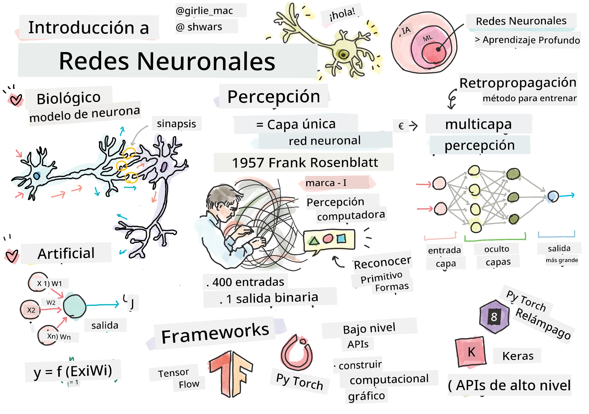
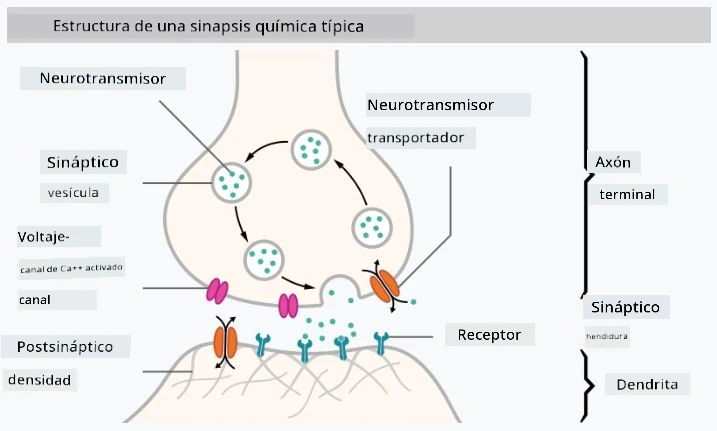
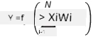

# Introducción a las Redes Neuronales

Como discutimos en la introducción, una de las formas de lograr inteligencia es entrenar un **modelo informático** o un **cerebro artificial**. Desde mediados del siglo XX, los investigadores probaron diferentes modelos matemáticos, hasta que en años recientes esta dirección resultó ser enormemente exitosa. Tales modelos matemáticos del cerebro se llaman **redes neuronales**.

> A veces a las redes neuronales se las llama *Redes Neuronales Artificiales*, RNA, para indicar que estamos hablando de modelos, no de redes reales de neuronas.

## Aprendizaje Automático

Las Redes Neuronales son una parte de una disciplina más amplia llamada **Aprendizaje Automático**, cuyo objetivo es usar datos para entrenar modelos informáticos capaces de resolver problemas. El Aprendizaje Automático constituye una gran parte de la Inteligencia Artificial, sin embargo, no cubrimos el aprendizaje automático clásico en este plan de estudios.

> Visita nuestro aparte currículum **[Aprendizaje Automático para Principiantes](http://github.com/microsoft/ml-for-beginners)** para aprender más sobre el Aprendizaje Automático clásico.

En Aprendizaje Automático, asumimos que tenemos algún conjunto de datos de ejemplos **X**, y valores de salida correspondientes **Y**. Los ejemplos son a menudo vectores N-dimensionales que consisten en **características**, y las salidas se llaman **etiquetas**.

Consideraremos los dos problemas más comunes del aprendizaje automático:

* **Clasificación**, donde necesitamos clasificar un objeto de entrada en dos o más clases.
* **Regresión**, donde necesitamos predecir un número numérico para cada muestra de entrada.

> Cuando representamos entradas y salidas como tensores, el conjunto de datos de entrada es una matriz de tamaño M&times;N, donde M es el número de muestras y N es el número de características. Las etiquetas de salida Y son un vector de tamaño M.

En este plan de estudios, solo nos enfocaremos en modelos de redes neuronales.

## Un Modelo de una Neurona

De la biología sabemos que nuestro cerebro consiste en células neuronales (neuronas), cada una de ellas con múltiples "entradas" (dendritas) y una sola "salida" (axón). Tanto las dendritas como los axones pueden conducir señales eléctricas, y las conexiones entre ellos — conocidas como sinapsis — pueden exhibir diferentes grados de conductividad, que son regulados por neurotransmisores.

 | 
----|----
Neurona Real *([Imagen](https://en.wikipedia.org/wiki/Synapse#/media/File:SynapseSchematic_lines.svg) de Wikipedia)* | Neurona Artificial *(Imagen por el Autor)*

Así, el modelo matemático más simple de una neurona contiene varias entradas X1, ..., XN y una salida Y, y una serie de pesos W1, ..., WN. Una salida se calcula como:

donde f es alguna **función de activación** no lineal.

> Los primeros modelos de neurona fueron descritos en el artículo clásico [A logical calculus of the ideas immanent in nervous activity](https://www.cs.cmu.edu/~./epxing/Class/10715/reading/McCulloch.and.Pitts.pdf) por Warren McCullock y Walter Pitts en 1943. Donald Hebb en su libro "[The Organization of Behavior: A Neuropsychological Theory](https://books.google.com/books?id=VNetYrB8EBoC)" propuso la forma en que esas redes pueden ser entrenadas.

## En esta Sección

En esta sección aprenderemos acerca de:
* [Perceptrón](03-Perceptron/README.md), uno de los primeros modelos de redes neuronales para clasificación de dos clases
* [Redes multicapa](04-OwnFramework/README.md) con un cuaderno emparejado [cómo construir nuestro propio framework](04-OwnFramework/OwnFramework.ipynb)
* [Frameworks de Redes Neuronales](05-Frameworks/README.md), con estos cuadernos: [PyTorch](05-Frameworks/IntroPyTorch.ipynb) y [Keras/Tensorflow](05-Frameworks/IntroKerasTF.ipynb)
* [Sobreajuste](../../../../lessons/3-NeuralNetworks/05-Frameworks#overfitting)

---

<!-- CO-OP TRANSLATOR DISCLAIMER START -->
**Descargo de responsabilidad**:
Este documento ha sido traducido utilizando el servicio de traducción automática [Co-op Translator](https://github.com/Azure/co-op-translator). Aunque nos esforzamos por la precisión, tenga en cuenta que las traducciones automatizadas pueden contener errores o inexactitudes. El documento original en su idioma nativo debe considerarse la fuente autorizada. Para información crítica, se recomienda una traducción profesional humana. No somos responsables de cualquier malentendido o interpretación errónea que surja del uso de esta traducción.
<!-- CO-OP TRANSLATOR DISCLAIMER END -->