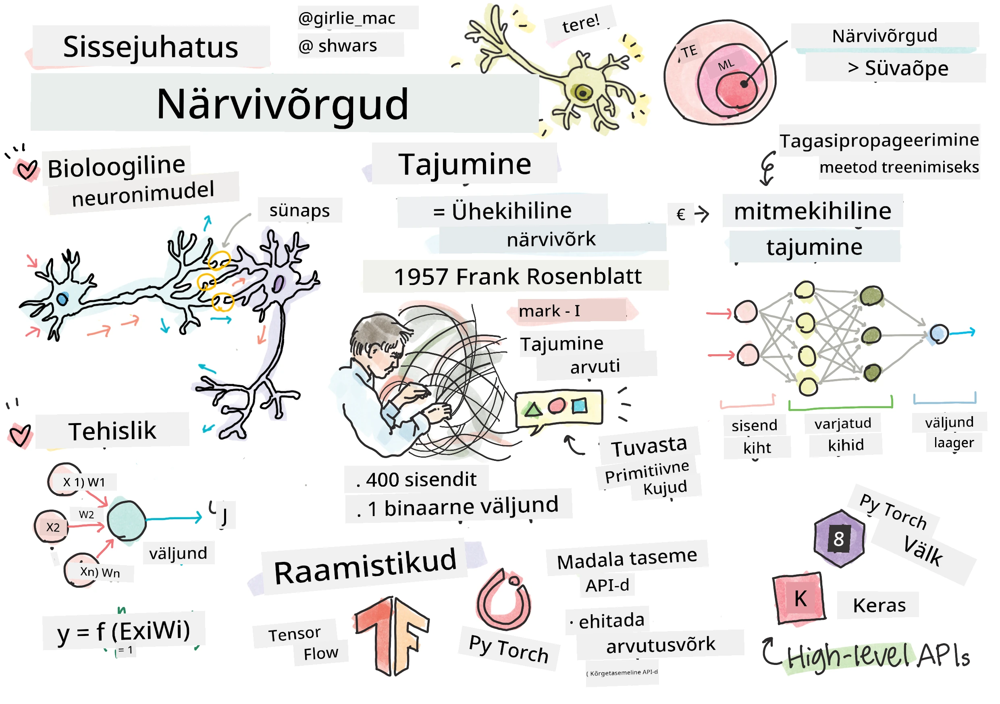
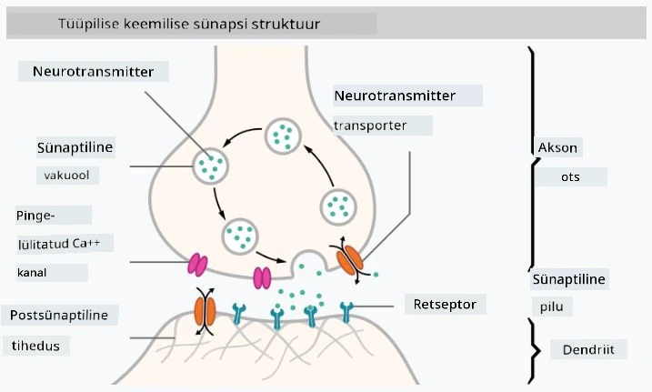

# Sissejuhatus närvivõrkudesse

Nagu me tutvustuses arutasime, on üks viis intelligentsuse saavutamiseks arvutimudeli või kunstliku aju treenimine. Alates 20. sajandi keskpaigast on uurijad proovinud erinevaid matemaatilisi mudeleid, kuni viimastel aastatel on see suund osutunud väga edukaks. Selliseid aju matemaatilisi mudeleid nimetatakse **närvivõrkudeks**.

> Mõnikord nimetatakse närvivõrke *kunstlikeks närvivõrkudeks* (ANN-deks), et rõhutada, et räägime mudelitest, mitte päris neuronite võrkudest.

## Masinõpe

Närvivõrgud kuuluvad suuremasse valdkonda, mida nimetatakse **masinõppeks**, mille eesmärk on kasutada andmeid arvutimudelite treenimiseks, mis suudavad lahendada erinevaid probleeme. Masinõpe moodustab suure osa tehisintellektist, kuid selles õppekavas ei käsitle me klassikalist masinõpet.

> Tutvu meie eraldi **[Masinõpe alustajatele](http://github.com/microsoft/ml-for-beginners)** õppekavaga, et õppida rohkem klassikalisest masinõppest.

Masinõppes eeldame, et meil on mingi näidete andmestik **X** ja vastavad väljundväärtused **Y**. Näited on tihti N-dimensionaalsed vektorid, mis koosnevad **omadustest**, ja väljundid on nimetatud **siltideks**.

Vaatame kahte kõige levinumat masinõppe probleemi:

* **Klassifitseerimine**, kus tuleb sisendobjekt liigitada kahe või enama klassi hulka.
* **Regressioon**, kus tuleb iga sisendi näidise jaoks ennustada arvuline väärtus.

> Kui sisendeid ja väljundeid esitada tensoritena, on sisendi andmestik M×N suurusega maatriks, kus M on näidiste arv ja N omaduste arv. Väljundi sildid Y on M-suurune vektor.

Selles õppekavas keskendume ainult närvivõrgu mudelitele.

## Neuroni mudel

Bioloogiast teame, et meie aju koosneb närvirakkudest (neuronitest), millest igaühel on mitu "sisendit" (dendriiti) ja üks "väljund" (akson). Nii dendriidid kui ka aksonid võivad juhtida elektrilisi signaale ning nende vahelised ühendused — mida nimetatakse sünapsideks — võivad avaldada erinevas ulatuses juhtivust, mida reguleerivad neurotransmitterid.

 | 
----|----
Tõeline neuron *([Pilt](https://en.wikipedia.org/wiki/Synapse#/media/File:SynapseSchematic_lines.svg) Vikipeediast)* | Kunstlik neuron *(pilt autorilt)*

Seega sisaldab lihtsaim neuroni matemaatiline mudel mitut sisendit X1, ..., XN ja väljundit Y ning seeriat kaalusid W1, ..., WN. Väljund arvutatakse järgmiselt:

kus f on mingi mitte-lineaarne **aktivatsioonifunktsioon**.

> Esimesed neuroni mudelid kirjeldati klassikalises artiklis [A logical calculus of the ideas immanent in nervous activity](https://www.cs.cmu.edu/~./epxing/Class/10715/reading/McCulloch.and.Pitts.pdf), mille tööd kirjutasid Warren McCullock ja Walter Pitts 1943. aastal. Donald Hebb pakkus oma raamatus "[The Organization of Behavior: A Neuropsychological Theory](https://books.google.com/books?id=VNetYrB8EBoC)" välja need võrgud treenimise meetodi.

## Selles jaotises

Selles jaotises õpime:
* [Perceptroni](03-Perceptron/README.md), ühte esimestest kaheklassi klassifikatsiooni närvivõrgu mudelitest
* [Mitmekihilisi võrke](04-OwnFramework/README.md) koos kaasaskäivaga sülearvutiga [kuidas ehitada oma raamistikku](04-OwnFramework/OwnFramework.ipynb)
* [Närvivõrgu raamistikke](05-Frameworks/README.md), nende sülearvutitega: [PyTorch](05-Frameworks/IntroPyTorch.ipynb) ja [Keras/Tensorflow](05-Frameworks/IntroKerasTF.ipynb)
* [Üleõppimist](../../../../lessons/3-NeuralNetworks/05-Frameworks#overfitting)

---

<!-- CO-OP TRANSLATOR DISCLAIMER START -->
**Lahtiütlus**:
See dokument on tõlgitud kasutades AI tõlketeenust [Co-op Translator](https://github.com/Azure/co-op-translator). Kuigi me püüdleme täpsuse poole, palun pange tähele, et automatiseeritud tõlgetes võib esineda vigu või ebatäpsusi. Originaaldokument selle emakeeles tuleks pidada autoriteetseks allikaks. Olulise teabe puhul soovitatakse kasutada professionaalset inimtõlget. Me ei vastuta selle tõlkega seotud eksimustest või valesti mõistmistest.
<!-- CO-OP TRANSLATOR DISCLAIMER END -->