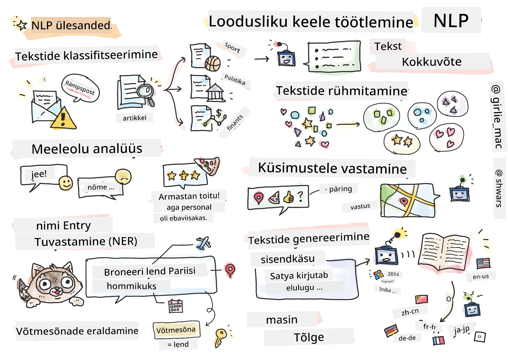

# Loomuliku Keele Töötlemine



Selles jaotises keskendume närvivõrkude kasutamisele ülesannete lahendamisel, mis on seotud **loomuliku keele töötlemisega (NLP)**. On palju NLP probleeme, mida soovime, et arvutid suudaksid lahendada:

* **Teksti klassifitseerimine** on tüüpiline klassifikatsiooniprobleem, mis käsitleb tekstijadasid. Näideteks on e-kirjade klassifitseerimine rämpspostiks või mitte-rämpspostiks, või artiklite kategoriseerimine sporti, äri, poliitika jms alla. Samuti, vestlusrobotite arendamisel on meil tihti vaja mõista, mida kasutaja tahtis öelda – sel juhul tegeleme **eesmärgi klassifitseerimisega**. Sageli tuleb eesmärkide klassifitseerimisel toime tulla paljude kategooriatega.
* **Sentimendi analüüs** on tüüpiline regressiooniprobleem, kus peame omistama lausetele numbri (sentimendi), mis kajastab lause tähenduse positiivsust või negatiivsust. Sentimendi analüüsi keerulisem versioon on **aspektipõhine sentimendi analüüs** (ABSA), kus me omistame sentimendi mitte kogu lausetele, vaid erinevatele selle osadele (aspektidele), nt *Selles restoranis meeldis mulle köök, kuid õhkkond oli kohutav*.
* **Nimede tuvastamine** (NER) viitab probleemile, kus tekstist tuleb välja võtta teatud üksused. Näiteks peame mõistma, et fraasis *Ma pean homme Pariisi lendama* tähendab sõna *homme* KUUPÄEVA ja *Pariis* on ASUKOHT.  
* **Märksõnade väljavõtmine** on sarnane NER-ile, kuid peame automaatselt välja võtma lause tähenduse seisukohalt olulised sõnad ilma konkreetsete üksuse tüüpide etteõppeta.
* **Teksti klasterdamine** võib olla kasulik, kui soovime grupeerida sarnaseid lauseid, näiteks sarnaseid päringuid tehnilise toe vestlustes.
* **Küsimustele vastamine** tähendab mudeli võimet vastata konkreetsele küsimusele. Mudel saab sisendiks tekstilõigu ja küsimuse, ning peab näitama kohta tekstis, kus küsimuse vastus sisaldub (või mõnikord genereerima vastava tekstivastuse).
* **Teksti genereerimine** on mudeli võime genereerida uut teksti. Seda võib vaadelda klassifikatsiooniülesandena, mis ennustab järgmise tähe/sõna mõne *teksti lähtepunkti* põhjal. Täiustatud tekstigeneratsiooni mudelid nagu GPT-3 suudavad lahendada ka teisi NLP ülesandeid, näiteks klassifikatsiooni, kasutades tehnikat, mida nimetatakse [prompt programmeerimiseks](https://towardsdatascience.com/software-3-0-how-prompting-will-change-the-rules-of-the-game-a982fbfe1e0) või [prompt inseneriks](https://medium.com/swlh/openai-gpt-3-and-prompt-engineering-dcdc2c5fcd29)
* **Teksti kokkuvõtete tegemine** on tehnika, mille abil soovime, et arvuti „loeks“ pikka teksti ja teeks sellest kokkuvõtte vaid mõne lausega.
* **Masintõlge** on vaadeldav kui tekstist arusaamise ja sama teksti genereerimise kombinatsioon erinevates keeltes.

Algul lahendati enamik NLP ülesandeid traditsiooniliste meetodite, näiteks grammatikate abil. Näiteks masintõlkes kasutati parsereid, et teisendada algne lause süntaksipuu kujule, seejärel tõlgiti lause tähendust esindavad kõrgema tasandi semantilised struktuurid ning selle tähenduse ja sihtkeele grammatikat põhinedes loodeti tulemus. Tänapäeval lahendatakse paljusid NLP ülesandeid tõhusamalt närvivõrkude abil.

> Paljud klassikalised NLP meetodid on rakendatud [Natural Language Processing Toolkit (NLTK)](https://www.nltk.org) Python teegis. Internetis on saadaval suurepärane [NLTK raamat](https://www.nltk.org/book/), mis käsitleb, kuidas erinevaid NLP ülesandeid saab NLTK abil lahendada.

Meie kursusel keskendume peamiselt närvivõrkude kasutamisele NLP jaoks ning kasutame NLTK-d seal, kus see on vajalik.

Oleme juba õppinud närvivõrkude kasutamist tabelandmete ja piltidega tegelemiseks. Peamine erinevus nende andmetüüpide ja teksti vahel on see, et tekst on muutuva pikkusega jada, samas kui piltide sisendi suurus on eelnevalt teada. Kuigi konvolutsioonivõrgud suudavad sisendandmetest mustreid tuvastada, on tekstis mustrid keerulisemad. Näiteks võib eituse ja subjektist eraldatuse vahe olla suvalise vahe paljude sõnade vahel (nt *Ma ei armasta apelsine* vs *Ma ei armasta neid suuri värvilisi maitsvaid apelsine*), ent see tuleks ikkagi tõlgendada ühe mustrina. Seetõttu vajame keele töötlemiseks uusi närvivõrkude tüüpe, nagu *rekursiivsed võrgud* ja *transformerid*.

## Raamatukogude installimine

Kui kasutate selle kursuse läbiviimiseks kohalikku Python keskkonda, võib teil vaja minna paigaldada kõik NLP jaoks vajalikud raamatukogud järgmiste käskudega:

**PyTorch jaoks**
```bash
pip install -r requirements-pytorch.txt
```
**TensorFlow jaoks**
```bash
pip install -r requirements-tf.txt
```

> Tekstianalüüsi proovimiseks TensorFlow-ga vaadake [Microsoft Learn](https://docs.microsoft.com/learn/modules/intro-natural-language-processing-tensorflow/?WT.mc_id=academic-77998-cacaste)

## GPU hoiatus

Selles jaotises treenime mõnes näites üsna suuri mudeleid.
* **Kasutage GPU-ga arvutit**: Soovitatav on jooksutada oma märkmikke GPU-ga arvutis, et vähendada ooteaegu suurte mudelitega töötamisel.
* **GPU mälupiirangud**: GPU peal töötamine võib põhjustada olukordi, kus GPU mälu jääb väheseks, eriti suurte mudelite treenimisel.
* **GPU mälukasutus**: Treeningu ajal GPU mälu kasutuse maht sõltub mitmetest teguritest, sealhulgas minibatch'i suurusest.
* **Minibatch'i suuruse vähendamine**: Kui teil tekib GPU mäluprobleeme, proovige vähendada oma koodis minibatch'i suurust.
* **TensorFlow GPU mälurelease**: Vanemad TensorFlow versioonid ei pruugi GPU mälu õigesti vabastada, kui treenitakse mitu mudelit ühe Python kerneli sees. GPU mälu tõhusaks haldamiseks saate seadistada TensorFlow’d kasutama GPU mälu ainult vajalikul määral.
* **Koodi kaasamine**: TensorFlow seadistamiseks, et see suurendaks GPU mälukasutust ainult vajadusel, lisage oma märkmikku järgmine kood:

```python
physical_devices = tf.config.list_physical_devices('GPU') 
if len(physical_devices)>0:
    tf.config.experimental.set_memory_growth(physical_devices[0], True) 
```

Kui soovite õppida NLP klassikalisest masinõppe vaatenurgast, külastage [seda õppematerjalide kogumit](https://github.com/microsoft/ML-For-Beginners/tree/main/6-NLP)

## Selles jaotises
Selles jaotises õpime:

* [Teksti esitus tensoritena](13-TextRep/README.md)
* [Sõnade manused](14-Embeddings/README.md)
* [Keelemudelid](15-LanguageModeling/README.md)
* [Rekursiivsed närvivõrgud](16-RNN/README.md)
* [Generatiivsed võrgud](17-GenerativeNetworks/README.md)
* [Transformerid](18-Transformers/README.md)

---

<!-- CO-OP TRANSLATOR DISCLAIMER START -->
**Lahtiütlus**:
See dokument on tõlgitud kasutades AI tõlketeenust [Co-op Translator](https://github.com/Azure/co-op-translator). Kuigi me püüdleme täpsuse poole, palun pange tähele, et automatiseeritud tõlgetes võib esineda vigu või ebatäpsusi. Originaaldokument selle emakeeles tuleks pidada autoriteetseks allikaks. Olulise teabe puhul soovitatakse kasutada professionaalset inimtõlget. Me ei vastuta selle tõlkega seotud eksimustest või valesti mõistmistest.
<!-- CO-OP TRANSLATOR DISCLAIMER END -->