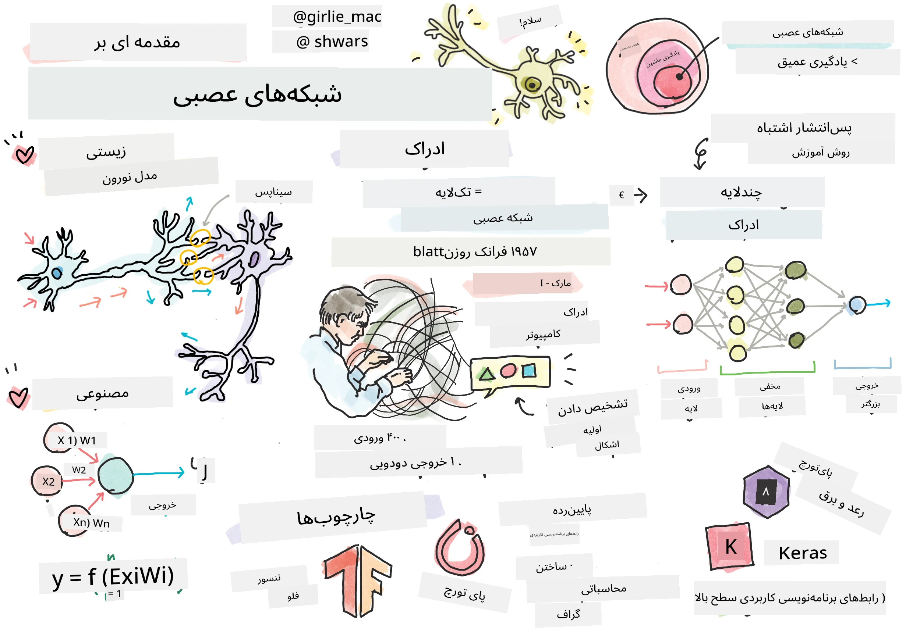
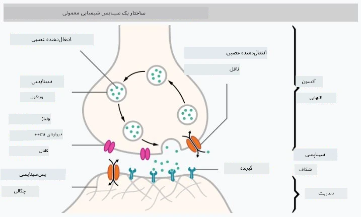
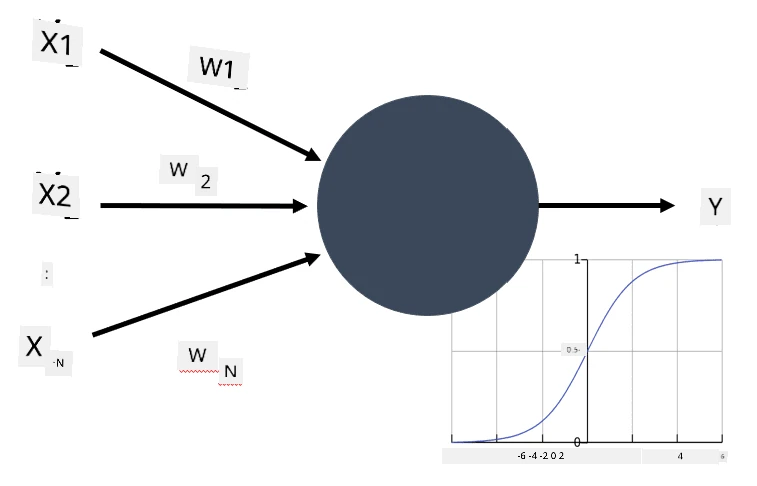
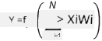

# مقدمه‌ای بر شبکه‌های عصبی

همانطور که در مقدمه بحث کردیم، یکی از راه‌های رسیدن به هوش، آموزش یک **مدل کامپیوتری** یا یک **مغز مصنوعی** است. از اواسط قرن بیستم، پژوهشگران مدل‌های ریاضی مختلفی را آزمایش کردند تا اینکه در سال‌های اخیر این مسیر بسیار موفقیت‌آمیز بوده است. چنین مدل‌های ریاضی مغز، به عنوان **شبکه‌های عصبی** شناخته می‌شوند.

> گاهی شبکه‌های عصبی با عنوان *شبکه‌های عصبی مصنوعی* یا ANNs نامیده می‌شوند تا نشان دهند که درباره مدل‌ها صحبت می‌کنیم، نه شبکه‌های واقعی نورون‌ها.

## یادگیری ماشین

شبکه‌های عصبی بخشی از یک رشته بزرگ‌تر به نام **یادگیری ماشین** هستند که هدف آن استفاده از داده‌ها برای آموزش مدل‌های کامپیوتری است که بتوانند مسائل را حل کنند. یادگیری ماشین بخش بزرگی از هوش مصنوعی است؛ اما ما در این برنامه درسی به یادگیری ماشین کلاسیک نمی‌پردازیم.

> برای مطالعه بیشتر درباره یادگیری ماشین کلاسیک، به برنامه درسی جداگانه ما **[یادگیری ماشین برای مبتدیان](http://github.com/microsoft/ml-for-beginners)** مراجعه کنید.

در یادگیری ماشین، فرض می‌کنیم که یک مجموعه داده از نمونه‌ها **X** و مقادیر خروجی متناظر **Y** داریم. نمونه‌ها معمولاً بردارهای N بعدی هستند که شامل **ویژگی‌ها** هستند و خروجی‌ها به عنوان **برچسب‌ها** شناخته می‌شوند.

دو مسئله رایج یادگیری ماشین که بررسی می‌کنیم عبارتند از:

* **دسته‌بندی**، جایی که باید یک شیء ورودی را به دو یا چند کلاس تقسیم کنیم.
* **رگرسیون**، جایی که باید یک عدد عددی برای هر نمونه ورودی پیش‌بینی کنیم.

> هنگام نمایش ورودی‌ها و خروجی‌ها به صورت تنسورها، مجموعه داده ورودی ماتریسی با ابعاد M×N است که M تعداد نمونه‌ها و N تعداد ویژگی‌هاست. برچسب خروجی Y برداری با اندازه M است.

در این برنامه درسی، فقط بر مدل‌های شبکه عصبی تمرکز خواهیم کرد.

## مدل یک نورون

از زیست‌شناسی می‌دانیم که مغز ما از سلول‌های عصبی (نورون‌ها) تشکیل شده است که هر کدام چندین "ورودی" (دندریت) و یک "خروجی" (آکسون) دارند. هم دندریت‌ها و هم آکسون‌ها می‌توانند سیگنال‌های الکتریکی را هدایت کنند و اتصالات بین آن‌ها که به آن سیناپس می‌گویند، میزان هدایت برق متغیری دارند که توسط انتقال‌دهنده‌های عصبی تنظیم می‌شوند.

 | 
----|----
نورون واقعی *([تصویر](https://en.wikipedia.org/wiki/Synapse#/media/File:SynapseSchematic_lines.svg) از ویکی‌پدیا)* | نورون مصنوعی *(تصویر توسط نویسنده)*

بنابراین، ساده‌ترین مدل ریاضی یک نورون شامل چندین ورودی X1، ...، XN و یک خروجی Y، و مجموعه‌ای از وزن‌ها W1، ...، WN است. خروجی به صورت زیر محاسبه می‌شود:

که در آن f یک **تابع فعال‌سازی** غیرخطی است.

> مدل‌های اولیه نورون در مقاله کلاسیک [محاسبه منطقی ایده‌های نهفته در فعالیت عصبی](https://www.cs.cmu.edu/~./epxing/Class/10715/reading/McCulloch.and.Pitts.pdf) توسط وارن مک‌کالوک و والتر پیتس در سال ۱۹۴۳ معرفی شدند. دونالد هب در کتاب خود "[سازماندهی رفتار: نظریه روان‌شناسی عصبی](https://books.google.com/books?id=VNetYrB8EBoC)" راهی برای آموزش این شبکه‌ها پیشنهاد کرد.

## در این بخش

در این بخش درباره موارد زیر می‌آموزیم:
* [پرسپترون](03-Perceptron/README.md)، یکی از اولین مدل‌های شبکه عصبی برای دسته‌بندی دوکلاسه
* [شبکه‌های چندلایه](04-OwnFramework/README.md) با دفترچه یادداشتی همراه [چگونه چارچوب خود را بسازیم](04-OwnFramework/OwnFramework.ipynb)
* [چارچوب‌های شبکه عصبی](05-Frameworks/README.md)، با این دفترچه‌ها: [PyTorch](05-Frameworks/IntroPyTorch.ipynb) و [Keras/Tensorflow](05-Frameworks/IntroKerasTF.ipynb)
* [بیش‌برازش](../../../../lessons/3-NeuralNetworks/05-Frameworks#overfitting)

---

<!-- CO-OP TRANSLATOR DISCLAIMER START -->
**سلب مسئولیت**:
این سند با استفاده از سرویس ترجمه هوش مصنوعی [Co-op Translator](https://github.com/Azure/co-op-translator) ترجمه شده است. در حالی که ما در تلاش برای دقت هستیم، لطفاً توجه داشته باشید که ترجمه‌های خودکار ممکن است شامل خطاها یا نادرستی‌هایی باشند. سند اصلی به زبان مادری خود باید به عنوان منبع معتبر در نظر گرفته شود. برای اطلاعات حیاتی، ترجمه حرفه‌ای انسانی توصیه می‌شود. ما در قبال هرگونه سوء تفاهم یا برداشت نادرست ناشی از استفاده از این ترجمه مسئولیتی نداریم.
<!-- CO-OP TRANSLATOR DISCLAIMER END -->