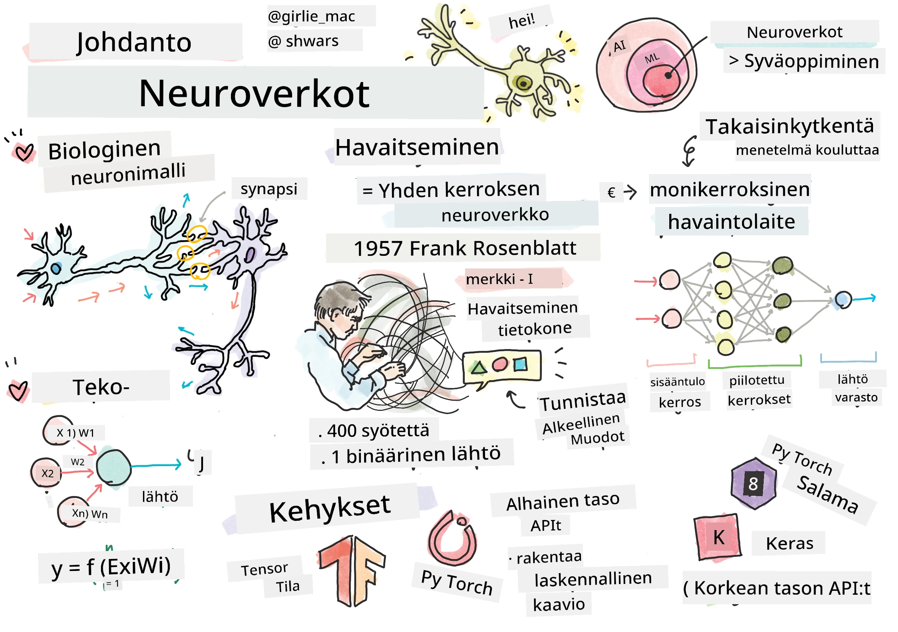
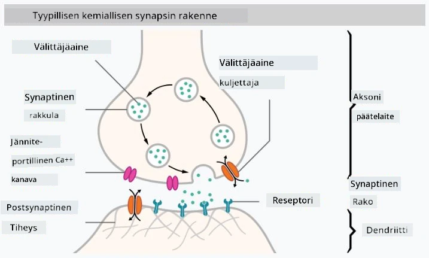

# Johdanto neuroverkkoihin

Kuten johdannossa keskustelimme, yksi tapa saavuttaa älykkyyttä on kouluttaa **tietokoneen malli** tai **tekoälyaivot**. 20. vuosisadan puolivälistä lähtien tutkijat ovat kokeilleet erilaisia matemaattisia malleja, kunnes viime vuosina tämä suuntaus on osoittautunut erittäin menestyksekkääksi. Tällaisia matemaattisia aivomalleja kutsutaan **neuroverkoiksi**.

> Joskus neuroverkkoja kutsutaan *tekoälyllisiksi neuroverkoiksi*, ANNeiksi, ilmaistakseen, että puhumme malleista, ei oikeista hermosolujen verkoista.

## Koneoppiminen

Neuroverkot ovat osa laajempaa oppialaa, jota kutsutaan **koneoppimiseksi**, jonka tavoitteena on käyttää dataa tietokoneen mallien kouluttamiseen, jotta ne pystyvät ratkaisemaan ongelmia. Koneoppiminen muodostaa suuren osan tekoälystä, mutta tässä oppimäärässä emme käsittele klassista koneoppimista.

> Vieraile erillisellä **[Koneoppiminen aloittelijoille](http://github.com/microsoft/ml-for-beginners)** -sisällöllämme oppiaksesi lisää klassisesta koneoppimisesta.

Koneoppimisessa oletamme, että meillä on joukko esimerkkejä **X** ja niihin liittyviä vastaavia tulosarvoja **Y**. Esimerkit ovat usein N-ulotteisia vektoreita, jotka koostuvat **ominaisuuksista**, ja tuloksia kutsutaan **luokittelutunnisteiksi**.

Tarkastelemme kahta yleisintä koneoppimisen ongelmaa:

* **Luokittelu**, jossa syöte luokitellaan kahteen tai useampaan luokkaan.
* **Regressio**, jossa jokaiselle syötteen näytteelle ennustetaan numeerinen arvo.

> Kun syötteet ja tulokset esitetään tensoreina, syötteiden aineisto on M×N-kokoinen matriisi, jossa M on näytteiden määrä ja N ominaisuuksien määrä. Tulosten tunnisteet Y ovat M-kokoinen vektori.

Tässä oppimäärässä keskitymme vain neuroverkkopohjaisiin malleihin.

## Hermosolun malli

Biologiasta tiedämme, että aivomme koostuvat hermosoluista (neuroneista), joilla jokaisella on useita "tuloja" (dendriittejä) ja yksi "lähtö" (aksoni). Sekä dendriitit että aksonit voivat johtaa sähköisiä signaaleja, ja niiden väliset yhteydet, synapsit, voivat näyttää vaihtelevan johtavuuden asteen, jota säätelevät välittäjäaineet.

 | 
----|----
Todellinen hermosolu *([Kuva](https://en.wikipedia.org/wiki/Synapse#/media/File:SynapseSchematic_lines.svg) Wikipediasta)* | Tekohermosolu *(Kuva: Tekijä)*

Näin ollen yksinkertaisin matemaattinen hermosolun malli sisältää useita tuloja X1, ..., XN ja yhden lähdön Y, sekä joukon painoja W1, ..., WN. Lähtö lasketaan seuraavasti:

missä f on jokin ei-lineaarinen **aktivointifunktio**.

> Varhaisia hermosolumalleja kuvattiin klassisessa artikkelissa [A logical calculus of the ideas immanent in nervous activity](https://www.cs.cmu.edu/~./epxing/Class/10715/reading/McCulloch.and.Pitts.pdf), jonka kirjoittivat Warren McCullock ja Walter Pitts vuonna 1943. Donald Hebb ehdotti teoksessaan "[The Organization of Behavior: A Neuropsychological Theory](https://books.google.com/books?id=VNetYrB8EBoC)" tapaa, jolla näitä verkkoja voidaan kouluttaa.

## Tässä osiossa

Tässä osiossa opit:
* [Perceptron](03-Perceptron/README.md), yksi varhaisimmista neuroverkkomal­leista kahden luokan luokitteluun
* [Monikerroksiset verkot](04-OwnFramework/README.md) ja niihin liittyvä harjoitusvihko [oman kehyksen rakentaminen](04-OwnFramework/OwnFramework.ipynb)
* [Neuroverkkokehykset](05-Frameworks/README.md), näihin liittyvät harjoitusvihkot: [PyTorch](05-Frameworks/IntroPyTorch.ipynb) ja [Keras/Tensorflow](05-Frameworks/IntroKerasTF.ipynb)
* [Ylisovittaminen](../../../../lessons/3-NeuralNetworks/05-Frameworks#overfitting)

---

<!-- CO-OP TRANSLATOR DISCLAIMER START -->
**Vastuuvapauslauseke**:
Tämä asiakirja on käännetty käyttämällä tekoälypohjaista käännöspalvelua [Co-op Translator](https://github.com/Azure/co-op-translator). Vaikka pyrimme tarkkuuteen, otathan huomioon, että automaattiset käännökset saattavat sisältää virheitä tai epätarkkuuksia. Alkuperäinen asiakirja sen alkuperäiskielellä on virallinen lähde. Tärkeissä asioissa suositellaan ammattimaista ihmiskäännöstä. Emme ole vastuussa tämän käännöksen käytöstä aiheutuvista väärinymmärryksistä tai tulkinnoista.
<!-- CO-OP TRANSLATOR DISCLAIMER END -->