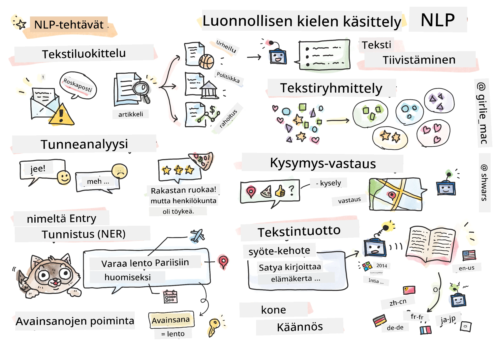

# Luonnollisen kielen käsittely



Tässä osassa keskitymme Neuroverkkojen käyttöön tehtävissä, jotka liittyvät **luonnollisen kielen käsittelyyn (NLP)**. On monia NLP-ongelmia, jotka haluamme tietokoneiden kykenevän ratkaisemaan:

* **Tekstiluokittelu** on tyypillinen luokitteluongelma, joka koskee tekstijaksoja. Esimerkkejä ovat sähköpostiviestien luokittelu roskapostiksi tai ei-roskapostiksi, tai artikkeleiden luokittelu urheilu-, liiketoiminta-, politiikka- yms. kategorioihin. Myös chattibottien kehittämisessä tarvitsemme usein ymmärrystä siitä, mitä käyttäjä yritti sanoa – tässä tapauksessa käsittelemme **aikomusluokittelua**. Aikomusluokittelussa joudutaan usein käsittelemään monia kategorioita.
* **Tunnetilan analyysi** on tyypillinen regressio-ongelma, jossa meidän tarvitsee liittää numero (tunnetila) vastaamaan, kuinka positiivinen/negatiivinen lauseen merkitys on. Tunnetilan analyysin kehittyneempi muoto on **aspektiperusteinen tunnetilan analyysi** (ABSA), jossa tunnetila liitetään ei koko lauseeseen vaan sen eri osiin (aspekteihin), esim. *Tässä ravintolassa pidin ruoasta, mutta ilmapiiri oli kauhea*.
* **Nimettyjen entiteettien tunnistus** (NER) viittaa ongelmaan, jossa tekstistä pitää poimia tiettyjä entiteettejä. Esimerkiksi saatamme haluta ymmärtää, että lauseessa *Minun täytyy lentää huomenna Pariisiin* sana *huomenna* viittaa PÄIVÄMÄÄRÄÄN ja *Pariisi* on PAIKKA.  
* **Avainsanojen poiminta** on samankaltainen kuin NER, mutta siinä pitää poimia lauseen merkityksen kannalta tärkeitä sanoja automaattisesti, ilman erillistä esikoulutusta tiettyihin entiteettityyppeihin.
* **Tekstien klusterointi** voi olla hyödyllistä, kun halutaan ryhmitellä samankaltaisia lauseita yhteen, esimerkiksi samankaltaisia pyyntöjä teknisen tuen keskusteluissa.
* **Kysymyksiin vastaaminen** tarkoittaa mallin kykyä vastata tiettyyn kysymykseen. Malli saa syötteenään tekstiotteen ja kysymyksen, ja sen pitää löytää tekstistä paikka, jossa vastauksen kysymykseen sisältävä tieto on (tai joskus tuottaa vastaustekstin).
* **Tekstin generointi** on kyky, jonka avulla malli tuottaa uutta tekstiä. Sitä voidaan pitää luokittelutehtävänä, joka ennustaa seuraavan kirjaimen/sanan jonkin *tekstikehotteen* perusteella. Kehittyneet tekstin generointimallit, kuten GPT-3, pystyvät ratkaisemaan myös muita luonnollisen kielen käsittelyn tehtäviä, kuten luokittelua, käyttäen tekniikkaa nimeltä [prompt-ohjelmointi](https://towardsdatascience.com/software-3-0-how-prompting-will-change-the-rules-of-the-game-a982fbfe1e0) tai [prompt-tekniikka](https://medium.com/swlh/openai-gpt-3-and-prompt-engineering-dcdc2c5fcd29)
* **Tekstiyhteenvedon tekeminen** on menetelmä, jossa haluamme tietokoneen "lukevan" pitkän tekstin ja tiivistävän sen muutamaan lauseeseen.
* **Konekäännös** voidaan nähdä yhdistelmänä tekstin ymmärtämistä yhdellä kielellä ja tekstin generointia toisella.

Aluksi useimmat luonnollisen kielen käsittelyn tehtävät ratkaistiin perinteisillä menetelmillä, kuten kieliopilla. Esimerkiksi konekäännöksissä käytettiin jäsennyksiä (parser), joilla alkuperäinen lause muutettiin syntaksipuun muotoon. Tämän jälkeen lauseen merkitystä kuvaavat korkeamman tason semanttiset rakenteet poimittiin, ja tämän merkityksen ja kohdekielen kieliopin perusteella tulos tuotettiin. Nykyään monet NLP-tehtävät ratkaistaan tehokkaammin neuroverkkojen avulla.

> Monet klassiset NLP-menetelmät on toteutettu Python-kirjastossa [Natural Language Processing Toolkit (NLTK)](https://www.nltk.org). Verkossa on saatavilla loistava [NLTK-kirja](https://www.nltk.org/book/), joka kattaa eri NLP-tehtävien ratkaisemisen NLTK:n avulla.

Kurssillamme keskitymme pääasiassa neuroverkkojen käyttöön NLP:ssä ja käytämme NLTK:ta tarvittaessa.

Olemme jo oppineet neuroverkkojen käytön taulukkomuotoisten tietojen ja kuvien käsittelyssä. Näiden tietotyyppien ja tekstin pääasiallinen ero on, että teksti on muuttuvan pituinen jono, kun taas kuvien syötteen koko on ennalta tiedossa. Vaikka konvoluutioverkot voivat poimia kuvasta kuvioita, tekstissä esiintyvät kuviot ovat monimutkaisempia. Esimerkiksi kieltosanan ja subjektin väliin voi mahtua mielivaltaisen monta sanaa (esim. *En pidä appelsiineista* vs. *En pidä noista isoista värikkäistä maukkaista appelsiineista*), ja tämä pitäisi silti tulkita yhdeksi kuvioksi. Siksi kielen käsittelyyn tarvitaan uusia neuroverkkotyyppejä, kuten *toistuvat verkot* ja *transformerit*.

## Kirjastojen asennus

Jos käytät paikallista Python-asennusta tämän kurssin suorittamiseen, sinun voi olla tarpeen asentaa kaikki NLP:n tarvitsemat kirjastot seuraavilla komennoilla:

**PyTorchille**
```bash
pip install -r requirements-pytorch.txt
```
**TensorFlow'lle**
```bash
pip install -r requirements-tf.txt
```

> Voit kokeilla NLP:tä TensorFlow'lla [Microsoft Learnissä](https://docs.microsoft.com/learn/modules/intro-natural-language-processing-tensorflow/?WT.mc_id=academic-77998-cacaste)

## GPU-varoitus

Tässä osiossa harjoitustemme malleista osa on melko suuria.
* **Käytä GPU:lla varustettua tietokonetta**: On suositeltavaa käyttää GPU:lla varustettua tietokonetta odotusajan lyhentämiseksi suuria malleja käsiteltäessä.
* **GPU-muistin rajoitteet**: GPU:lla ajaminen voi johtaa tilanteisiin, joissa GPU-muisti loppuu, varsinkin kun koulutat suuria malleja.
* **GPU-muistin kulutus**: GPU-muistin kulutus koulutuksen aikana riippuu monista tekijöistä, kuten minibatchin koosta.
* **Minibatch-koon minimointi**: Jos kohtaat GPU-muistin ongelmia, harkitse minibatch-koon pienentämistä koodissasi mahdollisena ratkaisuna.
* **TensorFlow GPU -muistin vapautus**: Vanhemmat TensorFlow-versiot eivät välttämättä vapauta GPU-muistia oikein, kun samassa Python-ytimessä harjoitellaan useita malleja. GPU-muistinkäytön tehokkaaseen hallintaan voit määrittää TensorFlown varaamaan GPU-muistin vain tarpeen mukaan.
* **Koodin lisääminen**: Asettaaksesi TensorFlown kasvattamaan GPU-muistivarausta vain tarvittaessa, lisää seuraava koodi muistikirjoihisi:

```python
physical_devices = tf.config.list_physical_devices('GPU') 
if len(physical_devices)>0:
    tf.config.experimental.set_memory_growth(physical_devices[0], True) 
```

Jos olet kiinnostunut oppimaan NLP:stä klassisesta koneoppimisen näkökulmasta, vieraile [tässä oppimiskokonaisuudessa](https://github.com/microsoft/ML-For-Beginners/tree/main/6-NLP)

## Tässä osiossa
Tässä osiossa opimme:

* [Tekstin esittäminen tensoreina](13-TextRep/README.md)
* [Sanapohjaiset upotukset](14-Embeddings/README.md)
* [Kielimallinnus](15-LanguageModeling/README.md)
* [Toistuvat neuroverkot](16-RNN/README.md)
* [Generatiiviset verkot](17-GenerativeNetworks/README.md)
* [Transformers-mallit](18-Transformers/README.md)

---

<!-- CO-OP TRANSLATOR DISCLAIMER START -->
**Vastuuvapauslauseke**:
Tämä asiakirja on käännetty käyttämällä tekoälypohjaista käännöspalvelua [Co-op Translator](https://github.com/Azure/co-op-translator). Vaikka pyrimme tarkkuuteen, otathan huomioon, että automaattiset käännökset saattavat sisältää virheitä tai epätarkkuuksia. Alkuperäinen asiakirja sen alkuperäiskielellä on virallinen lähde. Tärkeissä asioissa suositellaan ammattimaista ihmiskäännöstä. Emme ole vastuussa tämän käännöksen käytöstä aiheutuvista väärinymmärryksistä tai tulkinnoista.
<!-- CO-OP TRANSLATOR DISCLAIMER END -->