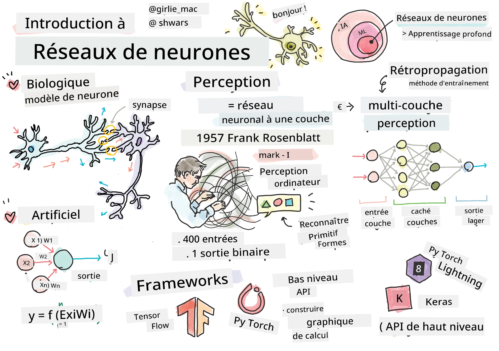
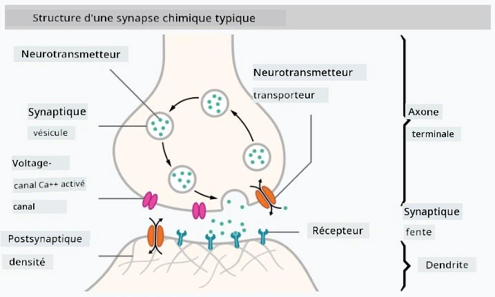
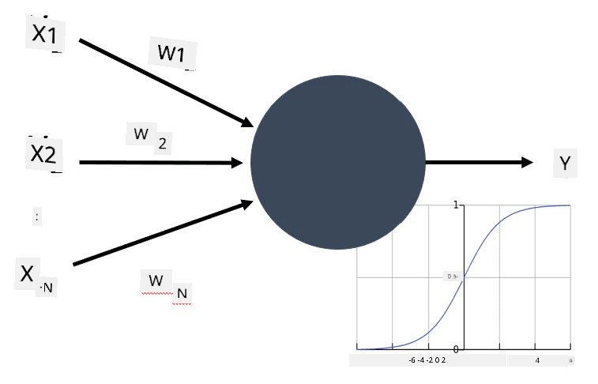

# Introduction aux réseaux de neurones

Comme nous l'avons évoqué dans l'introduction, une des manières d'atteindre l'intelligence est d'entraîner un **modèle informatique** ou un **cerveau artificiel**. Depuis le milieu du 20ème siècle, les chercheurs ont testé différents modèles mathématiques, jusqu'à ce que ces dernières années cette direction se révèle extrêmement fructueuse. Ces modèles mathématiques du cerveau sont appelés **réseaux de neurones**.

> Parfois les réseaux de neurones sont appelés *réseaux de neurones artificiels*, RNA, pour indiquer que nous parlons de modèles, et non de véritables réseaux de neurones.

## Apprentissage automatique

Les réseaux de neurones font partie d'une discipline plus vaste appelée **apprentissage automatique**, dont l'objectif est d'utiliser des données pour entraîner des modèles informatiques capables de résoudre des problèmes. L'apprentissage automatique constitue une large part de l'intelligence artificielle, cependant, ce programme ne couvre pas l'apprentissage automatique classique.

> Consultez notre programme séparé **[Apprentissage automatique pour débutants](http://github.com/microsoft/ml-for-beginners)** pour en savoir plus sur l'apprentissage automatique classique.

En apprentissage automatique, on suppose que nous avons un ensemble de données d'exemples **X**, et les valeurs de sortie correspondantes **Y**. Les exemples sont souvent des vecteurs N-dimensionnels qui consistent en des **caractéristiques**, et les sorties sont appelées **étiquettes**.

Nous considérerons deux des problèmes les plus courants en apprentissage automatique :

* **Classification**, où nous devons classer un objet d'entrée dans deux ou plusieurs classes.
* **Régression**, où nous devons prédire un nombre numérique pour chacun des échantillons d'entrée.

> Lorsqu'on représente les entrées et sorties sous forme de tenseurs, l'ensemble des entrées est une matrice de taille M×N, où M est le nombre d'échantillons et N le nombre de caractéristiques. Les étiquettes de sortie Y sont un vecteur de taille M.

Dans ce programme, nous nous concentrerons uniquement sur les modèles de réseaux de neurones.

## Modèle d'un neurone

En biologie, nous savons que notre cerveau est composé de cellules nerveuses (neurones), chacune ayant plusieurs "entrées" (dendrites) et une seule "sortie" (axon). Les dendrites et les axones peuvent conduire des signaux électriques, et les connexions entre eux — appelées synapses — peuvent présenter différents degrés de conductivité, régulés par des neurotransmetteurs.

 | 
----|----
Neurone réel *([Image](https://en.wikipedia.org/wiki/Synapse#/media/File:SynapseSchematic_lines.svg) depuis Wikipedia)* | Neurone artificiel *(Image par l'auteur)*

Ainsi, le modèle mathématique le plus simple d'un neurone contient plusieurs entrées X1, ..., XN et une sortie Y, ainsi qu'une série de poids W1, ..., WN. Une sortie est calculée comme suit :

où f est une **fonction d'activation** non linéaire.

> Les premiers modèles de neurones ont été décrits dans l'article classique [A logical calculus of the ideas immanent in nervous activity](https://www.cs.cmu.edu/~./epxing/Class/10715/reading/McCulloch.and.Pitts.pdf) de Warren McCullock et Walter Pitts en 1943. Donald Hebb, dans son livre "[The Organization of Behavior: A Neuropsychological Theory](https://books.google.com/books?id=VNetYrB8EBoC)", a proposé la manière dont ces réseaux peuvent être entraînés.

## Dans cette section

Dans cette section, nous apprendrons à propos de :
* [Perceptron](03-Perceptron/README.md), l’un des premiers modèles de réseaux de neurones pour la classification binaire
* [Réseaux multicouches](04-OwnFramework/README.md) avec un carnet associé [comment construire notre propre framework](04-OwnFramework/OwnFramework.ipynb)
* [Frameworks de réseaux de neurones](05-Frameworks/README.md), avec ces carnets : [PyTorch](05-Frameworks/IntroPyTorch.ipynb) et [Keras/Tensorflow](05-Frameworks/IntroKerasTF.ipynb)
* [Surapprentissage](../../../../lessons/3-NeuralNetworks/05-Frameworks#overfitting)

---

<!-- CO-OP TRANSLATOR DISCLAIMER START -->
**Avertissement** :
Ce document a été traduit à l'aide du service de traduction automatique [Co-op Translator](https://github.com/Azure/co-op-translator). Bien que nous nous efforçions d'assurer l'exactitude, veuillez noter que les traductions automatisées peuvent contenir des erreurs ou des inexactitudes. Le document original dans sa langue native doit être considéré comme la source faisant autorité. Pour les informations critiques, il est recommandé de recourir à une traduction professionnelle réalisée par un humain. Nous ne saurions être tenus responsables des malentendus ou erreurs d'interprétation découlant de l'utilisation de cette traduction.
<!-- CO-OP TRANSLATOR DISCLAIMER END -->