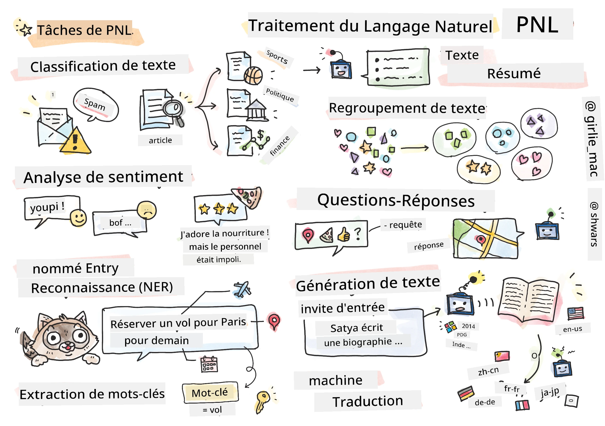

# Traitement du Langage Naturel



Dans cette section, nous nous concentrerons sur l'utilisation des réseaux neuronaux pour traiter des tâches liées au **Traitement du Langage Naturel (TLP)**. Il existe de nombreux problèmes de TLP que nous voulons que les ordinateurs puissent résoudre :

* **Classification de texte** est un problème typique de classification concernant des séquences de texte. Par exemple, classer des messages e-mails comme spam vs. non-spam, ou catégoriser des articles en sport, affaires, politique, etc. De plus, lors du développement de chat bots, nous avons souvent besoin de comprendre ce que l'utilisateur voulait dire -- dans ce cas, nous traitons une **classification d'intention**. Souvent, dans la classification d'intention, nous devons gérer de nombreuses catégories.
* **Analyse de sentiment** est un problème typique de régression, où nous devons attribuer un nombre (un sentiment) correspondant à la positivité/négativité du sens d'une phrase. Une version plus avancée de l'analyse de sentiment est **l'analyse de sentiment basée sur les aspects** (ABSA), où nous attribuons le sentiment non pas à la phrase entière, mais à différentes parties de celle-ci (aspects), par ex. *Dans ce restaurant, j'ai aimé la cuisine, mais l'ambiance était affreuse*.
* **Reconnaissance d'entités nommées** (REN) se réfère au problème d'extraction de certaines entités dans le texte. Par exemple, nous devons comprendre que dans la phrase *Je dois prendre l'avion pour Paris demain* le mot *demain* réfère à la DATE, et *Paris* est un LIEU.  
* **Extraction de mots-clés** est similaire à la REN, mais nous devons extraire automatiquement des mots importants pour le sens de la phrase, sans pré-entraînement pour des types d'entités spécifiques.
* **Regroupement de texte** peut être utile quand nous voulons regrouper des phrases similaires, par exemple des requêtes similaires dans des conversations de support technique.
* **Réponse à des questions** fait référence à la capacité d'un modèle à répondre à une question spécifique. Le modèle reçoit un passage de texte et une question en entrées, et il doit fournir un endroit dans le texte où la réponse à la question est contenue (ou, parfois, générer le texte de la réponse).
* **Génération de texte** est la capacité d'un modèle à générer un nouveau texte. Cela peut être considéré comme une tâche de classification qui prédit la lettre/mot suivant basé sur un *texte d'amorce*. Les modèles avancés de génération de texte, tels que GPT-3, sont capables de résoudre d'autres tâches de TLP comme la classification en utilisant une technique appelée [programmation par amorçage](https://towardsdatascience.com/software-3-0-how-prompting-will-change-the-rules-of-the-game-a982fbfe1e0) ou [conception d'amorces](https://medium.com/swlh/openai-gpt-3-and-prompt-engineering-dcdc2c5fcd29)
* **Résumé de texte** est une technique où nous voulons qu'un ordinateur "lise" un texte long et le résume en quelques phrases.
* **Traduction automatique** peut être vue comme une combinaison de compréhension de texte dans une langue, et génération de texte dans une autre.

Initialement, la plupart des tâches de TLP étaient résolues en utilisant des méthodes traditionnelles telles que les grammaires. Par exemple, en traduction automatique, des analyseurs syntaxiques étaient utilisés pour transformer la phrase initiale en un arbre syntaxique, puis des structures sémantiques de plus haut niveau étaient extraites pour représenter le sens de la phrase, et basé sur ce sens et la grammaire de la langue cible le résultat était généré. De nos jours, de nombreuses tâches de TLP sont plus efficacement résolues avec des réseaux neuronaux.

> Beaucoup de méthodes classiques de TLP sont implémentées dans la bibliothèque Python [Natural Language Processing Toolkit (NLTK)](https://www.nltk.org). Il existe un excellent [livre NLTK](https://www.nltk.org/book/) disponible en ligne qui couvre comment différentes tâches de TLP peuvent être résolues avec NLTK.

Dans notre cours, nous nous concentrerons principalement sur l'utilisation de réseaux neuronaux pour le TLP, et nous utiliserons NLTK quand cela sera nécessaire.

Nous avons déjà appris à utiliser des réseaux neuronaux pour traiter des données tabulaires et des images. La principale différence entre ces types de données et le texte est que le texte est une séquence de longueur variable, tandis que la taille d'entrée dans le cas des images est connue à l'avance. Alors que les réseaux convolutionnels peuvent extraire des motifs des données d'entrée, les motifs dans le texte sont plus complexes. Par exemple, nous pouvons avoir une négation séparée du sujet par un nombre arbitraire de mots (ex. *Je n'aime pas les oranges*, vs. *Je n'aime pas ces grosses oranges colorées et savoureuses*), et cela doit toujours être interprété comme un seul motif. Ainsi, pour traiter le langage, nous devons introduire de nouveaux types de réseaux neuronaux, tels que les *réseaux récurrents* et les *transformers*.

## Installer les bibliothèques

Si vous utilisez une installation locale de Python pour suivre ce cours, vous devrez peut-être installer toutes les bibliothèques requises pour le TLP en utilisant les commandes suivantes :

**Pour PyTorch**
```bash
pip install -r requirements-pytorch.txt
```
**Pour TensorFlow**
```bash
pip install -r requirements-tf.txt
```

> Vous pouvez essayer le TLP avec TensorFlow sur [Microsoft Learn](https://docs.microsoft.com/learn/modules/intro-natural-language-processing-tensorflow/?WT.mc_id=academic-77998-cacaste)

## Avertissement sur le GPU

Dans cette section, certains exemples impliqueront l'entraînement de modèles assez grands.
* **Utilisez un ordinateur avec GPU activé** : Il est conseillé de faire fonctionner vos notebooks sur un ordinateur équipé d'un GPU pour réduire les temps d'attente lors de la manipulation de grands modèles.
* **Contraintes de mémoire GPU** : L'exécution sur GPU peut entraîner des situations où la mémoire du GPU est saturée, notamment lors de l'entraînement de grands modèles.
* **Consommation de mémoire GPU** : La quantité de mémoire GPU utilisée pendant l'entraînement dépend de plusieurs facteurs, dont la taille du minibatch.
* **Minimiser la taille du minibatch** : Si vous rencontrez des problèmes de mémoire GPU, envisagez de réduire la taille du minibatch dans votre code comme solution possible.
* **Libération de la mémoire GPU dans TensorFlow** : Les versions plus anciennes de TensorFlow peuvent ne pas libérer correctement la mémoire GPU lorsqu'elles entraînent plusieurs modèles dans un même noyau Python. Pour gérer efficacement l'utilisation de la mémoire GPU, vous pouvez configurer TensorFlow pour qu'il n'alloue la mémoire GPU que lorsqu'elle est nécessaire.
* **Inclusion de code** : Pour configurer TensorFlow afin qu'il étende uniquement l'allocation de mémoire GPU au besoin, incluez le code suivant dans vos notebooks :

```python
physical_devices = tf.config.list_physical_devices('GPU') 
if len(physical_devices)>0:
    tf.config.experimental.set_memory_growth(physical_devices[0], True) 
```

Si vous souhaitez apprendre le TLP d'un point de vue classique du ML, visitez [cette suite de leçons](https://github.com/microsoft/ML-For-Beginners/tree/main/6-NLP)

## Dans cette section
Dans cette section, nous apprendrons :

* [Représentation du texte sous forme de tenseurs](13-TextRep/README.md)
* [Word Embeddings](14-Embeddings/README.md)
* [Modélisation du langage](15-LanguageModeling/README.md)
* [Réseaux neuronaux récurrents](16-RNN/README.md)
* [Réseaux génératifs](17-GenerativeNetworks/README.md)
* [Transformers](18-Transformers/README.md)

---

<!-- CO-OP TRANSLATOR DISCLAIMER START -->
**Avertissement** :
Ce document a été traduit à l'aide du service de traduction automatique [Co-op Translator](https://github.com/Azure/co-op-translator). Bien que nous nous efforçions d'assurer l'exactitude, veuillez noter que les traductions automatisées peuvent contenir des erreurs ou des inexactitudes. Le document original dans sa langue native doit être considéré comme la source faisant autorité. Pour les informations critiques, il est recommandé de recourir à une traduction professionnelle réalisée par un humain. Nous ne saurions être tenus responsables des malentendus ou erreurs d'interprétation découlant de l'utilisation de cette traduction.
<!-- CO-OP TRANSLATOR DISCLAIMER END -->