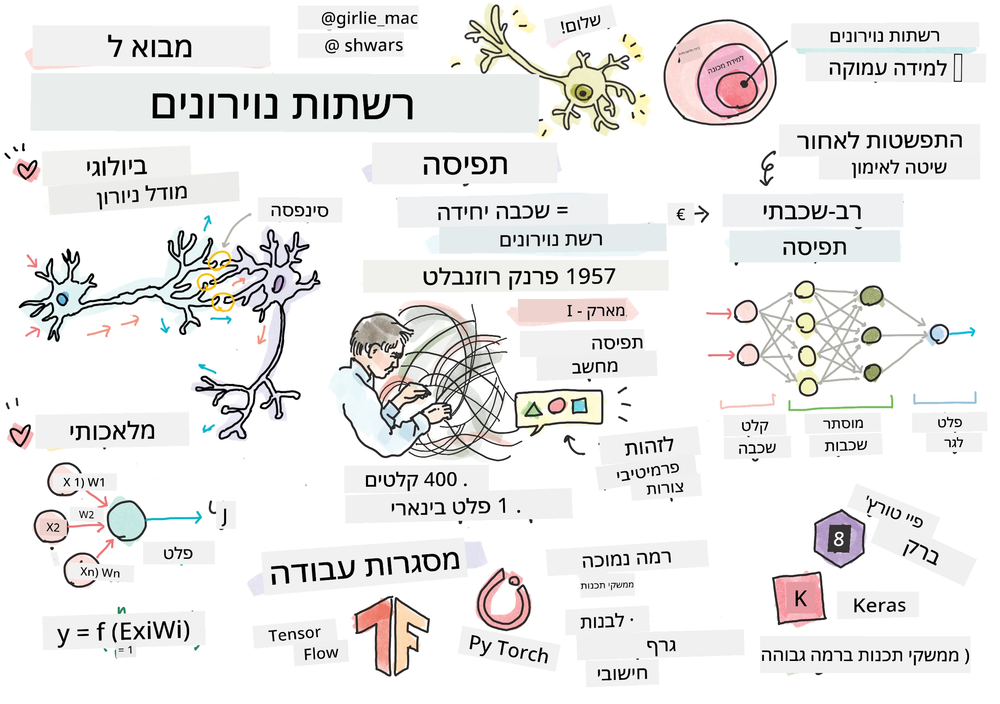
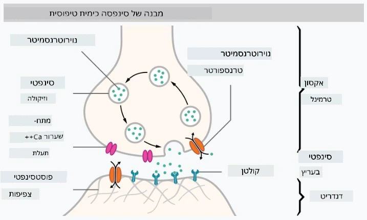
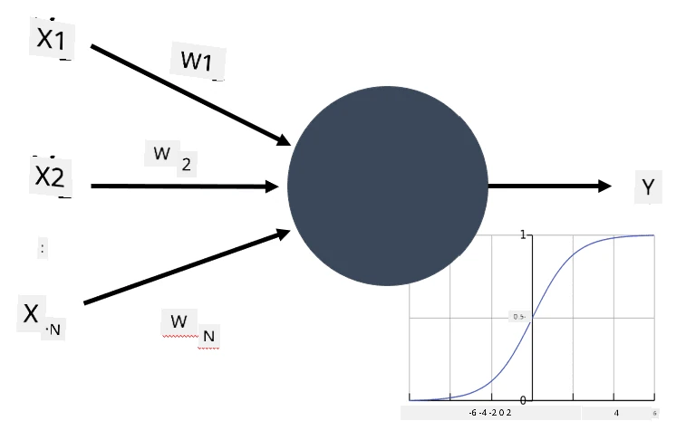
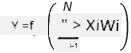

# مقدمة לרשתות עצביות

כפי שדנו בהקדמה, אחת הדרכים להשיג אינטיליגנציה היא לאמן **מודל מחשב** או **מוח מלאכותי**. מאז אמצע המאה ה-20, חוקרים ניסו מודלים מתמטיים שונים, עד שלבשנים האחרונות כיוון זה הוכח כמאוד מוצלח. מודלים מתמטיים כאלה של המוח נקראים **רשתות עצביות**.

> לפעמים רשתות עצביות נקראות *Artificial Neural Networks*, ANNs, כדי לציין שמדובר במודלים, לא ברשתות אמיתיות של נוירונים.

## למידת מכונה

רשתות עצביות הן חלק מתחום רחב יותר הנקרא **למידת מכונה**, שמטרתו להשתמש בנתונים כדי לאמן מודלים ממוחשבים המסוגלים לפתור בעיות. למידת מכונה מהווה חלק גדול מבינה מלאכותית, אך אנו לא מכסים את למידת המכונה הקלאסית בתכנית הלימודים הזו.

> בקרו בתכנית הלימודים שלנו נפרדת **[למידת מכונה למתחילים](http://github.com/microsoft/ml-for-beginners)** כדי ללמוד עוד על למידת מכונה קלאסית.

בלמידת מכונה, מניחים שיש לנו מסד נתונים של דוגמאות **X**, וערכי פלט תואמים **Y**. דוגמאות הן לעיתים וקטורים בעלי ממדים N הכוללים **תכונות**, והפלטים נקראים **תוויות**.

נשקול את שתי הבעיות השכיחות ביותר בלמידת מכונה:

* **סיווג**, שבו יש צורך לסווג אובייקט קלט לשתי קטגוריות או יותר.
* **רגרסיה**, שבו יש צורך לנבא מספר מספרי לכל דגימת קלט.

> כאשר מציגים קלטים ופלטים כטנסורים, מסד הנתונים הקלט הוא מטריצה בגודל M×N, כש-M הוא מספר הדוגמאות ו-N הוא מספר התכונות. תוויות הפלט Y הן וקטור בגודל M.

בתכנית לימודים זו נתמקד רק במודלים של רשתות עצביות.

## מודל של נוירון

מהביולוגיה ידוע שהמוח שלנו מורכב מתאי עצב (נוירונים), שכל אחד מהם כולל מספר רב של "קלטים" (דנדריטים) ו-"פלט" יחיד (אקסון). גם דנדריטים וגם אקסונים יכולים להעביר אותות חשמליים, והקשרים ביניהם — הידועים כסינפסות — יכולים להציג דרגות הולכה משתנות, שמתואמות על ידי מוליכים עצביים.

 | 
----|----
נוירון אמיתי *([תמונה](https://en.wikipedia.org/wiki/Synapse#/media/File:SynapseSchematic_lines.svg) מוויקיפדיה)* | נוירון מלאכותי *(תמונה על ידי המחבר)*

לכן, המודל המתמטי הפשוט ביותר של נוירון כולל מספר קלטים X1, ..., XN ופלט Y, וסדרה של משקולות W1, ..., WN. הפלט מחושב כך:

כאשר f היא פונקציית **הפעלה** לא ליניארית כלשהי.

> מודלים מוקדמים של נוירון תוארו במאמר הקלאסי [A logical calculus of the ideas immanent in nervous activity](https://www.cs.cmu.edu/~./epxing/Class/10715/reading/McCulloch.and.Pitts.pdf) מאת וורן מק'קולוק וולטר פיטס בשנת 1943. דונלד הב בספרו "[The Organization of Behavior: A Neuropsychological Theory](https://books.google.com/books?id=VNetYrB8EBoC)" הציע את הדרך שבה ניתן לאמן רשתות אלו.

## בסעיף זה

בסעיף זה נלמד על:
* [פרסספטרון](03-Perceptron/README.md), אחד המודלים הראשונים של רשת עצבית לסיווג לשני סוגים
* [רשתות מרובדות](04-OwnFramework/README.md) עם פנקס מודל מצורף [איך לבנות את המסגרת שלנו](04-OwnFramework/OwnFramework.ipynb)
* [מסגרות רשת עצבית](05-Frameworks/README.md), עם פנקסים: [PyTorch](05-Frameworks/IntroPyTorch.ipynb) ו-[Keras/Tensorflow](05-Frameworks/IntroKerasTF.ipynb)
* [התחמקות מדי](../../../../lessons/3-NeuralNetworks/05-Frameworks#overfitting)

---

<!-- CO-OP TRANSLATOR DISCLAIMER START -->
**כתב ויתור**:
מסמך זה תורגם באמצעות שירות תרגום אוטומטי [Co-op Translator](https://github.com/Azure/co-op-translator). למרות שאנו שואפים לדיוק, יש לקחת בחשבון שתרגומים אוטומטיים עלולים להכיל שגיאות או אי-דיוקים. יש להחשיב את המסמך המקורי בשפתו הטבעית כמקור הסמכות. למידע קריטי מומלץ להשתמש בתרגום מקצועי על ידי מתרגם אדם. אנו לא אחראים לכל אי-הבנה או פירוש שגוי הנובע מהשימוש בתרגום זה.
<!-- CO-OP TRANSLATOR DISCLAIMER END -->