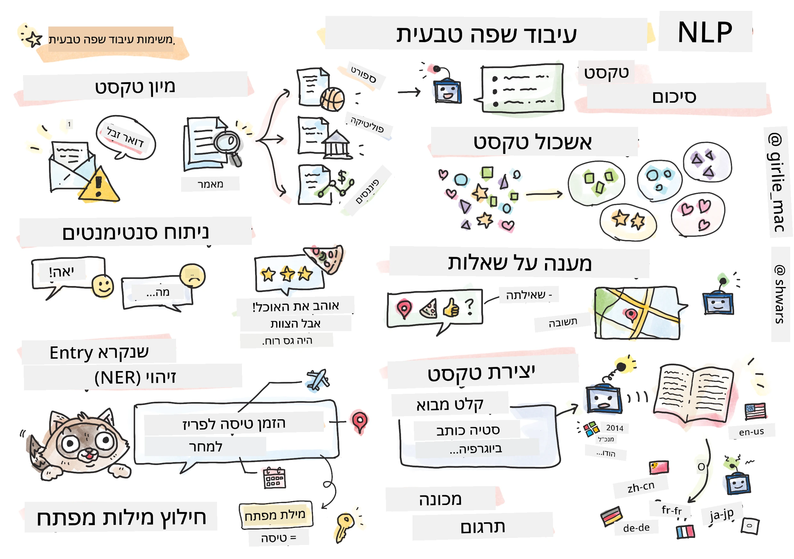

# עיבוד שפה טבעית



בחלק זה נתמקד בשימוש ברשתות עצביות לביצוע משימות הקשורות ל**עיבוד שפה טבעית (NLP)**. קיימות בעיות NLP רבות שאנו רוצים שמחשבים יוכלו לפתור:

* **סיווג טקסט** היא בעיית סיווג טיפוסית הנוגעת לרצפי טקסט. דוגמאות כוללות סיווג הודעות דוא"ל כספאם לעומת לא-ספאם, או קטלוג מאמרים כספורט, עסקים, פוליטיקה וכו'. בנוסף, בעת פיתוח צ׳אטבוטים, לעיתים קרובות אנו צריכים להבין מה המשתמש רצה לומר -- במקרה זה אנו מתמודדים עם **סיווג כוונות**. לעיתים קרובות, בסיווג כוונות יש צורך להתייחס להרבה קטגוריות.
* **ניתוח סנטימנטים** היא בעיית רגרסיה טיפוסית, שבה יש לייחס מספר (סנטימנט) המתאר עד כמה משמעות המשפט חיובית/שלילית. גרסה מתקדמת יותר של ניתוח סנטימנטים היא **ניתוח סנטימנטים מבוסס אספקטים** (ABSA), שבו מייחסים סנטימנט לא לכל המשפט אלא לחלקים שונים ממנו (אספקטים), למשל *במסעדה הזאת אהבתי את האוכל, אבל האווירה הייתה נוראית*.
* **זיהוי ישויות מוכללות** (NER) מתייחס לבעיה של חילוץ ישויות מסוימות מתוך הטקסט. לדוגמה, ייתכן שנרצה להבין שבביטוי *אני צריך לטוס לפריז מחר* המילה *מחר* מתייחסת לתאריך ו*פריז* היא מיקום.
* **חילוץ מילות מפתח** הוא דומה לזיהוי ישויות מוכללות, אבל יש צורך לחלץ מילים החשובות למשמעות המשפט באופן אוטומטי, בלי אימון מוקדם לסוגי ישויות ספציפיים.
* **אשכולות טקסט** יכולים להיות שימושיים כאשר רוצים לקבץ יחד משפטים דומים, לדוגמה, בקשות דומות בשיחות תמיכה טכנית.
* **מענה על שאלות** מתייחס ליכולת של מודל לענות על שאלה ספציפית. המודל מקבל כקלט קטע טקסט ושאלה, והוא צריך לספק מקום בטקסט שבו נמצאת התשובה לשאלה (או, לעיתים, לייצר את טקסט התשובה).
* **יצירת טקסט** היא היכולת של מודל ליצור טקסט חדש. ניתן לראות זאת כמשימת סיווג החוזה על האות/מילה הבאה בהתבסס על *הנחיית טקסט*. מודלים מתקדמים ליצירת טקסט, כגון GPT-3, מסוגלים לפתור משימות NLP אחרות כמו סיווג באמצעות טכניקה הנקראת [תכנות הנחיות](https://towardsdatascience.com/software-3-0-how-prompting-will-change-the-rules-of-the-game-a982fbfe1e0) או [הנדסת הנחיות](https://medium.com/swlh/openai-gpt-3-and-prompt-engineering-dcdc2c5fcd29)
* **סיכום טקסט** היא טכניקה שבה אנו רוצים שהמחשב "יקרא" טקסט ארוך וייסכם אותו בכמה משפטים.
* **תרגום מכונה** ניתן לראות כשילוב של הבנת טקסט בשפה אחת ויצירת טקסט בשפה אחרת.

בתחילה רוב משימות NLP נפתרו על ידי שיטות מסורתיות כמו דקדוקים. לדוגמה, בתרגום מכונה נעשה שימוש בפירסרים שמהווים עץ תחבירי למשפט ההתחלתי, ואז חולצו מבנים סמנטיים ברמה גבוהה לייצוג משמעות המשפט, ועל בסיס משמעות זו ודקדוק השפה היעד נוצר התוצאה. כיום, משימות NLP רבות נפתרות בצורה יעילה יותר באמצעות רשתות עצביות.

> שיטות קלאסיות רבות ל-NLP מיושמות בספריית הפייתון [Natural Language Processing Toolkit (NLTK)](https://www.nltk.org). קיים [ספר NLTK](https://www.nltk.org/book/) מצוין הזמין באינטרנט המכסה כיצד משימות NLP שונות יכולות להיפתר באמצעות NLTK.

בקורס שלנו, נתמקד בעיקר בשימוש ברשתות עצביות ל-NLP, ונשתמש ב-NLTK במידת הצורך.

כבר למדנו להשתמש ברשתות עצביות לעבודה עם נתונים טבלאיים ותמונות. ההבדל המרכזי בין סוגי נתונים אלה לטקסט הוא שטקסט הוא רצף באורך משתנה, בעוד שבמקרה של תמונות גודל הקלט ידוע מראש. בעוד שרשתות קונבולוציוניות יכולות לחלץ דפוסים מהקלט, דפוסים בטקסט מורכבים יותר. לדוגמה, ניתן שיהיה שלילה המופרדת מהנושא על ידי מילים רבות (למשל *אני לא אוהב תפוזים* לעומת *אני לא אוהב את אותם תפוזים גדולים, צבעוניים וטעימים*), ועם זאת יש לפרש זאת כדפוס אחד. לפיכך, כדי להתמודד עם שפה אנו צריכים להציג סוגי רשתות עצביות חדשים, כגון *רשתות חוזרות* ו*טרנספורמרים*.

## התקנת ספריות

אם אתם משתמשים בהתקנת פייתון מקומית להפעלת הקורס, ייתכן שתצטרכו להתקין את כל הספריות הנדרשות ל-NLP באמצעות הפקודות הבאות:

**עבור PyTorch**
```bash
pip install -r requirements-pytorch.txt
```
**עבור TensorFlow**
```bash
pip install -r requirements-tf.txt
```

> אפשר לנסות NLP עם TensorFlow ב[Microsoft Learn](https://docs.microsoft.com/learn/modules/intro-natural-language-processing-tensorflow/?WT.mc_id=academic-77998-cacaste)

## אזהרת GPU

בחלק זה, בדוגמאות מסוימות נאמן מודלים די גדולים.
* **השתמשו במחשב עם GPU**: מומלץ להריץ את המחברות שלכם על מחשב עם GPU כדי לקצר זמני המתנה בעבודה עם מודלים גדולים.
* **הגבלות זיכרון GPU**: עבודה על GPU עלולה להוביל למקרים שבהם נגמר זיכרון GPU, במיוחד בעת אימון מודלים גדולים.
* **צריכת זיכרון GPU**: כמות זיכרון ה-GPU הנצרך במהלך האימון תלויה בגורמים שונים, כולל גודל ה-minibatch.
* **הקטן את גודל ה-minibatch**: אם יש בעיות בזיכרון GPU, שקלו להקטין את גודל ה-minibatch בקוד שלכם כפתרון אפשרי.
* **שחרור זיכרון GPU ב-TensorFlow**: גרסאות ישנות של TensorFlow עשויות שלא לשחרר את זיכרון ה-GPU כראוי בעת אימון מספר מודלים באותו ליבת פייתון. לניהול יעיל של זיכרון ה-GPU ניתן להגדיר את TensorFlow להקצות זיכרון GPU רק לפי צורך.
* **הכללת קוד**: כדי להגדיר את TensorFlow להגדיל את הקצאת זיכרון ה-GPU רק במידת הצורך, כללו את הקוד הבא במחברות שלכם:

```python
physical_devices = tf.config.list_physical_devices('GPU') 
if len(physical_devices)>0:
    tf.config.experimental.set_memory_growth(physical_devices[0], True) 
```

אם אתם מעוניינים ללמוד על NLP מהזווית הקלאסית של למידת מכונה, בקרו ב[מערך שיעורים זה](https://github.com/microsoft/ML-For-Beginners/tree/main/6-NLP)

## בחלק זה
בחלק זה נלמד על:

* [ייצוג טקסט בתור טנסורים](13-TextRep/README.md)
* [הטמעות מילים](14-Embeddings/README.md)
* [דוגמנות שפה](15-LanguageModeling/README.md)
* [רשתות עצביות חוזרות](16-RNN/README.md)
* [רשתות גנרטיביות](17-GenerativeNetworks/README.md)
* [טרנספורמרים](18-Transformers/README.md)

---

<!-- CO-OP TRANSLATOR DISCLAIMER START -->
**כתב ויתור**:
מסמך זה תורגם באמצעות שירות תרגום אוטומטי [Co-op Translator](https://github.com/Azure/co-op-translator). למרות שאנו שואפים לדיוק, יש לקחת בחשבון שתרגומים אוטומטיים עלולים להכיל שגיאות או אי-דיוקים. יש להחשיב את המסמך המקורי בשפתו הטבעית כמקור הסמכות. למידע קריטי מומלץ להשתמש בתרגום מקצועי על ידי מתרגם אדם. אנו לא אחראים לכל אי-הבנה או פירוש שגוי הנובע מהשימוש בתרגום זה.
<!-- CO-OP TRANSLATOR DISCLAIMER END -->