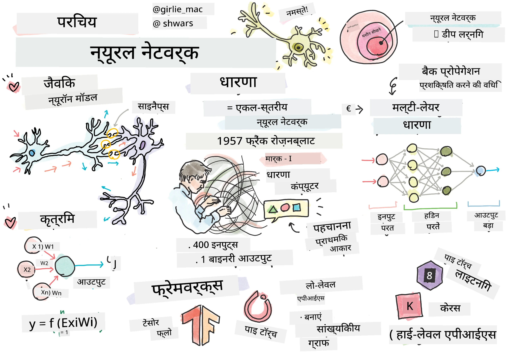
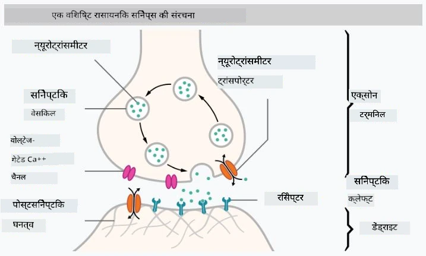
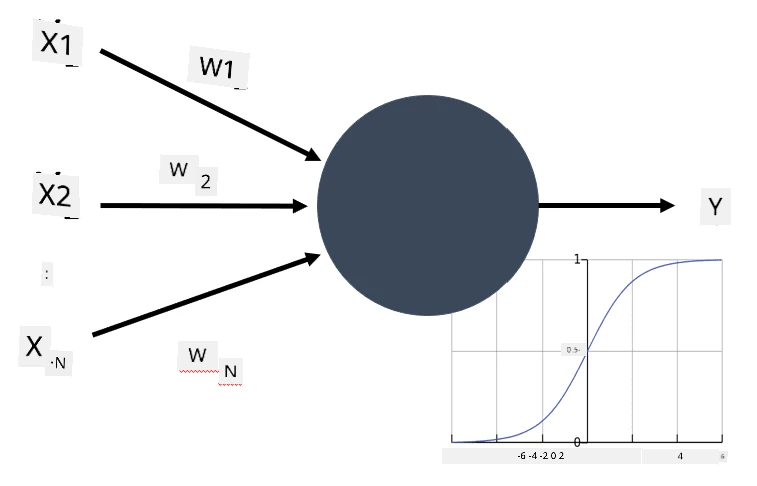

# न्यूरल नेटवर्क्स का परिचय

जैसा कि हमने परिचय में चर्चा की, बुद्धिमत्ता प्राप्त करने के तरीकों में से एक तरीका **कंप्यूटर मॉडल** या एक **कृत्रिम मस्तिष्क** को प्रशिक्षित करना है। 20वीं सदी के मध्य से, शोधकर्ताओं ने विभिन्न गणितीय मॉडल आजमाए, जब तक कि हाल के वर्षों में यह दिशा अत्यंत सफल साबित हुई। मस्तिष्क के ऐसे गणितीय मॉडल को **न्यूरल नेटवर्क्स** कहा जाता है।

> कभी-कभी न्यूरल नेटवर्क्स को *Artificial Neural Networks*, ANN कहा जाता है ताकि यह स्पष्ट हो सके कि हम वास्तविक न्यूरॉन्स के नेटवर्क नहीं बल्कि मॉडलों की बात कर रहे हैं।

## मशीन लर्निंग

न्यूरल नेटवर्क्स एक बड़े अनुशासन **मशीन लर्निंग** का हिस्सा हैं, जिसका उद्देश्य समस्याओं को हल करने में सक्षम कंप्यूटर मॉडल को डेटा से प्रशिक्षित करना है। मशीन लर्निंग कृत्रिम बुद्धिमत्ता का एक बड़ा हिस्सा है, हालांकि इस पाठ्यक्रम में हम पारंपरिक एमएल को शामिल नहीं करते।

> अतिरिक्त जानकारी के लिए हमारे अलग **[शुरुआती के लिए मशीन लर्निंग](http://github.com/microsoft/ml-for-beginners)** पाठ्यक्रम पर जाएं।

मशीन लर्निंग में, हम मानते हैं कि हमारे पास कुछ उदाहरणों का डेटासेट **X** है, और उनके संबंधित आउटपुट मान **Y**। उदाहरण अक्सर N-आयामी वेक्टर होते हैं जो **फीचर्स** से बने होते हैं, और आउटपुट को **लेबल्स** कहा जाता है।

हम दो सबसे सामान्य मशीन लर्निंग समस्याओं पर विचार करेंगे:

* **वर्गीकरण** (Classification), जहाँ हमें एक इनपुट वस्तु को दो या अधिक वर्गों में वर्गीकृत करना होता है।
* **प्रतिगमन** (Regression), जहाँ हमें प्रत्येक इनपुट उदाहरण के लिए एक संख्यात्मक मान का अनुमान लगाना होता है।

> जब इनपुट और आउटपुट को टेंसर के रूप में दर्शाया जाता है, तो इनपुट डेटासेट M×N आकार का मैट्रिक्स होता है, जहाँ M नमूनों की संख्या है और N फीचर्स की संख्या। आउटपुट लेबल Y आकार का वेक्टर होता है।

इस पाठ्यक्रम में, हम केवल न्यूरल नेटवर्क मॉडल पर ध्यान केंद्रित करेंगे।

## न्यूरॉन का मॉडल

जीवविज्ञान से हमें पता है कि हमारा मस्तिष्क न्यूरल कोशिकाओं (न्यूरॉन्स) से बना है, जिनमें से प्रत्येक के पास कई "इनपुट" (डेंड्राइट्स) और एक "आउटपुट" (एक्सॉन) होता है। डेंड्राइट्स और एक्सॉन दोनों विद्युत संकेतों का संचार कर सकते हैं, और उनके बीच कनेक्शन्स — जिन्हें सिनैप्स कहते हैं — विभिन्न स्तरों की चालकता दिखा सकते हैं, जिन्हें न्यूरोट्रांसमीटर द्वारा नियंत्रित किया जाता है।

 | 
----|----
वास्तविक न्यूरॉन *([छवि](https://en.wikipedia.org/wiki/Synapse#/media/File:SynapseSchematic_lines.svg) विकिपीडिया से)* | कृत्रिम न्यूरॉन *(लेखक द्वारा चित्रित)*

इस प्रकार, न्यूरॉन का सरलतम गणितीय मॉडल कई इनपुट्स X1, ..., XN और एक आउटपुट Y, तथा एक श्रृंखला वजन W1, ..., WN को शामिल करता है। आउटपुट की गणना इस प्रकार होता है:

जहाँ f कोई गैर-रैखिक **सक्रियण फ़ंक्शन** होता है।

> न्यूरॉन के प्रारंभिक मॉडल 1943 में वॉरेन मैककुलॉक और वाल्टर पिट्स द्वारा लिखित क्लासिक पेपर [A logical calculus of the ideas immanent in nervous activity](https://www.cs.cmu.edu/~./epxing/Class/10715/reading/McCulloch.and.Pitts.pdf) में वर्णित किए गए थे। डोनाल्ड हेब ने अपनी पुस्तक "[The Organization of Behavior: A Neuropsychological Theory](https://books.google.com/books?id=VNetYrB8EBoC)" में बताया कि उन नेटवर्क्स को कैसे प्रशिक्षित किया जा सकता है।

## इस अनुभाग में

इस अनुभाग में हम सीखेंगे:
* [परसेप्ट्रोन](03-Perceptron/README.md), दो-क्लास वर्गीकरण के लिए प्रारंभिक न्यूरल नेटवर्क मॉडल में से एक
* [मल्टी-लेयर्ड नेटवर्क्स](04-OwnFramework/README.md) जो अपने फ्रेमवर्क को बनाने के लिए एक जोड़ीदार नोटबुक के साथ हैं [कैसे अपना फ्रेमवर्क बनाएं](04-OwnFramework/OwnFramework.ipynb)
* [न्यूरल नेटवर्क फ्रेमवर्क्स](05-Frameworks/README.md), जिनमें ये नोटबुक शामिल हैं: [PyTorch](05-Frameworks/IntroPyTorch.ipynb) और [Keras/Tensorflow](05-Frameworks/IntroKerasTF.ipynb)
* [ओवरफिटिंग](../../../../lessons/3-NeuralNetworks/05-Frameworks#overfitting)

---

<!-- CO-OP TRANSLATOR DISCLAIMER START -->
**अस्वीकरण**:
इस दस्तावेज़ का अनुवाद AI अनुवाद सेवा [Co-op Translator](https://github.com/Azure/co-op-translator) का उपयोग करके किया गया है। जबकि हम सटीकता के लिए प्रयास करते हैं, कृपया ध्यान दें कि स्वचालित अनुवादों में त्रुटियाँ या अशुद्धियाँ हो सकती हैं। मूल दस्तावेज़ अपनी मूल भाषा में ही प्रामाणिक स्रोत माना जाना चाहिए। महत्वपूर्ण जानकारी के लिए, पेशेवर मानव अनुवाद की सिफारिश की जाती है। इस अनुवाद के उपयोग से उत्पन्न किसी भी गलतफहमी या गलत व्याख्या के लिए हम उत्तरदायी नहीं हैं।
<!-- CO-OP TRANSLATOR DISCLAIMER END -->