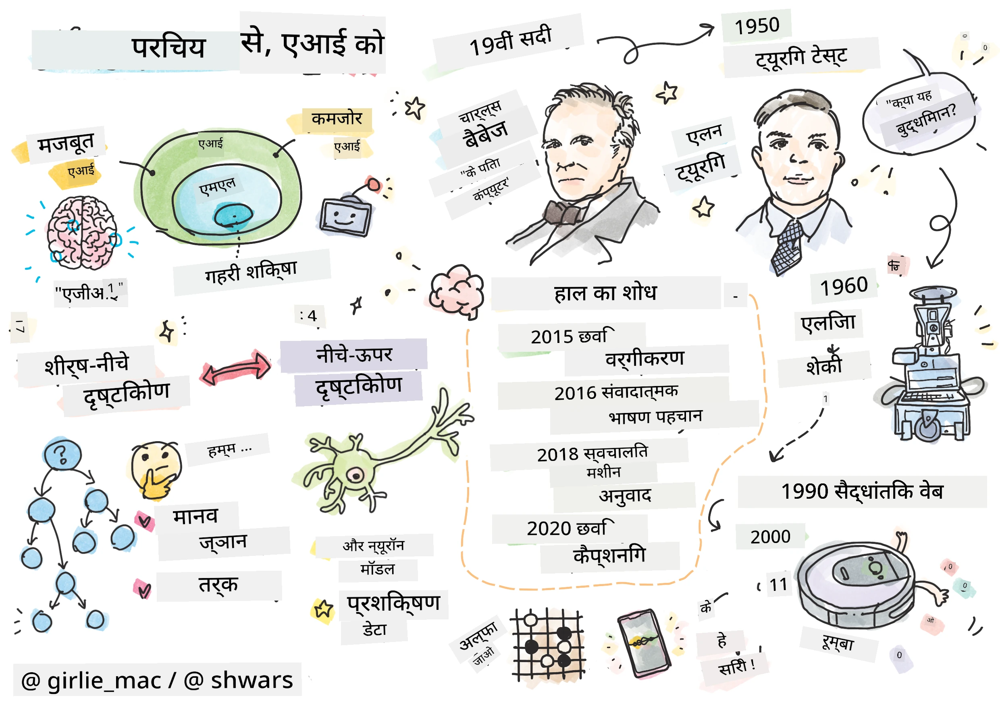
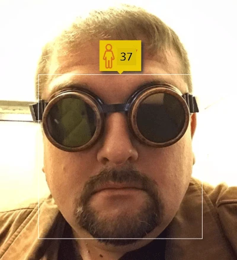
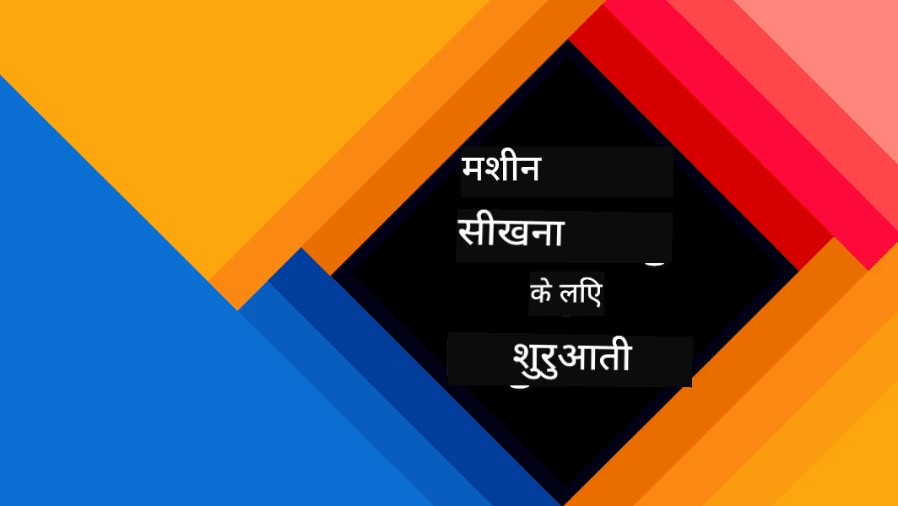
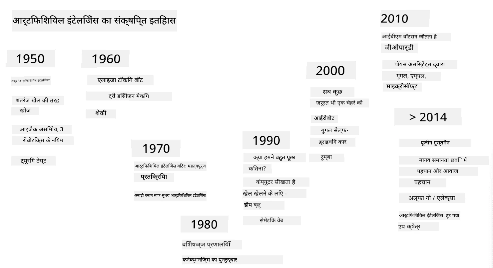
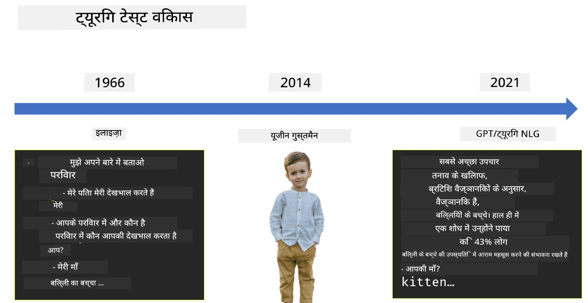
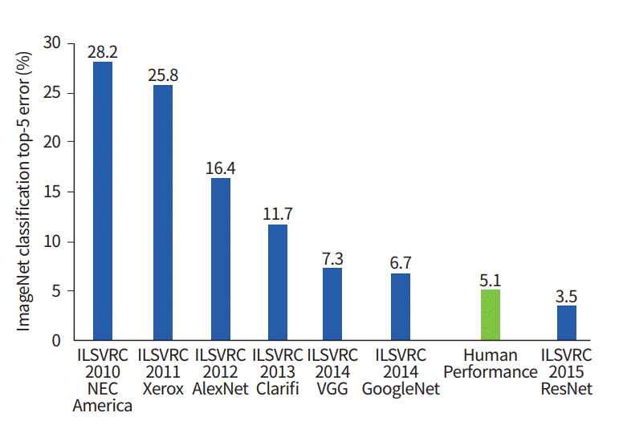

# AI ka Introduction

> Sketchnote [Tomomi Imura](https://twitter.com/girlie_mac) ki taraf se

## [Pre-lecture quiz](https://ff-quizzes.netlify.app/en/ai/quiz/1)

**Artificial Intelligence** ek exciting scientific field hai jisme hum study karte hain ki computers ko intelligent behavior kaise sikhaya jaye — jaise woh kaam jo insaan achhe se kar lete hain.

Shuru mein, computer ko [Charles Babbage](https://en.wikipedia.org/wiki/Charles_Babbage) ne numbers par ek tay process — yaani ek algorithm — ke hisaab se kaam karne ke liye invent kiya tha. Modern computers 19th century mein propose kiye gaye original model se kaafi advanced hain, lekin woh bhi controlled calculations ke usi idea ko follow karte hain. Isliye agar hamein pata hai ki goal tak pahunchne ke liye steps ka exact sequence kya hai, toh computer ko kuch karne ke liye program karna possible hai.

> Photo [Vickie Soshnikova](http://twitter.com/vickievalerie) ki taraf se

> ✅ Kisi insaan ki photo se uski age batana aisa task hai jise explicitly program nahi kiya ja sakta, kyunki jab hum yeh karte hain toh hamare dimaag mein woh number kaise aata hai, yeh hamein pata hi nahi hota.

---

Lekin kuch tasks aise hote hain jinhe solve karne ka tareeka hamein explicitly pata nahi hota. Jaise ki, kisi insaan ki photo se uski age batana. Hum yeh kisi tarah seekh lete hain, kyunki hamne alag-alag age ke bahut saare logon ko dekha hota hai, lekin hum explicitly samjha nahi sakte ki hum yeh kaise karte hain, aur na hi hum computer ko yeh karne ke liye program kar sakte hain. Isi tarah ke task mein **Artificial Intelligence** (short mein AI) ki dilchaspi hoti hai.

✅ Un tasks ke baare mein socho jo aap computer ko de sakte hain aur jinhe AI se fayda ho sakta hai. Finance, medicine aur arts ke fields ke baare mein socho — aaj yeh fields AI se kaise fayda utha rahe hain?

## Weak AI vs Strong AI

Weak AI | Strong AI
---------------------------------------|-------------------------------------
Weak AI un AI systems ko kehte hain jo kisi specific task ya tasks ke ek chhote set ke liye design aur train kiye gaye hain.|Strong AI, ya Artificial General Intelligence (AGI), un AI systems ko kehte hain jinme human-level intelligence aur understanding hoti hai.
Yeh AI systems general taur par intelligent nahi hote; woh ek pehle se tay task ko karne mein shandaar hote hain, lekin unme asli understanding ya consciousness nahi hoti.|Yeh AI systems koi bhi intellectual task kar sakte hain jo ek insaan kar sakta hai, alag-alag domains mein adapt kar sakte hain, aur unme consciousness ya self-awareness ka koi roop hota hai.
Weak AI ke examples mein virtual assistants jaise Siri ya Alexa, streaming services ke recommendation algorithms, aur specific customer service tasks ke liye design kiye gaye chatbots shamil hain.|Strong AI, AI research ka long-term goal hai aur iske liye aise AI systems develop karne honge jo alag-alag tasks aur contexts mein reasoning, learning, understanding aur adapt kar sakein.
Weak AI bahut specialized hota hai aur isme apne narrow domain se bahar human-jaisi cognitive abilities ya general problem-solving capabilities nahi hoti.|Strong AI abhi ek theoretical concept hai, aur koi bhi AI system abhi tak is level ki general intelligence tak nahi pahunchi hai.

Zyada jaankari ke liye **[Artificial General Intelligence](https://en.wikipedia.org/wiki/Artificial_general_intelligence)** (AGI) dekhiye.

## Intelligence ki Definition aur Turing Test

**[Intelligence](https://en.wikipedia.org/wiki/Intelligence)** term ke saath ek problem yeh hai ki is term ki koi clear definition nahi hai. Koi argue kar sakta hai ki intelligence **abstract thinking** ya **self-awareness** se juda hai, lekin hum ise theek se define nahi kar sakte.

> [Photo](https://unsplash.com/photos/75715CVEJhI) [Amber Kipp](https://unsplash.com/@sadmax) ki taraf se, Unsplash se

*Intelligence* term ki ambiguity dekhne ke liye, is sawaal ka jawab dene ki koshish kijiye: "Kya ek billi intelligent hai?" Alag-alag log is sawaal ke alag-alag jawab dete hain, kyunki is claim ko sach ya galat sabit karne ke liye koi universally accepted test nahi hai. Aur agar aapko lagta hai ki hai — toh apni billi ko ek IQ test dilwa ke dekhiye...

✅ Ek minute ke liye socho ki aap intelligence ko kaise define karte hain. Kya ek kauwa jo maze ko solve karke khaane tak pahunch jata hai, intelligent hai? Kya ek bachcha intelligent hai?

---

Jab hum AGI ki baat karte hain, toh hamare paas yeh batane ka koi tareeka hona chahiye ki kya hamne sach mein ek intelligent system bana liya hai. [Alan Turing](https://en.wikipedia.org/wiki/Alan_Turing) ne ek tareeka propose kiya jise **[Turing Test](https://en.wikipedia.org/wiki/Turing_test)** kehte hain, jo intelligence ki definition ka bhi kaam karta hai. Yeh test diye gaye system ko kisi natural taur par intelligent cheez — ek asli insaan — se compare karta hai, aur kyunki koi bhi automated comparison ek computer program bypass kar sakta hai, hum ek human interrogator ka use karte hain. Toh agar ek insaan text-based conversation mein asli insaan aur computer system ke beech farq nahi bata paata — toh system ko intelligent maana jata hai.

> [Eugene Goostman](https://en.wikipedia.org/wiki/Eugene_Goostman) naam ka ek chat-bot, jo Saint Petersburg mein develop hua tha, 2014 mein ek chalaak persona trick use karke Turing test pass karne ke kareeb aaya. Usne pehle hi bata diya tha ki woh 13 saal ka Ukrainian ladka hai, jisse knowledge ki kami aur text mein kuch inconsistencies explain ho jati hain. Bot ne 5 minute ki conversation ke baad 30% judges ko yakeen dila diya ki woh insaan hai — yeh woh metric tha jise Turing ne maana tha ki ek machine 2000 tak pass kar legi. Lekin yeh samajhna zaroori hai ki iska matlab yeh nahi hai ki hamne ek intelligent system bana liya hai, ya ki computer system ne human interrogator ko bewakoof banaya — system ne insaanon ko bewakoof nahi banaya, balki bot banane walon ne banaya!

✅ Kya aapko kabhi kisi chat bot ne yeh sochne par majboor kiya hai ki aap kisi insaan se baat kar rahe hain? Usne aapko yakeen kaise dilaya?

## AI ke alag-alag Approaches

Agar hum chahte hain ki computer insaan ki tarah behave kare, toh hamein kisi tarah computer ke andar hamari sochne ki process ko model karna hoga. Isliye hamein yeh samajhne ki koshish karni hogi ki ek insaan ko intelligent kya banata hai.

> Machine mein intelligence program karne ke liye, hamein yeh samajhna hoga ki hamare apne decision-making processes kaise kaam karte hain. Agar aap thoda self-introspection karein, toh aapko realize hoga ki kuch processes subconsciously hote hain – jaise hum bina sochein billi aur kutte mein farq kar lete hain – jabki kuch dusre processes mein reasoning shamil hoti hai.

Is problem ke do possible approaches hain:

Top-down Approach (Symbolic Reasoning) | Bottom-up Approach (Neural Networks)
---------------------------------------|-------------------------------------
Top-down approach us tareeke ko model karta hai jisse ek insaan problem solve karne ke liye reason karta hai. Isme kisi insaan se **knowledge** nikalna, aur use computer-readable form mein represent karna shamil hai. Hamein computer ke andar **reasoning** ko model karne ka tareeka bhi develop karna hoga. | Bottom-up approach human brain ke structure ko model karta hai, jisme **neurons** naam ki bahut saari simple units hoti hain. Har neuron apne inputs ke weighted average ki tarah kaam karta hai, aur hum **training data** dekar neurons ke network ko useful problems solve karne ke liye train kar sakte hain.

Intelligence ke kuch aur possible approaches bhi hain:

* **Emergent**, **Synergetic** ya **Multi-agent approach** is baat par based hai ki bahut saare simple agents ke interaction se complex intelligent behavior paaya ja sakta hai. [Evolutionary cybernetics](https://en.wikipedia.org/wiki/Global_brain#Evolutionary_cybernetics) ke mutabik, intelligence *metasystem transition* ki process mein zyada simple, reactive behavior se *emerge* ho sakti hai.

* **Evolutionary approach**, ya **Genetic Algorithm**, ek optimization process hai jo evolution ke principles par based hai.

In approaches ko hum course mein aage dekhenge, lekin abhi hum do main directions par focus karenge: top-down aur bottom-up.

### Top-down Approach

**Top-down approach** mein hum apni reasoning ko model karne ki koshish karte hain. Kyunki jab hum reason karte hain toh hum apne thoughts ko follow kar sakte hain, hum is process ko formalize karke computer ke andar program karne ki koshish kar sakte hain. Ise **symbolic reasoning** kehte hain.

Logon ke paas kuch rules hote hain jo unke decision-making processes ko guide karte hain. Jaise ki, jab ek doctor kisi patient ko diagnose kar raha hota hai, toh use lag sakta hai ki vyakti ko bukhar hai, aur isliye body ke andar kuch inflammation ho sakti hai. Ek doctor ek specific problem par rules ka bada set apply karke final diagnosis tak pahunch sakta hai.

Yeh approach **knowledge representation** aur **reasoning** par bahut zyada depend karti hai. Kisi human expert se knowledge nikalna sabse mushkil hissa ho sakta hai, kyunki kai cases mein doctor ko pata hi nahi hota ki woh ek particular diagnosis par kyun pahunch raha hai. Kabhi-kabhi solution bina explicit sochein uske dimaag mein aa jata hai. Kuch tasks, jaise kisi insaan ki photo se uski age batana, ko knowledge manipulate karne tak bilkul bhi reduce nahi kiya ja sakta.

### Bottom-up Approach

Alternative taur par, hum apne brain ke sabse simple element – ek neuron – ko model karne ki koshish kar sakte hain. Hum computer ke andar ek so-called **artificial neural network** bana sakte hain, aur phir use examples dekar problems solve karna sikhane ki koshish kar sakte hain. Yeh process aisi hai jaise ek newborn baby apne aas-paas ko observe karke seekhta hai.

✅ Thoda research kijiye ki bachche kaise seekhte hain. Bachche ke brain ke basic elements kya hain?

> | ML ke baare mein kya?         |      |
> |--------------|-----------|
> | Artificial Intelligence ka woh hissa jo kisi problem ko kuch data ke basis par solve karne ke liye computer ko seekhne par based hai, use **Machine Learning** kehte hain. Hum is course mein classical Machine Learning ko cover nahi karenge — iske liye hum aapko ek alag [Machine Learning for Beginners](http://aka.ms/ml-beginners) curriculum ki taraf refer karte hain. |       |

## AI ka Brief History

Artificial Intelligence ko 20th century ke beech mein ek field ke roop mein shuru kiya gaya tha. Shuru mein, symbolic reasoning ek prominent approach thi, aur isne kuch important successes diye, jaise expert systems – computer programs jo kuch limited problem domains mein expert ki tarah kaam kar sakte the. Lekin jaldi hi yeh clear ho gaya ki aisi approach achhe se scale nahi karti. Kisi expert se knowledge nikalna, use computer mein represent karna, aur us knowledge base ko accurate rakhna ek bahut complex task nikla, aur kai cases mein practically bahut mehnga bhi. Isi wajah se 1970s mein so-called [AI Winter](https://en.wikipedia.org/wiki/AI_winter) aaya.

> Image [Dmitry Soshnikov](http://soshnikov.com) ki taraf se

Waqt ke saath, computing resources sasta hote gaye, aur zyada data available hone laga, toh neural network approach ne kai fields mein, jaise computer vision ya speech understanding mein, insaanon ke saath competition mein shandaar performance dikhana shuru kar diya. Pichle dashak mein, Artificial Intelligence term ka use zyadatar neural networks ke synonym ke roop mein hua hai, kyunki AI ki zyadatar successes jinke baare mein hum sunte hain, unhi par based hain.

Hum dekh sakte hain ki approaches kaise badli, jaise ki chess khelne wala computer program banane mein:

* Shuruaati chess programs search par based the – program explicitly agle kuch moves ke liye opponent ke possible moves ka andaza lagane ki koshish karta tha, aur kuch moves mein paayi ja sakne wali optimal position ke basis par ek optimal move chunta tha. Isse so-called [alpha-beta pruning](https://en.wikipedia.org/wiki/Alpha%E2%80%93beta_pruning) search algorithm develop hua.
* Search strategies game ke end ke paas achhe se kaam karti hain, jahan search space kuch possible moves ki chhoti sankhya tak seemit hota hai. Lekin game ki shuruaat mein, search space bahut bada hota hai, aur algorithm ko insaani players ke beech maujooda matches se seekhkar improve kiya ja sakta hai. Baad ke experiments mein so-called [case-based reasoning](https://en.wikipedia.org/wiki/Case-based_reasoning) use hua, jahan program knowledge base mein aise cases dhoondta tha jo game ki current position ke bahut similar hon.
* Aaj ke modern programs jo insaani players ko haraate hain, woh neural networks aur [reinforcement learning](https://en.wikipedia.org/wiki/Reinforcement_learning) par based hain, jahan programs sirf apne aap ke khilaf lambe time tak khelkar aur apni galtiyon se seekhkar khelna seekhte hain – bilkul waise hi jaise insaan chess khelna seekhte hain. Lekin, ek computer program bahut kam time mein bahut zyada games khel sakta hai, aur isliye bahut tezi se seekh sakta hai.

✅ Un dusre games ke baare mein thoda research kijiye jo AI ne khele hain.

Isi tarah, hum dekh sakte hain ki "talking programs" (jo Turing test pass kar sakte hain) banane ki approach kaise badli:

* Is type ke shuruaati programs, jaise [Eliza](https://en.wikipedia.org/wiki/ELIZA), bahut simple grammatical rules aur input sentence ko question mein reformulate karne par based the.
* Modern assistants, jaise Cortana, Siri ya Google Assistant sabhi hybrid systems hain jo speech ko text mein convert karne aur hamare intent ko recognize karne ke liye neural networks use karte hain, aur phir zaroori actions karne ke liye kuch reasoning ya explicit algorithms use karte hain.
* Future mein, hum umeed kar sakte hain ki ek complete neural-based model khud conversation ko handle karega. Haal hi mein GPT aur [Turing-NLG](https://www.microsoft.com/research/blog/turing-nlg-a-17-billion-parameter-language-model-by-microsoft) neural network families is area mein badi success dikha rahi hain.

> Image Dmitry Soshnikov ki taraf se, [photo](https://unsplash.com/photos/r8LmVbUKgns) Marina Abrosimova ki taraf se [Marina Abrosimova](https://unsplash.com/@abrosimova_marina_foto), Unsplash

## Recent AI Research

Neural network research mein haal ki badi growth lagbhag 2010 mein shuru hui, jab bade public datasets available hone lage. [ImageNet](https://en.wikipedia.org/wiki/ImageNet) naam ka images ka ek bada collection, jisme lagbhag 14 million annotated images hain, ne [ImageNet Large Scale Visual Recognition Challenge](https://image-net.org/challenges/LSVRC/) ko janm diya.

> Image [Dmitry Soshnikov](http://soshnikov.com) ki taraf se

2012 mein, [Convolutional Neural Networks](../4-ComputerVision/07-ConvNets/README.md) ko pehli baar image classification mein use kiya gaya, jisse classification errors mein kaafi kami aayi (lagbhag 30% se 16.4% tak). 2015 mein, Microsoft Research ki ResNet architecture ne [human-level accuracy achieve ki](https://doi.org/10.1109/ICCV.2015.123).

Tab se, neural networks ne kai tasks mein bahut successful behavior dikhaya hai:

---

Year | Human parity achieve hui
-----|--------
2015 | [Image Classification](https://doi.org/10.1109/ICCV.2015.123)
2016 | [Conversational Speech Recognition](https://arxiv.org/abs/1610.05256)
2018 | [Automatic Machine Translation](https://arxiv.org/abs/1803.05567) (Chinese se English)
2020 | [Image Captioning](https://arxiv.org/abs/2009.13682)

Pichle kuch saalon mein hamne BERT aur GPT-3 jaise bade language models ke saath badi successes dekhi hain. Yeh mainly isliye hua kyunki bahut saara general text data available hai jo hamein models ko text ka structure aur meaning samajhne ke liye train karne deta hai, unhe general text collections par pre-train karke, aur phir un models ko zyada specific tasks ke liye specialize karke. Is course mein aage hum [Natural Language Processing](../5-NLP/README.md) ke baare mein aur seekhenge.

## 🚀 Challenge

Internet par ek round lagaiye aur decide kijiye ki aapke hisaab se AI ka sabse effective use kahan ho raha hai. Kya woh kisi mapping app mein hai, ya kisi speech-to-text service mein ya kisi video game mein? Research kijiye ki yeh system kaise banaya gaya tha.

## [Post-lecture quiz](https://ff-quizzes.netlify.app/en/ai/quiz/2)

## Review & Self Study

AI aur ML ke history ko [is lesson](https://github.com/microsoft/ML-For-Beginners/tree/main/1-Introduction/2-history-of-ML) ko padhkar review kijiye. Us lesson ke top se ya is lesson ke sketchnote se ek element chuniye aur use zyada gehrai se research kijiye, taaki uske evolution ko influence karne wala cultural context samajh sakein.

**Assignment**: [Game Jam](assignment.md)

---

<!-- HINGLISH NOTE START -->
**Note**:
Yeh document Hindi translation ko Hinglish (Roman script) mein convert karke banaya gaya hai, taaki padhna aur samajhna aasaan ho.
Isme kuch galtiyan ya anuvaad ki kamiyan ho sakti hain. Sabse sahi jaankari ke liye original English document ko hi authoritative source maanein.
<!-- HINGLISH NOTE END -->
