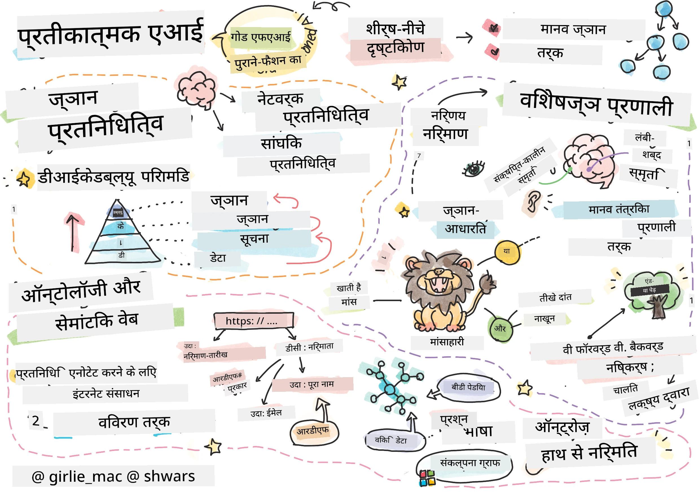
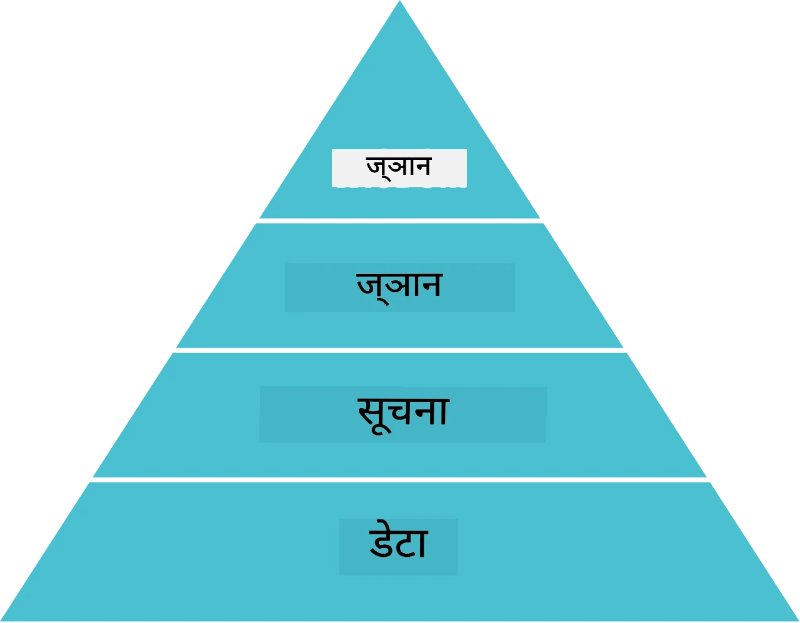
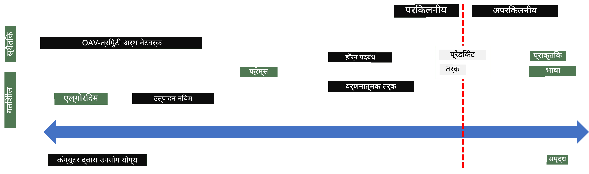
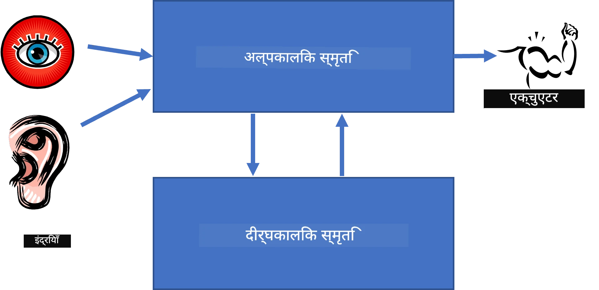
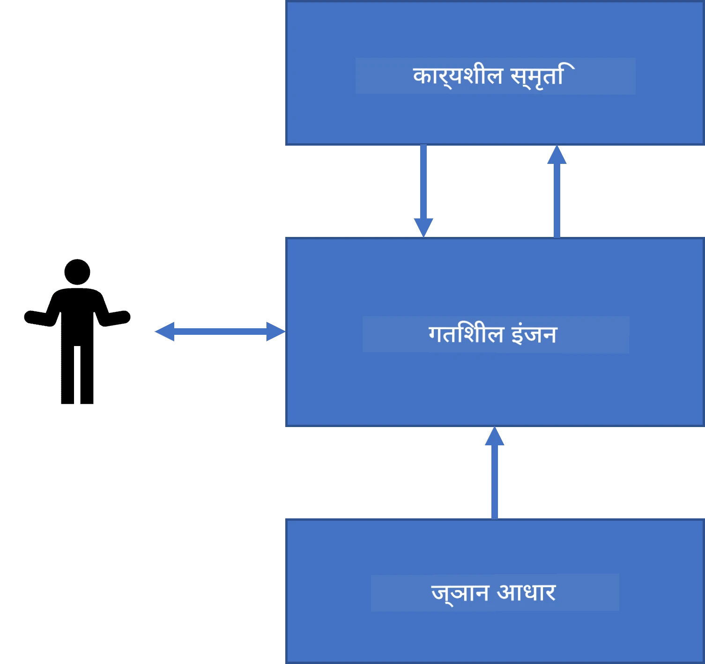
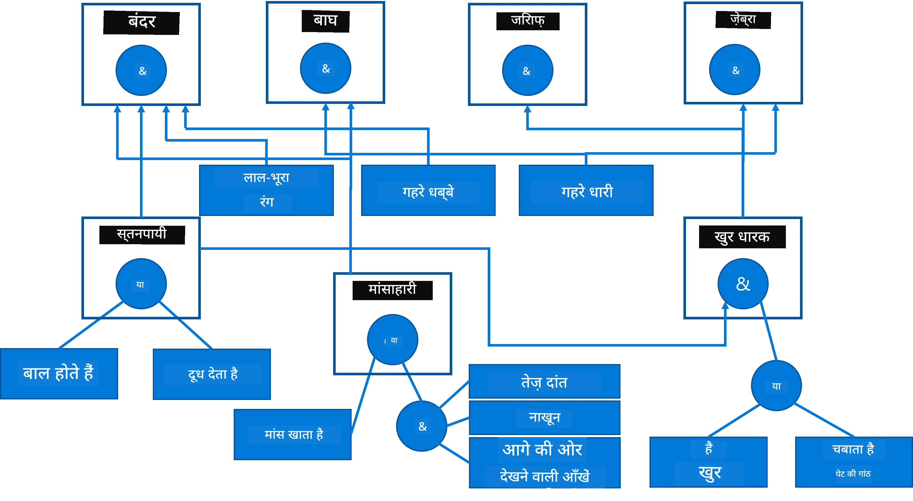
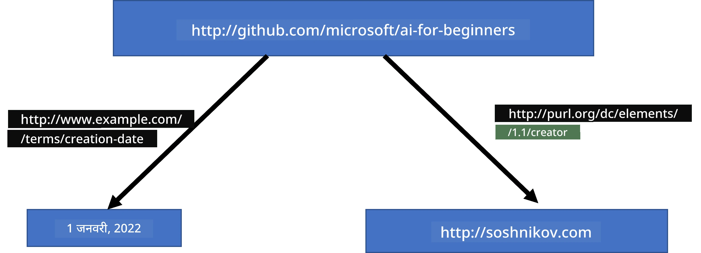
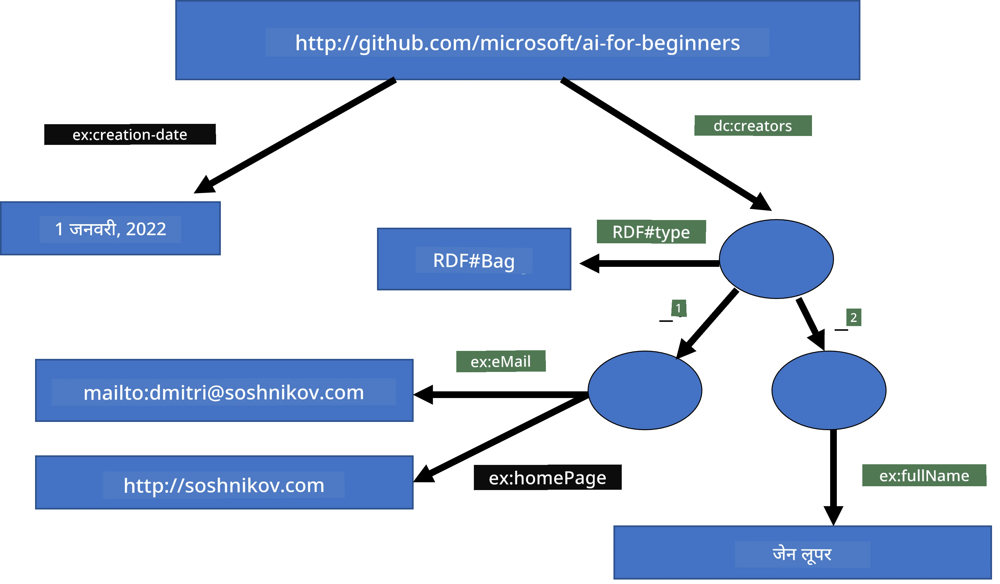
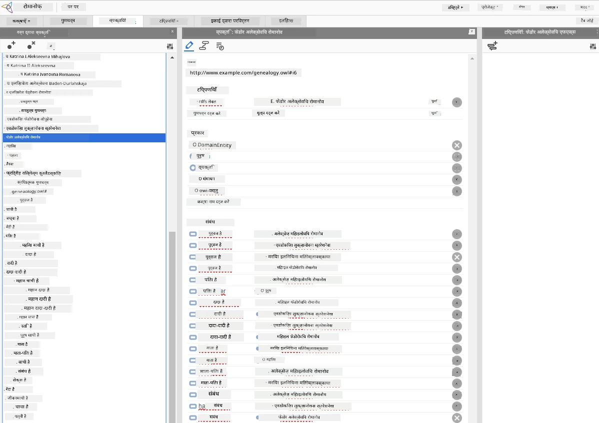

# Knowledge Representation aur Expert Systems



> Sketchnote: [Tomomi Imura](https://twitter.com/girlie_mac)

Artificial Intelligence ki khoj is baat par tiki hai ki hum knowledge ko dhoondhein, taaki duniya ko wahi insaan ki tarah samjha ja sake. Lekin yeh kaise kiya jaye?

## [Pre-lecture quiz](https://ff-quizzes.netlify.app/en/ai/quiz/3)

AI ke shuruaati dinon mein intelligent systems banane ke liye top-down approach (jiske baare mein pichhle lesson mein baat hui thi) kaafi popular thi. Idea yeh tha ki logon se knowledge ko machine-readable form mein nikaala jaye, aur phir usse problems ko automatically solve kiya jaye. Yeh approach do bade ideas par based thi:

* Knowledge Representation
* Reasoning

## Knowledge Representation

Symbolic AI ka ek important concept hai **knowledge**. Knowledge ko *information* ya *data* se alag samajhna zaroori hai. Jaise, hum keh sakte hain ki books mein knowledge hota hai, kyunki book padh kar koi expert ban sakta hai. Lekin books jo asal mein rakhti hain, usse *data* kehte hain, aur books padhkar tatha is data ko apne world model mein integrate karke hum ise knowledge mein badalte hain.

> ✅ **Knowledge** woh cheez hai jo hamare dimaag mein hoti hai aur duniya ke baare mein hamari understanding ko represent karti hai. Ise ek active **learning** process se paaya jaata hai, jo humein milne wali information ko hamare active world model mein integrate karta hai.

Zyadatar, hum knowledge ko strictly define nahi karte, balki ise [DIKW Pyramid](https://en.wikipedia.org/wiki/DIKW_pyramid) ka use karke doosre related concepts ke saath align karte hain. Isme yeh concepts shaamil hain:

* **Data** woh hai jo kisi physical medium mein represent hota hai, jaise likha hua text ya bole gaye shabd. Data insaanon se independent roop se exist karta hai aur logon ke beech pass kiya ja sakta hai.
* **Information** woh hai jo hum apne dimaag mein data se interpret karte hain. Jaise, jab hum shabd *computer* sunte hain, toh hamare dimaag mein uski kuch understanding hoti hai.
* **Knowledge** woh information hai jo hamare world model mein integrate ho chuki hoti hai. Jaise, jab hum seekhte hain ki computer kya hota hai, toh hum sochna shuru karte hain ki yeh kaise kaam karta hai, iski cost kya hai, aur ise kis kaam mein use kiya jaata hai. Interconnected concepts ka yeh network hamari knowledge banata hai.
* **Wisdom** hamari duniya ki understanding ka ek aur level hai, aur yeh *meta-knowledge* ko represent karta hai, yaani knowledge ke use ke baare mein kuch idea ki ise kab aur kaise use karna chahiye.



*Image [Wikipedia se](https://commons.wikimedia.org/w/index.php?curid=37705247), Longlivetheux dwara - Own work, CC BY-SA 4.0*

Toh, **knowledge representation** ki problem yeh hai ki knowledge ko computer ke andar data ke roop mein kisi effective tareeke se represent kiya jaye, taaki ise automatically use kiya ja sake. Ise ek spectrum ke roop mein dekha ja sakta hai:



> Image [Dmitry Soshnikov](http://soshnikov.com) dwara

* Left side par bahut simple types ke knowledge representation hain jinhe computers effectively use kar sakte hain. Sabse simple algorithmic hai, jahan knowledge ko computer program represent karta hai. Lekin, yeh knowledge ko represent karne ka sabse accha tareeka nahi hai kyunki yeh flexible nahi hai. Hamare dimaag mein knowledge aksar non-algorithmic hota hai.
* Right side par natural text jaise representations hain. Yeh sabse powerful hai, lekin ise automated reasoning ke liye use nahi kiya ja sakta.

> ✅ Ek minute sochiye ki aap apne dimaag mein knowledge ko kaise represent karte hain aur use notes mein kaise convert karte hain. Kya koi particular format hai jo aapko yaad rakhne mein madad karta hai?

## Computer knowledge representations ka classification

Hum alag-alag computer knowledge representation methods ko in categories mein classify kar sakte hain:

* **Network representations** is baat par based hain ki hamare dimaag mein concepts ka ek network hota hai. Hum isi network ko computer ke andar graph ke roop mein dobara banane ki koshish kar sakte hain - ise **semantic network** kehte hain.

1. **Object-Attribute-Value triplets** ya **attribute-value pairs**. Kyunki graph ko computer mein nodes aur edges ki list ke roop mein represent kiya ja sakta hai, hum semantic network ko triplets ki list se represent kar sakte hain, jisme objects, attributes aur values hoti hain. Jaise, programming languages ke baare mein hum yeh triplets banate hain:

Object | Attribute | Value
-------|-----------|------
Python | hai | Untyped-language
Python | invented-by | Guido van Rossum
Python | block-syntax | indentation
Untyped-language | nahi hai | type definitions

> ✅ Sochiye ki triplets ka use doosre types ke knowledge ko represent karne ke liye kaise kiya ja sakta hai.

2. **Hierarchical representations** is baat par zor dete hain ki hum aksar apne dimaag mein objects ki ek hierarchy banate hain. Jaise, humein pata hai ki canary ek bird hai, aur sabhi birds ke wings hote hain. Humein yeh bhi kuch idea hota hai ki canary aam taur par kis colour ki hoti hai, aur uski flight speed kitni hoti hai.

   - **Frame representation** har object ya object class ko ek **frame** ke roop mein represent karne par based hai jisme **slots** hote hain. Slots mein possible default values, value restrictions, ya stored procedures ho sakti hain jinhe call karke slot ki value mil sakti hai. Saare frames ek hierarchy banate hain jo object-oriented programming languages mein object hierarchy ke jaisi hoti hai.
   - **Scenarios** special type ke frames hote hain jo time ke saath develop hone wali complex situations ko represent karte hain.

**Python**

Slot | Value | Default value | Interval |
-----|-------|---------------|----------|
Name | Python | | |
Is-A | Untyped-language | | |
Variable Case | | CamelCase | |
Program length | | | 5-5000 lines |
Block Syntax | Indent | | |

3. **Procedural representations** knowledge ko actions ki list ke roop mein represent karne par based hain, jo kisi particular condition ke aane par execute hoti hain.
   - Production rules if-then statements hote hain jo humein conclusions nikaalne dete hain. Jaise, ek doctor ke paas ek rule ho sakta hai ki **agar** patient ko high fever hai **ya** blood test mein C-reactive protein ka level high hai, **toh** patient ko inflammation hai. Jab humein inme se koi bhi condition milti hai, hum inflammation ke baare mein conclude kar sakte hain, aur phir ise aage ke reasoning mein use karte hain.
   - Algorithms ko bhi procedural representation ka ek aur type maana ja sakta hai, halaanki unhe knowledge-based systems mein seedhe use lagbhag kabhi nahi kiya jaata.

4. **Logic** ko originally Aristotle ne universal human knowledge ko represent karne ke liye propose kiya tha.
   - Mathematical theory ke roop mein Predicate Logic bahut rich hai, isliye aam taur par uska koi subset use hota hai, jaise Prolog mein use hone wale Horn clauses.
   - Descriptive Logic logical systems ka ek family hai jo objects ki hierarchies aur *Semantic Web* jaise distributed knowledge representations ke baare mein reasoning karne ke liye use hoti hai.

## Expert Systems

Symbolic AI ki shuruaati safaltaon mein se ek the **expert systems** - computer systems jinhe kisi limited problem domain mein expert ki tarah kaam karne ke liye design kiya gaya tha. Yeh ek ya zyada human experts se nikaale gaye **knowledge base** par based the, aur inke paas ek **inference engine** hota tha jo uske upar reasoning karta tha.

 | 
---------------------------------------------|------------------------------------------------
Human neural system ka simplified structure | Knowledge-based system ka architecture

Expert systems ko human reasoning system ki tarah banaya jaata hai, jisme **short-term memory** aur **long-term memory** hoti hai. Isi tarah, knowledge-based systems mein hum yeh components alag karte hain:

* **Problem memory**: Isme us problem ke baare mein knowledge hota hai jise abhi solve kiya ja raha hai, jaise patient ka temperature ya blood pressure, use inflammation hai ya nahi, etc. Is knowledge ko **static knowledge** bhi kehte hain, kyunki isme problem ke baare mein abhi jo humein pata hai uska snapshot hota hai - jise *problem state* kehte hain.
* **Knowledge base**: Yeh kisi problem domain ke baare mein long-term knowledge ko represent karta hai. Ise human experts se manually nikaala jaata hai, aur yeh consultation se consultation tak badalta nahi hai. Kyunki yeh humein ek problem state se doosre mein navigate karne deta hai, ise **dynamic knowledge** bhi kehte hain.
* **Inference engine**: Yeh problem state space mein search ki poori process ko orchestrate karta hai, zarurat padne par user se sawaal puchta hai. Yeh har state par lagne wale sahi rules dhoondhne ke liye bhi responsible hota hai.

Jaise, animal ko uski physical characteristics ke basis par identify karne wale is expert system ko dekhiye:



> Image [Dmitry Soshnikov](http://soshnikov.com) dwara

Is diagram ko **AND-OR tree** kehte hain, aur yeh production rules ke ek set ka graphical representation hai. Expert se knowledge nikaalne ki shuruaat mein tree banana useful hota hai. Computer ke andar knowledge ko represent karne ke liye rules use karna zyada convenient hota hai:

```
IF the animal eats meat
OR (animal has sharp teeth
    AND animal has claws
    AND animal has forward-looking eyes
) 
THEN the animal is a carnivore
```

Aap dekh sakte hain ki rule ke left-hand side ki har condition aur action asal mein object-attribute-value (OAV) triplets hi hain. **Working memory** mein OAV triplets ka woh set hota hai jo abhi solve ki ja rahi problem se match karta hai. **Rules engine** woh rules dhoondhta hai jinki condition satisfy ho chuki hai aur unhe apply karta hai, working memory mein ek aur triplet add karte hue.

> ✅ Apni pasand ke kisi topic par apna AND-OR tree banaiye!

### Forward aur Backward Inference

Upar jo process describe ki gayi hai use **forward inference** kehte hain. Yeh working memory mein problem ke baare mein kuch initial data ke saath shuru hoti hai, aur phir yeh reasoning loop chalati hai:

1. Agar target attribute working memory mein maujood hai - ruk jaiye aur result dijiye
2. Un saare rules ko dhoondhiye jinki condition abhi satisfy ho chuki hai - **conflict set** milta hai.
3. **Conflict resolution** kijiye - ek rule chuniye jo is step mein execute hoga. Conflict resolution ki alag-alag strategies ho sakti hain:
   - Knowledge base mein pehla applicable rule chuniye
   - Ek random rule chuniye
   - Ek *zyada specific* rule chuniye, yaani jo "left-hand side" (LHS) mein sabse zyada conditions ko satisfy karta ho
4. Chune hue rule ko apply kijiye aur problem state mein naya knowledge add kijiye
5. Step 1 se dobara dohraiye.

Lekin, kuch cases mein hum problem ke baare mein khaali knowledge se shuru karna chahte hain, aur aise sawaal puchna chahte hain jo humein conclusion tak le jaayein. Jaise, medical diagnosis karte waqt, hum aam taur par patient ka diagnosis shuru karne se pehle saare tests nahi karwate. Hum tests tab karwate hain jab decision lena zaroori hota hai.

Is process ko **backward inference** se model kiya ja sakta hai. Yeh **goal** se driven hoti hai - woh attribute value jise hum dhoondh rahe hain:

1. Un saare rules ko chuniye jo humein goal ki value de sakte hain (yaani goal RHS ("right-hand side") par ho) - conflict set
1. Agar is attribute ke liye koi rule nahi hai, ya koi rule kehta hai ki is value ke liye user se poocha jaana chahiye - toh poochiye, warna:
1. Conflict resolution strategy use karke ek rule chuniye jise hum *hypothesis* ki tarah use karenge - hum ise prove karne ki koshish karenge
1. Rule ke LHS ki saari attributes ke liye process ko recursively dohraiye, unhe goals ki tarah prove karne ki koshish karte hue
1. Agar process kahin bhi fail ho jaye - toh step 3 mein koi doosra rule chuniye.

> ✅ Kin situations mein forward inference zyada suitable hota hai? Aur backward inference ke baare mein aap kya kahenge?

### Expert Systems ko implement karna

Expert systems ko alag-alag tools use karke implement kiya ja sakta hai:

* Seedha kisi high-level programming language mein program karna. Yeh sabse accha idea nahi hai, kyunki knowledge-based system ka main fayda yeh hai ki knowledge aur inference alag hote hain, aur problem domain ke expert ko inference process ki details samjhe bina rules likhne mein sakshm hona chahiye.
* **Expert systems shell** use karna, yaani aisa system jo specifically kisi knowledge representation language ka use karke knowledge se bharne ke liye banaya gaya ho.

## ✍️ Exercise: Animal Inference

Forward aur backward inference expert system implement karne ke example ke liye [Animals.ipynb](https://github.com/microsoft/AI-For-Beginners/blob/main/lessons/2-Symbolic/Animals.ipynb) dekhiye.

> **Note**: Yeh example kaafi simple hai, aur sirf yeh idea deta hai ki expert system kaisa dikhta hai. Jaise hi aap aisa system banana shuru karte hain, aapko usse kuch *intelligent* behavior tabhi dikhega jab rules ki sankhya lagbhag 200+ tak pahunch jaaye. Ek point par, rules itne complex ho jaate hain ki unhe yaad rakhna mushkil ho jaata hai, aur tab aap sochne lagte hain ki system kuch decisions kyun le raha hai. Lekin, knowledge-based systems ki important property yeh hai ki aap hamesha bilkul theek-theek explain kar sakte hain ki koi bhi decision kaise liya gaya.

## Ontologies aur Semantic Web

20th century ke end mein ek initiative hui jisme knowledge representation ka use Internet resources ko annotate karne ke liye kiya gaya, taaki bahut specific queries se match karte resources dhoondhna possible ho sake. Is movement ko **Semantic Web** kaha gaya, aur yeh kai concepts par based tha:

- **[Description Logics](https://en.wikipedia.org/wiki/Description_logic)** (DL) par based ek special knowledge representation. Yeh frame knowledge representation ke jaisi hai, kyunki yeh properties wale objects ki hierarchy banati hai, lekin iska formal logical semantics hai aur yeh inference lagu karti hai. DL ka ek poora family hai jo expressiveness aur inference ki algorithmic complexity ke beech balance karta hai.
- Distributed knowledge representation, jahan saare concepts ko ek global URI identifier se represent kiya jaata hai, jisse Internet par faili knowledge hierarchies banana possible hota hai.
- Knowledge description ke liye XML-based languages ka ek family: RDF (Resource Description Framework), RDFS (RDF Schema), OWL (Ontology Web Language).

Semantic Web ka ek core concept hai **Ontology**. Iska matlab hai kisi problem domain ka kisi formal knowledge representation ka use karke explicit specification. Sabse simple ontology sirf problem domain ke objects ki hierarchy ho sakti hai, lekin zyada complex ontologies mein rules honge jinhe inference ke liye use kiya ja sakta hai.

Semantic Web mein, saare representations triplets par based hain. Har object aur har relation ko URI se uniquely identify kiya jaata hai. Jaise, agar hum yeh fact express karna chahte hain ki is AI Curriculum ko Dmitry Soshnikov ne 1 January, 2022 ko develop kiya hai - toh hum yeh triplets use kar sakte hain:



```
http://github.com/microsoft/ai-for-beginners http://www.example.com/terms/creation-date “Jan 1, 2022”
http://github.com/microsoft/ai-for-beginners http://purl.org/dc/elements/1.1/creator http://soshnikov.com
```

> ✅ Yahan `http://www.example.com/terms/creation-date` aur `http://purl.org/dc/elements/1.1/creator` kuch well-known aur universally accepted URIs hain jo *creator* aur *creation date* ke concepts ko express karte hain.

Ek zyada complex case mein, agar hum creators ki list define karna chahte hain, toh hum RDF mein defined kuch data structures use kar sakte hain.



> Upar diya gaya diagram [Dmitry Soshnikov](http://soshnikov.com) dwara

Semantic Web ke development ki speed kuch had tak search engines aur natural language processing techniques ki safalta se dheemi hui, jo text se structured data nikaalne deti hain. Phir bhi, kuch areas mein ontologies aur knowledge bases maintain karne ke liye abhi bhi important efforts ho rahe hain. Kuch notable projects:

* [WikiData](https://wikidata.org/) Wikipedia se jude machine-readable knowledge bases ka collection hai. Zyadatar data Wikipedia *InfoBoxes* se mine kiya jaata hai, jo Wikipedia pages ke andar structured content ke tukde hote hain. Aap Wikidata ko SPARQL mein [query](https://query.wikidata.org/) kar sakte hain, jo Semantic Web ke liye ek special query language hai. Yahan ek sample query hai jo insaanon mein sabse common eye colours dikhati hai:

```sparql
#defaultView:BubbleChart
SELECT ?eyeColorLabel (COUNT(?human) AS ?count)
WHERE
{
  ?human wdt:P31 wd:Q5.       # human instance-of homo sapiens
  ?human wdt:P1340 ?eyeColor. # human eye-color ?eyeColor
  SERVICE wikibase:label { bd:serviceParam wikibase:language "en". }
}
GROUP BY ?eyeColorLabel
```

* [DBpedia](https://www.dbpedia.org/) bhi WikiData jaisi hi ek koshish hai.

> ✅ Agar aap apni khud ki ontologies banane ya maujooda ontologies ko kholne ke saath experiment karna chahte hain, toh ek badhiya visual ontology editor hai jise [Protégé](https://protege.stanford.edu/) kehte hain. Ise download kijiye, ya online use kijiye.



*Web Protégé editor Romanov Family ontology ke saath khula hua hai. Screenshot Dmitry Soshnikov dwara*

## ✍️ Exercise: Ek Family Ontology

Semantic Web techniques ka use karke family relationships par reasoning karne ka example dekhne ke liye [FamilyOntology.ipynb](https://github.com/Ezana135/AI-For-Beginners/blob/main/lessons/2-Symbolic/FamilyOntology.ipynb) dekhiye. Hum common GEDCOM format mein represent kiya gaya family tree aur family relationships ki ontology lenge, aur diye gaye individuals ke liye saare family relationships ka graph banayenge.

## Microsoft Concept Graph

Zyadatar cases mein, ontologies ko haath se dhyaan se banaya jaata hai. Lekin, unstructured data se, jaise natural language texts se, ontologies ko **mine** karna bhi possible hai.

Aisi ek koshish Microsoft Research ne ki thi, jisse [Microsoft Concept Graph](https://blogs.microsoft.com/ai/microsoft-researchers-release-graph-that-helps-machines-conceptualize/?WT.mc_id=academic-77998-cacaste) bana.

Yeh entities ka ek bada collection hai jinhe `is-a` inheritance relationship se group kiya gaya hai. Yeh "Microsoft kya hai?" jaise sawaalon ka jawab dene mein sakshm hai - jawab kuch aisa hoga "ek company jiski probability 0.87 hai, aur ek brand jiski probability 0.75 hai".

Graph REST API ke roop mein available hai, ya ek bade downloadable text file ke roop mein jo saari entity pairs ko list karti hai.

## ✍️ Exercise: Ek Concept Graph

[MSConceptGraph.ipynb](https://github.com/microsoft/AI-For-Beginners/blob/main/lessons/2-Symbolic/MSConceptGraph.ipynb) notebook dekhiye aur jaaniye ki hum Microsoft Concept Graph ka use karke news articles ko kai categories mein kaise group kar sakte hain.

## Conclusion

Aajkal, AI ko aksar *Machine Learning* ya *Neural Networks* ka paryay maana jaata hai. Lekin, ek insaan explicit reasoning bhi dikhata hai, jo aisi cheez hai jise neural networks abhi handle nahi kar paate. Real-world projects mein, explicit reasoning ka use abhi bhi un tasks ke liye hota hai jinme explanations zaroori hoti hain, ya jahan system ke behavior ko controlled tareeke se modify karne ki ability chahiye hoti hai.

## 🚀 Challenge

Is lesson se jude Family Ontology notebook mein, doosre family relationships ke saath experiment karne ka mauka hai. Family tree mein logon ke beech naye relationships dhoondhne ki koshish kijiye.

## [Post-lecture quiz](https://ff-quizzes.netlify.app/en/ai/quiz/4)

## Review & Self Study

Internet par thodi research kijiye ki kin areas mein insaanon ne knowledge ko measure aur codify karne ki koshish ki hai. Bloom's Taxonomy dekhiye, aur history mein jaakar seekhiye ki insaanon ne apni duniya ko samajhne ki koshish kaise ki. Linnaeus ka kaam dekhiye jo organisms ki taxonomy banane ke liye tha, aur dekhiye ki Dmitri Mendeleev ne chemical elements ko describe aur classify karne ka tareeka kaise banaya. Aapko aur kaun se interesting examples milte hain?

**Assignment**: [Ontology banaiye](assignment.md)

---

<!-- HINGLISH NOTE START -->
**Note**:
Yeh document Hindi translation ko Hinglish (Roman script) mein convert karke banaya gaya hai, taaki padhna aur samajhna aasaan ho.
Isme kuch galtiyan ya anuvaad ki kamiyan ho sakti hain. Sabse sahi jaankari ke liye original English document ko hi authoritative source maanein.
<!-- HINGLISH NOTE END -->
