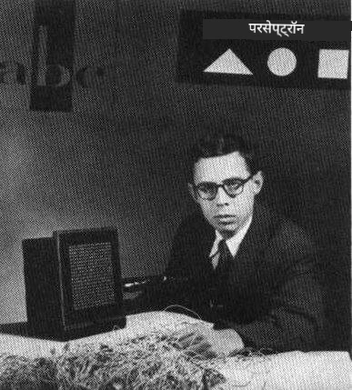
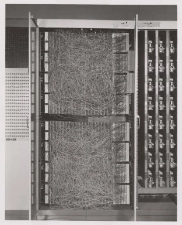
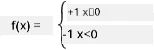

# Neural Networks ka Introduction: Perceptron

## [Pre-lecture quiz](https://ff-quizzes.netlify.app/en/ai/quiz/5)

Modern neural network jaisa kuch banane ki pehli koshish 1957 mein Cornell Aeronautical Laboratory ke Frank Rosenblatt ne ki thi. Yeh ek hardware implementation tha jise "Mark-1" kaha gaya, aur ise triangles, squares aur circles jaise primitive geometric shapes ko pehchaanne ke liye design kiya gaya tha.

|      |      |
|--------------|-----------|
| | |

> Pictures [Wikipedia se](https://en.wikipedia.org/wiki/Perceptron)

Input image ko 20x20 photocell array se represent kiya gaya tha, isliye neural network mein 400 inputs aur ek binary output tha. Ek simple network mein ek neuron hota tha, jise **threshold logic unit** bhi kehte hain. Neural network ke weights potentiometers ki tarah kaam karte the, jinhe training phase ke dauran manually adjust karna padta tha.

> ✅ Potentiometer ek device hai jo user ko circuit ki resistance adjust karne deta hai.

> Us waqt New York Times ne perceptron ke baare mein likha: *ek electronic computer ka embryo jisse [Navy] ummeed karti hai ki woh chal sakega, baat kar sakega, dekh sakega, likh sakega, khud ko reproduce kar sakega aur apne existence ke prati conscious ho sakega.*

## Perceptron Model

Maan lijiye humare model mein N features hain, is case mein input vector N size ka ek vector hoga. Perceptron ek **binary classification** model hai, yaani yeh input data ki do classes ke beech fark kar sakta hai. Hum maante hain ki har input vector x ke liye humare perceptron ka output class ke hisaab se +1 ya -1 hoga. Output is formula se calculate hoga:

y(x) = f(w<sup>T</sup>x)

jahan f ek step activation function hai

<!-- img src="http://www.sciweavers.org/tex2img.php?eq=f%28x%29%20%3D%20%5Cbegin%7Bcases%7D%0A%20%20%20%20%20%20%20%20%20%2B1%20%26%20x%20%5Cgeq%200%20%5C%5C%0A%20%20%20%20%20%20%20%20%20-1%20%26%20x%20%3C%200%0A%20%20%20%20%20%20%20%5Cend%7Bcases%7D%20%5C%5C%0A&bc=White&fc=Black&im=jpg&fs=12&ff=arev&edit=0" align="center" border="0" alt="f(x) = \begin{cases} +1 & x \geq 0 \\ -1 & x < 0 \end{cases} \\" width="154" height="50" / -->


## Perceptron ko Train karna

Perceptron ko train karne ke liye humein ek weights vector w dhoondhna hoga jo zyaadatar values ko sahi classify kare, yaani sabse kam **error** produce kare. Yeh error E **perceptron criterion** se is tarah define hota hai:

E(w) = -&sum;w<sup>T</sup>x<sub>i</sub>t<sub>i</sub>

jahan:

* sum un training data points i par liya jaata hai jinki wajah se wrong classification hoti hai
* x<sub>i</sub> input data hai, aur t<sub>i</sub> negative aur positive examples ke liye kramash: -1 ya +1 hai.

Is criterion ko weights w ke function ki tarah maana jaata hai, aur humein ise minimize karna hota hai. Aksar, **gradient descent** naam ka method use hota hai, jisme hum kuch initial weights w<sup>(0)</sup> se shuru karte hain, aur phir har step par weights ko is formula ke hisaab se update karte hain:

w<sup>(t+1)</sup> = w<sup>(t)</sup> - &eta;&nabla;E(w)

Yahan &eta; ko **learning rate** kehte hain, aur &nabla;E(w) E ka **gradient** darshata hai. Gradient calculate karne ke baad, humein milta hai:

w<sup>(t+1)</sup> = w<sup>(t)</sup> + &sum;&eta;x<sub>i</sub>t<sub>i</sub>

Python mein algorithm aisa dikhta hai:

```python
def train(positive_examples, negative_examples, num_iterations = 100, eta = 1):

    weights = [0,0,0] # Initialize weights (almost randomly :)
        
    for i in range(num_iterations):
        pos = random.choice(positive_examples)
        neg = random.choice(negative_examples)

        z = np.dot(pos, weights) # compute perceptron output
        if z < 0: # positive example classified as negative
            weights = weights + eta*weights.shape

        z  = np.dot(neg, weights)
        if z >= 0: # negative example classified as positive
            weights = weights - eta*weights.shape

    return weights
```


## Conclusion

Is lesson mein, aapne perceptron ke baare mein seekha, jo ek binary classification model hai, aur yeh bhi ki ise weights vector use karke kaise train kiya jaata hai.

## 🚀 Challenge

Agar aap apna khud ka perceptron banana chahte hain, toh [Microsoft Learn par is lab](https://docs.microsoft.com/en-us/azure/machine-learning/component-reference/two-class-averaged-perceptron?WT.mc_id=academic-77998-cacaste) ko try kijiye, jo [Azure ML designer](https://docs.microsoft.com/en-us/azure/machine-learning/concept-designer?WT.mc_id=academic-77998-cacaste) use karta hai.

## [Post-lecture quiz](https://ff-quizzes.netlify.app/en/ai/quiz/6)

## Review & Self Study

Yeh dekhne ke liye ki hum perceptron ko toy problem aur real-life problems solve karne ke liye kaise use kar sakte hain, aur learning continue karne ke liye - [Perceptron](Perceptron.ipynb) notebook par jaaiye.

Yahan perceptron ke baare mein ek interesting [article](https://towardsdatascience.com/what-is-a-perceptron-basics-of-neural-networks-c4cfea20c590) bhi hai.

## [Assignment](lab/README.md)

Is lesson mein, humne binary classification task ke liye ek perceptron implement kiya hai, aur ise do handwritten digits ke beech classify karne ke liye use kiya hai. Is lab mein, aapse kaha gaya hai ki digit classification problem ko poori tarah solve karein, yaani yeh determine karein ki diye gaye image ke liye kaun sa digit sabse zyada likely hai.

* [Instructions](lab/README.md)
* [Notebook](lab/PerceptronMultiClass.ipynb)

---

