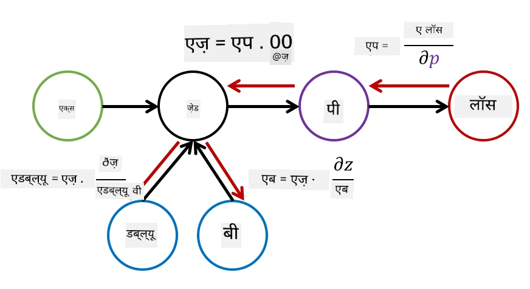

# Neural Networks ka Introduction: Multi-Layered Perceptron

Pichhle section mein, aapne sabse simple neural network model - one-layer perceptron, ek linear two-class classification model ke baare mein seekha.

Is section mein hum is model ko ek zyada flexible framework mein extend karenge, jisse hum:

* two-class classification ke saath-saath **multi-class classification** kar sakein  
* classification ke alawa **regression problems** solve kar sakein  
* un classes ko alag kar sakein jo linearly separable nahi hain  

Hum Python mein apna khud ka modular framework bhi develop karenge, jo humein alag-alag neural network architectures banane dega.

## [Pre-lecture quiz](https://ff-quizzes.netlify.app/en/ai/quiz/7)

## Machine Learning ka Formalization

Chalo Machine Learning problem ko formally samajhte hain. Maan lijiye hamare paas ek training dataset **X** hai, jisme labels **Y** hain, aur humein ek model *f* banana hai jo sabse accurate predictions karega. Predictions ki quality ko **loss function** &lagran; se measure kiya jaata hai. Neeche diye gaye loss functions aksar use kiye jaate hain:

* Regression problem ke liye, jab humein ek number predict karna hota hai, hum **absolute error** &sum;i|f(x(i))-y(i)|, ya **squared error** &sum;i(f(x(i))-y(i))2 use kar sakte hain.  
* Classification ke liye, hum **0-1 loss** (jo basically model ki **accuracy** ke same hai), ya **logistic loss** use karte hain.  

One-level perceptron ke liye, function *f* ko ek linear function *f(x)=wx+b* ke roop mein define kiya gaya tha (yahan *w* weight matrix hai, *x* input features ka vector hai, aur *b* bias vector hai). Alag-alag neural network architectures ke liye, yeh function zyada complex form le sakta hai.

> Classification ke case mein, aksar yeh desirable hota hai ki network output ke roop mein related classes ki probabilities de. Kisi bhi numbers ko probabilities mein convert karne ke liye (jaise output ko normalize karne ke liye), hum aksar **softmax** function &sigma; use karte hain, aur function *f* ban jaata hai *f(x)=&sigma;(wx+b)*.

Upar *f* ki definition mein, *w* aur *b* ko **parameters** &theta;=⟨*w,b*⟩ kehte hain. Diye gaye dataset ⟨**X**,**Y**⟩ ke basis par, hum poore dataset par overall error ko parameters &theta; ke function ke roop mein calculate kar sakte hain.

> ✅ **Neural network training ka goal error ko minimize karna hai, jo parameters &theta; ko badalkar kiya jaata hai.**

## Gradient Descent Optimization

Function optimization ka ek famous tareeka **gradient descent** hai. Idea yeh hai ki hum loss function ka derivative (multi-dimensional case mein ise **gradient** kehte hain) parameters ke respect mein calculate kar sakte hain, aur parameters ko is tarah badal sakte hain ki error kam ho jaye. Ise neeche diye gaye form mein formalize kiya ja sakta hai:

* Parameters ko kuch random values w(0), b(0) se initialize kijiye.  
* Neeche wale step ko kai baar repeat kijiye:  
    - w(i+1) = w(i)-&eta;&part;&lagran;/&part;w  
    - b(i+1) = b(i)-&eta;&part;&lagran;/&part;b  

Training ke dauran, optimization steps ko poore dataset ko dhyan mein rakhte hue calculate karna chahiye (yaad rakhiye ki loss sabhi training samples par sum ke roop mein calculate hota hai). Lekin, real life mein hum dataset ke chhote hisse lete hain jinhe **minibatches** kehte hain, aur data ke ek subset ke basis par gradients calculate karte hain. Kyunki subset har baar randomly liya jaata hai, is method ko **stochastic gradient descent** (SGD) kehte hain.

## Multi-Layered Perceptrons aur Backpropagation

Jaisa humne upar dekha, one-layer network linearly separable classes ko classify kar sakta hai. Ek zyada rich model banane ke liye, hum network ki kai layers ko combine kar sakte hain. Mathematically iska matlab hoga ki function *f* ka form zyada complex hoga, aur ise kai steps mein calculate kiya jaayega:
* z1=w1x+b1  
* z2=w2&alpha;(z1)+b2  
* f = &sigma;(z2)  

Yahan, &alpha; ek **non-linear activation function** hai, &sigma; ek softmax function hai, aur parameters &theta;=<*w1,b1,w2,b2*> hain.

Gradient descent algorithm wahi rahega, lekin gradients calculate karna zyada mushkil hoga. Chain differentiation rule ko dhyan mein rakhte hue, hum derivatives ko neeche diye gaye form mein calculate kar sakte hain:

* &part;&lagran;/&part;w2 = (&part;&lagran;/&part;&sigma;)(&part;&sigma;/&part;z2)(&part;z2/&part;w2)  
* &part;&lagran;/&part;w1 = (&part;&lagran;/&part;&sigma;)(&part;&sigma;/&part;z2)(&part;z2/&part;&alpha;)(&part;&alpha;/&part;z1)(&part;z1/&part;w1)  

> ✅ Loss function ke respect mein parameters ke derivatives calculate karne ke liye chain differentiation rule use kiya jaata hai.

Dhyan dijiye ki in sabhi expressions ka left part same hai, aur isliye hum loss function se shuru karke aur computational graph ke through "peeche ki taraf" jaakar derivatives ko effectively calculate kar sakte hain. Is tarah multi-layered perceptron ko train karne ke method ko **backpropagation**, ya 'backprop' kehte hain.

> TODO: image ka reference

> ✅ Hum apne notebook example mein backprop ko aur detail mein cover karenge.  

## Conclusion

Is lesson mein, humne apni khud ki neural network library banayi hai, aur ise ek simple two-dimensional classification task ke liye use kiya hai.

## 🚀 Challenge

Saath wale notebook mein, aap multi-layered perceptrons banane aur train karne ke liye apna khud ka framework implement karenge. Aap detail mein dekh paayenge ki modern neural networks kaise kaam karte hain.

[OwnFramework](OwnFramework.ipynb) notebook par jaaiye aur ise complete kijiye.

## [Post-lecture quiz](https://ff-quizzes.netlify.app/en/ai/quiz/8)

## Review & Self Study

Backpropagation AI aur ML mein use hone wala ek common algorithm hai, jise [aur detail mein](https://wikipedia.org/wiki/Backpropagation) study karna chahiye.

## [Assignment](lab/README.md)

Is lab mein, aapse is lesson mein banaye gaye framework ko use karke MNIST handwritten digit classification solve karne ko kaha gaya hai.

* [Instructions](lab/README.md)  
* [Notebook](lab/MyFW_MNIST.ipynb)  

---

