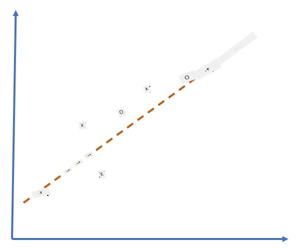
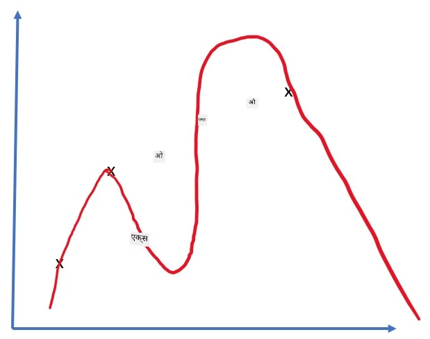
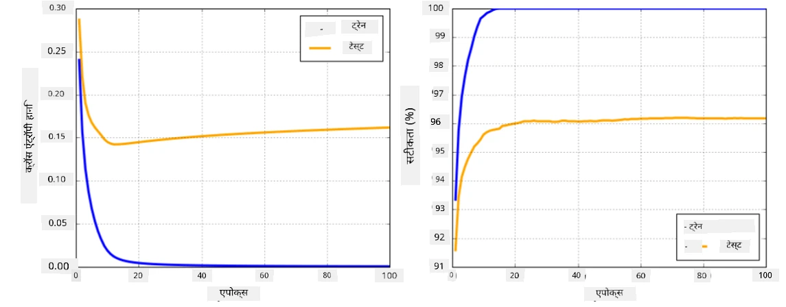

# Neural Network Frameworks

Jaisa ki humne pehle seekha hai, neural network ko effectively train karne ke liye humein do cheezein karni hoti hain:

* Tensors par operate karna, jaise unhe multiply karna, add karna, aur sigmoid ya softmax jaise kuch functions calculate karna.
* Saare expressions ke gradients calculate karna, taaki gradient descent optimization kiya ja sake.

## [Pre-lecture quiz](https://ff-quizzes.netlify.app/en/ai/quiz/9)

Haalaanki `numpy` library pehla kaam kar sakti hai, humein gradients calculate karne ke liye ek mechanism chahiye. [Hamare framework](../04-OwnFramework/OwnFramework.ipynb) mein, jo humne pichhle section mein develop kiya tha, humein `backward` method ke andar saare derivative functions ko manually program karna pada tha, jo backpropagation karta hai. Ideal tareeke se, ek framework humein *kisi bhi expression* ke gradients calculate karne ka mauka deta hai jo hum define kar sakte hain.

Ek aur important baat yeh hai ki GPU ya kisi aur special compute units, jaise [TPU](https://en.wikipedia.org/wiki/Tensor_Processing_Unit), par calculations kar paana. Deep neural network training mein *bahut saari* calculations hoti hain, aur in calculations ko GPU par parallel mein kar paana bahut important hai.

> ✅ 'Parallel' ka matlab hai calculations ko kai devices mein distribute karna.

Abhi, do sabse popular neural frameworks hain: [TensorFlow](http://TensorFlow.org) aur [PyTorch](https://pytorch.org/). Dono CPU aur GPU par tensors ke saath kaam karne ke liye low-level API dete hain. Low-level API ke upar, ek high-level API bhi hai, jise [Keras](https://keras.io/) aur [PyTorch Lightning](https://pytorchlightning.ai/) kaha jaata hai.

Low-Level API | [TensorFlow](http://TensorFlow.org) | [PyTorch](https://pytorch.org/)
--------------|-------------------------------------|--------------------------------
High-level API| [Keras](https://keras.io/) | [PyTorch Lightning](https://pytorchlightning.ai/)

Dono frameworks mein **low-level APIs** aapko **computational graphs** banane dete hain. Yeh graph define karta hai ki diye gaye input parameters ke saath output (aam taur par loss function) kaise calculate kiya jaye, aur agar GPU available hai toh isse calculation ke liye GPU par push kiya ja sakta hai. Is computational graph ko differentiate karne aur gradients calculate karne ke liye functions hote hain, jinhe phir model parameters ko optimize karne ke liye use kiya ja sakta hai.

**High-level APIs** neural networks ko **layers ki sequence** ki tarah treat karte hain, aur zyadatar neural networks banana bahut aasaan bana dete hain. Model ko train karne ke liye aam taur par data tayyar karna hota hai aur phir `fit` function ko call karna hota hai.

High-level API aapko typical neural networks bahut jaldi banane deta hai, bina bahut saare details ki chinta kiye. Wahin, low-level API training process par zyada control deta hai, aur isliye research mein bahut use hota hai, jab aap naye neural network architectures ke saath kaam kar rahe hote hain.

Yeh samajhna bhi important hai ki aap dono APIs ko saath mein use kar sakte hain, jaise aap low-level API se apna khud ka network layer architecture develop kar sakte hain, aur phir use bade network ke andar use kar sakte hain jo high-level API se banaya aur train kiya gaya ho. Ya aap high-level API se network ko layers ki sequence ki tarah define kar sakte hain, aur phir apne khud ke low-level training loop se optimization kar sakte hain. Dono APIs same basic concepts use karte hain, aur unhe saath mein kaam karne ke liye design kiya gaya hai.

## Learning

Is course mein, hum zyadatar content PyTorch aur TensorFlow dono ke liye dete hain. Aap apna pasandida framework chun sakte hain aur sirf uske notebooks ke through jaa sakte hain. Agar aapko pakka nahi pata ki kaun sa framework chunna hai, toh internet par **PyTorch vs. TensorFlow** par kuch discussions padh lijiye. Aap dono frameworks ko dekhkar behtar samajh bhi bana sakte hain.

Jahan possible hoga, hum simplicity ke liye high-level APIs use karenge. Lekin, humara maanna hai ki yeh samajhna important hai ki neural networks zameeni star se kaise kaam karte hain, isliye shuruaat mein hum low-level API aur tensors ke saath kaam karna shuru karte hain. Haalaanki, agar aap jaldi aage badhna chahte hain aur in details ko seekhne mein zyada time nahi lagana chahte, toh aap unhe skip karke seedhe high-level API notebooks mein jaa sakte hain.

## ✍️ Exercises: Frameworks

Agle notebooks mein apni learning jaari rakhiye:

Low-level API | [TensorFlow+Keras Notebook](IntroKerasTF.ipynb) | [PyTorch](IntroPyTorch.ipynb)
--------------|-------------------------------------|--------------------------------
High-level API| [Keras](IntroKeras.ipynb) | *PyTorch Lightning*

Frameworks mein mahaarat hasil karne ke baad, chaliye overfitting ka concept dohrate hain.

# Overfitting

Overfitting machine learning mein ek bahut hi important concept hai, aur ise sahi tareeke se samajhna bahut zaroori hai!

5 points ko (graph mein `x` se dikhaye gaye) approximate karne ki neeche di gayi problem par vichaar kijiye:

 | 
-------------------------|--------------------------
**Linear model, 2 parameters** | **Non-linear model, 7 parameters**
Training error = 5.3 | Training error = 0
Validation error = 5.1 | Validation error = 20

* Baayein taraf, hum ek achhi seedhi line ka approximation dekhte hain. Kyunki parameters ki sankhya sahi hai, model points ke distribution ke peeche ka idea sahi tareeke se samajh leta hai.
* Daayein taraf, model bahut powerful hai. Kyunki humare paas sirf 5 points hain aur model mein 7 parameters hain, yeh khud ko is tarah adjust kar sakta hai ki saare points se guzar jaye, jisse training error 0 ho jaata hai. Lekin, yeh model ko data ke peeche ke sahi pattern ko samajhne se rokta hai, jisse validation error bahut zyada ho jaata hai.

Model ki richness (parameters ki sankhya) aur training samples ki sankhya ke beech sahi balance banana bahut important hai.

## Overfitting kyun hota hai

  * Kaafi training data nahi hona
  * Bahut powerful model
  * Input data mein bahut zyada noise

## Overfitting ka pata kaise lagayein

Jaisa ki aap upar diye gaye graph se dekh sakte hain, overfitting ka pata bahut kam training error aur high validation error se lagaya ja sakta hai. Aam taur par training ke dauran hum dekhenge ki training aur validation error dono kam hone lagte hain, aur phir kisi point par validation error kam hona band ho sakta hai aur badhne lag sakta hai. Yeh overfitting ka sanket hoga, aur yeh sanket hoga ki humein shayad is point par training rok deni chahiye (ya kam se kam model ka snapshot lena chahiye).

## Overfitting ko kaise rokein

Agar aap dekh sakte hain ki overfitting ho rahi hai, toh aap neeche diye gaye mein se kuch kar sakte hain:

 * Training data ki quantity badhayein
 * Model ki complexity kam karein
 * Koi [regularization technique](../../4-ComputerVision/08-TransferLearning/TrainingTricks.md) use karein, jaise [Dropout](../../4-ComputerVision/08-TransferLearning/TrainingTricks.md#Dropout), jise hum baad mein dekhenge.

## Overfitting aur Bias-Variance Tradeoff

Overfitting asal mein statistics mein ek zyada general problem ka case hai jise [Bias-Variance Tradeoff](https://en.wikipedia.org/wiki/Bias%E2%80%93variance_tradeoff) kaha jaata hai. Agar hum apne model mein error ke possible sources par vichaar karein, toh hum do tarah ke errors dekh sakte hain:

* **Bias errors** hamare algorithm ke training data ke beech ke relationship ko sahi tareeke se capture na kar paane ki wajah se hote hain. Yeh is fact se aa sakta hai ki hamara model kaafi powerful nahi hai (**underfitting**).
* **Variance errors**, jo model ke input data mein noise ko meaningful relationship ki jagah approximate karne ki wajah se hote hain (**overfitting**).

Training ke dauran, bias error kam hota hai (jaise hamara model data ko approximate karna seekhta hai), aur variance error badhta hai. Overfitting ko rokne ke liye training ko rokna important hai - ya toh manually (jab hum overfitting detect karte hain) ya automatically (regularization introduce karke).

## Conclusion

Is lesson mein, aapne do sabse popular AI frameworks, TensorFlow aur PyTorch, ke alag-alag APIs ke beech ke difference ke baare mein seekha. Iske alawa, aapne ek bahut important topic, overfitting, ke baare mein seekha.

## 🚀 Challenge

Related notebooks mein, aapko neeche 'tasks' milenge; notebooks ke through kaam kijiye aur tasks ko poora kijiye.

## [Post-lecture quiz](https://ff-quizzes.netlify.app/en/ai/quiz/10)

## Review & Self Study

Neeche diye gaye topics par kuch research kijiye:

- TensorFlow
- PyTorch
- Overfitting

Apne aap se yeh sawal poochiye:

- TensorFlow aur PyTorch mein kya difference hai?
- Overfitting aur underfitting mein kya difference hai?

## [Assignment](lab/README.md)

Is lab mein, aapse PyTorch ya TensorFlow ka use karke single- aur multi-layered fully-connected networks ke saath do classification problems solve karne ko kaha gaya hai.

* [Instructions](lab/README.md)
* [Notebook](lab/LabFrameworks.ipynb)

---

