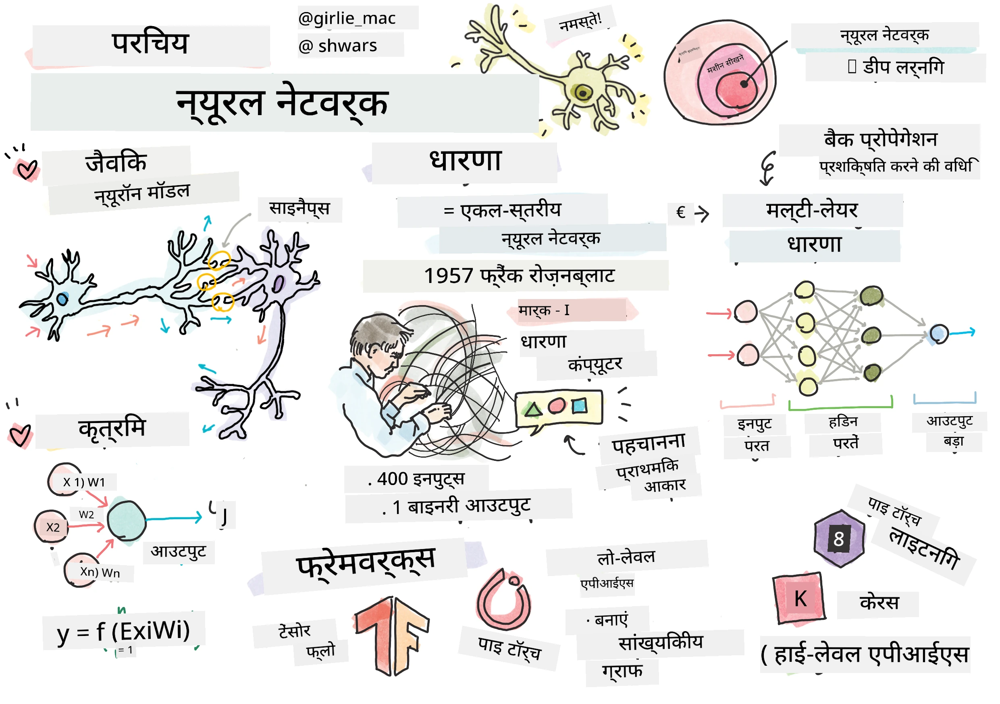
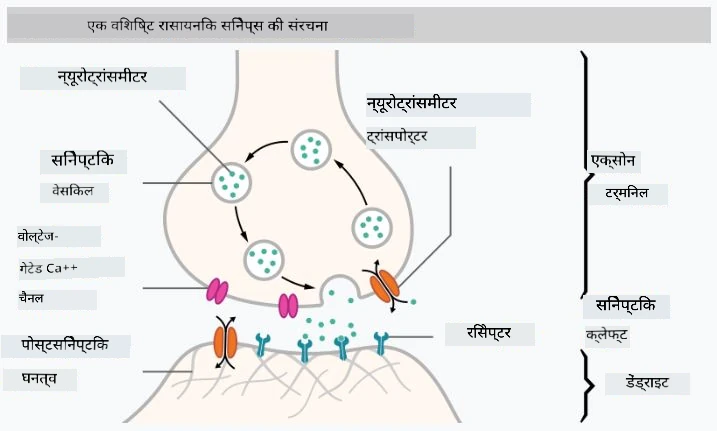
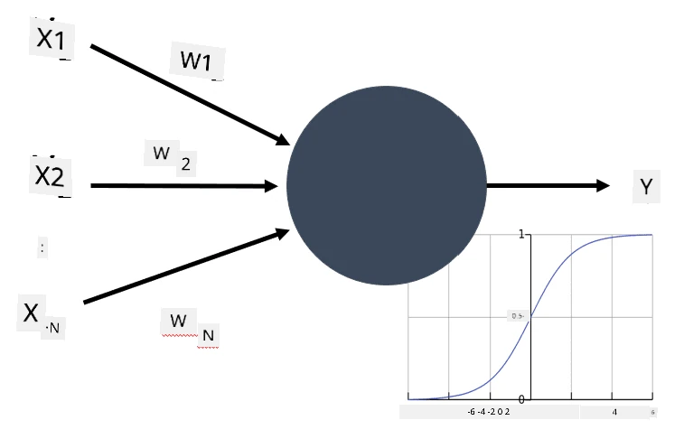
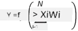

# Neural Networks ka Introduction

Jaisa ki humne introduction mein discuss kiya tha, intelligence achieve karne ke tareekon mein se ek hai **computer model** ya **artificial brain** ko train karna. 20th century ke middle se, researchers ne alag-alag mathematical models try kiye, aur haal ke saalon mein yeh direction bahut successful sabit hui hai. Brain ke in mathematical models ko **neural networks** kehte hain.

> Kabhi-kabhi neural networks ko *Artificial Neural Networks* (ANNs) kaha jaata hai, taaki yeh clear rahe ki hum models ki baat kar rahe hain, asli neurons ke network ki nahi.

## Machine Learning

Neural networks ek bade field ka hissa hain jise **Machine Learning** kehte hain, jiska goal data ka use karke computer models ko train karna hai taaki woh problems solve kar sakein. Machine Learning Artificial Intelligence ka ek bada hissa hai, lekin hum is course mein classical Machine Learning ko cover nahi karenge.

> Classical Machine Learning ke baare mein aur jaanne ke liye humare alag **[Machine Learning for Beginners](http://github.com/microsoft/ml-for-beginners)** curriculum par jaiye.

Machine Learning mein, hum maante hain ki humare paas examples ka ek dataset **X** hai aur unke corresponding output values **Y** hain. Examples aksar N-dimensional vectors hote hain jo **features** se bane hote hain, aur outputs ko **labels** kehte hain.

Hum Machine Learning ki do sabse common problems par vichar karenge:

* **Classification**, jisme humein ek input object ko do ya zyada classes mein classify karna hota hai.
* **Regression**, jisme humein har input sample ke liye ek numerical value predict karni hoti hai.

> Jab inputs aur outputs ko tensors ke roop mein represent kiya jaata hai, toh input dataset M&times;N size ka ek matrix hota hai, jahan M samples ki sankhya hai aur N features ki sankhya hai. Output labels Y, M size ka ek vector hota hai.

Is course mein, hum sirf neural network models par focus karenge.

## Neuron ka ek Model

Biology se, hum jaante hain ki hamara brain neural cells (neurons) se bana hai, jinme se har ek ke paas kai "inputs" (dendrites) aur ek "output" (axon) hota hai. Dendrites aur axons dono electrical signals conduct kar sakte hain, aur unke beech ke connections — jinhe synapses kehte hain — alag-alag levels ki conductivity dikha sakte hain, jo neurotransmitters se control hoti hai.

 | 
----|----
Real Neuron *([Image](https://en.wikipedia.org/wiki/Synapse#/media/File:SynapseSchematic_lines.svg) Wikipedia se)* | Artificial Neuron *(Author dwara banayi gayi image)*

Is tarah, neuron ka sabse simple mathematical model mein kai inputs X1, ..., XN aur ek output Y, aur weights ki ek series W1, ..., WN shaamil hoti hai. Output ko is tarah calculate kiya jaata hai:

Jahan f ek non-linear **activation function** hai.

> Neuron ke shuruaati models ko 1943 mein Warren McCulloch aur Walter Pitts ke classical paper [A logical calculus of the ideas immanent in nervous activity](https://www.cs.cmu.edu/~./epxing/Class/10715/reading/McCulloch.and.Pitts.pdf) mein describe kiya gaya tha. Donald Hebb ne apni book "[The Organization of Behavior: A Neuropsychological Theory](https://books.google.com/books?id=VNetYrB8EBoC)" mein in networks ko train karne ka tareeka propose kiya.

## Is section mein

Is section mein hum yeh sab seekhenge:
* [Perceptron](03-Perceptron/README.md), two-class classification ke liye sabse shuruaati neural network models mein se ek
* [Multi-layered networks](04-OwnFramework/README.md) aur ek related notebook [apna khud ka framework kaise banayein](04-OwnFramework/OwnFramework.ipynb)
* [Neural Network Frameworks](05-Frameworks/README.md), in notebooks ke saath: [PyTorch](05-Frameworks/IntroPyTorch.ipynb) aur [Keras/Tensorflow](05-Frameworks/IntroKerasTF.ipynb)
* [Overfitting](../../../../lessons/3-NeuralNetworks/05-Frameworks)

---

<!-- HINGLISH NOTE START -->
**Note**:
Yeh document Hindi translation ko Hinglish (Roman script) mein convert karke banaya gaya hai, taaki padhna aur samajhna aasaan ho.
Isme kuch galtiyan ya anuvaad ki kamiyan ho sakti hain. Sabse sahi jaankari ke liye original English document ko hi authoritative source maanein.
<!-- HINGLISH NOTE END -->
