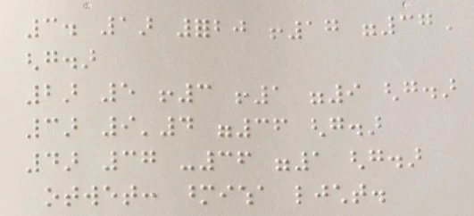
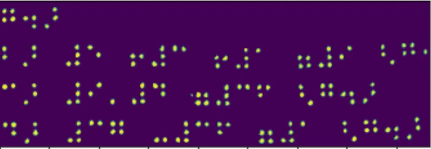
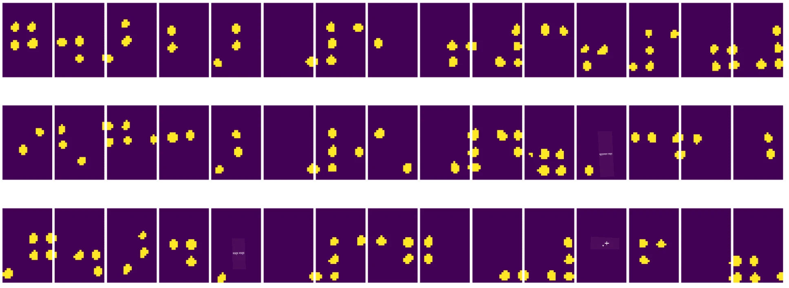
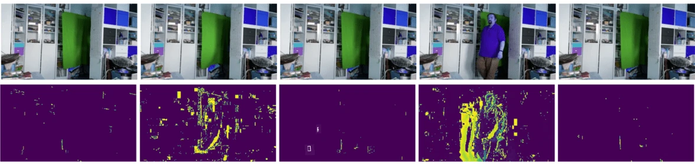
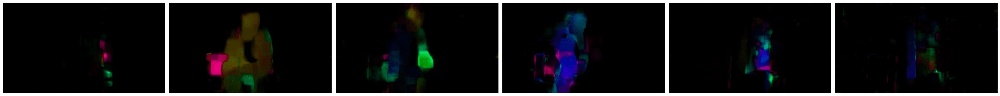
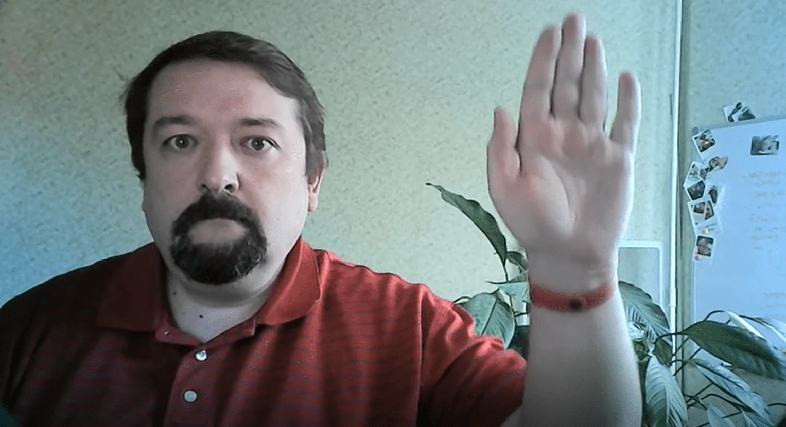

# Computer Vision ka Introduction

[Computer Vision](https://wikipedia.org/wiki/Computer_vision) ek aisa field hai jiska maksad computers ko digital images ki high-level understanding dena hai. Yeh definition kaafi broad hai kyunki *understanding* ke kai alag-alag matlab ho sakte hain, jaise kisi picture mein object dhoondhna (**object detection**), yeh samajhna ki kya ho raha hai (**event detection**), picture ko text mein describe karna, ya scene ko 3D mein reconstruct karna. Human images se jude kuch special tasks bhi hote hain: age aur emotions estimate karna, face detection aur identification, aur 3D pose estimation, etc.

## [Pre-lecture quiz](https://ff-quizzes.netlify.app/en/ai/quiz/11)

Computer Vision ke sabse simple tasks mein se ek hai **image classification**.

Computer Vision ko aksar AI ki ek branch maana jaata hai. Aajkal, Computer Vision ke zyadatar tasks neural networks se solve kiye jaate hain. Hum is section mein Computer Vision ke liye use hone wale special type ke neural networks, [Convolutional Neural Networks](../07-ConvNets/README.md), ke baare mein aur seekhenge.

Haalaanki, image ko neural network mein pass karne se pehle, kai cases mein image ko behtar banane ke liye kuch algorithmic techniques use karna samajhdari ho sakti hai.

Image processing ke liye kai Python libraries available hain:

* **[imageio](https://imageio.readthedocs.io/en/stable/)** alag-alag image formats ko read/write karne ke liye use ho sakti hai. Yeh ffmpeg ko bhi support karti hai, jo video frames ko images mein badalne ke liye ek useful tool hai.
* **[Pillow](https://pillow.readthedocs.io/en/stable/index.html)** (jise PIL bhi kehte hain) thodi zyada powerful hai aur kuch image manipulation jaise morphing, palette adjustments, aur bahut kuch support karti hai.
* **[OpenCV](https://opencv.org/)** ek powerful image processing library hai jo C++ mein likhi gayi hai aur image processing ke liye *de facto standard* ban gayi hai. Iska ek convenient Python interface hai.
* **[dlib](http://dlib.net/)** ek C++ library hai jo kai machine learning algorithms implement karti hai, jisme kuch Computer Vision algorithms bhi shamil hain. Iska bhi ek Python interface hai, aur ise face detection aur facial landmark detection jaise challenging tasks ke liye use kiya ja sakta hai.

## OpenCV

[OpenCV](https://opencv.org/) ko image processing ke liye *de facto standard* maana jaata hai. Isme kai useful algorithms hain, jo C++ mein implement kiye gaye hain. Aap OpenCV ko Python se bhi call kar sakte hain.

OpenCV seekhne ke liye ek achhi jagah [yeh Learn OpenCV course](https://learnopencv.com/getting-started-with-opencv/) hai. Hamare curriculum mein, hamara goal OpenCV seekhna nahi hai, balki aapko kuch examples dikhana hai ki ise kab aur kaise use kiya ja sakta hai.

### Images load karna

Python mein images ko NumPy arrays ke roop mein aasaani se represent kiya ja sakta hai. Jaise, 320x200 pixels size ki grayscale images 200x320 array mein store hongi, aur same dimensions ki color images ka shape 200x320x3 hoga (3 color channels ke liye). Image load karne ke liye, aap yeh code use kar sakte hain:

```python
import cv2
import matplotlib.pyplot as plt

im = cv2.imread('image.jpeg')
plt.imshow(im)
```

Traditionally, OpenCV color images ke liye BGR (Blue-Green-Red) encoding use karta hai, jabki Python ke baaki tools zyada traditional RGB (Red-Green-Blue) use karte hain. Image sahi dikhe, iske liye aapko ise RGB color space mein convert karna padta hai, ya toh NumPy array mein dimensions swap karke, ya OpenCV function call karke:

```python
im = cv2.cvtColor(im,cv2.COLOR_BGR2RGB)
```

Wahi `cvtColor` function doosre color space conversions karne ke liye bhi use ho sakta hai, jaise image ko grayscale ya HSV (Hue-Saturation-Value) color space mein badalna.

Aap OpenCV se video ko frame-by-frame bhi load kar sakte hain - iska ek example [OpenCV Notebook](OpenCV.ipynb) mein diya gaya hai.

### Image Processing

Image ko neural network mein bhejne se pehle, aap kai pre-processing steps apply karna chah sakte hain. OpenCV kai cheezein kar sakta hai, jinmein shamil hain:

* `im = cv2.resize(im, (320,200),interpolation=cv2.INTER_LANCZOS)` use karke image ko **resize karna**.
* `im = cv2.medianBlur(im,3)` ya `im = cv2.GaussianBlur(im, (3,3), 0)` use karke image ko **blur karna**.
* Image ki **brightness aur contrast** badalna NumPy array manipulation se kiya ja sakta hai, jaisa ki [is Stackoverflow note](https://stackoverflow.com/questions/39308030/how-do-i-increase-the-contrast-of-an-image-in-python-opencv) mein bataya gaya hai.
* [Thresholding](https://docs.opencv.org/4.x/d7/d4d/tutorial_py_thresholding.html) use karna, `cv2.threshold`/`cv2.adaptiveThreshold` functions call karke, jo aksar brightness ya contrast adjust karne se behtar hota hai.
* Image par alag-alag [transformations](https://docs.opencv.org/4.5.5/da/d6e/tutorial_py_geometric_transformations.html) apply karna:
    - **[Affine transformations](https://docs.opencv.org/4.5.5/d4/d61/tutorial_warp_affine.html)** useful ho sakte hain agar aapko image mein teen points ki source aur destination location pata ho aur aap rotation, resize aur skew add karna chahte hain. Affine transformations parallel lines ko parallel hi rakhte hain.
    - **[Perspective transformations](https://medium.com/analytics-vidhya/opencv-perspective-transformation-9edffefb2143)** useful ho sakte hain jab aapko image mein 4 points ki source aur destination location pata ho. Jaise, agar aap smartphone camera se kisi angle se ek rectangular document ki photo lete hain aur aap document ki rectangular image banana chahte hain.
* **[Optical flow](https://docs.opencv.org/4.5.5/d4/dee/tutorial_optical_flow.html)** use karke image ke andar movement samajhna.

## Computer Vision use karne ke examples

Hamare [OpenCV Notebook](OpenCV.ipynb) mein, hum kuch examples dete hain ki specific tasks karne ke liye Computer Vision kaise use ho sakta hai:

* **Braille book ki photo ka pre-processing**. Hum is par focus karte hain ki thresholding, feature detection, perspective transformation aur NumPy manipulation use karke Braille symbols ko kaise alag kiya ja sakta hai, taaki unhe neural network se aage classify kiya ja sake.

 |  | 
----|-----|-----

> Image [OpenCV.ipynb](OpenCV.ipynb) se

* **Frame difference use karke video mein motion detect karna**. Agar camera fixed hai, toh camera feed ke frames ek-doosre se kaafi similar hone chahiye. Kyunki frames arrays ke roop mein represent hote hain, sirf do consecutive frames ke liye un arrays ko subtract karne se humein pixel difference milega, jo static frames ke liye kam hona chahiye, aur image mein significant motion hone par zyada ho jaayega.



> Image [OpenCV.ipynb](OpenCV.ipynb) se

* **Optical Flow use karke motion detect karna**. [Optical flow](https://docs.opencv.org/3.4/d4/dee/tutorial_optical_flow.html) humein yeh samajhne deta hai ki video frames par individual pixels kaise move karte hain. Optical flow ke do types hain:

   - **Dense Optical Flow** woh vector field calculate karta hai jo dikhata hai ki har pixel kahan ja raha hai.
   - **Sparse Optical Flow** image mein kuch specific features (jaise edges) leta hai aur frame se frame tak unki trajectory banata hai.



> Image [OpenCV.ipynb](OpenCV.ipynb) se

## ✍️ Example Notebooks: OpenCV [OpenCV ko action mein try kijiye](OpenCV.ipynb)

Chaliye [OpenCV Notebook](OpenCV.ipynb) explore karke OpenCV ke saath kuch experiments karte hain.

## Conclusion

Kabhi-kabhi, motion detection ya fingertip detection jaise relatively complex tasks sirf Computer Vision se hi solve ho sakte hain. Isliye, Computer Vision ki basic techniques jaanna aur yeh jaanna ki OpenCV jaisi libraries kya kar sakti hain, bahut useful hai.

## 🚀 Challenge

AI Show ka [yeh video](https://docs.microsoft.com/shows/ai-show/ai-show--2021-opencv-ai-competition--grand-prize-winners--cortic-tigers--episode-32?WT.mc_id=academic-77998-cacaste) dekhiye, taaki Cortic Tigers project ke baare mein jaan sakein, aur yeh bhi ki unhone robot ke zariye Computer Vision tasks ko sabke liye accessible banane ke liye block-based solution kaise banaya. Is field mein naye learners ko laane mein madad karne wale doosre projects par research kijiye.

## [Post-lecture quiz](https://ff-quizzes.netlify.app/en/ai/quiz/12)

## Review & Self Study

Optical flow par [is shaandaar tutorial](https://learnopencv.com/optical-flow-in-opencv/) mein aur padhiye.

## [Assignment](lab/README.md)

Is lab mein, aap simple gestures wali ek video lenge, aur aapka goal optical flow use karke up/down/left/right movements extract karna hoga.



---

