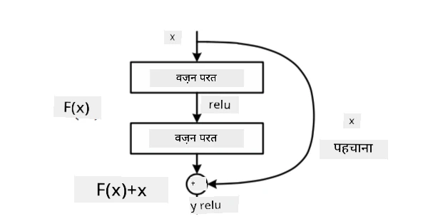
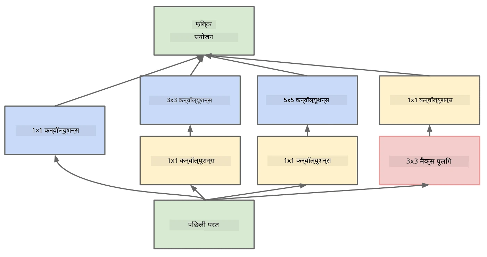

# Famous CNN Architectures

### VGG-16

VGG-16 ek network hai jisne 2014 mein ImageNet top-5 classification mein 92.7% accuracy hasil ki. Iska layer structure yeh hai:

Jaise ki aap dekh sakte hain, VGG ek traditional pyramid architecture follow karta hai, jo convolution-pooling layers ka sequence hai.

> Image [Researchgate](https://www.researchgate.net/figure/Vgg16-model-structure-To-get-the-VGG-NIN-model-we-replace-the-2-nd-4-th-6-th-7-th_fig2_335194493) se li gayi hai

### ResNet

ResNet Microsoft Research ke dwara 2015 mein propose kiye gaye models ki ek family hai. ResNet ka main idea **residual blocks** ka use karna hai:

> Image [is paper](https://arxiv.org/pdf/1512.03385.pdf) se li gayi hai

Residual blocks use karne ki wajah yeh hai ki hamari layer previous layer ke result aur residual block ke output ke beech ka **difference** predict kare — isi wajah se ise *residual* kehte hain. Yeh blocks train karne mein bahut aasaan hote hain, aur inhe use karke hundreds of blocks wale networks banaye ja sakte hain (sabse common variants hain ResNet-52, ResNet-101 aur ResNet-152).

Aap is network ko aise bhi samajh sakte hain ki yeh apni complexity level ko dataset ke hisaab se adjust kar sakta hai. Shuruat mein, jab aap network ko train karna shuru karte hain, toh weights ki values chhoti hoti hain, aur zyadatar signal pass-through identity layers se guzarta hai. Jaise-jaise training aage badhti hai aur weights bade hote jate hain, network parameters ki importance badhti hai, aur network training images ko sahi tareeke se classify karne ke liye zaroori expressive power adjust kar leta hai.

### Google Inception

Google Inception architecture is idea ko ek kadam aage le jata hai aur har network layer ko kai alag-alag paths ke combination ke roop mein banata hai:

> Image [Researchgate](https://www.researchgate.net/figure/Inception-module-with-dimension-reductions-left-and-schema-for-Inception-ResNet-v1_fig2_355547454) se li gayi hai

Yahan, hamein 1x1 convolutions ke role par zor dena hoga, kyunki shuruat mein yeh samajh nahi aata. Hum 1x1 filter ke saath image par kyun chalenge? Lekin, aapko yaad rakhna hoga ki convolution filters kai depth channels ke saath kaam karte hain (originally – RGB colors, aur baad ki layers mein – alag-alag filters ke channels), aur 1x1 convolution ka use in input channels ko alag-alag trainable weights ke saath mix karne ke liye hota hai. Ise channel dimension par downsampling (pooling) ke roop mein bhi dekha ja sakta hai.

Is topic par [ek achhi blog post](https://medium.com/analytics-vidhya/talented-mr-1x1-comprehensive-look-at-1x1-convolution-in-deep-learning-f6b355825578) aur [original paper](https://arxiv.org/pdf/1312.4400.pdf) yahan available hain.

### MobileNet

MobileNet chhote size ke models ki ek family hai, jo mobile devices ke liye suitable hai. Inhe tab use kijiye jab aapke paas limited resources hon aur aap thodi accuracy ka sacrifice kar sakte hon. Inke peeche main idea **depthwise separable convolution** hai, jo convolution filters ko spatial convolutions aur depth channels par 1x1 convolution ke combination ke roop mein represent karne deta hai. Yeh parameters ki sankhya ko kaafi kam kar deta hai, jisse network ka size chhota ho jata hai aur ise kam data ke saath train karna bhi aasaan ho jata hai.

MobileNet par [ek achhi blog post](https://medium.com/analytics-vidhya/image-classification-with-mobilenet-cc6fbb2cd470) yahan available hai.

## Conclusion

Is unit mein, aapne computer vision neural networks ke peeche ke main concept – convolutional networks – ke baare mein seekha. Image classification, object detection, aur image generation networks ko power karne wali real-life architectures sabhi CNNs par based hain, bas zyada layers aur kuch extra training tricks ke saath.

## 🚀 Challenge

Saath mein diye gaye notebooks mein, neeche notes diye gaye hain ki zyada accuracy kaise paayi ja sakti hai. Kuch experiments kijiye aur dekhiye ki kya aap higher accuracy hasil kar sakte hain.

## [Post-lecture quiz](https://ff-quizzes.netlify.app/en/ai/quiz/14)

## Review & Self Study

Halaanki CNNs ka use aksar computer vision tasks ke liye hota hai, woh generally fixed-size patterns extract karne mein achhe hote hain. Jaise ki, agar hum sounds ke saath kaam kar rahe hain, toh hum audio signal mein kuch specific patterns dhoondhne ke liye CNNs use karna chah sakte hain – is case mein filters 1-dimensional honge (aur is CNN ko 1D-CNN kaha jayega). Iske alawa, kabhi-kabhi 3D-CNN ka use multi-dimensional space mein features extract karne ke liye hota hai, jaise video mein kuch events ka hona – CNN time ke saath features ke badalne ke kuch patterns capture kar sakta hai. CNNs ke saath kiye ja sakne wale dusre tasks ke baare mein review aur self-study kijiye.

## [Assignment](lab/README.md)

Is lab mein, aapko alag-alag billi aur kutte ki breeds ko classify karne ka task diya gaya hai. Yeh images MNIST dataset ki comparison mein zyada complex aur higher dimension wali hain, aur 10 se zyada classes hain.

---

