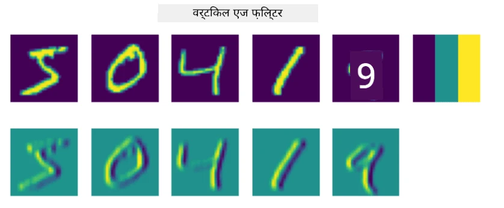
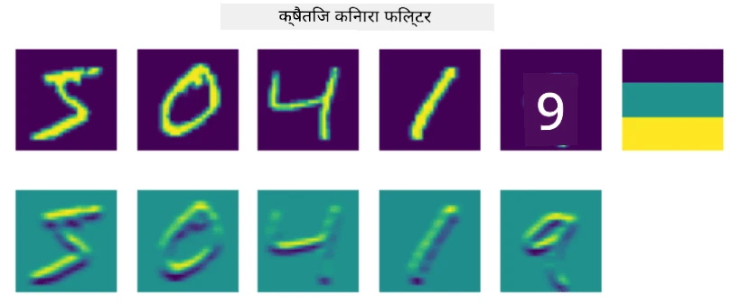
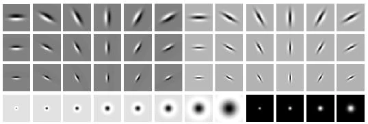
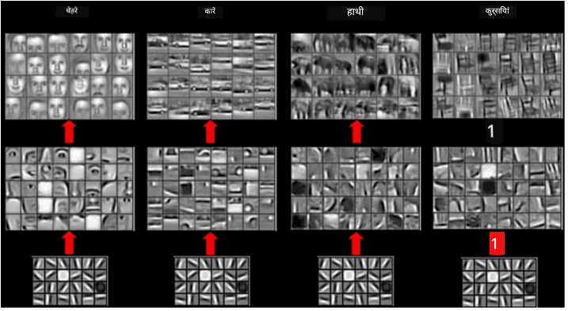
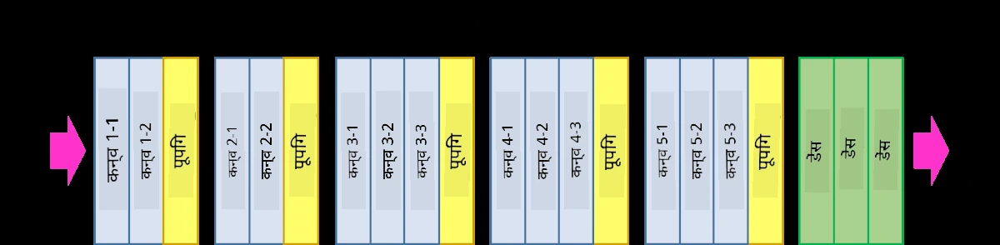
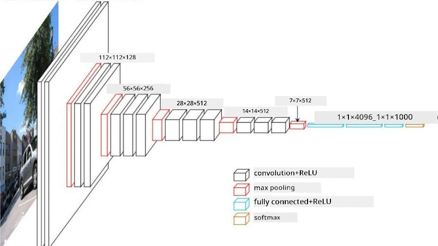

# Convolutional Neural Networks

Humne pehle dekha hai ki neural networks images ke saath kaam karne mein kaafi achhe hote hain, aur ek single-layer perceptron bhi MNIST dataset ke handwritten digits ko pehchanne mein theek-thaak accuracy le aata hai. Lekin MNIST dataset bahut special hai, aur saare digits image ke andar centered hote hain, jisse yeh task simple ho jaata hai.

## [Pre-lecture quiz](https://ff-quizzes.netlify.app/en/ai/quiz/13)

Real life mein hum chahte hain ki image mein kisi object ko uski exact location ki parwah kiye bina pehchaan saken. Computer vision generic classification se alag hai, kyunki jab hum image mein koi particular object dhoondhne ki koshish karte hain, toh hum image ko scan karte hain aur kuch khaas **patterns** aur unke combinations dhoondhte hain. Jaise, jab hum billi dhoondh rahe hote hain, toh pehle horizontal lines dhoondh sakte hain, jo whiskers bana sakti hain, aur phir whiskers ka ek certain combination humein bata sakta hai ki yeh sach mein billi ki picture hai. Patterns ki relative position aur presence important hai, na ki unki exact position.

Patterns extract karne ke liye hum **convolutional filters** ka concept use karenge. Jaise aap jaante hain, ek image ko 2D-matrix ya color depth ke saath 3D-tensor ke roop mein represent kiya jaata hai. Filter apply karne ka matlab hai ki hum ek relatively chhota **filter kernel** matrix lete hain, aur original image ke har pixel ke liye aas-paas ke points ke saath weighted average calculate karte hain. Ise aap aise dekh sakte hain jaise ek chhoti si window poori image par slide kar rahi ho aur filter kernel matrix ke weights ke hisaab se saare pixels ka average le rahi ho.

 | 
----|----

> Image: Dmitry Soshnikov ki taraf se

Jaise, agar hum MNIST digits par 3x3 vertical edge aur horizontal edge filters apply karte hain, toh humein highlights (yaani high values) mil sakte hain jahan hamari original image mein vertical aur horizontal edges hain. Is tarah, yeh do filters edges "dhoondhne" ke liye use kiye ja sakte hain. Isi tarah, hum doosre low-level patterns dhoondhne ke liye alag-alag filters design kar sakte hain:

> Image: [Leung-Malik Filter Bank](https://www.robots.ox.ac.uk/~vgg/research/texclass/filters.html)

Lekin, jab hum kuch patterns extract karne ke liye filters ko manually design kar sakte hain, toh hum network ko is tarah bhi design kar sakte hain ki woh patterns ko automatically seekh le. Yeh CNN ke peeche ke main ideas mein se ek hai.

## CNN ke peeche ke Main Ideas

CNNs jis tarah kaam karte hain, woh in important ideas par based hai:

* Convolutional filters patterns extract kar sakte hain
* Hum network ko is tarah design kar sakte hain ki filters automatically train ho jaayein
* Hum isi approach ko sirf original image mein hi nahi, balki high-level features mein bhi patterns dhoondhne ke liye use kar sakte hain. Is tarah, CNN feature extraction features ki ek hierarchy par kaam karta hai, jo low-level pixel combinations se shuru hokar image ke parts ke high-level combinations tak jaata hai.

> Image: [Hislop-Lynch ke paper](https://www.semanticscholar.org/paper/Computer-vision-based-pedestrian-trajectory-Hislop-Lynch/26e6f74853fc9bbb7487b06dc2cf095d36c9021d) se, unki [research](https://dl.acm.org/doi/abs/10.1145/1553374.1553453) par based

## ✍️ Exercises: Convolutional Neural Networks

Chalo dekhte hain ki convolutional neural networks kaise kaam karte hain aur hum trainable filters kaise paa sakte hain, related notebooks ke through:

* [Convolutional Neural Networks - PyTorch](ConvNetsPyTorch.ipynb)
* [Convolutional Neural Networks - TensorFlow](ConvNetsTF.ipynb)

## Pyramid Architecture

Image processing ke liye use hone wale zyaadatar CNNs tathakathit pyramid architecture follow karte hain. Original image par apply hone wali pehli convolutional layer mein aam taur par filters ki sankhya relatively kam (8-16) hoti hai, jo alag-alag pixel combinations, jaise horizontal/vertical lines ya strokes, se match karte hain. Agle level par, hum network ke spatial dimensions ko kam karte hain aur filters ki sankhya badhate hain, jo simple features ke zyada possible combinations se match karte hain. Har layer ke saath, jaise-jaise hum final classifier ki taraf badhte hain, image ke spatial dimensions ghat'te hain aur filters ki sankhya badhti hai.

Jaise, chalo VGG-16 ki architecture dekhte hain, ek network jisne 2014 mein ImageNet ki top-5 classification mein 92.7% accuracy hasil ki thi:

> Image: [Researchgate](https://www.researchgate.net/figure/Vgg16-model-structure-To-get-the-VGG-NIN-model-we-replace-the-2-nd-4-th-6-th-7-th_fig2_335194493) se

## Sabse Famous CNN Architectures

[Sabse famous CNN architectures ke baare mein apni padhai jaari rakhein](CNN_Architectures.md)

---

