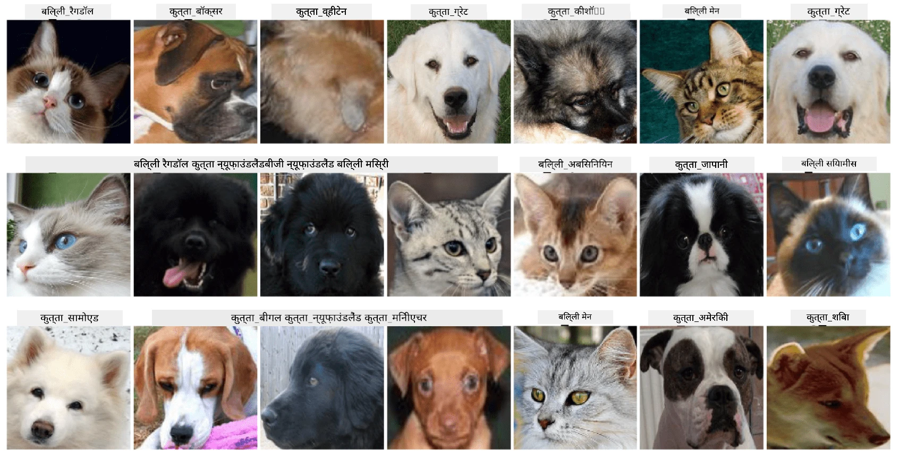

# Pet Faces ka Classification

[AI for Beginners Curriculum](https://github.com/microsoft/ai-for-beginners) se Lab Assignment.

## Task

Socho ki aapko ek pet nursery ke liye application develop karni hai, jisme saare pets ko catalog kiya jaye. Aisi application ka ek badhiya feature yeh hoga ki woh photograph se automatically breed pehchaan sake. Yeh task neural networks ka use karke successfully kiya ja sakta hai.

Aapko **Pet Faces** dataset ka use karke ek convolutional neural network ko train karna hai, jo cats aur dogs ki alag-alag breeds ko classify kare.

## Dataset

Hum [Oxford-IIIT Pet Dataset](https://www.robots.ox.ac.uk/~vgg/data/pets/) ka use karenge, jisme dogs aur cats ki 37 alag-alag breeds ki images shaamil hain.



Dataset download karne ke liye, is code snippet ka use kijiye:

```python
!wget https://thor.robots.ox.ac.uk/~vgg/data/pets/images.tar.gz
!tar xfz images.tar.gz
!rm images.tar.gz
```

**Note:** Oxford-IIIT Pet Dataset ki images filename ke hisaab se organized hain (jaise, `Abyssinian_1.jpg`, `Bengal_2.jpg`). Notebook mein in images ko breed-specific subdirectories mein organize karne ka code shaamil hai, taaki classification aasaan ho jaye.

## Starting Notebook

Lab shuru karne ke liye [PetFaces.ipynb](PetFaces.ipynb) kholiye.

## Takeaway

Aapne image classification ki ek relatively complex problem ko scratch se solve kiya hai! Yahan kaafi saari categories thi, aur phir bhi aap reasonable accuracy hasil karne mein kaamyab rahe! Top-k accuracy measure karna bhi samajh mein aata hai, kyunki kuch categories ko confuse karna aasaan hai jo insaani nazar se bhi clearly alag nahi hain.

---

<!-- HINGLISH NOTE START -->
**Note**:
Yeh document Hindi translation ko Hinglish (Roman script) mein convert karke banaya gaya hai, taaki padhna aur samajhna aasaan ho.
Isme kuch galtiyan ya anuvaad ki kamiyan ho sakti hain. Sabse sahi jaankari ke liye original English document ko hi authoritative source maanein.
<!-- HINGLISH NOTE END -->
