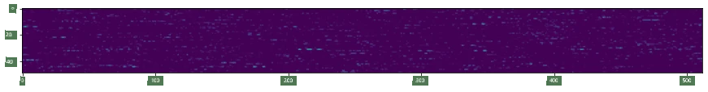
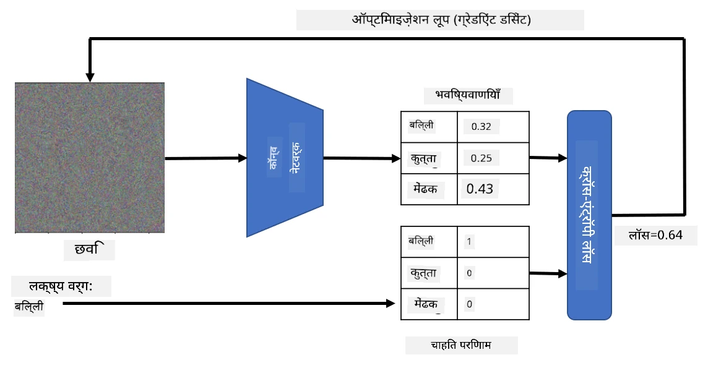
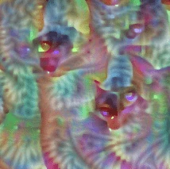
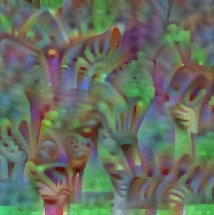
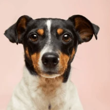
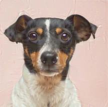

# Pre-trained Networks aur Transfer Learning

CNNs ko train karne mein kaafi time lag sakta hai, aur iske liye bahut saara data chahiye hota hai. Lekin, zyadatar time network ko woh best low-level filters seekhne mein lagta hai, jo image se patterns nikalne mein madad karte hain. Ek natural sawal uthta hai - kya hum ek dataset par train kiye gaye neural network ko use karke, use alag-alag images classify karne ke liye adapt kar sakte hain, bina poore training process ke?

## [Pre-lecture quiz](https://ff-quizzes.netlify.app/en/ai/quiz/15)

Is approach ko **transfer learning** kaha jaata hai, kyunki hum ek neural network model se doosre mein kuch knowledge transfer karte hain. Transfer learning mein, hum aam taur par ek pre-trained model se shuru karte hain, jise kisi bade image dataset, jaise **ImageNet**, par train kiya gaya hota hai. Yeh models pehle se hi general images se alag-alag features nikalne mein achha kaam kar sakte hain, aur kai cases mein un nikale gaye features ke upar ek classifier banana achhe results de sakta hai.

> ✅ Transfer learning ek aisa term hai jo aapko doosre academic fields, jaise education, mein bhi milta hai. Iska matlab hai ek domain se knowledge lekar use doosre domain mein apply karna.

## Pre-trained Models ko Feature Extractors ki tarah use karna

Pichhle section mein humne jin convolutional networks ke baare mein baat ki thi, unmein kai layers hoti hain, jinmein se har ek image se kuch features nikalne ka kaam karti hai. Yeh process low-level pixel combinations (jaise horizontal/vertical line ya stroke) se shuru hokar higher-level features tak jaati hai, jo kisi cheez jaise aag ki aankh se related ho sakte hain. Agar hum CNN ko kaafi bade aur diverse image dataset par train karein, toh network ko un general features ko nikalna seekh lena chahiye.

Keras aur PyTorch dono mein kuch common architectures ke liye pre-trained neural network weights ko aasaani se load karne ke functions available hain, jinmein se zyadatar ImageNet images par train kiye gaye hain. Sabse zyada use hone wale architectures pichhle lesson ke [CNN Architectures](../07-ConvNets/CNN_Architectures.md) page par describe kiye gaye hain. Khaas taur par, aap neeche diye gaye mein se kisi ek ko use karne par vichaar kar sakte hain:

* **VGG-16/VGG-19** jo relatively simple models hain aur phir bhi achhi accuracy dete hain. Aksar VGG use karna yeh dekhne ke liye achha option hota hai ki transfer learning kaise kaam kar rahi hai.
* **ResNet** Microsoft Research dwara 2015 mein propose kiye gaye models ka ek family hai. Inmein zyada layers hoti hain, aur isliye zyada resources ki zaroorat hoti hai.
* **MobileNet** chhote size wale models ka ek family hai, jo mobile devices ke liye suitable hain. Inhe tab use kijiye jab aapke paas resources ki kami ho aur aap thodi accuracy ka tyaag kar sakte hon.

Yahan VGG-16 network dwara ek billi ki picture se nikale gaye features ka ek example hai:

## Cats vs. Dogs Dataset

Is example mein, hum [Cats and Dogs](https://www.microsoft.com/download/details.aspx?id=54765&WT.mc_id=academic-77998-cacaste) dataset use karenge, jo ek real-life image classification scenario ke bahut kareeb hai.

## ✍️ Exercise: Transfer Learning

Chaliye related notebooks mein transfer learning ko action mein dekhte hain:

* [Transfer Learning - PyTorch](TransferLearningPyTorch.ipynb)
* [Transfer Learning - TensorFlow](TransferLearningTF.ipynb)

## Adversarial Cat ko Visualize karna

Pre-trained neural network ke "brain" mein alag-alag patterns hote hain, jinmein **ideal billi** (saath hi ideal kutta, ideal zebra, etc.) ka concept shamil hota hai. Ise kisi tarah **visualize karna** dilchasp hoga. Lekin, yeh aasaan nahi hai, kyunki patterns poore network weights mein faile hue hain aur ek hierarchical structure mein organized hain.

Ek approach yeh ho sakta hai ki hum ek random image se shuru karein, aur phir **gradient descent optimization** technique use karke us image ko is tarah adjust karein ki network ise billi maanne lage.

Lekin, agar hum aisa karte hain, toh humein kuch aisa milega jo random noise ke bahut kareeb hoga. Aisa isliye hai kyunki *network ke paas yeh sochne ke kai tareeke hain ki input image ek billi hai*, jinmein se kuch visually samajh mein nahi aate. Jabki un images mein billi ke liye specific kai patterns hote hain, unhe visually distinct banane ke liye kuch bhi bound nahi karta.

Result ko behtar banane ke liye, hum loss function mein ek aur term add kar sakte hain, jise **variation loss** kaha jaata hai. Yeh ek metric hai jo dikhata hai ki image ke neighboring pixels kitne similar hain. Variation loss ko kam karne se image smooth ho jaati hai aur noise hat jaata hai - jisse zyada visually appealing patterns saamne aate hain. Yahan aise "ideal" images ka ek example hai, jinhe high probability ke saath billi aur zebra ke roop mein classify kiya gaya hai:

 | 
-----|-----
 *Ideal Cat* | *Ideal Zebra*

Isi tarah ka approach **adversarial attacks** karne ke liye use ho sakta hai. Maan lijiye ki hum ek neural network ko dhokha dena chahte hain aur kutte ko billi jaisa dikhana chahte hain. Agar hum kutte ki image lein, jise network kutte ke roop mein pehchanta hai, toh hum use thoda sa adjust kar sakte hain, jab tak network use billi ke roop mein classify karna shuru na kar de:

 | 
-----|-----
*Kutte ki original picture* | *Billi ke roop mein classify ki gayi kutte ki picture*

Upar diye gaye results ko reproduce karne ka code neeche diye gaye notebook mein dekhiye:

* [Ideal and Adversarial Cat - TensorFlow](AdversarialCat_TF.ipynb)

## Conclusion

Transfer learning use karke, aap custom object classification task ke liye jaldi se ek classifier bana sakte hain aur high accuracy hasil kar sakte hain. Aap dekh sakte hain ki ab hum jo zyada complex tasks solve kar rahe hain, unhe high computational power ki zaroorat hai, aur unhe aasaani se CPU par solve nahi kiya ja sakta. Agli unit mein, hum kam compute resources use karke wahi model train karne ke liye ek zyada lightweight implementation use karne ki koshish karenge, jiske result mein accuracy mein sirf thodi si kami aayegi.

## 🚀 Challenge

Saath wale notebooks mein, neeche notes diye gaye hain ki transfer knowledge similar training data (shayad ek naye type ke janwar) ke saath sabse achha kaam karta hai. Bilkul naye type ki images ke saath kuch experiments kijiye yeh dekhne ke liye ki aapke transferred knowledge models kitna achha ya kharab perform karte hain.

## [Post-lecture quiz](https://ff-quizzes.netlify.app/en/ai/quiz/16)

## Review & Self Study

[TrainingTricks.md](TrainingTricks.md) padhiye taaki aap apne model ko train karne ke doosre tareekon ke baare mein aur jaankari paa sakein.

## [Assignment](lab/README.md)

Is lab mein, hum real-life [Oxford-IIIT](https://www.robots.ox.ac.uk/~vgg/data/pets/) pets dataset use karenge jisme billiyon aur kutton ki 35 breeds shamil hain, aur hum ek transfer learning classifier banayenge.

---

