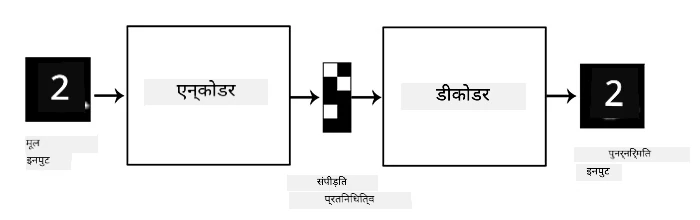
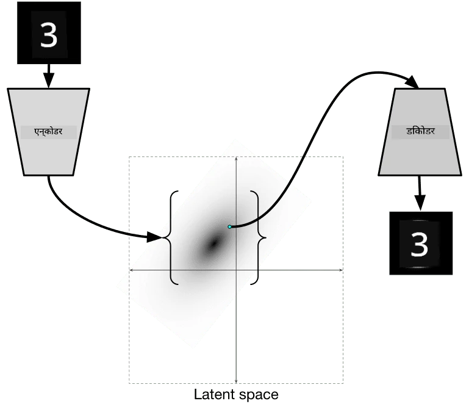
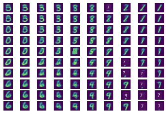
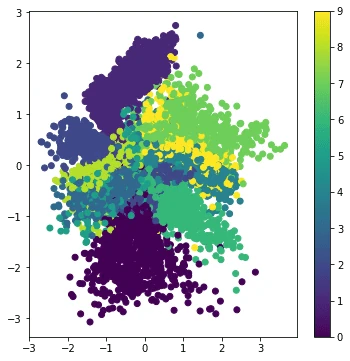

# Autoencoders

Jab CNNs ko train kiya jaata hai, toh ek problem yeh hoti hai ki humein bahut saara labeled data chahiye hota hai. Image classification ke case mein, humein images ko alag-alag classes mein divide karna padta hai, jo ek manual process hai.

## [Pre-lecture quiz](https://ff-quizzes.netlify.app/en/ai/quiz/17)

Halaanki, hum CNN feature extractors ko train karne ke liye raw (unlabeled) data use karna chah sakte hain, jise **self-supervised learning** kehte hain. Labels ki jagah, hum training images ko network input aur output dono ke roop mein use karenge. **Autoencoder** ka main idea yeh hai ki hamare paas ek **encoder network** hoga jo input image ko kisi **latent space** mein convert karta hai (aam taur par yeh kisi chhote size ka vector hota hai), aur phir **decoder network**, jiska goal original image ko reconstruct karna hoga.

> ✅ Ek [autoencoder](https://wikipedia.org/wiki/Autoencoder) "ek type ka artificial neural network hai jo unlabeled data ki efficient coding seekhne ke liye use hota hai."

Kyunki hum autoencoder ko original image se maximum information capture karne ke liye train kar rahe hain taaki accurate reconstruction ho sake, network input image ka sabse accha **embedding** dhoondhne ki koshish karta hai.

> Image [Keras blog](https://blog.keras.io/building-autoencoders-in-keras.html) se

## Autoencoders use karne ke scenarios

Halaanki original image ko reconstruct karna apne aap mein useful nahi lagta, lekin kuch scenarios hain jahan autoencoders khaas taur par useful hote hain:

* **Images ki dimensionality kam karna** ya **image embeddings train karna**. Aam taur par autoencoders PCA se behtar results dete hain, kyunki yeh image ki spatial nature aur hierarchical features ko dhyan mein rakhta hai.
* **Denoising**, yaani image se noise hataana. Kyunki noise mein bahut saari bekaar information hoti hai, autoencoder ise chhote latent space mein fit nahi kar sakta, aur isliye woh sirf image ke important hisse ko capture karta hai. Denoiser train karte waqt, hum original images se shuru karte hain aur autoencoder ke input ke roop mein artificially noise add ki hui images use karte hain.
* **Super-resolution**, image resolution badhaana. Hum high-resolution images se shuru karte hain aur autoencoder input ke roop mein low-resolution images use karte hain.
* **Generative models**. Ek baar jab hum autoencoder train kar lete hain, toh decoder part ko random latent vectors se naye objects banane ke liye use kiya ja sakta hai.

## Variational Autoencoders (VAE)

Traditional autoencoders input data ki dimensionality kisi tarah kam karte hain, input image ke important features samajhte hain. Lekin, latent vectors aksar bahut meaningful nahi hote. Doosre shabdon mein, MNIST dataset ko example lete hue, yeh samajhna aasaan nahi hai ki kaunse digits alag-alag latent vectors se match karte hain, kyunki paas ke latent vectors zaroori nahi ki same digits se match karein.

Doosri taraf, *generative* models ko train karne ke liye latent space ki kuch understanding hona behtar hota hai. Yeh idea humein **Variational Autoencoder** (VAE) ki taraf le jaata hai.

VAE woh autoencoder hai jo latent parameters ke *statistical distribution* ko predict karna seekhta hai, jise **latent distribution** kehte hain. Jaise, hum chahte hain ki latent vectors normally distributed hon, kuch mean zmean aur standard deviation zsigma ke saath (mean aur standard deviation dono kisi dimension d ke vectors hote hain). VAE mein encoder in parameters ko predict karna seekhta hai, aur phir decoder is distribution se ek random vector leta hai taaki object ko reconstruct kiya ja sake.

Summary:

* Input vector se, hum `z_mean` aur `z_log_sigma` predict karte hain (standard deviation ko seedha predict karne ki bajaye, hum uska logarithm predict karte hain)
* Hum distribution N(zmean,exp(zlog\_sigma)) se ek vector `sample` lete hain
* Decoder `sample` ko input vector ke roop mein use karke original image ko decode karne ki koshish karta hai

> Image [is blog post](https://ijdykeman.github.io/ml/2016/12/21/cvae.html) se, author: Isaac Dykeman

Variational Autoencoders ek complex loss function use karte hain, jisme do parts hote hain:

* **Reconstruction loss** woh loss function hai jo dikhata hai ki reconstructed image target ke kitni kareeb hai (yeh Mean Squared Error, ya MSE ho sakta hai). Yeh normal autoencoders mein use hone wale loss function ke jaisa hi hai.
* **KL loss**, jo ensure karta hai ki latent variable distribution normal distribution ke kareeb rahe. Yeh [Kullback-Leibler divergence](https://www.countbayesie.com/blog/2017/5/9/kullback-leibler-divergence-explained) ke concept par based hai - do statistical distributions ki similarity estimate karne ka ek metric.

VAEs ka ek important fayda yeh hai ki yeh humein naye images ko relatively aasaani se generate karne dete hain, kyunki humein pata hota hai ki latent vector ko kis distribution se sample karna hai. Jaise, agar hum MNIST par 2D latent vector ke saath VAE ko train karein, toh hum latent vector ke components ko badal kar alag-alag digits paa sakte hain:

> Image [Dmitry Soshnikov](http://soshnikov.com) dwara

Dhyan dijiye ki kaise images ek doosre mein mil jaati hain, jaise hi hum latent parameter space ke alag-alag hisson se latent vectors lena shuru karte hain. Hum is space ko 2D mein visualize bhi kar sakte hain:

 

> Image [Dmitry Soshnikov](http://soshnikov.com) dwara

## ✍️ Exercises: Autoencoders

In related notebooks mein autoencoders ke baare mein aur seekhiye:

* [TensorFlow mein Autoencoders](AutoencodersTF.ipynb)
* [PyTorch mein Autoencoders](AutoEncodersPyTorch.ipynb)

## Autoencoders ki properties

* **Data specific** - Yeh sirf usi type ki images ke saath accha kaam karte hain jin par inhe train kiya gaya hai. Jaise, agar hum flowers par super-resolution network train karein, toh yeh portraits par accha kaam nahi karega. Aisa isliye hai kyunki network high resolution image ko training dataset se seekhe gaye features se fine details lekar generate kar sakta hai.
* **Lossy** - Reconstructed image original image ke bilkul same nahi hoti. Loss ki nature training ke dauran use kiye gaye *loss function* se define hoti hai.
* **Unlabeled data** par kaam karta hai

## [Post-lecture quiz](https://ff-quizzes.netlify.app/en/ai/quiz/18)

## Conclusion

Is lesson mein, aapne autoencoders ke alag-alag types ke baare mein seekha jo AI scientists ke liye available hain. Aapne seekha ki unhe kaise banaya jaata hai aur images ko reconstruct karne ke liye kaise use kiya jaata hai. Aapne VAE ke baare mein bhi seekha aur yeh bhi samjha ki ise naye images generate karne ke liye kaise use kiya jaata hai.

## 🚀 Challenge

Is lesson mein, aapne images ke liye autoencoders use karna seekha. Lekin inhe music ke liye bhi use kiya ja sakta hai! Magenta project ka [MusicVAE](https://magenta.tensorflow.org/music-vae) project dekhiye, jo music ko reconstruct karna seekhne ke liye autoencoders use karta hai. Is library ke saath kuch [experiments](https://colab.research.google.com/github/magenta/magenta-demos/blob/master/colab-notebooks/Multitrack_MusicVAE.ipynb) kijiye aur dekhiye ki aap kya bana sakte hain.

## [Post-lecture quiz](https://ff-quizzes.netlify.app/en/ai/quiz/16)

## Review & Self Study

Reference ke liye, in resources mein autoencoders ke baare mein aur padhiye:

* [Keras mein Autoencoders banana](https://blog.keras.io/building-autoencoders-in-keras.html)
* [NeuroHive par blog post](https://neurohive.io/ru/osnovy-data-science/variacionnyj-avtojenkoder-vae/)
* [Variational Autoencoders explained](https://kvfrans.com/variational-autoencoders-explained/)
* [Conditional Variational Autoencoders](https://ijdykeman.github.io/ml/2016/12/21/cvae.html)

## Assignment

[TensorFlow use karte hue is notebook](AutoencodersTF.ipynb) ke end mein ek 'task' milega - ise apna assignment maniye.

---

