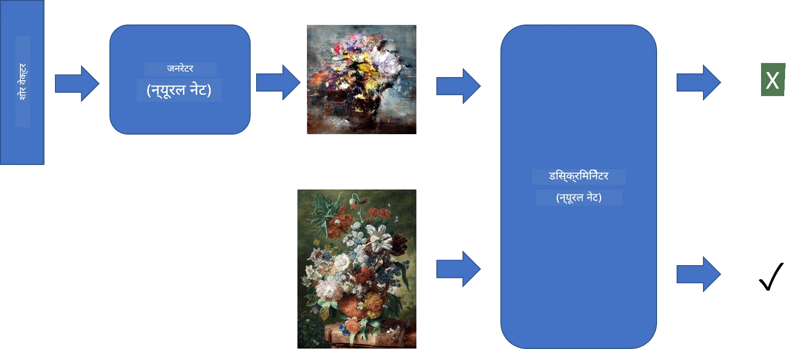
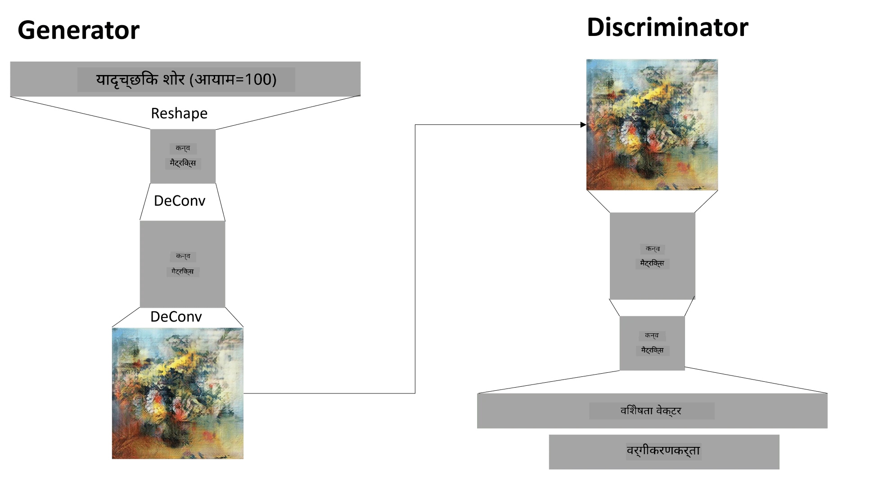

# Generative Adversarial Networks

Pichhle section mein humne **generative models** ke baare mein seekha: aise models jo training dataset ki images jaisi nayi images generate kar sakte hain. VAE iska ek accha example tha.

## [Pre-lecture quiz](https://ff-quizzes.netlify.app/en/ai/quiz/19)

Lekin agar hum kuch sach mein meaningful generate karne ki koshish karein, jaise ki ek painting reasonable resolution par, toh VAE ke saath training achhe se converge nahi hoti. Is use case ke liye humein ek aur architecture ke baare mein seekhna chahiye jo khaas taur par generative models ke liye design kiya gaya hai - **Generative Adversarial Networks**, ya GANs.

GAN ka main idea do neural networks ko ek-doosre ke khilaaf train karna hai:

> Image: [Dmitry Soshnikov](http://soshnikov.com) dwara

> ✅ Kuch terminology:
> * **Generator**: Ek network jo ek random vector leta hai aur result mein ek image generate karta hai.
> * **Discriminator**: Ek network jo ek image leta hai aur yeh decide karta hai ki woh ek real image hai (training dataset se) ya generator ne generate ki hai. Yeh basically ek image classifier hai.

### Discriminator

Discriminator ka architecture ek normal image classification network se alag nahi hota. Sabse simple case mein, yeh ek fully-connected classifier ho sakta hai, lekin zyada chance hai ki yeh ek [convolutional network](../07-ConvNets/README.md) hoga.

> ✅ Convolutional networks par based GAN ko [DCGAN](https://arxiv.org/pdf/1511.06434.pdf) kehte hain.

Ek CNN discriminator mein yeh layers hoti hain: kai convolutions+poolings (spatial size ko ghatate hue) aur ek ya zyada fully-connected layers jo "feature vector" nikaalti hain, aur end mein ek binary classifier.

> ✅ 'Pooling' ek technique hai jo image ka size kam karti hai. "Pooling layers data ki dimensions ko kam karti hain, ek layer mein neuron clusters ke outputs ko agli layer ke ek neuron mein combine karke." - [Source](https://wikipedia.org/wiki/Convolutional_neural_network#Pooling_layers)

### Generator

Generator thoda zyada complicated hota hai. Aap ise ek ulta discriminator maan sakte hain. Ek latent vector (feature vector ki jagah) se shuru karte hue, isme ek fully-connected layer hoti hai jo ise zaroori size/shape mein convert karti hai, uske baad de-convolutions+upscaling hoti hai. Yeh [autoencoders](../09-Autoencoders/README.md) ke *decoder* part jaisa hi hai.

> ✅ Kyunki convolution layer ko image par ek linear filter ki tarah apply kiya jaata hai, de-convolution basically convolution jaisi hi hai aur ise wahi layer logic use karke implement kiya ja sakta hai.

> Image: [Dmitry Soshnikov](http://soshnikov.com) dwara

### GAN ki Training

GANs ko **adversarial** kaha jaata hai kyunki generator aur discriminator ke beech lagatar competition hota rehta hai. Is competition ke dauraan, generator aur discriminator dono improve hote hain, jisse network behtar aur behtar images generate karna seekhta hai.

Training do steps mein hoti hai:

* **Discriminator ki training**. Yeh task kaafi simple hai: hum generator se images ka ek batch generate karte hain, unhe 0 label karte hain, jo fake image ke liye hota hai, aur input dataset se images ka ek batch lete hain (label 1, real image). Hum kuch *discriminator loss* nikaalte hain aur backprop karte hain.
* **Generator ki training**. Yeh thoda zyada complicated hai kyunki generator ke liye expected output humein seedhe nahi pata hota. Hum poore GAN network ko generator aur discriminator ke saath lete hain, ise kuch random vectors se feed karte hain, aur result ko 1 (real image ke liye) maante hain. Phir hum discriminator ke parameters ko freeze kar dete hain (is step mein hum ise train nahi karna chahte), aur backprop karte hain.

Is process ke dauraan, generator aur discriminator dono ke losses kaafi had tak neeche nahi jaate. Ideal situation mein, unhe oscillate karna chahiye, jo dono networks ki performance mein improvement ko dikhata hai.

## ✍️ Exercises: GANs

* [GAN Notebook TensorFlow/Keras mein](GANTF.ipynb)
* [GAN Notebook PyTorch mein](GANPyTorch.ipynb)

### GAN training ki problems

GANs ko train karna khaas taur par mushkil maana jaata hai. Yahan kuch problems hain:

* **Mode Collapse**. Iska matlab hai ki generator ek successful image generate karna seekh leta hai jo discriminator ko dhokha de deti hai, lekin alag-alag tarah ki images generate nahi karta.
* **Hyperparameters ke prati sensitivity**. Aksar aap dekh sakte hain ki GAN bilkul bhi converge nahi hota, aur phir achanak learning rate kam karne se convergence ho jaata hai.
* Generator aur discriminator ke beech **balance banaye rakhna**. Kai cases mein discriminator loss jaldi se zero tak gir sakta hai, jisse generator aage train nahi ho paata. Isse paar paane ke liye, hum generator aur discriminator ke liye alag-alag learning rate set kar sakte hain, ya agar loss pehle se hi bahut kam hai toh discriminator training ko skip kar sakte hain.
* **High resolution** ke liye training. Autoencoders ke saath hone wali isi problem ki tarah, yeh problem tab aati hai jab convolutional network ki bahut saari layers ko reconstruct karne se artifacts paida hote hain. Is problem ko aam taur par **progressive growing** se solve kiya jaata hai, jisme pehle kuch layers ko low-res images par train kiya jaata hai, aur phir layers ko "unblock" ya add kiya jaata hai. Ek aur solution layers ke beech extra connections add karna aur ek saath kai resolutions par training karna ho sakta hai - zyada jaankari ke liye yeh [Multi-Scale Gradient GANs paper](https://arxiv.org/abs/1903.06048) dekhein.

## Style Transfer

GANs artistic images generate karne ka ek shaandaar tareeka hain. Ek aur dilchasp technique **style transfer** hai, jo ek **content image** leti hai aur use ek alag style mein dobara draw karti hai, **style image** se filters apply karke.

Yeh is tarah kaam karta hai:
* Hum ek random noise image se shuru karte hain (ya content image ke saath, lekin samajhne ke liye random noise se shuru karna aasaan hai).
* Humara goal aisi image banana hoga, jo content image aur style image dono ke kareeb ho. Yeh do loss functions se determine hoga:
   - **Content loss** current image aur content image se kuch layers par CNN dwara nikaale gaye features ke basis par calculate hota hai.
   - **Style loss** current image aur style image ke beech ek smart tareeke se Gram matrices use karke calculate hota hai (zyada details [example notebook](StyleTransfer.ipynb) mein hain).
* Image ko smooth banane aur noise hataane ke liye, hum **variation loss** bhi add karte hain, jo neighboring pixels ke beech ki average distance calculate karta hai.
* Main optimization loop current image ko adjust karta hai, gradient descent (ya kisi aur optimization algorithm) use karke total loss ko kam karne ke liye, jo teeno losses ka weighted sum hai.

## ✍️ Example: [Style Transfer](StyleTransfer.ipynb)

## [Post-lecture quiz](https://ff-quizzes.netlify.app/en/ai/quiz/20)

## Conclusion

Is lesson mein, aapne GANs aur unhe train kaise karna hai, uske baare mein seekha. Aapne yeh bhi seekha ki is type ke neural networks ko kin khaas challenges ka saamna karna pad sakta hai, aur unhe paar karne ki kuch strategies.

## 🚀 Challenge

[Style Transfer notebook](StyleTransfer.ipynb) ko apni khud ki images use karke chalayein.

## Review & Self Study

GANs ke baare mein zyada jaanne ke liye yeh resources padhein:

* Marco Pasini, [10 Lessons I Learned Training GANs for one Year](https://towardsdatascience.com/10-lessons-i-learned-training-generative-adversarial-networks-gans-for-a-year-c9071159628)
* [StyleGAN](https://en.wikipedia.org/wiki/StyleGAN), ek *de facto* GAN architecture jise consider karna chahiye.
* [Azure ML par GANs use karke Generative Art banana](https://soshnikov.com/scienceart/creating-generative-art-using-gan-on-azureml/)

## Assignment

Is lesson se jude do notebooks mein se ek ko dobara dekhein aur GAN ko apni khud ki images par dobara train karein. Aap kya bana sakte hain?

---

