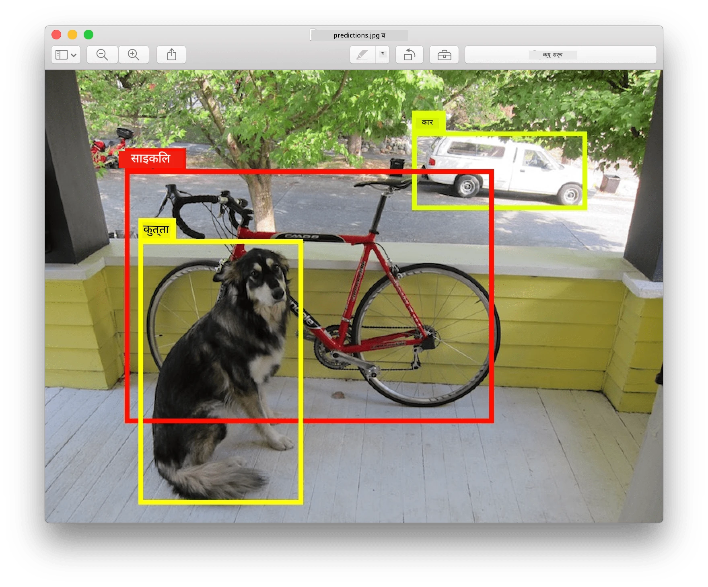
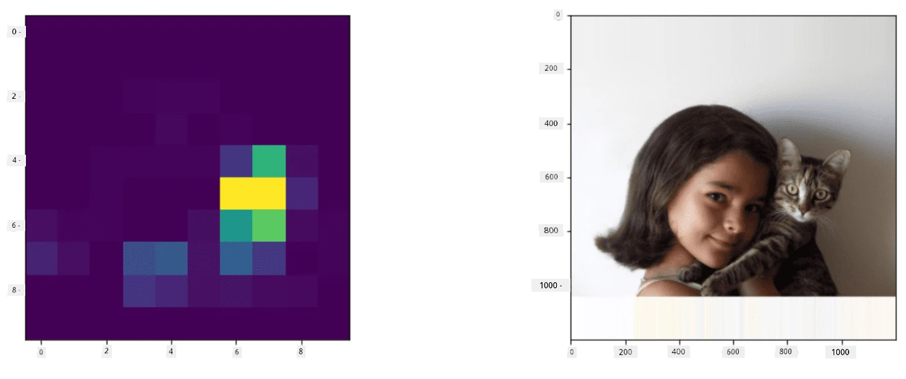
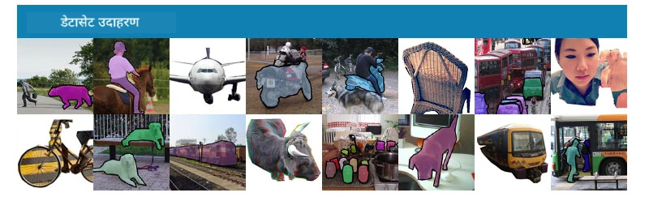
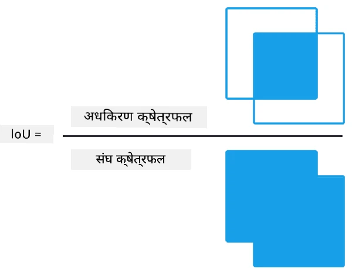
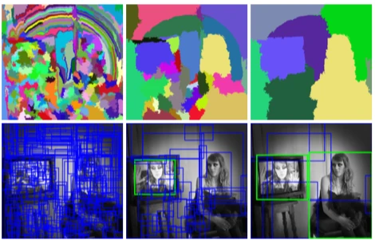
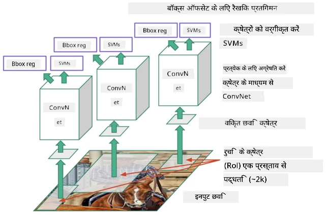
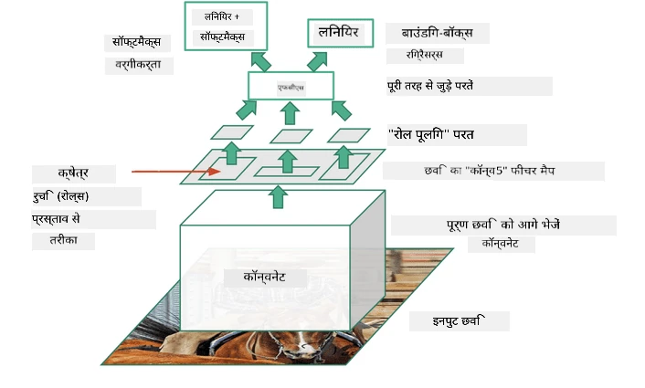
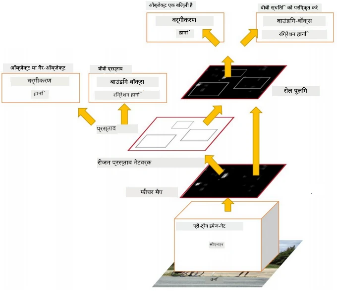
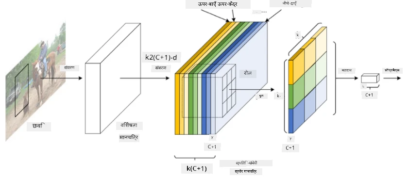
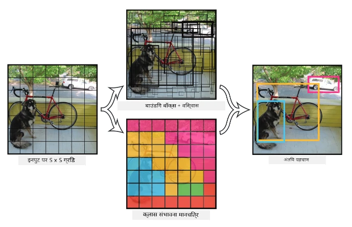

# Object Detection

Ab tak humne jo image classification models use kiye hain, woh ek image lete hain aur ek categorical result dete hain, jaise MNIST problem mein 'number' class. Lekin kai cases mein hum sirf yeh nahi jaanna chahte ki picture mein objects hain - hum unki exact location bhi jaanna chahte hain. Yahi **object detection** ka purpose hai.

## [Pre-lecture quiz](https://ff-quizzes.netlify.app/en/ai/quiz/21)

> Image [YOLO v2 website](https://pjreddie.com/darknet/yolov2/) se

## Object Detection ke liye ek simple approach

Maan lijiye hum ek picture mein billi dhoondhna chahte hain, toh object detection ke liye ek bahut simple approach yeh hogi:

1. Picture ko kai tiles mein divide karo.
2. Har tile par image classification chalao.
3. Jin tiles mein kaafi high activation aati hai, unhe maana ja sakta hai ki unme woh object maujood hai.

> *Image [exercise notebook](ObjectDetection-TF.ipynb) se*

Lekin yeh approach ideal nahi hai, kyunki isme algorithm object ke box ki location bahut hi rough tareeke se determine kar pata hai. Zyada accurate location ke liye humein **regression** use karke box ke coordinates predict karne honge - aur uske liye humein specific datasets chahiye hote hain.

## Object Detection ke liye Regression

[Yeh blog post](https://towardsdatascience.com/object-detection-with-neural-networks-a4e2c46b4491) shapes detect karne ka ek shandaar introduction deta hai.

## Object Detection ke liye Datasets

Is task ke liye aapko yeh datasets mil sakte hain:

* [PASCAL VOC](http://host.robots.ox.ac.uk/pascal/VOC/) - 20 classes
* [COCO](http://cocodataset.org/#home) - Common Objects in Context. 80 classes, boxes aur segmentation masks

## Object Detection Metrics

### Intersection over Union

Jahan image classification ke liye algorithm ki performance measure karna aasaan hai, wahin object detection mein humein class ki sahi pehchaan aur box location ki accuracy, dono measure karni hoti hain. Location accuracy ke liye hum **Intersection over Union** (IoU) use karte hain, jo measure karta hai ki do boxes (ya do regions) kitne achhe se overlap karte hain.

> *Figure 2 [is excellent blog post](https://pyimagesearch.com/2016/11/07/intersection-over-union-iou-for-object-detection/) se*

Idea simple hai - hum do shapes ke beech intersection ki area ko unke union ki area se divide karte hain. Do identical regions ke liye IoU 1 hoga, jabki bilkul alag regions ke liye yeh 0 hoga. Baaki cases mein yeh 0 se 1 ke beech hoga. Hum aam taur par sirf unhi boxes ko consider karte hain jinka IoU ek certain value se upar ho.

### Average Precision

Maan lijiye hum kisi given class $C$ ki pehchaan measure karna chahte hain. Isse measure karne ke liye hum **Average Precision** metric use karte hain, jo is tarah calculate hota hai:

1. Precision-Recall curve dikhata hai ki detection threshold value (0 se 1 tak) ke hisaab se accuracy kaise badalti hai.
2. Threshold ke hisaab se, humein image mein zyada ya kam objects milenge, aur precision aur recall ki alag-alag values milengi.
3. Curve kuch aisi dikhegi:

> *Image [NeuroWorkshop](http://github.com/shwars/NeuroWorkshop) se*

Kisi given class $C$ ke liye Average Precision is curve ke neeche ki area hai. Zyada precisely, recall axis ko aam taur par 10 parts mein divide kiya jaata hai, aur precision ko in sabhi points par average kiya jaata hai:

$$
AP = {1\over11}\sum_{i=0}^{10}\mbox{Precision}(\mbox{Recall}={i\over10})
$$

### AP aur IoU

Hum sirf unhi detections ko consider karenge jinka IoU ek certain value se upar hai. Jaise, PASCAL VOC dataset mein aam taur par $\mbox{IoU Threshold} = 0.5$ maana jaata hai, jabki COCO mein AP alag-alag $\mbox{IoU Threshold}$ values ke liye measure kiya jaata hai.

> *Image [NeuroWorkshop](http://github.com/shwars/NeuroWorkshop) se*

### Mean Average Precision - mAP

Object detection ki main metric **Mean Average Precision** ya **mAP** kehlati hai. Yeh Average Precision ki value hai, jo saari object classes par aur kabhi-kabhi $\mbox{IoU Threshold}$ par average ki jaati hai. Zyada detail mein, **mAP** calculate karne ka process
[is blog post](https://medium.com/@timothycarlen/understanding-the-map-evaluation-metric-for-object-detection-a07fe6962cf3) mein explain kiya gaya hai, aur [yahan code samples ke saath](https://gist.github.com/tarlen5/008809c3decf19313de216b9208f3734) bhi.

## Object Detection ke alag-alag approaches

Object detection algorithms ki do broad categories hain:

* **Region Proposal Networks** (R-CNN, Fast R-CNN, Faster R-CNN). Main idea hai **Regions of Interest** (ROI) generate karna aur unke upar CNN chalana, maximum activation ki talaash karna. Yeh simple approach jaisa hi hai, bas ROI zyada smart tareeke se generate hote hain. Aise methods ki ek badi kamzori yeh hai ki yeh slow hote hain, kyunki humein image par CNN classifier ke kai passes chalane padte hain.
* **One-pass** (YOLO, SSD, RetinaNet) methods. In architectures mein hum network ko aise design karte hain ki woh ek hi pass mein classes aur ROI dono predict kar le.

### R-CNN: Region-Based CNN

[R-CNN](http://islab.ulsan.ac.kr/files/announcement/513/rcnn_pami.pdf) [Selective Search](http://www.huppelen.nl/publications/selectiveSearchDraft.pdf) use karta hai taaki ROI regions ka ek hierarchical structure generate ho sake, jinhe phir CNN feature extractors aur SVM-classifiers se guzaara jaata hai taaki object class decide ho sake, aur *box* coordinates determine karne ke liye linear regression use hota hai. [Official paper](https://arxiv.org/pdf/1506.01497v1.pdf)

> *Image van de Sande et al. ICCV’11 se*

> *Image [is blog](https://towardsdatascience.com/r-cnn-fast-r-cnn-faster-r-cnn-yolo-object-detection-algorithms-36d53571365e) se*

### F-RCNN - Fast R-CNN

Yeh approach R-CNN jaisi hi hai, lekin regions convolution layers apply ho jaane ke baad define kiye jaate hain.

> Image [Official paper](https://www.cv-foundation.org/openaccess/content_iccv_2015/papers/Girshick_Fast_R-CNN_ICCV_2015_paper.pdf), [arXiv](https://arxiv.org/pdf/1504.08083.pdf), 2015 se

### Faster R-CNN

Is approach ka main idea hai regions predict karne ke liye neural network use karna - jise *Region Proposal Network* kehte hain. [Paper](https://arxiv.org/pdf/1506.01497.pdf), 2016

> Image [official paper](https://arxiv.org/pdf/1506.01497.pdf) se

### R-FCN: Region-Based Fully Convolutional Network

Yeh algorithm Faster R-CNN se bhi tez hai. Main idea yeh hai:

1. Hum ResNet-101 use karke features extract karte hain.
2. Features ko **Position-Sensitive Score Map** se process kiya jaata hai. $C$ classes ke har object ko $k\times k$ regions mein divide kiya jaata hai, aur hum objects ke parts predict karne ke liye train karte hain.
3. $k\times k$ regions ke har part ke liye saare networks object classes ke liye vote karte hain, aur sabse zyada votes wali object class chuni jaati hai.

> Image [official paper](https://arxiv.org/abs/1605.06409) se

### YOLO - You Only Look Once

YOLO ek realtime one-pass algorithm hai. Main idea yeh hai:

 * Image ko $S\times S$ regions mein divide kiya jaata hai.
 * Har region ke liye, **CNN** $n$ possible objects, *box* coordinates aur *confidence*=*probability* * IoU predict karta hai.

 

> Image [official paper](https://arxiv.org/abs/1506.02640) se

### Other Algorithms

* RetinaNet: [Official paper](https://arxiv.org/abs/1708.02002)
   - [Torchvision mein PyTorch implementation](https://pytorch.org/vision/stable/_modules/torchvision/models/detection/retinanet.html)
   - [Keras implementation](https://github.com/fizyr/keras-retinanet)
   - Keras samples mein [RetinaNet ke saath Object Detection](https://keras.io/examples/vision/retinanet/)
* SSD (Single Shot Detector): [Official paper](https://arxiv.org/abs/1512.02325)

## ✍️ Exercise: Object Detection

Apni learning is notebook mein continue kijiye:

[ObjectDetection.ipynb](ObjectDetection.ipynb)

## Conclusion

Is lesson mein aapne object detection karne ke alag-alag tareeko ka ek quick tour kiya!

## 🚀 Challenge

Yeh articles aur notebooks padhiye aur YOLO khud try kijiye:

* [YOLO ko describe karne wala achha blog post](https://www.analyticsvidhya.com/blog/2018/12/practical-guide-object-detection-yolo-framewor-python/)
 * [Official site](https://pjreddie.com/darknet/yolo/)
 * YOLO: [Keras implementation](https://github.com/experiencor/keras-yolo2), [step-by-step notebook](https://github.com/experiencor/basic-yolo-keras/blob/master/Yolo%20Step-by-Step.ipynb)
 * YOLO v2: [Keras implementation](https://github.com/experiencor/keras-yolo2), [step-by-step notebook](https://github.com/experiencor/keras-yolo2/blob/master/Yolo%20Step-by-Step.ipynb)

## [Post-lecture quiz](https://ff-quizzes.netlify.app/en/ai/quiz/22)

## Review & Self Study

* Nikhil Sardana ka [Object Detection](https://tjmachinelearning.com/lectures/1718/obj/)
* [Object detection algorithms ki achhi comparison](https://lilianweng.github.io/lil-log/2018/12/27/object-detection-part-4.html)
* [Object Detection ke liye Deep Learning Algorithms ka review](https://medium.com/comet-app/review-of-deep-learning-algorithms-for-object-detection-c1f3d437b852)
* [Object Detection algorithms ka step-by-step introduction](https://www.analyticsvidhya.com/blog/2018/10/a-step-by-step-introduction-to-the-basic-object-detection-algorithms-part-1/)
* [Python mein Faster R-CNN ka implementation Object Detection ke liye](https://www.analyticsvidhya.com/blog/2018/11/implementation-faster-r-cnn-python-object-detection/)

## [Assignment: Object Detection](lab/README.md)

---

