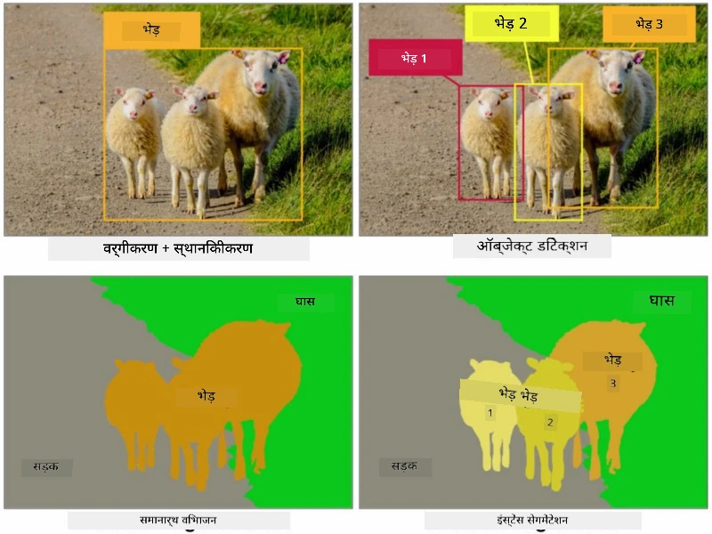
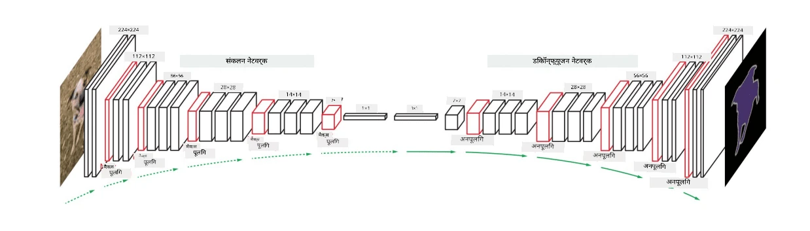
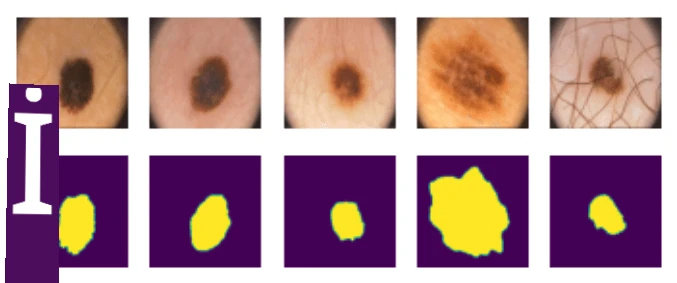

# Segmentation

Humne pehle Object Detection ke baare mein seekha tha, jo humein *bounding boxes* predict karke image mein objects ko locate karne deta hai. Lekin, kuch tasks ke liye humein sirf bounding boxes nahi chahiye, balki objects ka zyada precise localization chahiye. Is task ko **segmentation** kehte hain.

## [Pre-lecture quiz](https://ff-quizzes.netlify.app/en/ai/quiz/23)

Segmentation ko **pixel classification** ke roop mein dekha ja sakta hai, jisme image ke **har** pixel ke liye humein uski class predict karni hoti hai (*background* bhi ek class hoti hai). Segmentation ke do main algorithms hain:

* **Semantic segmentation** sirf pixel ki class batata hai, aur same class ke alag-alag objects ke beech difference nahi karta.
* **Instance segmentation** classes ko alag-alag instances mein divide karta hai.

Jaise, instance segmentation mein yeh sheep alag-alag objects hain, lekin semantic segmentation mein saari sheep ek hi class ke roop mein represent hoti hain.

> Image [is blog post](https://nirmalamurali.medium.com/image-classification-vs-semantic-segmentation-vs-instance-segmentation-625c33a08d50) se li gayi hai

Segmentation ke liye alag-alag neural architectures hain, lekin un sabki structure similar hoti hai. Ek tarah se, yeh us autoencoder jaisa hai jiske baare mein aapne pehle seekha tha, lekin original image ko deconstruct karne ki jagah, hamara goal ek **mask** ko deconstruct karna hai. Isliye, segmentation network ke ye parts hote hain:

* **Encoder** input image se features extract karta hai.
* **Decoder** un features ko **mask image** mein transform karta hai, jiska size aur channels ki sankhya classes ki sankhya ke corresponding hoti hai.

> Image [is publication](https://arxiv.org/pdf/2001.05566.pdf) se li gayi hai

Humein segmentation ke liye use hone wale loss function ka khaas zikr karna chahiye. Classical autoencoders use karte waqt, humein do images ke beech similarity measure karni hoti hai, aur iske liye hum mean square error (MSE) use kar sakte hain. Segmentation mein, target mask image ka har pixel class number ko represent karta hai (third dimension ke saath one-hot-encoded), isliye humein classification ke liye specific loss function use karna hota hai - cross-entropy loss, jise saare pixels par average kiya jata hai. Agar mask binary hai, toh **binary cross-entropy loss** (BCE) use hota hai.

> ✅ One-hot encoding ek technique hai jisme class label ko classes ki sankhya ke barabar length wale vector mein encode kiya jata hai. Is technique ke baare mein [is article](https://datagy.io/sklearn-one-hot-encode/) mein aur jaanein.

## Medical Imaging ke liye Segmentation

Is lesson mein, hum segmentation ko action mein dekhenge, jahaan network ko medical images mein human nevi (jinhein moles bhi kehte hain) recognize karne ke liye train kiya jayega. Hum <a href="https://www.fc.up.pt/addi/ph2%20database.html">PH2 Database</a> use karenge, jo dermoscopy images ka source hai. Is dataset mein teen classes ki 200 images hain: typical nevus, atypical nevus, aur melanoma. Saari images mein ek corresponding **mask** bhi hota hai jo nevus ko outline karta hai.

> ✅ Yeh technique is type ki medical imaging ke liye khaas taur par suitable hai, lekin aap aur kaun si real-world applications imagine kar sakte hain?

> Image PH2 Database se li gayi hai

Hum ek aisa model train karenge jo kisi bhi nevus ko uske background se segment kar sake.

## ✍️ Exercises: Semantic Segmentation

Neeche diye gaye notebooks kholein taaki aap alag-alag semantic segmentation architectures ke baare mein aur seekh sakein, unke saath practice kar sakein, aur unhein action mein dekh sakein.

* [Semantic Segmentation PyTorch](SemanticSegmentationPytorch.ipynb)
* [Semantic Segmentation TensorFlow](SemanticSegmentationTF.ipynb)

## [Post-lecture quiz](https://ff-quizzes.netlify.app/en/ai/quiz/24)

## Conclusion

Segmentation image classification ke liye ek bahut powerful technique hai, jo bounding boxes se aage badhkar pixel-level classification tak jati hai. Yeh technique medical imaging samet doosri applications mein use hoti hai.

## 🚀 Challenge

Body segmentation images mein logon ke saath kiye jane wale common tasks mein se ek hai. Doosre important tasks mein **skeleton detection** aur **pose detection** shamil hain. [OpenPose](https://github.com/CMU-Perceptual-Computing-Lab/openpose) library try karein aur dekhein ki pose detection kaise use ho sakta hai.

## Review & Self Study

Yeh [Wikipedia article](https://wikipedia.org/wiki/Image_segmentation) is technique ki alag-alag applications ka achha overview deta hai. Is field mein instance segmentation aur panoptic segmentation ke sub-domains ke baare mein khud se aur jaanein.

## [Assignment](lab/README.md)

Is lab mein, [Segmentation Full Body MADS Dataset](https://www.kaggle.com/datasets/tapakah68/segmentation-full-body-mads-dataset) use karke **human body segmentation** karne ki koshish karein.

---

