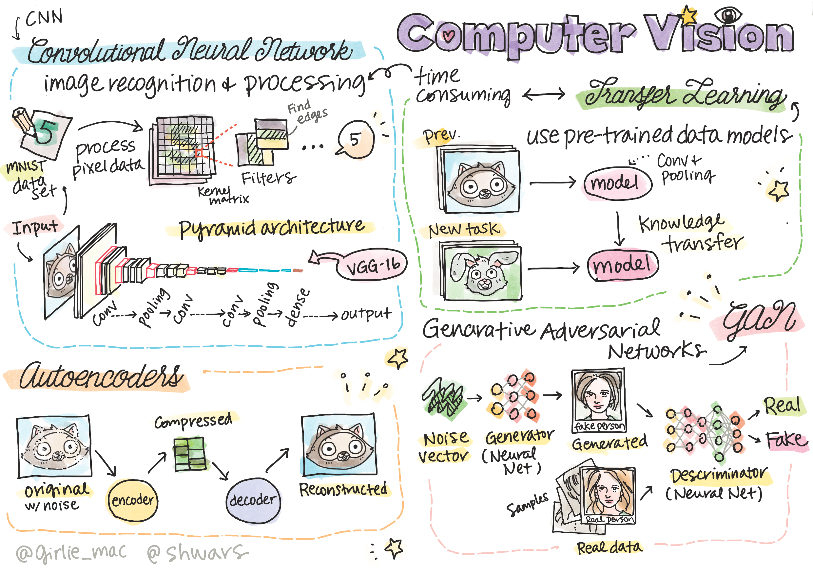

# Computer Vision

Is section mein hum in topics ke baare mein seekhenge:

* [Computer Vision aur OpenCV ka Introduction](06-IntroCV/README.md)
* [Convolutional Neural Networks](07-ConvNets/README.md)
* [Pre-trained Networks aur Transfer Learning](08-TransferLearning/README.md) 
* [Autoencoders](09-Autoencoders/README.md)
* [Generative Adversarial Networks](10-GANs/README.md)
* [Object Detection](11-ObjectDetection/README.md)
* [Semantic Segmentation](12-Segmentation/README.md)

---

<!-- HINGLISH NOTE START -->
**Note**:
Yeh document Hindi translation ko Hinglish (Roman script) mein convert karke banaya gaya hai, taaki padhna aur samajhna aasaan ho.
Isme kuch galtiyan ya anuvaad ki kamiyan ho sakti hain. Sabse sahi jaankari ke liye original English document ko hi authoritative source maanein.
<!-- HINGLISH NOTE END -->
