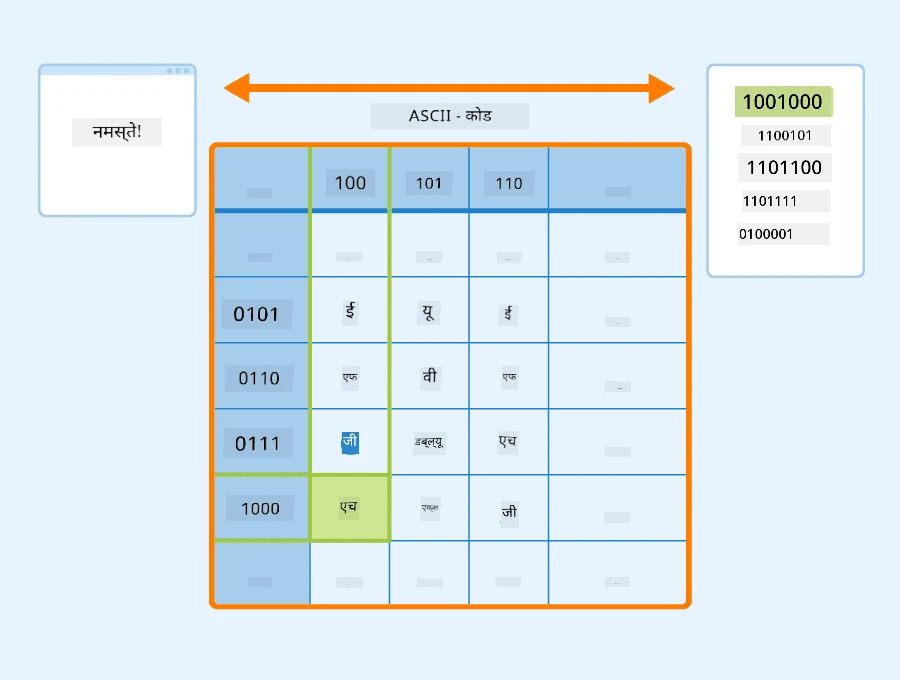
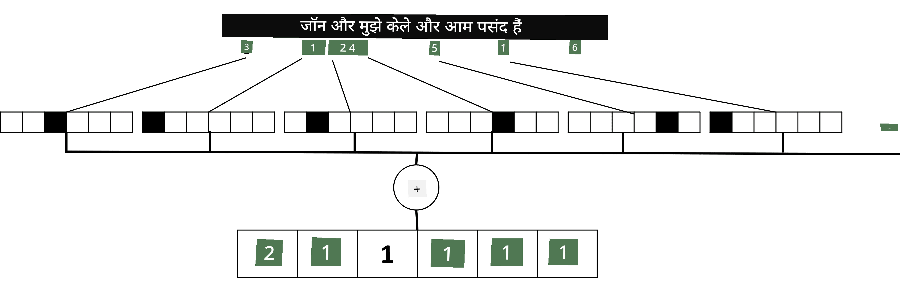

# Text ko Tensors ke roop mein Represent karna

## [Pre-lecture quiz](https://ff-quizzes.netlify.app/en/ai/quiz/25)

## Text Classification

Is section ke pehle hisse mein, hum **text classification** task par focus karenge. Hum [AG News](https://www.kaggle.com/amananandrai/ag-news-classification-dataset) dataset use karenge, jisme neeche jaise news articles hain:

* Category: Sci/Tech  
* Title: Ky. Company Wins Grant to Study Peptides (AP)  
* Body: AP - A company founded by a chemistry researcher at the University of Louisville won a grant to develop...  

Hamara goal text ke basis par news item ko categories mein classify karna hoga.

## Text ko Represent karna

Agar hum Natural Language Processing (NLP) tasks ko neural networks se solve karna chahte hain, toh humein text ko tensors ke roop mein represent karne ka koi tareeka chahiye. Computers already text characters ko numbers ke roop mein represent karte hain jo ASCII ya UTF-8 jaise encodings use karke aapki screen par fonts se map hote hain.

> [Image source](https://www.seobility.net/en/wiki/ASCII)

Insaan ke roop mein, hum samajhte hain ki har letter **kya represent karta hai**, aur saare characters milkar ek sentence ke words kaise banate hain. Lekin, computers khud se aisa nahi samajh paate, aur neural network ko training ke dauran meaning seekhna padta hai.

Isliye, text ko represent karne ke liye hum alag-alag approaches use kar sakte hain:

* **Character-level representation**, jisme hum text ko har character ko ek number maanke represent karte hain. Maan lijiye hamare text corpus mein *C* alag-alag characters hain, toh word *Hello* ko 5x*C* tensor se represent kiya jayega. Har letter one-hot encoding mein ek tensor column ke roop mein hoga.  
* **Word-level representation**, jisme hum apne text ke saare words ki ek **vocabulary** banate hain aur phir words ko one-hot encoding se represent karte hain. Yeh approach kuch had tak better hai, kyunki har letter akele mein zyada meaning nahi rakhta, aur isliye higher-level semantic concepts - words - use karke hum neural network ke liye task ko simple bana dete hain. Lekin, bade dictionary size ki wajah se, humein high-dimensional sparse tensors se deal karna padta hai.  

Representation chahe jo bhi ho, humein pehle text ko **tokens** ke ek sequence mein convert karna hoga, jahaan ek token ek character, ek word, ya kabhi-kabhi word ka ek hissa bhi ho sakta hai. Phir, hum token ko ek number mein convert karte hain, aam taur par **vocabulary** use karke, aur is number ko one-hot encoding ke zariye neural network mein feed kiya ja sakta hai.

## N-Grams

Natural language mein, words ka precise meaning sirf context mein hi decide ho sakta hai. Jaise, *neural network* aur *fishing network* ke meanings bilkul alag hain. Isse dhyaan mein rakhne ka ek tareeka hai ki hum apna model words ke pairs par banayein, aur word pairs ko alag vocabulary tokens maanein. Is tarah, sentence *I like to go fishing* ko is token sequence se represent kiya jayega: *I like*, *like to*, *to go*, *go fishing*. Is approach ki problem yeh hai ki dictionary size kaafi badh jati hai, aur *go fishing* aur *go shopping* jaise combinations alag tokens se represent hote hain, jo same verb hone ke bawajood koi semantic similarity share nahi karte.  

Kuch cases mein, hum tri-grams -- teen words ke combinations -- use karne par bhi vichaar kar sakte hain. Isliye is approach ko aksar **n-grams** kehte hain. Saath hi, character-level representation ke saath n-grams use karna bhi make sense karta hai, jisme n-grams roughly alag-alag syllables ke corresponding honge.

## Bag-of-Words aur TF/IDF

Jab hum text classification jaise tasks solve kar rahe hote hain, toh humein text ko ek fixed-size vector se represent kar sakna chahiye, jise hum final dense classifier ke input ke roop mein use karenge. Isko karne ke sabse simple tareekon mein se ek hai saare individual word representations ko combine karna, jaise unhein add karke. Agar hum har word ki one-hot encoding add karte hain, toh humein frequencies ka ek vector milega, jo dikhayega ki text ke andar har word kitni baar aata hai. Text ki aisi representation **bag of words** (BoW) kehlati hai.

> Image author dwara banayi gayi

BoW basically yeh dikhata hai ki text mein kaun se words aur kitni quantity mein aate hain, jo sach mein yeh indicate karne ke liye achha ho sakta hai ki text kis baare mein hai. Jaise, politics par news article mein *president* aur *country* jaise words hone ki sambhavna hai, jabki scientific publication mein *collider*, *discovered* jaise words ho sakte hain. Is tarah, word frequencies kai cases mein text content ka achha indicator ho sakti hain.

BoW ki problem yeh hai ki kuch common words, jaise *and*, *is*, etc. zyadatar texts mein aate hain, aur unki frequencies sabse zyada hoti hain, jo asli important words ko dabaa deti hain. Hum in words ki importance kam kar sakte hain agar hum us frequency ko dhyaan mein rakhein jis par words poore document collection mein aate hain. Yahi TF/IDF approach ke peeche ka main idea hai, jise is lesson ke saath diye gaye notebooks mein zyada detail mein cover kiya gaya hai.

Lekin, in approaches mein se koi bhi text ke **semantics** ko poori tarah dhyaan mein nahi rakh sakta. Isko karne ke liye humein zyada powerful neural network models chahiye, jinhein hum is section mein aage discuss karenge.

## ✍️ Exercises: Text Representation

Apni learning agle notebooks mein continue karein:

* [PyTorch ke saath Text Representation](TextRepresentationPyTorch.ipynb)  
* [TensorFlow ke saath Text Representation](TextRepresentationTF.ipynb)  

## Conclusion

Ab tak, humne aisi techniques study ki hain jo alag-alag words ko frequency weight de sakti hain. Lekin, woh meaning ya order ko represent karne mein asamarth hain. Mashhoor linguist J. R. Firth ne 1935 mein kaha tha, "Kisi word ka poora meaning hamesha contextual hota hai, aur context se alag meaning ki koi bhi study seriously nahi li ja sakti." Hum course mein aage seekhenge ki language modelling use karke text se contextual information kaise capture karein.

## 🚀 Challenge

Bag-of-words aur alag-alag data models use karke kuch aur exercises try karein. Aap is [Kaggle competition](https://www.kaggle.com/competitions/word2vec-nlp-tutorial/overview/part-1-for-beginners-bag-of-words) se inspire ho sakte hain.

## [Post-lecture quiz](https://ff-quizzes.netlify.app/en/ai/quiz/26)

## Review & Self Study

[Microsoft Learn](https://docs.microsoft.com/learn/modules/intro-natural-language-processing-pytorch/?WT.mc_id=academic-77998-cacaste) par text embeddings aur bag-of-words techniques ke saath apni skills practice karein.

## [Assignment: Notebooks](assignment.md)

---

