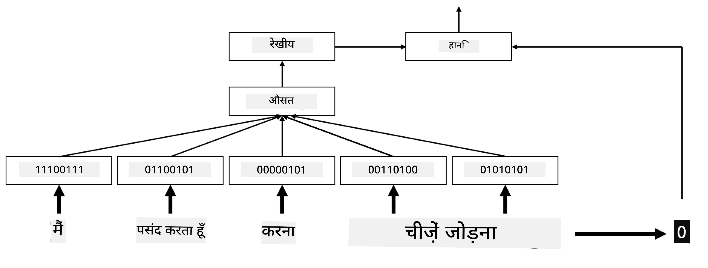
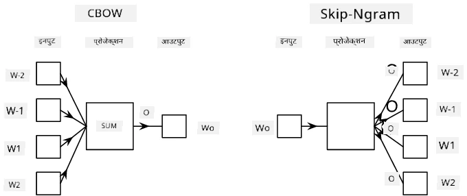

# Embeddings

## [Pre-lecture quiz](https://ff-quizzes.netlify.app/en/ai/quiz/27)

Jab humne BoW ya TF/IDF based classifiers ko train kiya, toh hum high-dimensional bag-of-words vectors par kaam kar rahe the, jinki length `vocab_size` thi. Hum explicitly low-dimensional positional representation vector ko sparse one-hot representation mein convert kar rahe the. Lekin yeh one-hot representation memory-efficient nahi hai. Saath hi, har word ko ek-dusre se independent maana jata hai, yaani one-hot encoded vectors words ke beech kisi bhi semantic similarity ko express nahi karte.

**Embedding** ka idea yeh hai ki words ko low-dimensional dense vectors se represent kiya jaye, jo kisi tarah word ke semantic meaning ko reflect karein. Meaningful word embeddings kaise banate hain, yeh hum baad mein discuss karenge, lekin abhi ke liye embeddings ko word vector ki dimensionality kam karne ke ek tareeke ke roop mein socho.

Toh, embedding layer ek word ko input ke roop mein legi aur specified `embedding_size` ka output vector produce karegi. Ek tarah se, yeh `Linear` layer jaisi hi hai, lekin one-hot encoded vector lene ki jagah, yeh word number ko input ke roop mein le sakegi, jisse bade one-hot-encoded vectors banane se bacha ja sake.

Apne classifier network mein embedding layer ko first layer ke roop mein use karke, hum bag-of-words se **embedding bag** model par switch kar sakte hain, jahan hum pehle apne text ke har word ko uske corresponding embedding mein convert karte hain aur phir un sabhi embeddings par koi aggregate function calculate karte hain, jaise `sum`, `average` ya `max`.

> Image author ne banayi hai

## ✍️ Exercise: Embeddings

Apni learning in notebooks mein jaari rakhiye:
* [PyTorch ke saath Embeddings](EmbeddingsPyTorch.ipynb)
* [TensorFlow ke saath Embeddings](EmbeddingsTF.ipynb)

## Semantic Embeddings: Word2Vec

Embedding layer ne words ko vector representation mein map karna seekh liya, lekin is representation mein zaroori nahi ki bahut zyada semantic meaning ho. Yeh achha hoga ki hum aisi vector representation seekhein jisme similar words ya synonyms aise vectors ke roop mein hon jo kisi vector distance (jaise, Euclidean distance) ke hisaab se ek-dusre ke kareeb hon.

Iske liye, hamein apne embedding model ko ek bade text collection par ek specific tareeke se pre-train karna hoga. Semantic embeddings ko train karne ka ek tareeka [Word2Vec](https://en.wikipedia.org/wiki/Word2vec) kehlata hai. Yeh do main architectures par based hai, jo words ka distributed representation produce karne ke liye use hote hain:

 - **Continuous bag-of-words** (CBoW) — is architecture mein, hum model ko aas-paas ke context se ek word predict karne ke liye train karte hain. Diye gaye ngram $(W_{-2},W_{-1},W_0,W_1,W_2)$ mein, model ka goal $(W_{-2},W_{-1},W_1,W_2)$ se $W_0$ ko predict karna hai.
 - **Continuous skip-gram** CBoW ka ulta hai. Model context words ki window use karke current word ko predict karta hai.

CBoW fast hai, jabki skip-gram slow hai, lekin yeh rare words ko behtar tareeke se represent karta hai.

> [Is paper](https://arxiv.org/pdf/1301.3781.pdf) se li gayi image

Word2Vec pre-trained embeddings (aur GloVe jaise dusre similar models) ko bhi neural networks mein embedding layer ki jagah use kiya ja sakta hai. Lekin, hamein vocabularies ke saath dhyan se kaam karna hoga, kyunki Word2Vec/GloVe ko pre-train karne ke liye use hui vocabulary hamare text corpus ki vocabulary se alag ho sakti hai. Upar diye gaye notebooks mein dekhiye ki is problem ko kaise solve kiya ja sakta hai.

## Contextual Embeddings

Word2Vec jaise traditional pre-trained embedding representations ki ek key limitation word sense ambiguity ki problem hai. Pre-trained embeddings context mein words ka kuch meaning capture kar sakti hain, lekin word ke har possible meaning ko ek hi embedding mein encode kiya jata hai. Isse downstream models mein problems ho sakti hain, kyunki 'play' jaise kai words ka meaning is par depend karta hai ki unhe kis context mein use kiya gaya hai.

Jaise ki, 'play' word in do alag sentences mein kaafi alag meaning rakhta hai:

- Main theatre mein ek **play** dekhne gaya.
- John apne friends ke saath **play** karna chahta hai.

Upar bataye gaye pre-trained embeddings 'play' word ke in dono meanings ko ek hi embedding mein represent karte hain. Is limitation ko door karne ke liye, hamein **language model** par based embeddings banani hongi, jo ek bade text corpus par train ki gayi ho aur *jaanti ho* ki words ko alag-alag contexts mein kaise rakha ja sakta hai. Contextual embeddings ke baare mein discuss karna is tutorial ke scope se bahar hai, lekin course mein aage language models discuss karte waqt hum inpar wapas aayenge.

## Conclusion

Is lesson mein, aapne seekha ki TensorFlow aur PyTorch mein embedding layer kaise banayein aur use karein, taaki words ke semantic meaning ko behtar tareeke se reflect kiya ja sake.

## 🚀 Challenge

Word2Vec ka use kuch interesting applications ke liye kiya gaya hai, jaise song lyrics aur poetry generate karna. [Is article](https://www.politetype.com/blog/word2vec-color-poems) ko dekhiye, jisme author ne samjhaya hai ki unhone Word2Vec use karke poetry kaise generate ki. [Dan Shiffmann ki yeh video](https://www.youtube.com/watch?v=LSS_bos_TPI&ab_channel=TheCodingTrain) bhi dekhiye, jisme is technique ka ek alag explanation diya gaya hai. Phir in techniques ko apne text corpus par apply karne ki koshish kijiye, jo aap Kaggle se le sakte hain.

## [Post-lecture quiz](https://ff-quizzes.netlify.app/en/ai/quiz/28)

## Review & Self Study

Word2Vec par yeh paper padhiye: [Efficient Estimation of Word Representations in Vector Space](https://arxiv.org/pdf/1301.3781.pdf)

## [Assignment: Notebooks](assignment.md)

---

