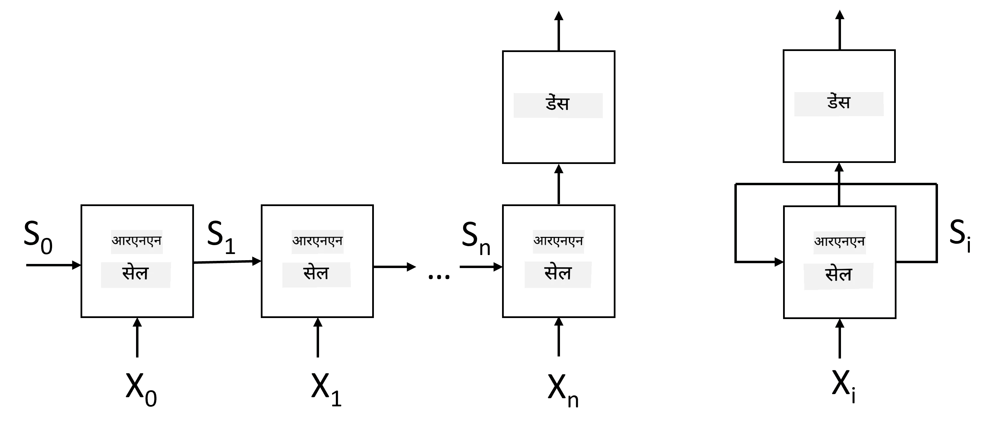
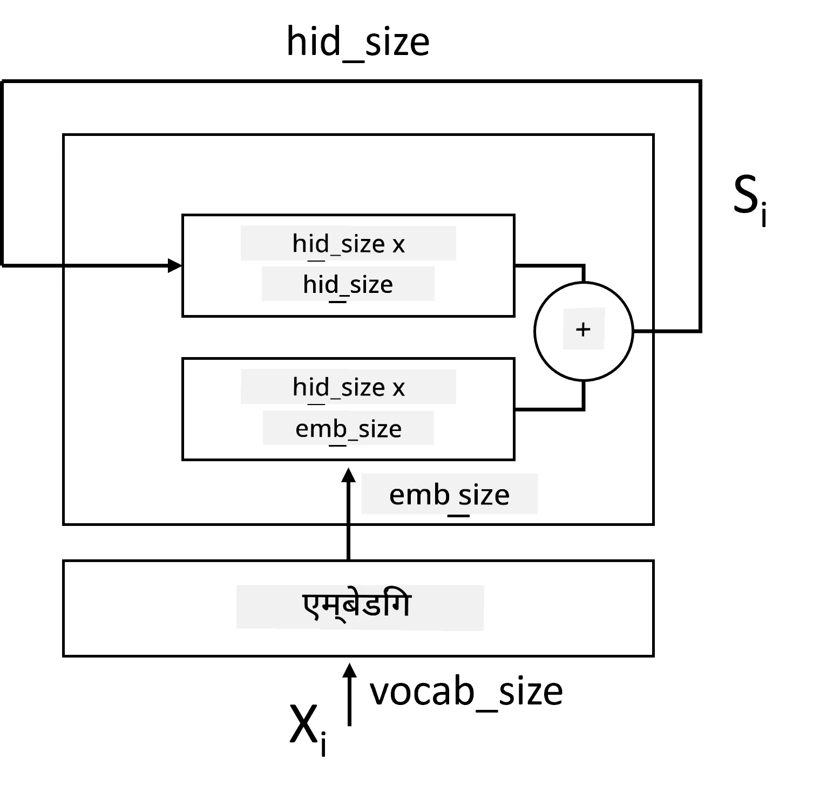
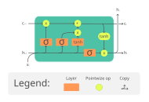
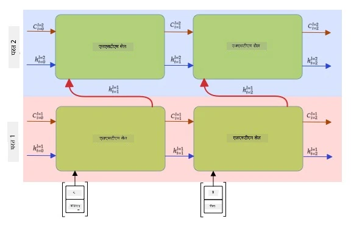

# Recurrent Neural Networks

## [Pre-lecture quiz](https://ff-quizzes.netlify.app/en/ai/quiz/31)

Pichhle sections mein humne text ke rich semantic representations aur unke upar ek simple linear classifier use kiya tha. Yeh architecture sentence mein words ka overall meaning pakadta hai, lekin yeh words ke **order** ko dhyan mein nahi rakhta, kyunki embeddings par ki gayi aggregation operation ne original text se yeh information hata di. Kyunki yeh models words ke order ko model nahi kar sakte, woh text generation ya question answering jaise zyada complex ya ambiguous tasks solve nahi kar sakte.

Text sequence ka meaning capture karne ke liye, humein ek aur neural network architecture use karna hoga, jise **Recurrent Neural Network** ya RNN kehte hain. RNN mein hum apne sentence ko network se ek time par ek symbol pass karte hain, aur network kuch **state** produce karta hai, jise hum agle symbol ke saath network mein dobara pass karte hain.

> Image author ki taraf se

Symbols ke input sequence X0,...,Xn ko dekhte hue, RNN neural network blocks ka ek sequence banata hai, aur is sequence ko end-to-end backpropagation use karke train karta hai. Har network block (Xi,Si) ki ek pair ko input ki tarah leta hai, aur result mein Si+1 produce karta hai. Final state Sn ya (output Yn) ko result produce karne ke liye ek linear classifier mein bheja jaata hai. Saare network blocks same weights share karte hain, aur ek backpropagation pass use karke end-to-end train hote hain.

Kyunki state vectors S0,...,Sn network se guzarte hain, yeh words ke beech sequential dependencies seekh pata hai. Jaise, jab sequence mein kahin *not* word aata hai, toh yeh state vector ke kuch elements ko negative banana seekh sakta hai, jisse negation produce hota hai.

> ✅ Kyunki upar diye gaye picture mein saare RNN blocks ke weights shared hain, wahi picture ek block (right side mein) ki tarah bhi dikhaya ja sakta hai, jisme ek recurrent feedback loop hota hai, jo network ki output state ko wapas input mein bhejta hai.

## RNN Cell ki Anatomy

Chalo dekhte hain ki ek simple RNN cell kaise organized hota hai. Yeh previous state Si-1 aur current symbol Xi ko input ki tarah accept karta hai, aur output state Si produce karta hai (aur, kabhi-kabhi, hum kisi aur output Yi mein bhi interested hote hain, jaise generative networks ke case mein).

Ek simple RNN cell ke andar do weight matrices hoti hain: ek input symbol ko transform karti hai (ise W kehte hain), aur doosri input state ko transform karti hai (H). Is case mein network ka output &sigma;(W&times;Xi+H&times;Si-1+b) ke roop mein calculate hota hai, jahan &sigma; activation function hai aur b additional bias hai.

> Image author ki taraf se

Kai cases mein, input tokens ko RNN mein enter karne se pehle embedding layer se pass kiya jaata hai taaki dimensionality kam ho sake. Is case mein, agar input vector ki dimension *emb_size* hai, aur state vector ki dimension *hid_size* hai - toh W ka shape *emb_size*&times;*hid_size* hoga, aur H ka shape *hid_size*&times;*hid_size* hoga.

## Long Short Term Memory (LSTM)

Classical RNNs ki main problems mein se ek hai **vanishing gradients** problem. Kyunki RNNs ko ek backpropagation pass mein end-to-end train kiya jaata hai, isliye error ko network ki first layers tak propagate karna mushkil hota hai, aur isliye network door-door ke tokens ke beech ke relationships nahi seekh pata. Is problem se bachne ka ek tareeka hai **explicit state management** introduce karna **gates** use karke. Is type ke do famous architectures hain: **Long Short Term Memory** (LSTM) aur **Gated Relay Unit** (GRU).

> Image source TBD

LSTM network RNN jaise hi organized hota hai, lekin isme do states hoti hain jo layer se layer pass hoti hain: actual state C, aur hidden vector H. Har unit par, hidden vector Hi input Xi ke saath combine hota hai, aur woh **gates** ke through control karte hain ki state C ke saath kya hoga. Har gate ek neural network hota hai jisme sigmoid activation (output [0,1] range mein) hota hai, jise state vector se multiply karte waqt bitwise mask ki tarah socha ja sakta hai. Yeh gates hote hain (picture mein left se right):

* **Forget gate** hidden vector leta hai aur determine karta hai ki vector C ke kin components ko bhulana hai aur kinhe aage pass karna hai.
* **Input gate** input aur hidden vector se kuch information leta hai aur use state mein daalta hai.
* **Output gate** state ko *tanh* activation wali ek linear layer se transform karta hai, phir naya state Ci+1 produce karne ke liye uske kuch components select karta hai.

State C ke components ko kuch flags ki tarah socha ja sakta hai jinhe on aur off kiya ja sakta hai. Jaise, jab hume sequence mein *Alice* naam milta hai, toh hum maan sakte hain ki yeh ek female character ko refer karta hai, aur state mein ek flag raise karte hain ki sentence mein ek female noun hai. Jab hume aage *and Tom* phrase milta hai, toh hum ek flag raise karte hain ki humare paas plural noun hai. Is tarah, state ko manipulate karke, hum sentence ke grammatical properties ka track rakh sakte hain.

> ✅ LSTM ke internal structure ko samajhne ke liye ek excellent resource hai Christopher Olah ka yeh shandaar article [Understanding LSTM Networks](https://colah.github.io/posts/2015-08-Understanding-LSTMs/).

## Bidirectional aur Multilayer RNNs

Humne un recurrent networks ki baat ki hai jo ek direction mein kaam karte hain, sequence ki shuruaat se end tak. Yeh natural lagta hai, kyunki yeh waise hi hai jaise hum padhte hain aur speech sunte hain. Lekin, kyunki kai practical cases mein humare paas input sequence tak random access hota hai, isliye dono directions mein recurrent computation chalana samajh mein aata hai. Aise networks ko **bidirectional** RNNs kehte hain. Bidirectional network ke saath kaam karte waqt, humein har direction ke liye do hidden state vectors chahiye honge.

Ek recurrent network, chahe woh one-directional ho ya bidirectional, sequence ke andar kuch patterns capture karta hai, aur unhe state vector mein store kar sakta hai ya output mein pass kar sakta hai. Jaise convolutional networks ke saath, hum first layer ke upar ek aur recurrent layer bana sakte hain taaki first layer ke nikaale gaye low-level patterns se high-level patterns capture kar sakein. Yeh humein **multi-layer RNN** ke concept tak le jaata hai, jisme do ya zyada recurrent networks hote hain, jahan pichhli layer ka output agli layer mein input ki tarah pass hota hai.

*Picture [is shandaar post](https://towardsdatascience.com/from-a-lstm-cell-to-a-multilayer-lstm-network-with-pytorch-2899eb5696f3) se liya gaya hai, author: Fernando López*

## ✍️ Exercise: Embeddings

Apni learning is notebooks mein continue kijiye:

* [PyTorch ke saath RNNs](RNNPyTorch.ipynb)
* [TensorFlow ke saath RNNs](RNNTF.ipynb)

## Conclusion

Is unit mein, humne dekha ki RNNs ko sequence classification ke liye use kiya ja sakta hai, lekin actually, woh aur bhi kai tasks handle kar sakte hain, jaise text generation, machine translation, aur bahut kuch. Hum in tasks ko agle unit mein dekhenge.

## 🚀 Challenge

LSTMs ke baare mein thoda literature padhiye aur unke applications ke baare mein sochiye:

- [Grid Long Short-Term Memory](https://arxiv.org/pdf/1507.01526v1.pdf)
- [Show, Attend and Tell: Neural Image Caption Generation with Visual Attention](https://arxiv.org/pdf/1502.03044v2.pdf)

## [Post-lecture quiz](https://ff-quizzes.netlify.app/en/ai/quiz/32)

## Review & Self Study

- Christopher Olah ka [Understanding LSTM Networks](https://colah.github.io/posts/2015-08-Understanding-LSTMs/).

## [Assignment: Notebooks](assignment.md)

---

