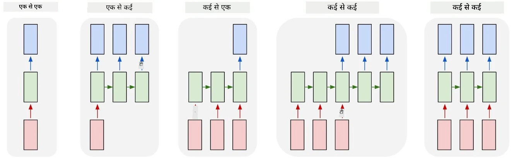
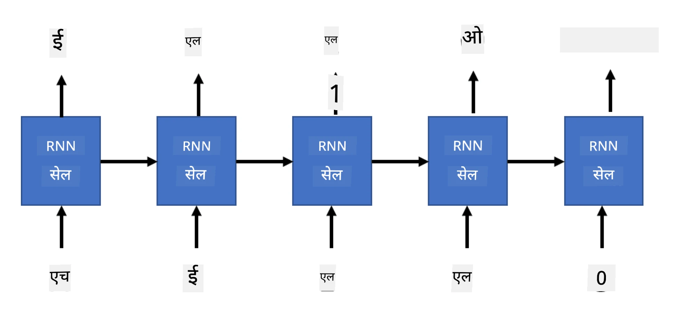
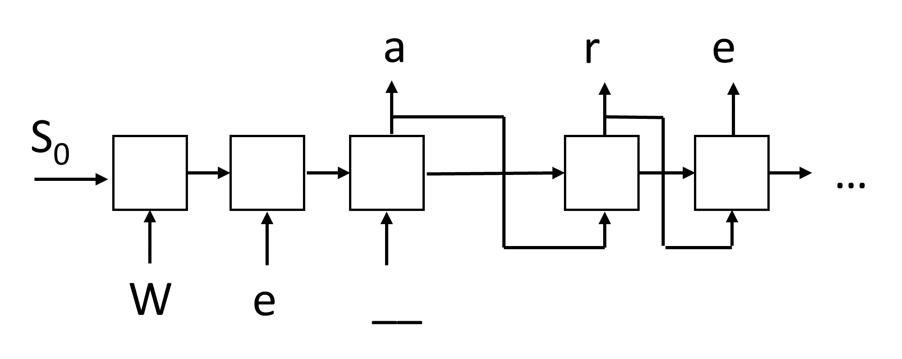

# Generative Networks

## [Pre-lecture quiz](https://ff-quizzes.netlify.app/en/ai/quiz/33)

Recurrent Neural Networks (RNNs) aur unke gated cell variants jaise Long Short Term Memory Cells (LSTMs) aur Gated Recurrent Units (GRUs) ne language modeling ke liye ek mechanism diya hai, jisse woh words ka order seekh sakte hain aur sequence mein agla word predict kar sakte hain. Isse hum RNNs ko **generative tasks** ke liye use kar sakte hain, jaise ordinary text generation, machine translation, aur yahan tak ki image captioning bhi.

> ✅ Un sabhi mauqon ke baare mein socho jab aapne text completion jaise generative tasks ka fayda uthaya hai. Apni favourite applications ke baare mein research karo aur dekho ki kya unhone RNNs use kiye hain.

Pichhli unit mein discuss ki gayi RNN architecture mein, har RNN unit ne agla hidden state output ke roop mein produce kiya tha. Lekin, hum har recurrent unit mein ek aur output jod sakte hain, jisse hum ek **sequence** output kar sakenge (jo original sequence ke barabar length ka hoga). Iske alawa, hum aise RNN units bhi use kar sakte hain jo har step par input accept nahi karte, aur sirf ek initial state vector lete hain, aur phir outputs ka ek sequence produce karte hain.

Isse alag-alag neural architectures possible hote hain, jo neeche di gayi picture mein dikhaye gaye hain:



> Image blog post [Unreasonable Effectiveness of Recurrent Neural Networks](http://karpathy.github.io/2015/05/21/rnn-effectiveness/) se liya gaya hai, author [Andrej Karpaty](http://karpathy.github.io/).

* **One-to-one** ek traditional neural network hai jisme ek input aur ek output hota hai.
* **One-to-many** ek generative architecture hai jo ek input value accept karta hai aur output values ka ek sequence produce karta hai. Jaise, agar hum ek **image captioning** network train karna chahte hain jo kisi picture ka text description produce kare, toh hum ek picture ko input ki tarah le sakte hain, use CNN se pass karke hidden state hasil kar sakte hain, aur phir ek recurrent chain caption ko word-by-word generate kar sakti hai.
* **Many-to-one** pichhli unit mein bataye gaye RNN architectures se match karta hai, jaise text classification.
* **Many-to-many**, ya **sequence-to-sequence** un tasks se match karta hai jaise **machine translation**, jahan pehla RNN input sequence ki saari information ko hidden state mein collect karta hai, aur doosri RNN chain is state ko output sequence mein unroll karti hai.

Is unit mein, hum simple generative models par focus karenge jo humein text generate karne mein madad karte hain. Simplicity ke liye, hum character-level tokenization use karenge.

Hum is RNN ko text step-by-step generate karne ke liye train karenge. Har step par, hum `nchars` length ke characters ka ek sequence lenge, aur network se kahenge ki har input character ke liye agla output character generate kare:



Jab text generate kiya jaata hai (inference ke dauran), hum kisi **prompt** se shuru karte hain, jise RNN cells se pass kiya jaata hai taaki uska intermediate state ban sake, aur phir is state se generation shuru hoti hai. Hum ek baar mein ek character generate karte hain, aur state aur generated character ko agle RNN cell mein pass karte hain taaki agla character generate ho, jab tak ki hum kaafi characters generate na kar lein.



> Image author ki taraf se

## ✍️ Exercises: Generative Networks

Neeche diye gaye notebooks ke saath apni learning jaari rakhein:

* [PyTorch ke saath Generative Networks](GenerativePyTorch.ipynb)
* [TensorFlow ke saath Generative Networks](GenerativeTF.ipynb)

## Soft Text Generation aur Temperature

Har RNN cell ka output characters ka ek probability distribution hota hai. Agar hum hamesha sabse high probability wale character ko agla character chunte hain, toh generated text aksar "cycled" ho sakta hai, jisme wahi character sequences baar-baar aate hain, jaise is example mein:

```
today of the second the company and a second the company ...
```

Lekin, agar hum agle character ke probability distribution ko dekhein, toh ho sakta hai ki kuch sabse high probabilities ke beech ka difference bahut bada na ho, jaise ek character ki probability 0.2 ho, aur doosre ki 0.19. Jaise, jab sequence '*play*' mein agla character dhoondha jaata hai, toh agla character space ya **e** (jaise word *player* mein) ho sakta hai.

Isse hum is conclusion par pahunchte hain ki hamesha highest probability wala character chunna "fair" nahi hai, kyunki doosra highest chunne se bhi meaningful text ban sakta hai. Zyada samajhdari yeh hai ki network output ke diye gaye probability distribution se characters ko **sample** kiya jaaye. Hum ek parameter, **temperature**, bhi use kar sakte hain, jo probability distribution ko flatten kar sakta hai, agar hum zyada randomness add karna chahte hain, ya use zyada steep bana sakta hai, agar hum highest-probability characters par zyada tike rehna chahte hain.

Upar diye gaye notebooks mein dekhein ki yeh soft text generation kaise implement kiya gaya hai.

## Conclusion

Halanki text generation apne aap mein useful ho sakta hai, lekin main fayda RNNs ka use karke kisi initial feature vector se shuru karke text generate karne ki ability se aata hai. Jaise, text generation ka use machine translation mein hota hai (sequence-to-sequence, jisme is case mein *encoder* ke state vector ka use karke translated message ko generate ya *decode* kiya jaata hai) ya kisi image ka text description generate karne mein (jisme is case mein feature vector CNN extractor se aata hai).

## 🚀 Challenge

Microsoft Learn par is topic par kuch lessons lein:

* [PyTorch](https://docs.microsoft.com/learn/modules/intro-natural-language-processing-pytorch/6-generative-networks/?WT.mc_id=academic-77998-cacaste)/[TensorFlow](https://docs.microsoft.com/learn/modules/intro-natural-language-processing-tensorflow/5-generative-networks/?WT.mc_id=academic-77998-cacaste) ke saath Text Generation

## [Post-lecture quiz](https://ff-quizzes.netlify.app/en/ai/quiz/34)

## Review & Self Study

Apna knowledge badhane ke liye yahan kuch articles diye gaye hain:

* Markov Chain, LSTM aur GPT-2 ke saath text generation ke alag-alag approaches: [blog post](https://towardsdatascience.com/text-generation-gpt-2-lstm-markov-chain-9ea371820e1e)
* [Keras documentation](https://keras.io/examples/generative/lstm_character_level_text_generation/) mein text generation ka example

## [Assignment](lab/README.md)

Humne dekha ki character-by-character text kaise generate kiya ja sakta hai. Lab mein, aap word-level text generation explore karenge.

---

