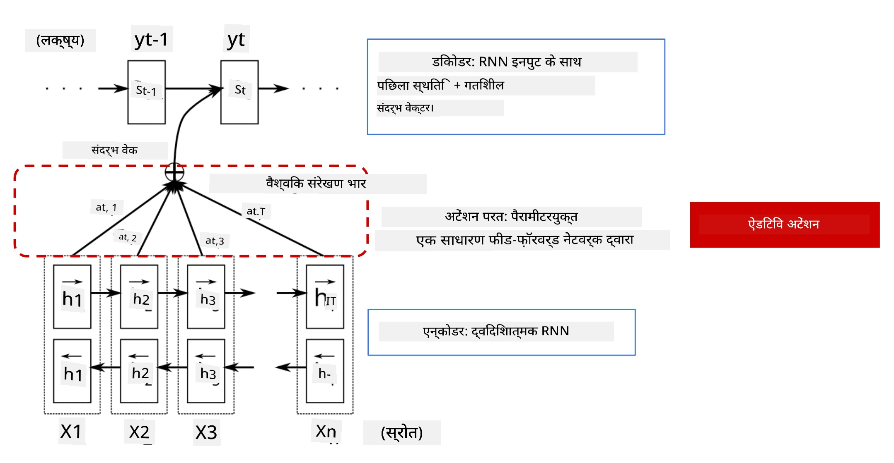
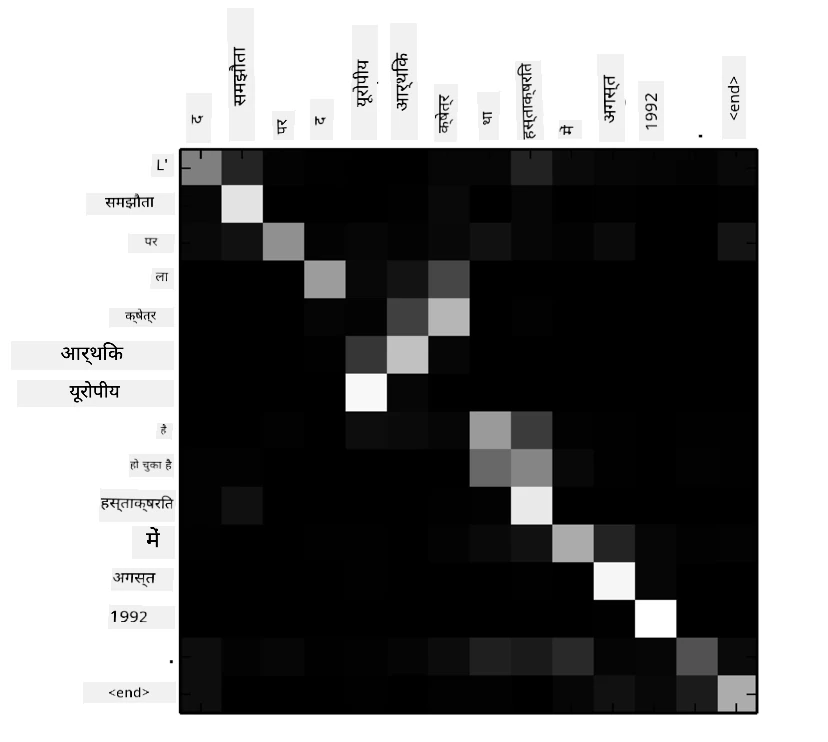
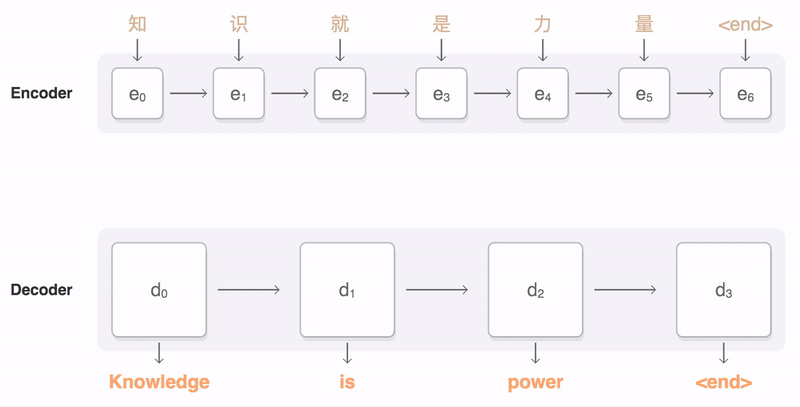
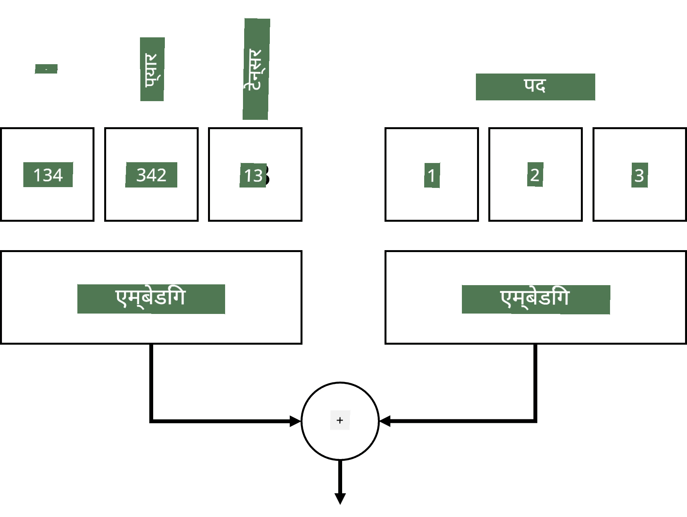
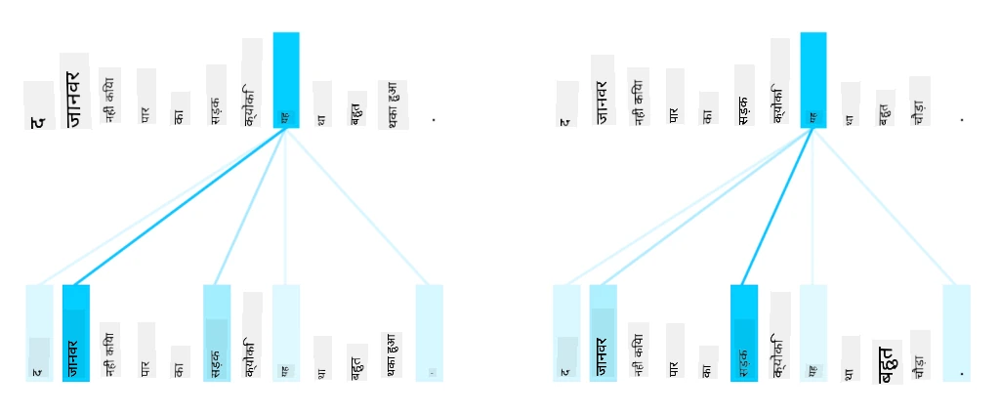
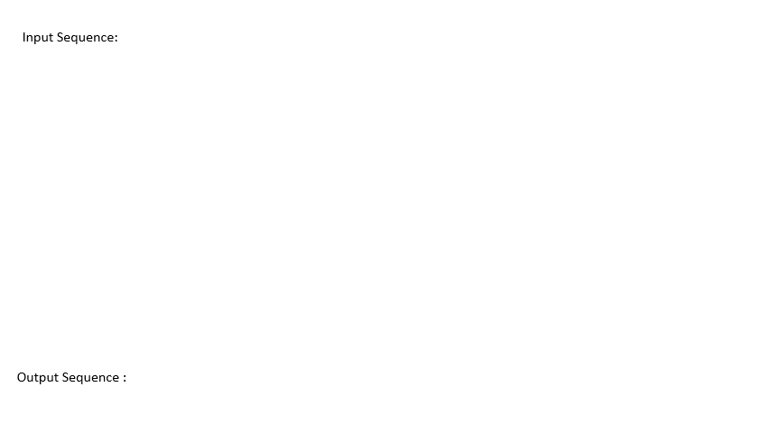
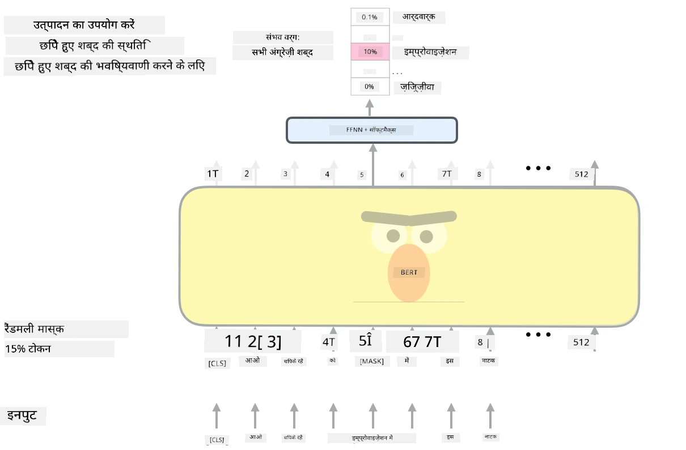

# Attention Mechanisms aur Transformers

## [Pre-lecture quiz](https://ff-quizzes.netlify.app/en/ai/quiz/35)

NLP field ki sabse important problems mein se ek hai **machine translation**, jo Google Translate jaise tools ke peeche ka main task hai. Is section mein, hum machine translation par focus karenge, ya general roop mein, kisi bhi *sequence-to-sequence* task par (jise **sentence transduction** bhi kehte hain).

RNNs ke saath, sequence-to-sequence ko do recurrent networks implement karte hain, jahaan ek network, **encoder**, input sequence ko ek hidden state mein collapse kar deta hai, jabki doosra network, **decoder**, is hidden state ko translated result mein unroll karta hai. Is approach mein kuch problems hain:

* Encoder network ke final state ko sentence ki shuruaat yaad rakhne mein dikkat hoti hai, jisse lambe sentences ke liye model ki quality kharab ho jati hai.
* Sequence ke saare words ka result par equal impact hota hai. Lekin, real mein, input sequence ke kuch specific words ka sequential output par zyada impact hota hai.

**Attention Mechanisms** har input vector ke contextual impact ko RNN ke har output prediction par weight dene ka ek tareeka hain. Isse implement karne ka tareeka yeh hai ki input RNN aur output RNN ke intermediate states ke beech shortcuts banaye jaate hain. Is tarah, jab output symbol yt generate hota hai, toh hum saare input hidden states hi ko alag-alag weight coefficients &alpha;t,i ke saath dhyaan mein rakhte hain.

> [Bahdanau et al., 2015](https://arxiv.org/pdf/1409.0473.pdf) mein additive attention mechanism ke saath encoder-decoder model, [is blog post](https://lilianweng.github.io/lil-log/2018/06/24/attention-attention.html) se liya gaya.

Attention matrix {&alpha;i,j} dikhata hai ki output sequence ke kisi diye gaye word ko banane mein kuch input words ka kitna role hai. Neeche iska ek example hai:

> [Bahdanau et al., 2015](https://arxiv.org/pdf/1409.0473.pdf) se figure (Fig.3)

Attention mechanisms NLP mein current ya current ke kareeb state of the art ke liye zimmedaar hain. Lekin attention add karne se model parameters ki sankhya kaafi badh jati hai, jisse RNNs ke saath scaling issues aate hain. RNNs ko scale karne mein ek key constraint yeh hai ki models ki recurrent nature ki wajah se training ko batch aur parallelize karna challenging ho jata hai. RNN mein sequence ke har element ko sequential order mein process karna padta hai, matlab ise aasaani se parallelize nahi kiya ja sakta.

> [Google ke blog](https://research.googleblog.com/2016/09/a-neural-network-for-machine.html) se figure

Attention mechanisms ko adopt karna aur is constraint ne aaj ke state of the art Transformer models, jaise BERT aur Open-GPT3, ke creation ko drive kiya.

## Transformer models

Transformers ke peeche ek main idea hai RNNs ki sequential nature se bachna aur aisa model banana jo training ke dauran parallelizable ho. Yeh do ideas implement karke achieve kiya gaya hai:

* Positional encoding
* Patterns capture karne ke liye RNNs (ya CNNs) ki jagah self-attention mechanism use karna (isi wajah se Transformers introduce karne wale paper ka naam hai *[Attention is all you need](https://arxiv.org/abs/1706.03762)*)

### Positional Encoding/Embedding

Positional encoding ka idea yeh hai:
1. RNNs use karte waqt, tokens ki relative position steps ki sankhya se represent hoti hai, isliye use explicitly represent karne ki zaroorat nahi hoti.
2. Lekin, jaise hi hum attention par switch karte hain, humein sequence ke andar tokens ki relative positions pata honi chahiye.
3. Positional encoding paane ke liye, hum apne tokens ke sequence ko sequence mein token positions ke sequence (jaise, 0,1, ...) ke saath augment karte hain.
4. Phir hum token position ko token embedding vector ke saath mix karte hain. Position (integer) ko vector mein transform karne ke liye, hum alag-alag approaches use kar sakte hain:

* Trainable embedding, token embedding jaisi hi. Yeh woh approach hai jo hum yahaan consider karte hain. Hum tokens aur unki positions dono par embedding layer apply karte hain, jisse same dimensions ke embedding vectors milte hain, jinhein hum phir add kar dete hain.
* Original paper mein propose kiya gaya fixed position encoding function.

> Image author dwara banayi gayi

Positional embedding se jo result humein milta hai woh original token aur sequence ke andar uski position dono ko embed karta hai.

### Multi-Head Self-Attention

Ab humein apne sequence ke andar kuch patterns capture karne hain. Aisa karne ke liye, transformers **self-attention** mechanism use karte hain, jo basically wahi attention hai jo input aur output ke roop mein same sequence par apply hota hai. Self-attention apply karne se humein sentence ke andar **context** ko dhyaan mein rakhne aur yeh dekhne ka mauka milta hai ki kaun se words aapas mein related hain. Jaise, yeh humein dekhne deta hai ki kaun se words *it* jaise coreferences se refer kiye ja rahe hain, aur context ko bhi dhyaan mein rakhta hai:

> [Google Blog](https://research.googleblog.com/2017/08/transformer-novel-neural-network.html) se image

Transformers mein, hum **Multi-Head Attention** use karte hain taaki network ko alag-alag types ki dependencies capture karne ki power mil sake, jaise long-term vs. short-term word relations, co-reference vs. kuch aur, etc.

[TensorFlow Notebook](TransformersTF.ipynb) mein transformer layers ke implementation ki zyada details hain.

### Encoder-Decoder Attention

Transformers mein, attention do jagah use hota hai:

* Input text ke andar patterns capture karne ke liye self-attention use karna
* Sequence translation karne ke liye - yeh encoder aur decoder ke beech ki attention layer hai.

Encoder-decoder attention RNNs mein use hue attention mechanism jaisa hi hai, jaisa is section ki shuruaat mein bataya gaya hai. Yeh animated diagram encoder-decoder attention ka role samjhata hai.

Kyunki har input position ko independently har output position par map kiya jata hai, transformers RNNs ke mukable better parallelize kar sakte hain, jisse bahut bade aur zyada expressive language models possible hote hain. Har attention head ka use words ke beech alag-alag relationships seekhne ke liye kiya ja sakta hai, jisse downstream Natural Language Processing tasks improve hote hain.

## BERT

**BERT** (Bidirectional Encoder Representations from Transformers) ek bahut bada multi-layer transformer network hai jisme *BERT-base* ke liye 12 layers aur *BERT-large* ke liye 24 layers hain. Model ko pehle ek bade text data corpus (WikiPedia + books) par unsupervised training (sentence mein masked words predict karna) se pre-train kiya jata hai. Pre-training ke dauran model language understanding ka significant level absorb kar leta hai, jise phir fine tuning ke zariye doosre datasets ke saath leverage kiya ja sakta hai. Is process ko **transfer learning** kehte hain.

> Image [source](http://jalammar.github.io/illustrated-bert/)

## ✍️ Exercises: Transformers

Apni learning agle notebooks mein continue karein:

* [PyTorch mein Transformers](TransformersPyTorch.ipynb)
* [TensorFlow mein Transformers](TransformersTF.ipynb)

## Conclusion

Is lesson mein aapne Transformers aur Attention Mechanisms ke baare mein seekha, jo NLP toolbox ke essential tools hain. Transformer architectures ke bahut saare variations hain, jinmein BERT, DistilBERT, BigBird, OpenGPT3 aur aur bhi shamil hain, jinhein fine tune kiya ja sakta hai. [HuggingFace package](https://github.com/huggingface/) PyTorch aur TensorFlow dono ke saath in architectures ko train karne ke liye repository provide karta hai.

## 🚀 Challenge

## [Post-lecture quiz](https://ff-quizzes.netlify.app/en/ai/quiz/36)

## Review & Self Study

* [Blog post](https://mchromiak.github.io/articles/2017/Sep/12/Transformer-Attention-is-all-you-need/), jo classical [Attention is all you need](https://arxiv.org/abs/1706.03762) paper ko explain karti hai.
* Transformers par [blog posts ki ek series](https://towardsdatascience.com/transformers-explained-visually-part-1-overview-of-functionality-95a6dd460452), jo architecture ko detail mein explain karti hai.

## [Assignment](assignment.md)

---

