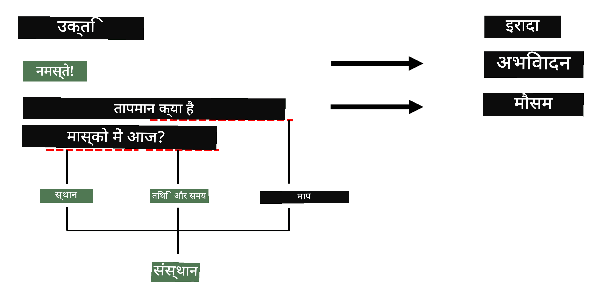

# Named Entity Recognition

Ab tak, humne mainly ek NLP task - classification - par focus kiya hai. Lekin, neural networks ke saath doosre NLP tasks bhi poore kiye ja sakte hain. Unmein se ek task hai **[Named Entity Recognition](https://wikipedia.org/wiki/Named-entity_recognition)** (NER), jo text mein specific entities ko pehchanne se related hai, jaise places, logon ke naam, date-time intervals, chemical formulas, etc.

## [Pre-lecture quiz](https://ff-quizzes.netlify.app/en/ai/quiz/37)

## NER use karne ka Example

Maan lijiye aap ek natural language chat bot develop karna chahte hain, jaise Amazon Alexa ya Google Assistant. Intelligent chat bots is tarah kaam karte hain ki woh user ki baat ko *samajhte* hain, input sentence par text classification karke. Is classification ka result **intent** kehlata hai, jo decide karta hai ki chat bot ko kya karna chahiye.

> Author dwara banayi gayi image

Lekin, user phrase ke hisse ke roop mein kuch parameters de sakta hai. Jaise, weather ke baare mein poochte waqt, woh location ya date specify kar sakta hai. Bot ko un entities ko samajhne aur action lene se pehle parameter slots ko fill karne mein sakshaam hona chahiye. Yahi woh jagah hai jahan NER kaam aata hai.

> ✅ Ek aur example [scientific medical papers ka analysis](https://soshnikov.com/science/analyzing-medical-papers-with-azure-and-text-analytics-for-health/) ho sakta hai. Jin main cheezon ko humein dekhna hota hai, unmein se ek hain specific medical terms, jaise diseases aur medical substances. Jabki kuch diseases ko shayad substring search use karke nikala ja sakta hai, zyada complex entities, jaise chemical compounds aur medication names, ke liye zyada complex approach ki zaroorat hoti hai.

## Token Classification ke roop mein NER

NER models basically **token classification models** hote hain, kyunki humein har input token ke liye decide karna hota hai ki woh kisi entity se belong karta hai ya nahi, aur agar karta hai - toh kis entity class se.

Neeche diye gaye paper title par vichaar kijiye:

**Tricuspid valve regurgitation** aur **lithium carbonate** **toxicity** ek newborn infant mein.

Yahan entities hain:

* Tricuspid valve regurgitation ek disease hai (`DIS`)
* Lithium carbonate ek chemical substance hai (`CHEM`)
* Toxicity bhi ek disease hai (`DIS`)

Dhyan rakhiye ki ek entity kai tokens tak faili ho sakti hai. Aur, is case mein, humein do consecutive entities ke beech difference karna hoga. Isliye, har entity ke liye do classes use karna aam hai - ek jo entity ke pehle token ko specify karti hai (aksar `B-` prefix use hota hai, **beginning** ke liye), aur doosri - entity ki continuation (`I-`, **inner token** ke liye). Hum `O` use karte hain sabhi **other** tokens ko dikhane ke liye. Is tarah ki token tagging ko [BIO tagging](https://en.wikipedia.org/wiki/Inside%E2%80%93outside%E2%80%93beginning_(tagging)) (ya IOB) kaha jaata hai. Tagging ke baad, hamara title is tarah dikhega:

Token | Tag
------|-----
Tricuspid | B-DIS
valve | I-DIS
regurgitation | I-DIS
and | O
lithium | B-CHEM
carbonate | I-CHEM
toxicity | B-DIS
in | O
a | O
newborn | O
infant | O
. | O

Kyunki humein tokens aur classes ke beech one-to-one correspondence banana hai, hum is picture se ek right **many-to-many** neural network model train kar sakte hain:

> *[Andrej Karpathy](http://karpathy.github.io/) ke [is blog post](http://karpathy.github.io/2015/05/21/rnn-effectiveness/) se image. NER token classification models is picture mein sabse daayein taraf wale network architecture se match karte hain.*

## NER models ko Train karna

Kyunki NER model basically ek token classification model hai, hum is task ke liye RNNs use kar sakte hain, jinse hum pehle hi parichit hain. Is case mein, recurrent network ka har block token ID return karega. Neeche diya gaya example notebook dikhata hai ki token classification ke liye LSTM ko kaise train kiya jaye.

## ✍️ Example Notebooks: NER

Neeche diye gaye notebook mein apni learning jaari rakhiye:

* [TensorFlow ke saath NER](NER-TF.ipynb)

## Conclusion

Ek NER model ek **token classification model** hai, iska matlab hai ki ise token classification karne ke liye use kiya ja sakta hai. Yeh NLP mein ek bahut hi common task hai, jo text mein specific entities ko pehchanne mein madad karta hai, jaise places, names, dates aur bahut kuch.

## 🚀 Challenge

Neeche diya gaya assignment poora kijiye taaki medical terms ke liye ek Named Entity Recognition model train kiya ja sake, phir ise ek alag dataset par try kijiye.

## [Post-lecture quiz](https://ff-quizzes.netlify.app/en/ai/quiz/38)

## Review & Self Study

Blog [The Unreasonable Effectiveness of Recurrent Neural Networks](http://karpathy.github.io/2015/05/21/rnn-effectiveness/) padhiye aur us article ke Further Reading section ke saath aage badhiye, taaki aap apni knowledge ko gehra kar sakein.

## [Assignment](lab/README.md)

Is lesson ke assignment mein, aapko ek medical entity recognition model train karna hoga. Aap is lesson mein describe kiye gaye LSTM model ko train karne se shuru kar sakte hain aur phir BERT transformer model use kar sakte hain. Saare details paane ke liye [instructions](lab/README.md) padhiye.

---

