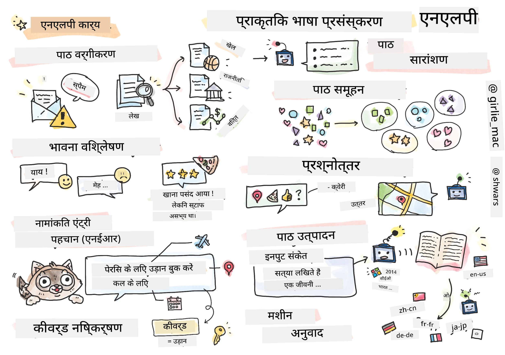

# Natural Language Processing



Is section mein, hum **Natural Language Processing (NLP)** se related tasks handle karne ke liye neural networks use karne par focus karenge. Kai NLP problems hain jinhe hum chahte hain ki computers solve kar sakein:

* **Text classification** text sequences se related ek typical classification problem hai. Examples mein email messages ko spam vs. non-spam classify karna, ya articles ko sports, business, politics, etc. mein classify karna shamil hai. Saath hi, chat bots develop karte waqt, humein aksar yeh samajhna padta hai ki user kya kehna chahta tha -- is case mein hum **intent classification** se deal kar rahe hote hain. Aksar, intent classification mein humein kai categories se deal karna padta hai.
* **Sentiment analysis** ek typical regression problem hai, jahan humein ek number (sentiment) assign karna hota hai jo batata hai ki sentence ka meaning kitna positive/negative hai. Sentiment analysis ka ek advanced version hai **aspect-based sentiment analysis** (ABSA), jahan hum sentiment ko poore sentence ke bajaye uske alag-alag hisson (aspects) ko assign karte hain, jaise *Is restaurant mein, mujhe khana pasand aaya, lekin atmosphere bhayanak tha*.
* **Named Entity Recognition** (NER) text se kuch specific entities nikalne ki problem ko kehte hain. Jaise, humein yeh samajhna pad sakta hai ki phrase *mujhe kal Paris jaana hai* mein word *kal* DATE ko refer karta hai, aur *Paris* LOCATION hai.
* **Keyword extraction** NER jaisa hi hai, lekin ismein humein kisi specific entity type ke liye pehle se training diye bina, sentence ke meaning ke liye important words automatically nikalne hote hain.
* **Text clustering** tab useful ho sakti hai jab hum similar sentences ko group karna chahte hain, jaise technical support conversations mein similar requests.
* **Question answering** model ki kisi specific question ka answer dene ki ability ko kehte hain. Model ko input ke roop mein ek text passage aur ek question milta hai, aur use us text mein woh jagah batani hoti hai jahan question ka answer maujood hai (ya kabhi-kabhi answer text generate karna hota hai).
* **Text generation** model ki naya text banane ki ability hai. Ise ek classification task maana ja sakta hai jo kisi *text prompt* ke basis par agla letter/word predict karta hai. Advanced text generation models, jaise GPT-3, doosre NLP tasks bhi solve kar sakte hain, jaise classification, jo [prompt programming](https://towardsdatascience.com/software-3-0-how-prompting-will-change-the-rules-of-the-game-a982fbfe1e0) ya [prompt engineering](https://medium.com/swlh/openai-gpt-3-and-prompt-engineering-dcdc2c5fcd29) naam ki technique use karte hain.
* **Text summarization** ek technique hai jab hum chahte hain ki computer lamba text "padhe" aur use kuch sentences mein summarize kare.
* **Machine translation** ko ek language mein text samajhne aur doosri language mein text banane ke combination ke roop mein dekha ja sakta hai.

Shuru mein, zyadatar NLP tasks traditional methods jaise grammars use karke solve kiye jaate the. Jaise, machine translation mein parser use hota tha jo initial sentence ko syntax tree mein badalta tha, phir sentence ka meaning represent karne ke liye higher-level semantic structures nikale jaate the, aur is meaning aur target language ke grammar ke basis par result generate hota tha. Aajkal, kai NLP tasks neural networks use karke zyada effectively solve ho jaate hain.

> Kai traditional NLP methods [Natural Language Processing Toolkit (NLTK)](https://www.nltk.org) Python library mein implement hain. Online ek bahut accha [NLTK Book](https://www.nltk.org/book/) available hai jo batati hai ki alag-alag NLP tasks NLTK use karke kaise solve kiye ja sakte hain.

Hamare course mein, hum mainly NLP ke liye neural networks use karne par focus karenge, aur jahan zaroorat hogi wahan NLTK use karenge.

Hum pehle hi neural networks ko tabular data aur images ke saath use karna seekh chuke hain. In data types aur text ke beech main difference yeh hai ki text ek variable length ki sequence hai, jabki images ke case mein input size pehle se pata hota hai. Jahan convolutional networks input data se patterns nikal sakte hain, wahin text mein patterns zyada complex hote hain. Jaise, negation ko subject se alag kiya ja sakta hai, jo kai words ke liye arbitrary ho sakta hai (jaise *mujhe oranges pasand nahi hain*, vs. *mujhe woh bade colorful tasty oranges pasand nahi hain*), aur ise phir bhi ek hi pattern ke roop mein samajhna chahiye. Isliye, language handle karne ke liye humein naye types ke neural networks introduce karne padenge, jaise *recurrent networks* aur *transformers*.

## Libraries Install Karein

Agar aap is course ko chalane ke liye local Python installation use kar rahe hain, toh aapko NLP ke liye saari required libraries neeche diye commands se install karni pad sakti hain:

**PyTorch ke liye**
```bash
pip install -r requirements-pytorch.txt
```
**TensorFlow ke liye**
```bash
pip install -r requirements-tf.txt
```

> Aap [Microsoft Learn](https://docs.microsoft.com/learn/modules/intro-natural-language-processing-tensorflow/?WT.mc_id=academic-77998-cacaste) par TensorFlow ke saath NLP try kar sakte hain.

## GPU Warning

Is section mein, kuch examples mein hum kaafi bade models train karenge.
* **GPU enabled computer use karein**: Bade models ke saath kaam karte waqt waiting time kam karne ke liye apne notebooks ko GPU enabled computer par chalane ki salah di jaati hai.
* **GPU memory constraints**: GPU par chalane se aisi situation aa sakti hai jahan aapke GPU ki memory khatam ho jaaye, khaaskar bade models train karte waqt.
* **GPU memory consumption**: Training ke dauran use hone wali GPU memory ki matra kai factors par depend karti hai, jinme minibatch size shamil hai.
* **Minibatch size kam karein**: Agar aapko GPU memory problems aati hain, toh solution ke roop mein apne code mein minibatch size kam karne par vichar karein.
* **TensorFlow GPU memory release**: TensorFlow ke purane versions ek Python kernel mein ek se zyada model train karte waqt GPU memory sahi tarah se release nahi kar paate. GPU memory ko effectively manage karne ke liye, aap TensorFlow ko configure kar sakte hain ki woh GPU memory sirf zaroorat ke hisaab se allocate kare.
* **Code shamil karna**: Apne notebooks mein TensorFlow ko GPU memory sirf zaroorat ke hisaab se allocate karne ke liye set karne ke liye neeche diya code shamil karein:

```python
physical_devices = tf.config.list_physical_devices('GPU') 
if len(physical_devices)>0:
    tf.config.experimental.set_memory_growth(physical_devices[0], True) 
```

Agar aap classical machine learning approach se NLP seekhne mein interested hain, toh [lessons ka yeh set](https://github.com/microsoft/ML-For-Beginners/tree/main/6-NLP) dekhein.

## Is Section Mein
Is section mein hum yeh sab seekhenge:

* [Text ko Tensors ke roop mein represent karna](13-TextRep/README.md)
* [Word Embeddings](14-Embeddings/README.md)
* [Language Modeling](15-LanguageModeling/README.md)
* [Recurrent Neural Networks](16-RNN/README.md)
* [Generative Networks](17-GenerativeNetworks/README.md)
* [Transformers](18-Transformers/README.md)

---

<!-- HINGLISH NOTE START -->
**Note**:
Yeh document Hindi translation ko Hinglish (Roman script) mein convert karke banaya gaya hai, taaki padhna aur samajhna aasaan ho.
Isme kuch galtiyan ya anuvaad ki kamiyan ho sakti hain. Sabse sahi jaankari ke liye original English document ko hi authoritative source maanein.
<!-- HINGLISH NOTE END -->
